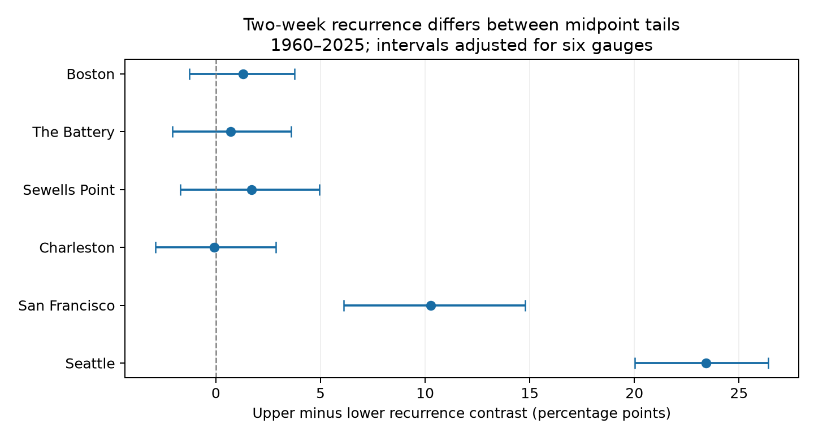
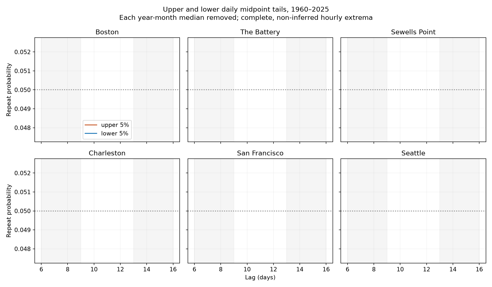

# Upper midpoint tails had a larger two-week recurrence contrast at Seattle under two baselines in 1960-2025

At Seattle, upper daily midpoint tails had a larger two-week recurrence contrast than lower tails under both tested baseline methods. The primary difference was 23.44 percentage points. The six-site adjusted interval was 20.03 to 26.39 points. At San Francisco, the primary difference was positive, but the second baseline left that difference uncertain. The result is a diagnostic of these daily records. It is not a storm surge or flood recovery estimate.



## Question and prior work

Does the two-week recurrence contrast differ between high and low daily water-level midpoints? The midpoint is the mean of the highest and lowest hourly samples on a local date. It is not the daily mean.

Published campaign report 3332303d tested upper-tail recurrence and found a lunar-period signal in Pacific midpoints. Report 88a8ecb5 found more next-day persistence in lower midpoint tails at two Pacific sites. We test a different lag scale and compare both tails on common records. Report 6e3a42bf describes the maximum-midpoint-range identity. Full SCI references are in sci.json. We read these publications and use overlapping NOAA snapshots. The present work is an exploratory extension, not an independent replication or a new tide mechanism.

Stephens, Bell and Haigh (2020) studied tide effects on the timing of separate extreme coastal water events in New Zealand. Their result motivates a lag comparison. It does not show that a midpoint measures surge. Search notes and source links are in files/literature.txt. A long campaign search was started before the question was made precise. While verification ran, we screened published bundle metadata and read the relevant publications. The first provisional question overlapped prior upper-tail work. We then chose the paired-tail question.

## Data

We reused 42 public NOAA CO-OPS daily maximum/minimum responses in the shared store. The snapshot label is 20261108. This label is a retrieval date, not an immutable NOAA release. Sources cover 1960-2025 at Boston, The Battery, Sewells Point, Charleston, San Francisco, and Seattle. Heights are in metres relative to the station MSL datum. Dates use local standard time. These values are extrema of hourly samples; they can miss peaks between hourly samples.

Both extrema must be finite, have 100% hourly coverage, and have inferred flag zero. The maximum must be at least the minimum. No gaps are filled. A year-month must have at least 25 such paired days for the primary analysis. There are 139,889 retained station-days across six sites. files/coverage.csv gives coverage before the month rule; files/tail_thresholds.json gives retained counts and primary thresholds. We selected the six gauges because the shared data were available. The sites are not a random coast sample.

files/provenance.json records all 42 exact shared paths, resolved object paths, source request URLs, byte counts, and SHA-256 hashes. It also gives hashes of the source provenance records. The shared paths have this form:

```
/mnt/dell-data/shared_datasets/noaa-coops-STATION-daily-START-END-msl-lst-20261108/data.json
```

START runs from 1960 to 2020 in decade steps. END is START+9, except 2025 for the last response. No shared data were changed. The included files/daily.csv.gz preserves selected extrema, midpoint, half-range, residuals, names, and dates, including invalid dates as missing values.

## Method

Let H and L be the daily maximum and minimum. Define C=(H+L)/2. The primary anomaly is C minus the median C in its own year-month. Round the anomaly to one micrometre to make decimal threshold ties repeatable. Use the site-wide 95th and 5th percentiles of retained anomalies. Upper events strictly exceed the 95th percentile; lower events are strictly below the 5th percentile. Thresholds are retrospective and stay fixed in all resamples.

For each tail and lag k, count pairs with an event at the start and valid values at both endpoints. Divide the number with an event at both endpoints by the number with a start event. Both dates must be in the same calendar year. Intermediate dates need not be valid. Events are not declustered. We do not require that the target is the first repeat. Pool counts over lags 13-16 for one rate and over lags 6-9 for the other. Subtract the latter rate from the former to give contrast D. The primary statistic is D_upper minus D_lower at each site. This statistic is a difference of lag-window rates, not the chance of any repeat within two weeks.

Use 4,000 circular three-year block resamples of the 66 annual count vectors. Each upper and lower estimate uses the same sampled years. Individual 95% percentile intervals are supplied. For the primary family of six site differences, use percentile bounds 0.025/6 and 1-0.025/6. This Bonferroni rule gives conservative nominal 95% family coverage if the bootstrap intervals are valid. It does not correct all exploratory baseline and threshold comparisons. The seed is 110728. Saved primary draws and annual lag counts allow inspection.

Checks use one- and five-year blocks, 90th/10th and 99th/1st percentile tails, and the two periods 1960-1989 and 1990-2025. Period checks keep full-record thresholds. The second baseline subtracts the annual median C, then the calendar-month median of that annual residual across years. It retains years with at least 300 valid paired days. It does not apply the primary 25-day month rule. Thus this check changes both baseline and data support. It removes no individual month block and retains more slow variation. Both baselines use later observations and are diagnostic, not forecast methods.

## Results

The table gives percentage points. The last interval is adjusted for the six primary site differences. Tail-specific D values are point estimates.

| Site | Upper D | Lower D | Upper minus lower | Adjusted interval |
|---|---:|---:|---:|---:|
| Boston | -0.29 | -1.60 | 1.31 | -1.27 to 3.76 |
| The Battery | 0.14 | -0.55 | 0.69 | -2.07 to 3.61 |
| Sewells Point | 0.77 | -0.93 | 1.70 | -1.69 to 4.94 |
| Charleston | -1.28 | -1.22 | -0.07 | -2.89 to 2.86 |
| San Francisco | 16.48 | 6.22 | 10.26 | 6.11 to 14.77 |
| Seattle | 25.50 | 2.06 | 23.44 | 20.03 to 26.39 |

At Seattle, upper D was 25.50 points and lower D was 2.06 points. At San Francisco, they were 16.48 and 6.22 points. The four Atlantic primary difference intervals included zero. These intervals do not prove equal tails.



The baseline check matters. Under annual and seasonal median removal, Seattle had a difference of 18.74 points, with a six-site adjusted interval of 14.88 to 22.36 points. San Francisco had 3.91 points, with an interval of -1.49 to 9.41 points. The claim at San Francisco therefore depends on baseline and selection. We do not treat the primary estimate as a baseline-free property.

Seattle retained a positive adjusted difference with one- and five-year blocks, both threshold checks, and both time periods under the primary baseline. At the 99th-percentile threshold, Seattle had 7.91 points, with an adjusted three-year interval of 3.84 to 11.39 points. San Francisco had 0.44 points with an interval of -1.61 to 3.07 points. Its tail difference is not resolved at this rare threshold. All sensitivity estimates, including null results, are in files/tail_summary.csv.

## Interpretation and limits

The upper and lower tails can have different lag patterns. A longer lag result need not match next-day persistence. However, the earlier next-day study used a different period, centering rule, and seasonal thresholds. We have not made a common-method test of a sign change between lag scales.

The earlier lunar-period study makes tide-related daily sampling a plausible contributor. Daily highs and lows can come from unequal tide cycles. A midpoint can therefore retain lunar variation. Our comparison has no tide predictions, wind, pressure, river flow, or storm tracks. It cannot separate astronomical tides from weather, tide interactions, or gauge processing. It does not explain the physical cause of the tail difference.

Monthly centering changes the target and can affect lag dependence. The alternate baseline shows a material effect at San Francisco. Missing days and inferred-value exclusions can select events. Years need not be exchangeable; blocks up to five years do not capture every long climate or nodal cycle. The intervals fix source revisions, thresholds, and baseline estimates. They omit their estimation uncertainty. Prior studies already inspected these records, so these are exploratory conditional intervals. Gauge changes were not independently audited. The result does not estimate storm duration, physical recovery, flood damage, or future event frequency.

## Inspection and reproduction

First verify the SCI ZIP. Use a writable copy of the verified files. The main analysis needs Python, NumPy, pandas, and Matplotlib. Exact versions are in files/environment.json. No extra package was installed.

Run from the bundle root:

```sh
python files/tails.py
python files/plot_summary.py
python files/validate.py
```

These commands use the included daily evidence without a network connection. tails.py writes annual counts, complete summaries, primary bootstrap draws, lag curves, and the recurrence figure. plot_summary.py writes the paired contrast figure. validate.py independently recounts all 420 primary lag probabilities, checks the 12 tail contrasts, checks unique dates and count bounds, and checks the midpoint identity. files/validation.json records the executed audit. The audit also checks all 18 primary adjusted intervals against saved draws. files/repeat_check.json records an exact independent offline repeat of the saved outputs. files/source_check.json records the raw-source rebuild check.

To rebuild daily evidence and check all 42 raw data hashes from the shared store:

```sh
python files/prepare.py /mnt/dell-data/shared_datasets
python files/tails.py
python files/plot_summary.py
python files/validate.py
```

prepare.py writes only beside itself in this writable copy. It never writes into the shared store. To retrieve raw responses on another host, use `python files/retrieve.py NEW_PRIVATE_DIRECTORY`, then give that directory to prepare.py. The retrieval code requires the saved raw hashes. Live NOAA responses can change; if they do, it stops. The bundled daily evidence still supports offline inspection and repeat. The baseline license applies to this publication's text, code, figures, and derived evidence; NOAA remains the source of the raw facts.

## Job record

Campaign: 11_07_2026. Job: sci-1107-syam2-earth-and-ocean-sciences-28cd7c607a77. Topic: earth-and-ocean-sciences. Machine: syam2. Account: codex-myxtap. Model: gpt-6.1-sol, high reasoning effort. Date: 2026-11-08 UTC. Computations ran directly in this assigned worktree. No agents were launched. The campaign-machine key is not a personal authorship claim. No private key is included. The signed bundle stays in the local campaign; no remote archive or index was used.
