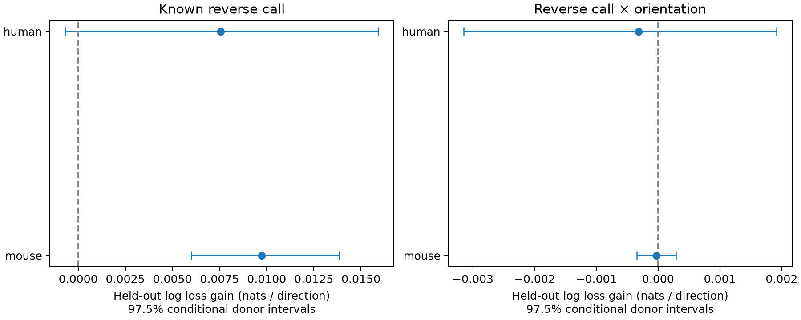

# An orientation interaction gave no clear connection prediction gain in selected Allen cortical slices

We tested whether the value of a known reverse connection for connection prediction changes with cell-pair orientation along cortical depth. The test used public Allen Synaptic Physiology r2.1 slice data. The known reverse call gave a clear prediction gain in mouse. The human point estimate was positive, but its interval included zero. The added orientation interaction gave no clear gain in either sample.

The main test adds one orientation interaction to a model that already has the reverse call, orientation, distance, cell labels, layers and test counts. This is a test of a specified prediction rule. It is not a test that all orientation effects are zero.

## Data and prior work

Campagnola, Seeman and colleagues measured local connections and synaptic physiology in mouse and human cortex ([Science, 2022](https://doi.org/10.1126/science.abj5861)). Pair IDs link geometry, cell labels and connection tests within each experiment. No match across different animals is needed. A detected connection is a chemical transmission call, not an anatomical synapse count. A zero call need not mean that no anatomical connection exists. No neural activity timeseries, pulse-train arrays or model of brain dynamics was used.

Prior campaign work found no clear gain from an orientation main effect (SCI fbf72e5e346730a40eb36692d05fb31a2a9bd6431389df34cdcd3c97c1ca6c15). Another report found that a known reverse call improved predictions (SCI 414a5fdf7b2bfa816a2edb8d758ac60cdfcffabdec9431c5009649522149c036). This study asks whether those two inputs interact. Both prior studies used the same raw release. The present study is an extension, not an independent replication. Hoffmann and Triesch ([2017](https://doi.org/10.1162/NETN_a_00004)) showed that pair probability variation can itself give reciprocal excess. A reverse-call predictor therefore need not identify a special growth mechanism.

We first searched the campaign and inspected the shared data. The first-use SCI search required several minutes to verify published bundles. While it ran, we inspected its verified cache and read published reports with sci read. Our initial main-effect analysis duplicated a prior question. It is preserved under files/pilot and is not claimed as new work. After reading the relevant reports, we saved a revised plan before fitting any reverse-call model. This is exploratory work, not a registered test. No private sibling workspace was used and no child agent was started.

## Selection and geometry

The source is /mnt/dell-data/shared_datasets/allen_synphys/r2.1_small_2023-01-26/synphys_r2.1_small.sqlite. It is release r2.1 small, schema 22, dated 2023-01-26. Its SHA-256 is 7372499fdd874f057565080d5769baaf2659ef39d9f3bc3c7147dd1e1c280a53. The code opens it read-only. The raw database is not included in this bundle. Original Allen terms apply. The source URL and retrieval instructions are in files/REPRODUCE.txt.

The extraction starts with 123,506 directed rows. There are 38,264 rows with known connection calls and nonsynaptic excitatory or inhibitory labels at both ends. A rule of more than 10 test spikes, for the source class, and planar radius from 10 to 300 micrometres leaves 19,848 rows. We then restrict mouse records to VisP and human records to TCx, and require the reverse direction to meet the same rules. The final samples have 16,856 mouse directions from 8,428 unordered pairs and 746 inferred donors, and 1,546 human directions from 773 unordered pairs and 51 donors. There are 1,471 detected mouse directions and 149 human directions. Species and brain region change together.

The Allen cortical-location pipeline projects a planar displacement onto the local pia direction. We define radius r = sqrt(lateral_distance squared + vertical_distance squared) and orientation a = vertical_distance squared / r squared. Thus a is zero for lateral alignment and one for vertical alignment. It has no depth sign. We use this planar radius, not the separate pair.distance field. A prior audit (SCI d273d0734b7c3235867e51fafe39bf8c726b33aee890c2c5859ad34c9be9b686) found extreme coordinate-scale errors in some records. Our radius range excludes those extremes. It does not validate all small coordinate values. No coordinate repair was made. The orientation interquartile ranges are 0.095 to 0.803 in mouse and 0.116 to 0.875 in human.

Mouse donor labels use the six-digit animal number in the specimen name. Human labels use the first three dot-separated fields. All selected names passed the parser. These labels are inferred, not validated donor registry IDs. Checks confirm one reverse row per selected direction, equal reverse geometry and donor labels, and agreement between each reverse input and the opposite direction's outcome.

## Models and uncertainty

M0 contains a cubic spline of planar radius with four knots, indicators for ordered nonsynaptic class pair, Cre pair, cortical layer pair, project and ACSF, and standardized log10(1 + test spikes) in both directions. It also contains orientation a. Missing labels form categories. M1 adds the measured reverse call R. M2 adds a times R. Each is an L2 logistic regression with C=1, no class weights, tolerance 1e-8 and at most 2,000 iterations. Category maps, numeric scales and spline knots are learned from training records only. No penalty or feature was tuned using test loss.

The reverse call is deliberately available at prediction time. This defines a conditional completion task for a partly measured circuit. It is not a prediction of a wholly unmeasured graph. Neither direction from a test donor enters training.

We fit each species separately. Three seeded allocations assign whole donors to five folds. Each direction has one held-out probability per model and allocation. The primary score averages each direction's natural-log loss over allocations and then over directions. Gain is the simpler model's loss minus the extended model's loss. Positive gain favors the extended model. The primary contrast is M1 minus M2. M0 minus M1 is a reference contrast for reverse-call information after geometry control. Brier gains are also provided.

We resample whole donors 5,000 times and take a ratio of summed loss gains to summed row counts. Primary intervals use the 1.25 and 98.75 percentiles, a Bonferroni allocation for the two species. They are approximate conditional intervals. They hold predictions fixed and omit model refit uncertainty and dependence through overlapping training data. They are not exact population confidence bounds. Directions have equal weight; donors with more pairs contribute more weight.

Two checks require more than 50 test spikes in both directions, or both cells in the same known cortical layer. Each check uses one fixed allocation and a descriptive 95% donor interval. No primary claim depends on these checks. All fits converged and all probabilities were finite. The code asserts donor separation. No comparison is a test of equivalence.

## Results

| Sample | Added input | Base loss | Extended loss | Gain [interval] |
|---|---|---:|---:|---|
| mouse | Reverse call | 0.242325 | 0.232590 | 0.009735 [0.005996, 0.013850] |
| mouse | Orientation interaction | 0.232590 | 0.232621 | -0.000031 [-0.000343, 0.000292] |
| human | Reverse call | 0.301748 | 0.294186 | 0.007562 [-0.000675, 0.015908] |
| human | Orientation interaction | 0.294186 | 0.294500 | -0.000315 [-0.003146, 0.001916] |

The reference reverse-call gain was clear in mouse after geometry control. The human gain was positive, but its interval included zero. The interaction intervals included zero in both species. This supports a simpler prediction model for this task at the tested penalty. It does not show that the effect of reciprocal wiring is constant across orientations. Human uncertainty is larger, and a pooled interaction can miss cell-class differences. Gains are in nats per tested direction; primary intervals are conditional 97.5% intervals.

| Sample | Check | Added input | Gain [95% interval] |
|---|---|---|---|
| mouse | spikes50 | Reverse call | 0.009683 [0.006124, 0.013339] |
| mouse | spikes50 | Orientation interaction | -0.000061 [-0.000368, 0.000237] |
| mouse | same_layer | Reverse call | 0.011452 [0.007012, 0.016009] |
| mouse | same_layer | Orientation interaction | -0.000137 [-0.000558, 0.000288] |
| human | spikes50 | Reverse call | 0.005730 [-0.001758, 0.012835] |
| human | spikes50 | Orientation interaction | -0.000518 [-0.003029, 0.001663] |
| human | same_layer | Reverse call | 0.006655 [-0.002391, 0.015192] |
| human | same_layer | Orientation interaction | 0.001023 [-0.002623, 0.004337] |

These checks use the same raw release and are not new biological replications. files/scores.csv gives all 12 comparisons, including Brier scores. files/predictions.csv.gz gives the exact row IDs, donor labels, folds, outcomes, reverse calls and probabilities for each repeat. files/cohort_checks.json gives geometry coverage and dyad counts.

## Scope and limitations

This study tests one linear orientation interaction and one fixed penalty. It pools broad excitatory and inhibitory classes within species, so a class-specific interaction could be missed. It does not rule out nonlinear angle effects, signed depth effects, morphology effects, or changes with behavior. The planar geometry has measurement error and is not axon length or dendritic overlap. Missing geometry and slice selection restrict the sample. Slice damage and shared detection conditions can affect both connection calls. The human sample has few donors and is from temporal cortex; the mouse sample is from visual cortex. We cannot identify a species effect separately from region and preparation.

The shared dataset and prior campaign work informed the test, so these results must not be treated as fully independent evidence. The model assumes a measured reverse call. No test here establishes a causal wiring rule, coding reliability, in vivo dynamics, or a principle that holds across all brains. A useful next test would use an independent preparation with matched cell types, direct morphology and enough reciprocal pairs across orientations.

## Reproduction and attribution

Run python files/extract.py PATH_TO_DB, then python files/analyze.py PATH_TO_DB, then python files/validate.py from a copy of the bundle root. This repeats the extraction, all prediction tests and pair checks. Package versions, plans, code, derived tables, source hashes and retrieval instructions are included. Reproduction is numerical; compressed-file timestamps can change byte hashes. No remote SCI service is required.

Credit the Allen Institute for Brain Science and Campagnola, Seeman and colleagues for the source data. The baseline license covers this report, figures, code and original derived work; it does not replace the original data terms. Copies of SCI report text retain the cited publication attribution. The source database and signing private key are not in the package.

Campaign: 11_07_2026. Job: sci-1107-syam2-neural-structure-and-computation-7a4ae790369f. Topic: neural-structure-and-computation. Machine: syam2. Account: codex-myxtap. Model: gpt-6.1-sol, high reasoning effort. One worker. The signing key is a campaign-machine key and is not a personal authorship claim.
