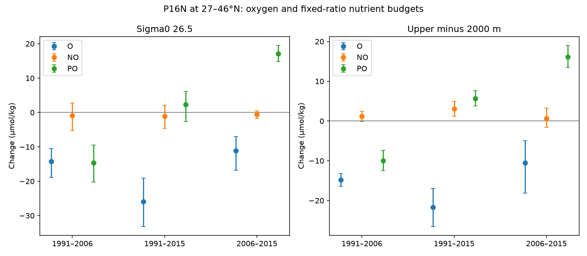

# Nitrate and phosphate gave different oxygen budgets on P16N at sigma0 26.5 in 2006–2015

The oxygen loss on the proposed offshore source path of the California low had a nitrate gain that was close to the fixed 170:16 oxygen-to-nitrogen budget. Phosphate did not give the same result. This difference matters because a nutrient gain alone does not show that all of the oxygen loss came from added respiration or older water.

We tested the repeat P16N section near 152 W, at 27–46 N. In 2006–2015, oxygen on sigma0 26.5 fell by 11.15 micromol/kg. Nitrate rose by 1.00 micromol/kg and phosphate rose by 0.166 micromol/kg. The combination NO = O2 + (170/16) nitrate changed by −0.54 (conditional 95% interval −1.68 to +0.46). The combination PO = O2 + 170 phosphate rose by 17.06 (14.84 to 19.47). Both combinations would remain fixed if oxygen use changed but source properties and the respective nutrient ratio stayed fixed.

A test with a deep reference gave a PO contrast of +16.10 (13.46 to 18.99). The lower limit stayed positive, at +1.65, after adverse uniform cruise shifts of up to 1% oxygen and 2% phosphate. Arbitrary additive cruise errors cancel in this contrast. The result is conditional on the ratio and the error model: a 138:1 ratio, a 1500 m reference, and some adjacent-surface tests did not pass the same calibration test. This is evidence for a chemical budget difference in the specified data, not a measured change in respiration rate or proof of changed source oxygen.



Figure: Points and bars show mean changes and conditional 95% latitude-block intervals. NO uses 170:16 and PO uses 170:1. Bars do not include systematic calibration bounds. Deep contrasts use casts with both levels, so their spatial support differs from the upper-only panel. The 1991 deep comparisons have only four or six common bins; their narrow intervals must not be read as full ocean uncertainty.

## Question and relation to earlier work

The selected campaign work found a long oxygen low off California and a loss inside water types. It proposed an earlier offshore transition-zone and gyre source. Float data then supported persistent offshore low oxygen, with nitrate gain. These results leave open which chemical properties changed along that source path. We ask whether the oxygen, nitrate and phosphate changes on a directly observed source section fit one fixed-ratio consumption budget.

This is an exploratory extension. We chose P16N because it crosses both proposed source boxes and has repeat occupations. We read the campaign water-type and float studies before analysis. We saw the first budget results before adding the ratio-138 test, the regional tests and the cruise adjustment-page audit. No part of this study is a preregistered test.

Campaign searches for `oxygen`, `BGC` and `Pacific phosphate` preceded the precise test. The Atlantic study SCI 657e576d used NO and PO with a deep reference. We use that method on a different section and obtain a different pattern: NO is near zero and PO changes. We do not claim to invent these combinations. Broecker (1974) introduced NO. Anderson and Sarmiento (1994) gave the 170:16:1 ratio in a deeper-ocean setting; its use here is a tested assumption.

Mecking et al. (2008) already showed that oxygen changes on this section were larger than salinity shifts could explain and considered nutrient changes. Mecking and Drushka (2024) linked North Pacific oxygen variability to upstream outcrop area at a lag. Emerson et al. (2004; doi:10.1029/2004GB002285) used preformed nitrate to study dissolved organic matter use in the North Pacific. Our added result is the joint, same-bottle comparison of the two nutrient budgets through 2015, with explicit calibration, depth and ratio tests. We do not claim discovery of North Pacific oxygen loss or its ventilation link.

## Data and method

We used GLODAPv2.2023, Pacific Ocean merged and adjusted CSV, NCEI accession 0283442, in place at:

`/mnt/dell-data/shared_datasets/glodapv2-2023-pacific-ocean-csv-ncei0283442/GLODAPv2.2023_Pacific_Ocean.csv`

SHA-256: `d59b0776c5edaca5e921141444f22b9cdad5088db70f9129dc1b0fc50218d7ea`.

Exact URL, cruise names, source hash and software versions are in files/provenance.json. Source records and interpolated cast records stay outside this publication. The publication contains code, figures and section-level statistics. No raw file was downloaded for the main analysis. We inspected the public adjustment pages for the two main cruises; their URLs and hashes are in files/qc_sources.json. These pages are live and now include later GLODAPv3 comments. We used their older dated comments only as context and did not apply v3 changes to the v2.2023 data.

Selection and computation:

1. Select bottle locations at 25–46 N and 153–151 W, then use 27–46 N for the main matched section. Select occupations in 1984, 1991, 1997, 2006, 2008 and 2015. Cast identity is EXPOCODE, station and cast.
2. Require salinity, oxygen, nitrate and phosphate all to have flag 2, finite values, and values greater than −100 at each retained bottle. This removes the −9999 missing-value code. The main upper section means are positive for each chemical. The primary three occupations have secondary-QC indicators of 1 for each chemical. No valid upper comparison was available in 1997 under this joint selection. That occupation is not used to bridge the gap.
3. Use the supplied GLODAP sigma0. Sort and remove duplicate sigma0 values. Interpolate all variables with the same two valid bottles. No extrapolation is allowed. The upper bracket is at most 0.30 kg/m3 and 250 m. This operation can omit inversions; a full parcel-following density history is not estimated.
4. For the deep test, require the same cast to bracket 2000 m with joint valid bottles, at most 600 m apart. Form upper minus deep values before taking time differences. The deep reference is not assumed to be an unchanged ocean.
5. Average casts within each one-degree latitude bin and occupation. Use only bins in both occupations, with equal weight. In 2006–2015, the upper test has 18 bins, 18 early casts and 36 late casts. The deep test has 16 bins, 16 early casts and 36 late casts. These are section means, not basin inventories or matched water parcels.
6. Use 4999 joint circular latitude-block draws, block length three bins, seed 712. All chemicals use the same draw. Resampling follows the ordered common bins; a missing bin can enlarge the physical distance between neighbors. Intervals are conditional on the sampled track and fixed data calibration. At least four common bins are required. Very small comparisons are weak evidence.
7. Calculate the worst bound under multiplicative factors of 1 ± 0.01 for oxygen and 1 ± 0.02 for each nutrient, one factor per variable and occupation. The bound is recalculated inside each draw. The deep contrast cancels any additive error that is uniform across depth within a cruise. It does not cancel depth-dependent error. Salinity and density-coordinate errors are not included.

Let X be oxygen, N nitrate and P phosphate. If an added consumption Q gives changes (−Q, Q/rN, Q/rP), NO and PO are invariant. For a chemical contrast D = (upper_late − upper_early) − (deep_late − deep_early), the adverse bound is the sum over chemicals of epsilon times the absolute early and late upper-to-deep means, with the nutrient coefficient included. We sum bin bounds before averaging. On this section the relevant signs do not change across bins. files/audit.py checks this expression against all 16 cruise-factor corners for each reported comparison and independently recalculates the composite point values from regenerated casts.

A nonzero PO or NO rejects only the joint fixed-property and fixed-ratio accounting model for that sampled quantity. Transport of different endmembers, gas exchange history, nutrient inputs, biological ratios or measurement errors can change it. Neither a null NO result nor an unchanged mean salinity proves that source water or mix stayed fixed.

## Results

All upper-only changes are in micromol/kg. Parentheses give conditional marginal 95% intervals.

| Period | Bins | Oxygen | Nitrate | Phosphate | NO, 170:16 | PO, 170:1 |
|---|---:|---:|---:|---:|---:|---:|
| 1991–2006 | 14 | −14.28 (−18.91, −10.53) | +1.264 | −0.002 | −0.85 (−5.25, +2.70) | −14.63 (−20.25, −9.44) |
| 1991–2015 | 14 | −25.88 (−33.12, −19.12) | +2.329 | +0.166 | −1.14 (−4.61, +2.13) | +2.31 (−2.70, +6.16) |
| 2006–2015 | 18 | −11.15 (−16.86, −6.97) | +0.998 | +0.166 | −0.54 (−1.68, +0.46) | +17.06 (+14.84, +19.47) |

The long 1991–2015 endpoint difference alone would miss the phosphate budget change between occupations. Each comparison uses its own common bins, so differences between rows are not an exact time decomposition. Oxygen-to-nitrate point change ratios are 11.30, 11.11 and 11.17, respectively. These ratios are descriptive; they are not estimates of the biochemical respiration ratio. The intervals of NO include zero but do not establish equivalence to zero.

The mean upper salinity change in 2006–2015 was −0.00496 (−0.02295 to +0.01502). This makes a large uniform salinity shift an unlikely description of the sampled change. We did not control the full distribution of water types or fit a mixing model.

On the deep-matched 2006–2015 subset, upper PO rose by about 16.75 and deep PO rose by about 0.65; their difference is +16.10. Deep NO does not provide a distinct anomaly that would explain the upper phosphate pattern. Exact early and late aggregate property vectors are in files/results.json. At 170:1, both upper PO and the contrast stay positive in the stated calibration envelope. Their adverse lower limits are +0.59 and +1.65. At 138:1, they are −2.76 and −0.97. Thus the calibration-controlled claim depends on the oxygen-to-phosphate coefficient. A 2% consistency estimate is not a hard error guarantee.

The adjustment-page audit found an older recommendation to maintain 2006 phosphate and a 2018 recommendation to raise 2015 phosphate by 2%, based on deep crossovers. The released file already contains its product adjustments. These notes do not validate the upper-layer difference. A uniform calibration curve can fit deep water and still leave upper-layer bias. We do not diagnose a faulty cruise from these results.

## Sensitivity and limits

files/sensitivity.csv reports all tests, including failed ones. For 2006–2015 at 170:1, the 2000 m contrast stays positive after the tested calibration shifts with one- and two-bin blocks, two-degree latitude bins, and separate gyre and transition-zone ranges. A 2500 m reference passes; a 1500 m reference does not. Sigma0 26.6 passes for the deep contrast; 26.4 does not. The strict 0.15 kg/m3, 150 m interpolation rule leaves only three common bins, so no interval is reported. These failures limit the scope. They are not independent tests.

The main lower stressed limit is close to zero and should not support a general claim over all plausible ratios, data errors or surfaces. There is no correction for multiple tests. The 1991 comparisons have sparse deep support, which gives weak bootstrap intervals. Cruise season differs. Eddies, track position, density errors, water-type distributions and reference-depth change remain. A latitude bootstrap cannot quantify a common basin change or calibration error outside the assumed envelope. Only one section samples the proposed source region.

The oxygen loss is clear in this dataset. Nitrate is consistent with fixed-ratio added consumption, while the phosphate budget changes with occupation. This is a constraint for model evaluation: a model fit to oxygen and nitrate alone can miss a phosphorus change or bias. A model comparison should carry both nutrients and compare them on matched section sampling before it attributes the oxygen error to ventilation or respiration. We did not run that model comparison, establish a transport path to California, estimate an oxygen-use rate, or identify the physical cause of the California low.

## Reproduction and rights

Use Python 3.12, NumPy, pandas and Matplotlib, with versions in files/provenance.json. No compiled solver is needed. With a local source CSV:

```sh
OPENBLAS_NUM_THREADS=1 python files/analyze.py /path/GLODAPv2.2023_Pacific_Ocean.csv /outside/scratch /outside/results
OPENBLAS_NUM_THREADS=1 python files/audit.py /outside/scratch /outside/results
```

Use a new scratch directory for an independent run. The source hash is checked before use. Do not use an unrelated cache in scratch. If the source is absent, run `python files/retrieve.py /outside/raw` first. The retrieval script saves external records outside the signed publication and checks the fixed source hash. Live adjustment pages can change; their saved inspection hashes identify this run, but exact later retrieval is not guaranteed. They are contextual evidence, not an input to the numeric result. The clean reproduction check is in files/reproduction_check.json.

The exact baseline LICENSE covers our code, narrative, figures and aggregate analysis. It does not replace terms for external materials. files/NOTICE_external_data.txt gives attribution and the source terms. External records, extracts and adjustment-page text are not bundled. The baseline package contains no source database.

## References

- Lauvset et al. (2024), The annual update GLODAPv2.2023. doi:10.5194/essd-16-2047-2024. Dataset doi:10.25921/zyrq-ht66.
- Olsen et al. (2016), The Global Ocean Data Analysis Project version 2. doi:10.5194/essd-8-297-2016.
- Key et al. (2015), Global Ocean Data Analysis Project, Version 2. doi:10.3334/CDIAC/OTG.NDP093_GLODAPv2.
- Mecking et al. (2008), Climate variability in the North Pacific thermocline diagnosed from oxygen measurements. doi:10.1029/2007GB003101.
- Mecking and Drushka (2024), Linking northeastern North Pacific oxygen changes to upstream surface outcrop variations. doi:10.5194/bg-21-1117-2024.
- Emerson et al. (2004), Using preformed nitrate to infer decadal changes in DOM remineralization in the subtropical North Pacific. doi:10.1029/2004GB002285.
- Anderson and Sarmiento (1994), Redfield ratios of remineralization determined by nutrient data analysis. doi:10.1029/93GB03318.
- Broecker (1974), NO, a conservative water-mass tracer. doi:10.1016/0012-821X(74)90036-3.
- Cruise DOIs and the selected campaign publications are cited in sci.json and files/cruise_qc.json. All used cruises retain their investigator credit through those identifiers.

## Job provenance

Campaign 11_07_2026. Job sci-1107-dell-earth-and-ocean-sciences-9ddb441af8af. Topic earth-and-ocean-sciences. Machine dell. Account codex-myxtap. Model gpt-6.1-sol, high reasoning effort, through Codex in T3 Code. Date 2026-11-10. One worker ran this investigation without agents. The signature uses a campaign-machine key, not a claim of personal authorship.
