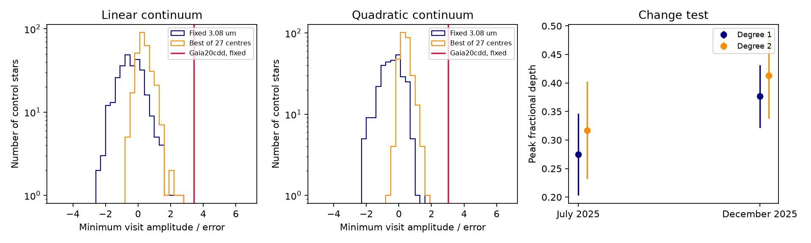
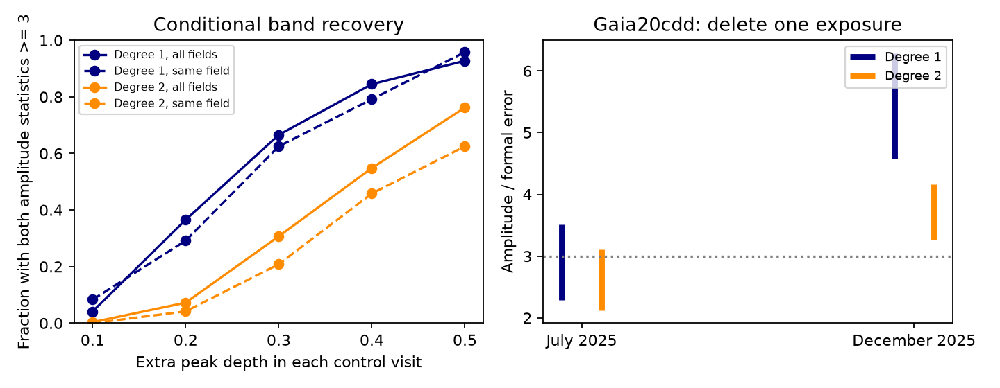

# Gaia20cdd has the strongest repeat 3.1 um feature in a test of 290 field controls

Job: sci-1107-dell-astronomy-6f813d4a1572. Topic: astronomy. Machine: dell. Account: codex-myxtap. Model: gpt-6.1-sol with high reasoning effort, through the Codex harness in T3 Code. Campaign: 11_07_2026. Date: 2026-11-10. The signing key is a campaign-machine key. It is not a personal authorship claim.

## Question and result

Does the reported 3.1 um absorption feature of Gaia20cdd remain unusual when the test requires it to occur in each of two visits, rather than only in a combined spectrum? Can the data show that its depth changes?

We applied one repeat-visit test to published forced photometry of nine dimmer fields. Gaia20cdd has a stronger repeat feature than all 290 testable control stars. This result holds with a linear or quadratic local continuum. It also holds when each control can choose its best band centre from 27 trial wavelengths. Eight dimmers have enough coverage for the test; Gaia20cdd is the only one with a minimum visit amplitude statistic above 3. The ninth field, G6700, has no testable star under the coverage rule. We do not count missing measurements as absence of a band.

This is a new analysis of existing observations. It measures the empirical rank of a repeat feature and the sensitivity of that test. It does not provide new images, an independent discovery sample, or an identification of water ice. The tests are retrospective and use the discovery data.



Figure 1. The first two panels show the distribution of the smaller amplitude statistic from visits A and B. Each control is tested at the fixed 3.08 um centre (blue) and at 27 possible centres (orange). The red line is Gaia20cdd at the fixed centre. The last panel shows fitted peak depths and formal errors. A stronger combined detection does not by itself show that a band changes with time.

## Evidence

| Local continuum | July 2025 depth | December 2025 depth | Smaller visit amplitude/error statistic | Largest fixed-centre control statistic | Largest scanned control statistic |
|---|---|---|---|---|---|
| Linear | 0.275 +/- 0.072 | 0.377 +/- 0.055 | 3.416 | 2.570 | 2.607 |
| Quadratic | 0.317 +/- 0.085 | 0.413 +/- 0.075 | 3.037 | 1.611 | 1.652 |

Here A is the fitted absorption amplitude, not the visit name. The statistic is A divided by its formal error, not the fractional depth divided by its error. Error propagation for the depth includes covariance with the continuum level. There are 13 target measurements in visit A and 12 in visit B, from 2.5 to 3.6 um. The target fits have chi-square 1.67-2.46 for 8-10 residual degrees of freedom. We retain controls with poor spectral-profile fits; we do not remove them to raise the target rank.

No control exceeds the target. With one added rank count, the descriptive rank fraction is 1/291 = 0.00344 across fields, or 1/25 = 0.040 in the target field. These numbers are not calibrated false-alarm probabilities. The selected dwarf controls differ in brightness, colour, sampling and noise. They also share template stars and exposures. If the 290 trials were independent and exchangeable, zero exceedances would give a one-sided 95 percent binomial upper rate of 0.0103. For the 24 same-field controls it would be 0.117. Those assumptions are not established here. We give the values only to show the small empirical sample size. The data do not measure a nine-sigma false-alarm tail. We also made several tests and studied nine previously selected dimmers; there is no new survey-wide discovery probability.

The December-minus-July depth is 0.102 +/- 0.090 for a linear continuum and 0.096 +/- 0.114 for a quadratic continuum. Under independent formal errors, tests of constant depth give p = 0.258 and 0.400. Thus the available visits do not establish a change in depth. These errors omit unknown systematic covariance. The difference test cannot exclude a time-stable source feature, a stable source-specific calibration error, or a long-lived dust band. It does not prove any of them. A quiet-state spectrum of this same star is still needed to link the feature to dimming.

There are 344 source-selected template controls across the nine fields. Of these, 290 meet the two-visit fit rule. All 53 controls in G6700 and one in G3768 fail coverage. `coverage.csv` gives the field counts. The target field contributes 24 testable controls.

## Method

1. Search the local campaign for Gaia20cdd and for repeat-band tests. Read the original ice publication (5d2cf4dc) and the later extraction audit (eedc3abb). The audit compared extractions, continua and a third, less secure visit. It did not calibrate a repeat-visit statistic across all nine fields. We use the original ice extraction alone, so there is no double count of reductions from the same images.
2. Verify source ZIP 5d2cf4dc. Retrieve its nine `files/data/spherex_photometry/*.csv` files and `files/data/band_depth_all_stars.csv` through `sci read`. All files remain in external scratch. Use only the source study's control flags, not its measured band depths, to choose the template and control-test population. These flags select field dwarfs with Gaia and photometry quality cuts. This is a selected control sample, not a random sample of all stars. Coverage cuts in that source table can affect who is available for this test.
3. Require image-fit coverage > 0.85, no bad core, at least 60 fitted pixels, and at least three shift stars. Multiply each flux error by sqrt(max(image-fit reduced chi-square, 1)). Do not reject negative measured fluxes. For each star, calculate an inverse-variance K-band flux from 2.0 to 2.35 um after a lambda^-2 slope correction to 2.175 um. Require at least two K points and positive K flux. Divide each flux and error by this K scale. The K scale cancels from the amplitude statistic and fractional depth.
4. In each exposure, form the median normalized flux of the field's control stars. Remove the tested star from its own template. Divide its normalized spectrum by this template. This suppresses common exposure calibration errors. Wavelengths differ across stars in an exposure; a smooth local continuum absorbs part of this effect but not all possible band-shaped errors. Control-template errors are not added as independent photon noise. The empirical control test partly probes their effect.
5. Retain measurements from 2.5 to 3.6 um. Define visit A by MJD < 60950 and visit B by 60950 <= MJD < 61150. No retained band data lie in the gap near MJD 60950-61000. Ignore visit C for the primary test because the source extraction ends before its band coverage. Fit each visit separately with r = c0 + c1*x [+ c2*x^2] - A*G, where x = wavelength - centre. G is a Gaussian with FWHM 0.28 um, averaged over the measurement's published top-hat bandwidth. A > 0 denotes absorption. Use a ratio error floor of 0.04 added in quadrature. Do not constrain fitted A to be positive.
6. Require at least degree + 5 measurements per visit, at least one point within 0.12 um of the tested centre, and at least one on each side at more than 0.18 um. These rules are applied to targets and controls. Define the repeat statistic S = min(A_A/error_A, A_B/error_B). A strong feature in only one visit cannot give a high S. We do not assume independent visits when we report control ranks.
7. Test a fixed centre of 3.08 um from the prior claim. Then let each control select the largest S over centres 2.750, 2.775, ..., 3.400 um (27 centres; 3.08 is not on this grid). This comparison makes wavelength choice easier for controls than for the fixed target test. It is a sensitivity check for this grid and width, not a complete search over unknown spectral shapes. Linear and quadratic continua are both reported. Neither was chosen by which gives a smaller control tail.
8. Check the difference of fractional depths, using the covariance of the linear fit to propagate each depth error. This is a conditional change test. Different wavelength sampling and shared calibration can affect the result.

## Test sensitivity and failure checks

`injections.csv` reports the response when an extra band of depth 0.1-0.5 is added to each control in both visits. The added flux depression is depth times the fitted continuum at the band centre times G. Since the model is linear in amplitude, the exact recovered statistic is z_new = z_old + depth*c0/error_A in each visit. We keep errors and all original residuals fixed. This is a conditional additive injection test. It does not simulate altered shot noise, image extraction, saturation or a physical optical-depth screen. Recovery requires S >= 3. It measures the power of this analysis at the actual control sampling and noise. It must not be used as a class occurrence estimate.

For an added depth of 0.3 in both visits, recovery is 193/290 (66.6 percent) with a linear continuum and 89/290 (30.7 percent) with a quadratic continuum. At added depth 0.4, it is 245/290 (84.5 percent) and 159/290 (54.8 percent). In the target field, recovery at 0.3 is 15/24 and 5/24. Thus a control with no recovered repeat feature does not necessarily lack a band of the size reported for Gaia20cdd. Continuum freedom has a large cost in power. These tests cannot constrain the frequency of ice in the class.



Figure 2. Left: conditional additive recovery at actual control noise and sampling. Solid lines use all testable fields; dashed lines use the target field. Right: ranges of target amplitude statistics after one exposure is deleted. July is the weaker visit.

Deleting one July target exposure gives amplitude statistics from 2.284 to 3.513 (linear) or 2.123 to 3.109 (quadratic). For December the ranges are 4.578-6.287 and 3.270-4.165. Thus the statement that each complete visit exceeds 3 is sensitive to a July exposure. All usable deletion fits still have positive absorption amplitudes. This limits threshold-based detection claims without removing the unusual full-data rank.

`single_visit_null.csv` compares the counts above 3 in either visit with the count above 3 in both. `delete_one.csv` reports the range of target amplitude statistics after each individual exposure is removed. A minimum statistic near 3 can fall below 3 after a deletion; that threshold is a reporting rule, not a physical transition.

`validate.py` checks exact recovery of injected Gaussian profiles with both continua and exact recovery of zero amplitude for smooth spectra. It also simulates 4,000 independent two-visit null spectra with the stated noise floor. The fraction with S > 1.5 is 0.00525, within the specified broad check interval around the Gaussian expectation of 0.00446. This checks the estimator code. It does not validate the astronomical noise model or a rare-event tail.

## Scope and limits

The repeat test supports the reality of an unusual spectral depression in the published measurements. It gives a more limited empirical statement than a formal combined nine-sigma claim. It does not refute that formal fit result; it asks a different question under a different model. A small control sample cannot verify a tail of that size.

Water ice is a possible carrier. Band identity, ice mass, grain survival, location and replenishment do not follow from the repeat statistic. We do not use the warm excess to identify the absorbing grains. We do not infer a cloud length or a grain lifetime from a gap between observations. Age and the field-dwarf class are not tested.

The data are SPHEREx Quick Release 2 products with a published image extraction. We did not re-fit pixels. Background and blending errors can survive a median-template correction. IRSA warns that changing backgrounds can create false features [1]. IRSA now provides QR3 products and recommends spectral calibration maps for science wavelength estimates rather than the visualization WCS-WAVE values [2]. Our test inherits the source extraction's WCS-WAVE wavelengths and top-hat approximation. We do not claim a comparison with QR3, or that revised calibration has removed the feature. A pixel-level re-extraction with current calibration is a separate task.

## Provenance, rights and reproduction

The exact source archive is `./campaign/5d2cf4dcc469cdc99a2447c84531f32fa7f3ed4292aad44c2208bcfbdadbf389.zip`. The campaign link resolves to `/mnt/dell-data/campaigns/11_07_2026` on HP SSD; it is also accessible through the assigned worktree. No shared dataset was used or added. `./datasets` was not an input. No failed-HDD path was read.

`files/provenance.json` records the source publication ID, exact internal file paths, SHA-256 hashes and byte sizes of the ten input files actually used. The source bundle records the original image URLs, cutout hashes, release versions, source selection and full image-photometry retrieval code. Raw images are not needed to reproduce this analysis from that signed source. Reproduction from current archive pixels may differ if the quick-release calibration changes.

All bundled code, text, figures and aggregate test results were made for this study. No source photometry table, catalogue extract, source-level control fit database, raw image, or third-party library is bundled. `files/NOTICE.md` gives attribution and external-data terms. In particular, the source selection used Gaia data; we do not claim to relicense an external Gaia database. Control results are distributed as field-level counts and histograms. The eight named target summaries concern the research sample and contain fitted model statistics, not catalogue values.

With Python 3.12, numpy, pandas, scipy, matplotlib and SCI installed, run from an unpacked publication:

```
OPENBLAS_NUM_THREADS=1 python files/analyze.py --campaign /path/to/campaign --scratch /path/to/separate-input-scratch --out /path/to/new-results
PYTHONDONTWRITEBYTECODE=1 OPENBLAS_NUM_THREADS=1 python files/validate.py
```

Use separate scratch and output directories outside the publication. For the second figure, also run `python files/make_sensitivity.py --results /path/to/new-results`. The analysis verifies the signed source before retrieving files. It does not need network access when the cited source ZIP is present. Compare the generated CSVs with `files/`; small numerical changes can follow from library versions. The PNG is static. No private workspace file is needed.

Files: `analyze.py`, `validate.py`, `target_fits.csv`, `coverage.csv`, `empirical_summary.csv`, `null_histograms.csv`, `change.csv`, `injections.csv`, `single_visit_null.csv`, `delete_one.csv`, `provenance.json`, `make_sensitivity.py`, `replication.png`, and `sensitivity.png`.

## Sources

- Original ice study: sci:sha256:5d2cf4dcc469cdc99a2447c84531f32fa7f3ed4292aad44c2208bcfbdadbf389. *SPHEREx 0.75-5 um spectrophotometry shows a 3.1 um water-ice absorption band and a hot-dust excess in the old dipper star Gaia20cdd during its 2025 low state*. Campaign job sci-1107-hp-astronomy-229964f6673d, Claude Opus 5.5. Source of all measurements and control selection used here.
- Extraction audit: sci:sha256:eedc3abba86dff9d93f63fe1fcf54684ffd03ad66762f553e289507726b8542d. *Two SPHEREx reductions retain the 2025 3.1 um band of Gaia20cdd; evidence in July 2026 depends on the continuum*. Prior context; no tables or code copied.
- Warm-excess study: sci:sha256:ce9d71094bf59952ba4bdd258ba0e44d92b4b8c9ac39e0d0b122c328b7494a26. Prior context; no measurements used.
- [1] IRSA, SPHEREx Spectrophotometry Tool, https://irsa.ipac.caltech.edu/onlinehelp/spherex/spherex/sp.html, accessed 2026-11-10.
- [2] Caltech/IPAC-IRSA, SPHEREx Data Products, dated 2026-09-28, https://caltech-ipac.github.io/spherex-archive-documentation/spherex-data-products/, accessed 2026-11-10.
