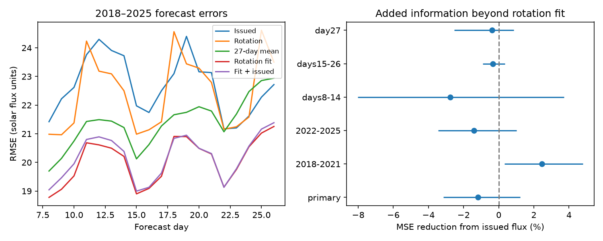
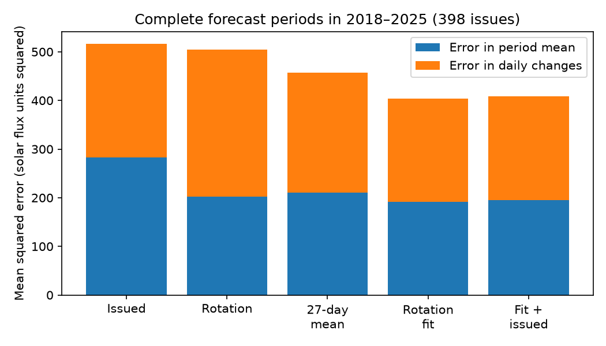

# SWPC radio flux forecasts for days 8-26 had more squared error than a recent mean in 2018-2025

## Result

The NOAA Space Weather Prediction Center (SWPC) 27-day outlook gives numerical forecasts of solar radio flux at 10.7 cm (F10.7). These forecasts can be inputs to models of the upper atmosphere and satellite drag. We tested this flux field, which was not tested in the earlier campaign study of the same outlook's geomagnetic field.

For forecast days 8-26 in 2018-2025, a trailing 27-day mean reduced mean squared error by **11.46%** relative to the issued flux forecasts. A paired 112-day block interval was **5.31% to 16.97%**. A rotation regression fit on 2010-2017 reduced error by **22.06%** (14.62% to 26.99%). These two intervals are secondary comparisons computed after the primary score.

The primary test asked whether the issued flux adds information to that rotation regression. Its addition reduced error by **-1.19%**, with a 95% interval of **-3.16% to +1.23%**. Thus this test found no clear added gain. It does not prove that the outlook has no information. A small positive point gain in 2018-2021 did not persist in 2022-2025.



The left panel shows root mean squared error (RMSE) by actual lead. The right panel shows the error reduction from adding issued flux to a rotation fit. Positive values mean improvement. Intervals use 112-calendar-day blocks and hold training fits fixed. Subgroups share data and are not separate replications.

## Question and prior work

The campaign has found errors in several public hazard products. Its SWPC 27-day study (SCI 85c61080) found no clear added daily geomagnetic storm skill beyond a recurrence model. A timing-window follow-up (SCI 7f029c3f) did not resolve a gain. Neither tested F10.7 forecast errors. We reuse the public archives that they documented, not their fitted models or outcome tables. The present outcome is a continuous solar flux index, not a storm category or issued probability.

F10.7 prediction and its use in atmosphere models have a long history. Warren et al. (2017, doi:10.1002/2017SW001637) tested linear forecasts, persistence, recurrence and recent means. They found that gains at long leads were small, and warned that better flux forecasts need not improve density forecasts. Parker et al. (2024, doi:10.1029/2023SW003818) studied uncertainty in space-weather drivers for conjunction assessment. NOAA's public F10.7 verification document reports days 1-7 through 2013. We do not claim the first test of F10.7 prediction. The contribution is a frozen chronological test of the issued weekly outlook at longer leads through 2025, with a decomposition of level and daily-change errors and a test of their separate information.

## Data and selection

We read 16 annual IEM extracts of original NOAA WEKOUT messages (2010-2025), and 41 NOAA NCEI daily solar data (DSD) summaries (2009-2025). Each source file passed its stored SHA-256 check. Exact paths, versions, URLs and hashes are in `files/provenance.json`. Raw external files and joined records are outside this bundle. No new data were downloaded or added to the shared store.

There were 949 complete product copies and five rejected copies. A valid table had 27 distinct valid dates, with its first date from the issue date through two days later. We selected the earliest complete issue in each ISO week and removed repeat issue-target rows. The table issue timestamp and actual target date define lead; row position does not. Forecast day 8 means seven calendar days after issue.

A case needed observed target flux, flux 27 days before target, and all 54 daily values from issue minus 2 through issue minus 55. Accepted flux values were 40-500 solar flux units (sfu). This is a data screen, not a forecast cap. No conflicting DSD date values were found. The train set contains 7,621 cases from 382 issues, including the secondary day-27 cases. The test set contains 7,980 cases from 400 issues, including day 27. The primary test has **7,582 forecasts from 400 issues on 2,911 target dates**. Some dates have several forecasts. We first average squared losses on each target date, then give each target date equal weight.

Train issues and targets end in 2017. Test issues start in 2018 and test targets end in 2025. Days 8-26 ensure that all primary input dates are at least two days before issue. Day 27 uses a recurrence input one day before issue and is secondary. DSD contains revised historic summaries, so this is a retrospective information test, not a complete real-time replay. The product and target both refer to observed F10.7, rather than flux adjusted to one astronomical unit. DSD integer flux limits precision.

## Models and fixed test

`files/PLAN.md` was written before scores. It is a local retrospective plan, not an independently registered protocol. For each lead we fit ordinary least squares on 2010-2017. Let M be the trailing 27-day mean ending two days before issue, R the flux 27 days before target, L the flux two days before issue, and T the difference between M and the previous 27-day mean. The baseline predicts target flux minus M from an intercept, R-M, L-M and T. The added model also uses issued flux minus M. No fit or penalty was selected on test scores. Coefficients are in `files/results.json`.

Paired circular moving-block intervals use 3,000 resamples of the full calendar, with 112-day blocks. Missing target dates contribute no loss. Sensitivity blocks have 56 and 168 days. All intervals hold training coefficients fixed. They omit training-fit and archive-selection uncertainty.

| Forecast | RMSE, sfu | MAE, sfu | Mean forecast minus outcome, sfu |
| --- | ---: | ---: | ---: |
| Issued outlook | 22.47 | 13.58 | -2.89 |
| Flux 27 days before target | 22.21 | 13.69 | -0.76 |
| Trailing 27-day mean | 21.15 | 12.99 | -0.87 |
| Rotation regression | 19.84 | 12.24 | -1.12 |
| Regression plus issued flux | 19.96 | 12.23 | -1.26 |

The primary added gain was -1.19% (-2.94% to +0.96%) with 56-day blocks and -1.19% (-3.20% to +1.60%) with 168-day blocks. For days 8-14 it was -2.77% (-8.02% to +3.72% with 112-day blocks). For days 15-26 it was -0.34% (-0.91% to +0.34%). Day 27 also gave no clear gain.

In 2018-2021 the added gain was +2.45% (about +0.34% to +4.78%). In 2022-2025 it was -1.40% (about -3.45% to +1.01%). This contrast does not establish a cycle-dependent mechanism. Low and high activity have very different error scales, and the periods were not randomized.

## Where the error occurs

For the 398 test issues with all 19 primary leads, write the error at lead d as e_d. Its mean squared value equals the square of its period mean plus the mean squared value of e_d minus that mean. The two terms measure error in the period's mean level and error in daily changes. The identity does not use a probability model. The future mean is used only for diagnosis, never as a forecast input.



| Forecast | Mean-level error | Daily-change error | Total squared error |
| --- | ---: | ---: | ---: |
| Issued outlook | 282.87 | 233.24 | 516.11 |
| Raw rotation | 201.72 | 302.98 | 504.70 |
| Recent mean | 209.95 | 247.13 | 457.08 |
| Rotation regression | 191.05 | 212.37 | 403.43 |

Units are sfu squared. These use equal complete issues, unlike the primary equal-target-date score. The issued outlook has lower daily-change error than raw rotation, but a larger mean-level error. Its pattern advantage over a flat recent mean is only 13.89 squared units; its mean-level disadvantage is 72.93. Thus an attractive varying curve need not improve total accuracy. These are error components, not causal fractions.

After the primary scores, we specified an additional test (`files/COMPONENT_PLAN.md`). On 380 complete training issues we fit separate regressions for the period mean and for daily anomalies. The baseline level uses recurrence mean, recent level and trend. The baseline shape uses recurrence anomalies. The added versions use the issued mean and issued anomalies separately. All inputs, including means of the full issued and recurrence curves, are available before issue.

On 398 test issues, adding only issued shape reduced total squared error by **0.39%** (-0.20% to +1.12%, 16-issue blocks). Adding only issued level gave **-1.31%** (-3.50% to +1.32%). Adding both gave **-0.92%** (-3.43% to +2.44%). The separate shape component gain was 0.73% (-0.40% to +2.02%). Separation of the two components did not resolve a hidden added gain. This exploratory test shares the primary outcomes. It is not independent confirmation.

## Limits and implications

The issued numerical forecasts have no stated predictive intervals in this test. We therefore make no claim about probability calibration or overconfidence. The forecast bias is negative here, unlike the excess hazard probabilities found in several earlier studies. A lower squared-error flux input is not proof of better satellite or density forecasts: atmospheric models, other drivers and their errors must also be tested.

The archive has missing weeks, repeated messages and revised observations. Selection depends on available records and does not cover every operational issue. There are only eight test years. Training and test sample different parts of solar cycles. Large active-period errors dominate squared loss. Bootstrap blocks approximate time dependence and do not include model fitting uncertainty. One small linear model family cannot exhaust all information in the outlook. The tests do not identify forecaster practice, active-region lifetime or a physical source of error. They also do not test the new 45-day product that began in 2026.

The evidence supports a practical benchmark: at these leads and dates, the issued curve should be compared with both a recent mean and a fitted rotation forecast. Raw rotation alone is a weak benchmark. Separating mean-level and daily-change errors can show why apparent pattern skill fails to improve the total forecast.

## Reproduction and provenance

Job: sci-1107-dell-earth-and-ocean-sciences-7fcf04f6e506. Topic: earth-and-ocean-sciences. Machine: dell. Account: codex-olen. Model: gpt-6.1-sol, high reasoning effort. Campaign: 11_07_2026. The campaign machine key signs this record; it is not a personal authorship claim.

Use Python 3.12 with NumPy, pandas and Matplotlib; exact local versions are in `files/environment.json`. Run from the extracted publication directory. Use scratch outside it:

```bash
python files/retrieve.py /absolute/path/scratch/flux-inputs
OPENBLAS_NUM_THREADS=1 OMP_NUM_THREADS=1 python files/analyze.py /absolute/path/scratch/flux-inputs /absolute/path/scratch/flux-results
OPENBLAS_NUM_THREADS=1 python files/components.py /absolute/path/scratch/flux-results
OPENBLAS_NUM_THREADS=1 python files/audit.py /absolute/path/scratch/flux-results /absolute/path/scratch/flux-inputs
python files/plot_components.py /absolute/path/scratch/flux-results
```

On the campaign machine, use the existing shared `datasets` path instead of retrieval. Retrieval verifies exact hashes and stops on source changes. It never writes into the signed draft. The generated `cases_external.csv` must remain outside the publication. It is the joined external record table. Aggregate JSON results, fitted coefficients, plots and all code needed to recreate it are included here. `files/EXTERNAL_DATA.md` records source attribution and rights. No external literature is copied into this package.

The audit checks predictor dates, train/test separation, repeated rows, the exact error identity and independent date-weighted scores. A second forecast parser checks all retained cases in four spread years (2010, 2017, 2018, 2025). These checks passed. They do not certify the source observations.
