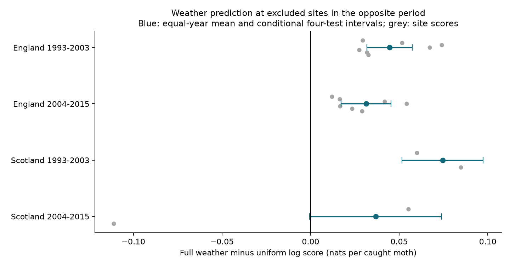

# Weather models improved catch allocation scores in 17 of 18 UK moth site-period tests in 1993-2015

## Result

A weather model trained at other sites in the opposite period improved the allocation of recorded moth catch among observed nights in 17 of 18 site-period tests. We used seven English sites and two Scottish sites in 1993-2003 and 2004-2015: 29,041 nights, 249,973 moths and 5,415 trap weeks. Each test site and test period was absent from its training set.

Average gains were positive in four region-period samples. Conditional four-test intervals were above zero in England in both periods and early Scotland. Later Scotland was uncertain. Transfer failed at later Sourhope (T07): its catch-weighted score change was -0.1112 nats per moth, with 203 nights and 2,725 moths. The other later Scottish site, Glensaugh, had 1,960 nights and 14,933 moths and a gain of 0.0552.

| Test region | Test period | Nights | Equal-year score gain | Conditional four-test interval | Full minus temperature-only gain |
| --- | --- | ---: | ---: | --- | ---: |
| England | 1993-2003 | 13,165 | 0.0446 | 0.0317 to 0.0574 | 0.0176 |
| England | 2004-2015 | 9,594 | 0.0313 | 0.0173 to 0.0454 | 0.0159 |
| Scotland | 1993-2003 | 4,119 | 0.0745 | 0.0517 to 0.0973 | 0.0046 |
| Scotland | 2004-2015 | 2,163 | 0.0368 | -0.0005 to 0.0741 | 0.0021 |

Scores are changes in log probability per caught moth, in nats. Positive values mean better allocation among observed nights in the same trap week. They are not percent changes in abundance or prediction accuracy. The last column is descriptive; we did not test a separate hypothesis family for it.

## Question and prior work

Can a shared weather model predict catches at an excluded site in a separate period? This is a useful check before weather correction is used to interpret biodiversity trends. A strong fitted weather slope need not transfer.

Holyoak and colleagues (1997) described weather bias in moth activity measurements. Jonason and colleagues (2014) found weather and lamp effects in German traps. SCI publication 4cb5ee4a estimated within-week weather slopes in ECN catches. SCI publication 7fd8cfc1 found a larger temperature slope on the trap night than seven days before or after. We use their archive and add a test of prediction across sites and periods. This is not independent replication of those source observations.

We searched the campaign for phenology, climate, pollution, ozone, warming, moth rain, and moth prediction transfer. Search logs are included. We read published results, not private workspaces. The design file was written before fitting. This is an exploratory follow-up, not a registered study. Earlier results were known.

## Data and observation bias

We verified parent publication sha256:4cb5ee4ae0a958d9ba8bcc60f07c02e91b26bc42a9651abc93f94a7720c71437 and restored its moth_nights.csv.gz and night_weather.csv.gz into external scratch. The sources are ECN moth data for 1992-2015 and hourly meteorology for 1991-2015. Parent night weather uses approximate sunset and sunrise. Temperature and rain require at least 80 percent of expected hourly records.

The parent keeps reported biological samples and explicit no-moth codes, one-night sample labels, and removes quality flags 100-103. The trap date is the start date. Missing samples are not zero catches. We keep March-November start dates in 1993-2015 at Drayton (T01), Moor House (T04), North Wyke (T05), Rothamsted (T06), Wytham (T08), Alice Holt (T09), Porton (T10), Glensaugh (T02) and Sourhope (T07). All models use the same complete current-weather rows. Each trap location has separate week groups. Groups need at least two nights and a positive catch total.

Later retained records contain no explicit zeros. Some earlier records also have positive-only reporting and operating gaps. This can change model transfer. The source does not identify all intended operating nights. We pool moth counts; species-specific transfer is not tested.

## Method

Each of 18 folds tests one site in one period. Training uses only other sites in the same region in the other period. Each Scottish training set contains only one site. Each English training set contains six sites. A record can train another fold, so folds are not independent experiments.

The full model has a Poisson conditional mean with separate intercepts for each site, trap location, ISO year and ISO week. Predictors are night temperature, wind, rain above 0.2 mm, log(1 + rain), net radiation divided by ten, and approximate moon illumination. Alternatives use temperature only or no weather. No model tuning uses test scores.

The predicted probability for test night i is exp(X_i beta) divided by the sum of exp(X_j beta) over observed nights j in its group. The no-weather allocation is 1/n for n observed nights. The gain is the sum of catch_i times log(n times probability_i). We divide annual gain by annual catch, pooled over test sites in the region, then average those annual ratios equally. We also report catch-weighted, equal-week and site scores.

These predictions condition on the test week's observed catch total and observed set of nights. They do not forecast weekly totals or missing nights. Group intercepts remove slow changes by design. Gain can reflect activity, attraction to light, rapid emergence or record selection. It cannot identify detection alone.

Intervals use the standard error of annual scores and a t reference with years minus one degrees of freedom. There are 11 and 12 years in England and 10 and 12 in Scotland. Bonferroni correction covers four primary comparisons under the marginal approximation. Intervals condition on fitted models. They omit training uncertainty and multi-year dependence. They are not confidence guarantees for new sites. Shared training data and weather systems couple folds. We therefore emphasize actual scores and the site failure.

## Checks

Positive-catch-only fits gave equal-year gains of 0.0331, 0.0317, 0.0557 and 0.0438 in table order. Three-day groups gave 0.0229, 0.0163, 0.0324 and 0.0233. Later Scotland remained uncertain with three-day groups. Later Sourhope kept negative scores in both checks (-0.0435 and -0.0722). Early zeros do not alone explain that failure. These checks change the target sample and do not repair selection.

All four primary cells also had positive catch-weighted and equal-week gains. Thus high-catch weeks alone do not explain the pooled sign. Extra gain over temperature alone was small in Scotland and became negative in early Scotland with three-day groups.

All 108 fits passed an absolute score-gradient tolerance of 1e-6. All predicted group probabilities summed to one within 1e-12. An independent Statsmodels Poisson fit with 35 explicit group intercepts and 134 nights matched six coefficients within 1.3e-14 and fitted counts within 3.3e-13. A direct group score calculation agreed within 3.6e-14. Row reordering did not change coefficients. These checks verify computation, not ecological assumptions.

We rebuilt counts from shared raw counts and sampling periods, using the verified parent night weather. Aggregate reproduction differences are in files/results/rebuild_check.json. This is a count-route check, not an independent hourly-weather rebuild.

## Meaning and limits

The transfer test finds useful short-term weather information in 17 site-period samples and a clear failure in one small later sample. Shared weather corrections need local validation.

Only nine sites and one monitoring network are represented. Sites are not random samples of Britain. Species mixtures, lamp and sensor changes, humidity and operating practice can differ. Linear weather terms may extrapolate poorly. We did not determine why later Sourhope failed. No air pollution exposure, range shift or extreme-weather threshold was tested. These results do not estimate causal climate effects, population growth or biodiversity loss. They test a method relevant to their measurement.

## Reproduction

Use Python 3.12, NumPy, pandas, SciPy and Matplotlib; Statsmodels is needed for validation. Tested versions are in files/results/environment.json. Keep records and generated outputs outside the signed publication.

    python -B files/restore_inputs.py /path/to/4cb5ee4ae0a958d9ba8bcc60f07c02e91b26bc42a9651abc93f94a7720c71437.zip /tmp/moth-inputs
    python -B files/analyze.py /tmp/moth-inputs /tmp/moth-results
    python -B files/validate.py /tmp/moth-inputs /tmp/moth-results

The parent ZIP is preserved in this campaign at /mnt/dell-data/campaigns/11_07_2026/4cb5ee4ae0a958d9ba8bcc60f07c02e91b26bc42a9651abc93f94a7720c71437.zip. Restore checks the full signature and exact file hashes. Preserve or retrieve the parent by its full SCI ID; private scratch is not needed.

Optional full rebuild: run files/retrieve_raw.py with an external raw-output directory, then files/rebuild_inputs.py with that directory and a separate output directory. Analyze the rebuilt panel. The route downloads about 0.9 GB, checks recorded hashes and may require an EIDC access token. It was not run here. For the tested count-only route, put the exact shared count and sampling-period files listed in provenance into separate scratch, then use rebuild_inputs.py with --night-weather pointing to the verified parent table. The scripts preserve URLs and checksums.

## Provenance and rights

Campaign: 11_07_2026. Job: sci-1107-dell-climate-pollution-biodiversity-4d6e31877ed9. Topic: climate-pollution-biodiversity. Machine: dell. Account: codex-andrii. Model: gpt-6.1-sol with high reasoning effort, through the Codex harness in T3 Code. Date: 2026-11-09. No other agent was used. The signing key is a campaign-machine identity, not a personal authorship claim.

Contains data supplied by UK Centre for Ecology & Hydrology. Copyright UK Centre for Ecology & Hydrology. Sources use Open Government Licence v3. Versions, shared paths, URLs and exact file hashes are in files/provenance.json. The raw files used for the count audit were read in place. No shared dataset was changed. Upstream weather hashes are inherited provenance, not a claim of a new hourly rebuild. Source records and derivative record tables stay outside the bundle. SCI baseline terms cover our report, figure, code and aggregate model scores. External terms and code attribution are in files/EXTERNAL_DATA_NOTICE.md.

## References

- Rennie, S. et al. (2017). UK Environmental Change Network (ECN) moth data: 1992-2015. NERC Environmental Information Data Centre. https://doi.org/10.5285/a2a49f47-49b3-46da-a434-bb22e524c5d2.
- Rennie, S. et al. (2017). UK Environmental Change Network (ECN) meteorology data: 1991-2015. NERC Environmental Information Data Centre. https://doi.org/10.5285/fc9bcd1c-e3fc-4c5a-b569-2fe62d40f2f5.
- Rennie, S. et al. (2020). The UK Environmental Change Network datasets: integrated and co-located data for long-term environmental research (1993-2015). Earth System Science Data 12, 87-107. https://doi.org/10.5194/essd-12-87-2020.
- Holyoak, M., Jarosik, V. and Novak, I. (1997). Weather-induced changes in moth activity bias measurement of long-term population dynamics from light trap samples. Entomologia Experimentalis et Applicata 83, 329-335. https://doi.org/10.1046/j.1570-7458.1997.00188.x.
- Jonason, D., Franzen, M. and Ranius, T. (2014). Surveying Moths Using Light Traps: Effects of Weather and Time of Year. PLOS ONE 9, e92453. https://doi.org/10.1371/journal.pone.0092453.
- SCI publication 4cb5ee4ae0a958d9ba8bcc60f07c02e91b26bc42a9651abc93f94a7720c71437. Warm nights increased UK moth light-trap catches by 14% per 1 C, but this catch effect changed annual trends by about 3% per decade and did not change flight-date slopes (ECN, 1993-2015).
- SCI publication 7fd8cfc164b5e33274ecc80f9b0a73ea3e761da9693fbe9ec4681cb42f6fad39. Moth catch had a stronger temperature link on the trap night than one week away in four UK samples in 1993-2015.
