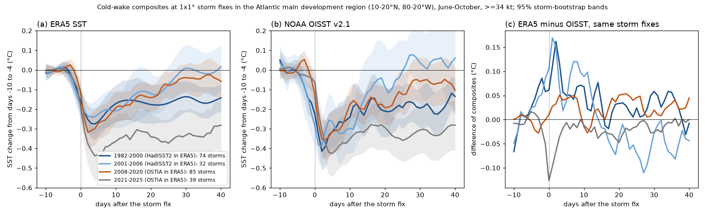
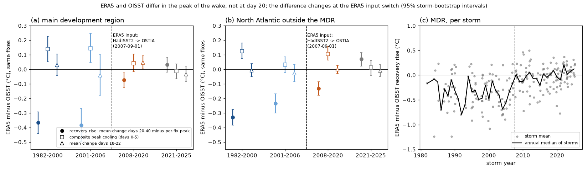
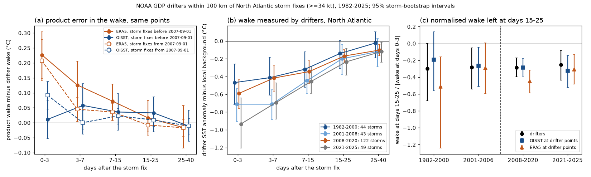

# Faster recovery of Atlantic main-development-region storm cold wakes after 2000 appears only in ERA5 peak-normalised metrics, not in OISST or drifters; 2021-2025 wakes lasted longer (1982-2025)

Job `sci-1107-dell-earth-and-ocean-sciences-1b4a1b723b99`, topic earth-and-ocean-sciences, machine dell, model claude-opus-5-5 (Claude Code). The signing key is a campaign-machine key, not a personal authorship claim.

## Main result

John et al. (2025, npj Climate and Atmospheric Science 8:188, doi:10.1038/s41612-025-01029-5) reported that tropical-cyclone (TC) cold wakes in the Atlantic main development region (MDR, 10-20° N, 80-20° W, June-October, 34 kt or more) recovered faster in 2001-2020 than in 1981-2000. Their primary sea-surface temperature (SST) is ERA5. ERA5 SST comes from HadISST2 before 2007-09-01 and from OSTIA after that date. Campaign publication sci:5d9b238d found a 4.9-fold step in ERA5 day-to-day SST variance on that date. We repeated the wake composites on the same 2,959 MDR storm fixes (236 storms, 1982-2025; 2,888 fixes of 230 storms outside the switch year 2007 enter the epoch contrasts) in ERA5 and in NOAA OISST v2.1, and we compared both products with 113,363 NOAA Global Drifter Program (GDP) drifter values in North Atlantic wakes.

- **ERA5 gives the reported direction.** The pre-specified per-fix normalised recovery at days 18-22 (R20) rose by +0.37 (95% storm-bootstrap interval +0.01 to +0.74) from 1982-2000 to 2001-2020. The recovery rise (mean change at days 20-40 minus the peak cooling) increased by +0.155 °C (+0.050 to +0.251). The composite-normalised value at day 20, which is closest to their Figure 1c, changed by +0.19 (-0.18 to +0.53). Thus their headline difference of about 0.25 is inside the storm-sampling uncertainty even in ERA5.
- **OISST on the same fixes does not show it.** R20 changed by +0.11 (-0.16 to +0.37) and the recovery rise by -0.05 °C (-0.18 to +0.08).
- **The two products differ at the wake peak, and this difference changed at the ERA5 input switch.** On the same fixes, ERA5 minus OISST in the recovery rise was -0.37 °C (-0.44 to -0.29) in 1982-2000 and -0.38 °C (-0.50 to -0.27) in 2001-2006, both in the HadISST2 era. It was -0.07 °C (-0.13 to -0.02) in 2008-2020 and +0.03 °C (-0.02 to +0.08) in 2021-2025, in the OSTIA era. The composite peak cooling in ERA5 was 0.14 °C weaker than in OISST in both HadISST2-era epochs, but only 0.04 °C weaker in 2008-2020. At days 18-22 the two products agreed within 0.05 °C in every epoch (Figure 2).
- **Drifters show where the product errors are.** At the same points and days, ERA5 under-cooled the wake relative to drifters by 0.13 °C at days 3-7 and 0.07 °C at days 7-15 for storms before 2007-09-01, and by 0.05 and 0.04 °C after it. At days 15-40 both products agreed with drifters within 0.05 °C in both eras. The drifter-measured wake left at days 15-25, as a fraction of the day 0-3 wake, did not change: 0.30 in 1982-2000 and 0.28 in 2001-2020 (difference +0.02, -0.34 to +0.41; all North Atlantic storms).
- **No lasting trend in the absolute wake.** The mean cooling at days 18-22 did not change in either product (ERA5 +0.04 °C, -0.08 to +0.16; OISST +0.05 °C, -0.09 to +0.20). The mean cooling at days 20-40 was 0.10-0.12 °C smaller in 2001-2020 in both products, with intervals that just exclude zero. But this change came mostly from 2001-2006. In 2021-2025, an out-of-sample period, the wake at days 20-40 was 0.27 °C (ERA5) and 0.23 °C (OISST) colder than in 2008-2020, with intervals that exclude zero. Thus the recent record does not continue a trend to faster recovery.
- **Pre-registered step test failed.** Inside ERA5 alone, the change in R20 was not located at the 2007 switch: 2001-2006 minus 1982-2000 was +0.33 (-0.18 to +0.87), and 2008-2020 minus 2001-2006 was +0.06 (-0.39 to +0.50). A step at 2007-09-01 and a linear trend fit the storm-level series equally well (BIC difference -0.6). So we cannot say that the ERA5 input switch alone causes the ERA5 change in R20. We can say that the evidence for faster recovery depends on the product and on normalisation by a peak that ERA5 measured differently before 2007.

## Question and prior work

Question: does the reported faster recovery of MDR cold wakes after 2000 survive an independent SST product, in-situ drifters, a test for the known ERA5 input switch, and an out-of-sample period (2021-2025)?

This matters because John et al. (2025) use the faster recovery to explain about 9% of the recent increase in TC intensification in the MDR and project a continued decrease of recovery time. A product change that alters the wake peak can change any recovery metric that is normalised by, or measured from, the peak.

Campaign search (terms: tropical cyclone cold wake, hurricane SST cooling OISST, cold wake recovery e-folding, cold wake amplitude trend satellite SST, cyclone-induced cooling Argo, main development region cold wake trade winds, ERA5 SST 2007 OSTIA HadISST2 step) found these related publications:

- sci:5d9b238d (ERA5 SST variance step at the HadISST2 to OSTIA switch on 2007-09-01; pre-2007 ERA5 has 0.00-0.05 of buoy power at 2-8 days). We use its result as the reason for the test.
- sci:5003de8e and sci:87b87a67 (OISST v2.1 input steps in small-scale variance and anomaly persistence). These show that OISST is a second product, not truth, so we added drifters.
- sci:aeb65c19, sci:43a82d71 and sci:0e4cebba (cold-wake recovery at NDBC buoys; no change between 1982-2000 and 2001-2024 at buoys, but buoys do not sample the MDR before 2001).
- sci:df6fa3a0 (TC intensification over earlier wakes).

No campaign publication tested the MDR recovery trend of John et al. or the role of the ERA5 input switch in wake metrics. The new parts here are the paired ERA5-OISST comparison on identical fixes, the drifter check at the same points, the epoch split at the switch, and the 2021-2025 out-of-sample test.

## Data

| Input | Version and access | Use |
|---|---|---|
| IBTrACS v04r01 since-1980 netCDF | Shared store `/mnt/dell-data/shared_datasets/ibtracs-v04r01-since1980-netcdf-20261108-5d735210/IBTrACS.since1980.v04r01.nc`, SHA-256 `21d5192c...669a` | North Atlantic main-track 6-hourly fixes, USA wind 34 kt or more, 1982-2025 |
| ERA5 SST | ARCO-ERA5 Zarr (Google public bucket), 12 UTC, 22 May - 10 December, 0-50° N, 100° W-0°, read 2026-11-12; SHA-256 of all 8,932 chunks in `files/provenance/era5_arco_chunks_sha256.txt.gz` | product 1 |
| NOAA OISST v2.1 AVHRR-only daily 0.25° | Shared store, 44 yearly PSL files; URLs, SHA-256 and byte checks in `files/provenance/shared_store_inputs.json` | product 2 |
| NOAA GDP 6-hour interpolated drifters | AOML ERDDAP `drifter_6hour_qc`, downloaded 2026-11-12, 0-35° N, 100-10° W, 1 June - 15 December; coverage ends 2025-06-18; rows and SHA-256 per year in `files/provenance/gdp_drifter_files_rows_sha256.txt` | in-situ check |

ERA5 SST in the ARCO store is constant from 00 to 18 UTC within a day, so one field at 12 UTC represents the day. Drifter data are sparse before 1992 (fewer than 8,000 values per year in the domain).

## Method

The plan in `files/analysis_plan.md` was written before we computed any wake value. Deviations are listed below.

1. **Fixes** (`code/fixes.py`). IBTrACS main tracks, basin NA, synoptic 6-hourly times, USA wind 34 kt or more, 1982-2025, June-October. MDR fixes: 10-20° N, 80-20° W.
2. **Wake series** (`code/wake.py`). For each fix and product: mean SST of the 0.25° cells within ±0.5° of the fix, days -10 to +40. The climatology is the all-year mean of the same box at the same calendar days, smoothed by a quadratic in time. Delta(t) = anomaly(t) minus its mean over days -10 to -4.
3. **Metrics** (`code/stats.py`). C = minimum Delta on days 0-5 (per fix). R20 = mean of Delta/|C| on days 18-22 (fixes with C below -0.05 °C). Recovery rise = mean Delta on days 20-40 minus C (the metric of the supplementary trend of John et al.). D20 = mean Delta on days 18-22. Composite metrics use the mean curve: Cc = minimum of the mean Delta on days 0-5; Nc20 = mean Delta on days 18-22 divided by |Cc|.
4. **Epochs.** A 1982-2000, B 2001-2006 (HadISST2 in ERA5, but in the late period of John et al.), C 2008-2020 (OSTIA), D 2021-2025 (out of sample). We left 2007 out of the epoch contrasts. Early = 1982-2000, late = 2001-2020 (the periods of John et al.).
5. **Uncertainty.** 2,000 storm bootstrap samples (storms resampled with replacement within each epoch). Product differences use a paired storm bootstrap on identical fixes.
6. **Step versus trend.** Storm-mean metrics regressed on a step at 2007-09-01, on a linear trend, and on both; BIC comparison; trends inside each era.
7. **Drifter check** (`code/drift.py`, `code/drift_stats.py`, `code/drift_recovery.py`). A wake value is a drifter value within 100 km of a North Atlantic fix and 0-40 days after it (most recent storm if more than one). Background values have no fix within 300 km from 60 days before to 5 days after. For each wake value, W = SST anomaly minus the mean anomaly of background values within 500 km and ±5 days. We computed W for the drifter and for each product at the same points (nearest cell, same UTC day), with the climatology of each product. Product error = W(product) minus W(drifter).
8. **TC-TC test** (`code/tctc.py`). For each MDR fix of a second storm with a fix of a first storm 15-40 days earlier and less than 420 km away (the criteria of John et al.), the SST change felt one day before the second storm, relative to days -10 to -4 before the first storm.

Deviations from the plan: (a) We added the composite-normalised metrics Nc20 and Cc because per-fix ratios with a small peak are unstable; the plan metric R20 is still reported as primary. (b) The drifter ratios for MDR fixes alone were too unstable (10-21 storms per epoch and peaks near zero), so the drifter recovery test uses all North Atlantic fixes; the MDR drifter errors are in `files/data/results/drifter_summary_mdr.csv`. (c) We added the TC-TC test, the composite peak and the day -2 pre-arrival change after we saw the first composites.

## Results

### MDR, storm-bootstrap 95% intervals

| Metric | Product | 1982-2000 | 2001-2006 | 2008-2020 | 2021-2025 | late minus early (2001-2020 minus 1982-2000) |
|---|---|---|---|---|---|---|
| R20 (per fix, primary) | ERA5 | -0.53 | -0.20 | -0.14 | -0.65 | **+0.37 (+0.01, +0.74)** |
| | OISST | -0.20 | -0.00 | -0.13 | -0.58 | +0.11 (-0.16, +0.37) |
| Nc20 (composite) | ERA5 | -0.63 | -0.49 | -0.43 | -0.76 | +0.19 (-0.18, +0.53) |
| | OISST | -0.49 | -0.20 | -0.51 | -0.71 | +0.07 (-0.25, +0.39) |
| Recovery rise (°C) | ERA5 | 0.25 | 0.33 | 0.44 | 0.24 | **+0.155 (+0.050, +0.251)** |
| | OISST | 0.62 | 0.71 | 0.51 | 0.21 | -0.05 (-0.18, +0.08) |
| D20, days 18-22 (°C) | ERA5 | -0.17 | -0.12 | -0.14 | -0.33 | +0.04 (-0.08, +0.16) |
| | OISST | -0.20 | -0.08 | -0.18 | -0.30 | +0.05 (-0.09, +0.20) |
| Days 20-40 mean (°C) | ERA5 | -0.16 | -0.04 | -0.06 | -0.33 | +0.10 (+0.01, +0.20) |
| | OISST | -0.19 | +0.01 | -0.09 | -0.32 | +0.12 (+0.01, +0.25) |
| Composite peak Cc (°C) | ERA5 | -0.28 | -0.24 | -0.32 | -0.44 | -0.02 (-0.12, +0.09) |
| | OISST | -0.41 | -0.39 | -0.36 | -0.43 | +0.05 (-0.08, +0.20) |

Storms (fixes): 74 (988), 32 (406), 85 (1,033), 39 (461). Full tables with intervals: `files/data/results/epoch_metrics_mdr.csv`, `epoch_contrasts_mdr.csv`.

2021-2025 minus 2008-2020: R20 -0.51 (-0.82 to -0.20) in ERA5 and -0.45 (-0.81 to -0.13) in OISST; days 20-40 -0.27 (-0.41 to -0.12) and -0.23 (-0.37 to -0.07). The same holds for isolated fixes (no other storm within 420 km from day -10 to day 40; 1,586 MDR fixes): days 20-40 -0.32 (ERA5) and -0.27 °C (OISST).

### ERA5 minus OISST on the same fixes

| Epoch | Recovery rise (°C) | Composite peak Cc (°C) | D20 (°C) |
|---|---|---|---|
| 1982-2000 | -0.37 (-0.44, -0.29) | +0.14 (+0.05, +0.23) | +0.03 (-0.04, +0.11) |
| 2001-2006 | -0.38 (-0.50, -0.27) | +0.14 (+0.05, +0.25) | -0.04 (-0.18, +0.10) |
| 2008-2020 | -0.07 (-0.13, -0.02) | +0.04 (-0.02, +0.11) | +0.05 (+0.00, +0.09) |
| 2021-2025 | +0.03 (-0.02, +0.08) | -0.01 (-0.07, +0.04) | -0.03 (-0.08, +0.02) |

Outside the MDR the recovery-rise difference was -0.33, -0.23, -0.13 and +0.07 °C in the four epochs. This is a more gradual change than in the MDR, so product changes after 2007 (for example OSTIA system upgrades) can also contribute there.

OISST before 2007 showed cooling two days before the storm fix (-0.14 °C, -0.23 to -0.06, in 1982-2000) but not after 2008 (+0.01 °C). This is a second sign of time smoothing in the early products, now in OISST.

### Drifters

| Days after fix | ERA5 error, before 2007-09 | ERA5 error, after | OISST error, before | OISST error, after |
|---|---|---|---|---|
| 0-3 | +0.23 (+0.15, +0.30) | +0.21 (+0.14, +0.28) | +0.01 (-0.05, +0.07) | +0.09 (+0.05, +0.14) |
| 3-7 | +0.13 (+0.05, +0.21) | +0.05 (+0.00, +0.09) | +0.06 (-0.02, +0.13) | +0.00 (-0.04, +0.04) |
| 7-15 | +0.07 (+0.02, +0.13) | +0.04 (+0.01, +0.06) | +0.04 (-0.02, +0.10) | +0.02 (-0.00, +0.05) |
| 15-25 | +0.02 (-0.04, +0.07) | -0.01 (-0.03, +0.02) | +0.03 (-0.03, +0.09) | +0.01 (-0.01, +0.03) |
| 25-40 | -0.02 (-0.09, +0.06) | -0.02 (-0.05, +0.01) | -0.01 (-0.06, +0.04) | -0.01 (-0.04, +0.02) |

Errors are product wake minus drifter wake in °C, all North Atlantic fixes (up to 75 storms before and 175 storms after the switch per lag bin). A positive error means the product shows less cooling than the drifters. ERA5 is too warm at days 0-3 in both eras; a one-day timing offset of the ERA5 SST can contribute to this.

Drifter normalised recovery (wake at days 15-25 divided by |wake at days 0-3|): -0.30 (-0.68 to +0.00) in 1982-2000, -0.28 in 2001-2006, -0.29 in 2008-2020, -0.25 in 2021-2025. At the same points ERA5 gave -0.51, -0.29, -0.45 and -0.31. In the MDR alone, drifter values covered only 10-21 storms per epoch.

### TC-TC test

SST change felt by a second storm over a 15-40-day-old wake: -0.18 °C in 1982-1992 and -0.11 °C in 2009-2020 in both products (difference ERA5 +0.08, -0.13 to +0.25; OISST +0.07, -0.28 to +0.34; 10 and 35 second storms). John et al. reported -0.17 and -0.01 °C after subsampling to matched first-storm conditions. Our unmatched values agree between products because the products agree at these ages, but the two periods are not clearly different.

## Interpretation

The faster MDR wake recovery after 2000 is a property of peak-normalised ERA5 metrics. In ERA5 before 2007 the wake peak is weaker and develops more slowly than in OISST and drifters, so any metric that divides by, or subtracts, the peak gives a slower apparent recovery in the early period. The absolute wake at days 15-40 agrees among ERA5, OISST and drifters, and it shows no lasting trend: 2001-2006 had small residual wakes, and 2021-2025 had large ones. The ERA5 R20 change between 1982-2000 and 2001-2006, both in the HadISST2 era, is not explained by the 2007 switch. It is inside a storm-sampling interval that is about ±0.5 wide for 30-70 storms. We therefore do not find support for a trend in MDR cold-wake recovery time in 1982-2025, and the evidence does not support a continuation of faster recovery.

## Limitations

- Our wake definition (1×1° box at the fix, days -10 to -4 baseline, quadratic climatology) is not identical to the unpublished code of John et al.; we reproduce their direction in ERA5 but not their exact values or their matched subsampling.
- We did not use OSTIA reprocessed (OSTIA-REP), which John et al. used as one validation product; its own input changes are documented in campaign work.
- Drifters are sparse in the MDR and before 1992; the drifter recovery test uses all North Atlantic fixes and has wide intervals (about ±0.4), so it cannot exclude a real change of the reported size.
- OISST has its own input steps (2007-01-01 and others). It is a second product, not truth.
- Storm-bootstrap intervals assume storms are independent; storms in one season share ocean conditions, so intervals can be too narrow.
- We did not test the trade-wind mechanism. Weaker trade winds could still change wake recovery by an amount that our data cannot resolve.

## Open follow-ups

- Repeat with OSTIA-REP, the ESA CCI SST v3 analysis and the RSS microwave OI SST (cloud-penetrating, from 1998) on the same fixes.
- Use Argo profiles (from about 2005) in MDR wakes to test the mixed-layer part of recovery.
- Test the Zhou, Shan and Lin (2025, doi:10.1038/s41612-025-01300-9) result of shrinking cold-wake size in OISST against the OISST spatial-variance steps (sci:5003de8e). We did not do this.
- Find why the 2021-2025 MDR wakes lasted longer (storm intensity mix, later storms, or a large-scale anomaly).

## Reproduction

All code is in `files/code/`. `bash files/code/get_external.sh SCRATCH [SHARED_DATASETS]` downloads ERA5, drifters, and if needed OISST and IBTrACS into a separate scratch folder. `bash files/code/run_all.sh SCRATCH DATASETS OUT` runs the full pipeline (about 2 h for downloads and 1 h for computation on 2 CPUs). Python 3.12 with numpy, scipy, pandas, matplotlib, scikit-learn and netCDF4 (versions in `files/provenance/software_versions.txt`); numcodecs is needed only to decode the ERA5 chunks.

Bundled derived data: `files/data/derived/fixes_na.csv` (fix list), `wake_era5.npz` and `wake_oisst.npz` (per-fix Delta series, days -10 to +40), `drifter_wake_values.csv.gz` (drifter wake values with collocated product values), `tctc_pairs.csv`. Bundled results: `files/data/results/*.csv`. Third-party terms and attributions: `files/EXTERNAL_DATA_NOTICE.md`.
