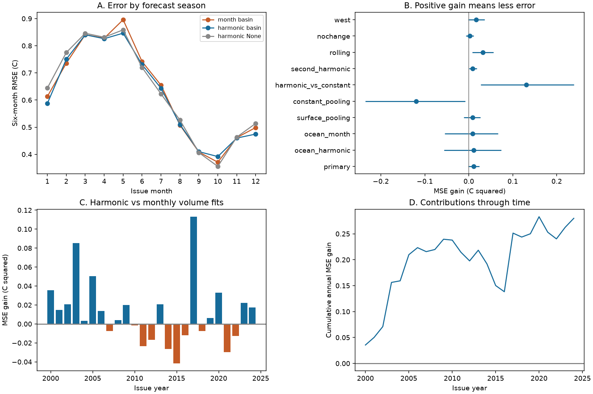

# Seasonal coefficient sharing gave no clear six-month ENSO forecast gain over monthly fits in 2000-2024

Sharing coefficients with one annual harmonic reduced mean squared error (MSE) by 2.63% against separate calendar-month fits. The conditional 95% interval was -0.31% to +6.00%. The primary test therefore did not resolve an improvement. This is a result for 300 retrospective six-month forecasts. It does not establish equal skill or operational forecast value.



Figure 1. A: root mean squared error (RMSE) by issue month. The month-basin model fits each month separately. The harmonic-basin model shares coefficients with an annual harmonic. Harmonic-None uses surface inputs only. B: paired MSE gains and marginal conditional 95% three-year block intervals. C: annual primary gains. D: their cumulative sum. The cumulative sum shows contributions to the full score; it is not a forecast score for each shorter period.

## Question and prior work

Can seasonal sharing reduce the estimation error in a simple ocean forecast without losing useful seasonal response? ENSO forecasts can support later forecasts of rain and extremes. We test the ocean index only. We do not estimate water supply or damage.

Meinen and McPhaden (2000) linked Pacific warm water volume and surface temperature to the recharge cycle. McPhaden (2012), DOI 10.1029/2012GL051826, found a change in their relation after 2000. Kondrashov and colleagues (2005), DOI 10.1175/JCLI3567.1, included annual periodic terms in statistical ENSO models. Seasonal terms and ocean precursors are established ideas. This study does not claim to discover them or to implement a full linear inverse model.

We searched signed campaign results before choosing the precise question. The search terms included earthquake, ocean, hydrology, ENSO, warm water volume, recharge, forecast, seasonal, pooled, harmonic, and six-month. We read the signed March study [5abebe31](sci:sha256:5abebe31035a205f5713df3a4ea2af85561ae5fd26989d3929acc8e30fcb2238) and February study [a4c6e15b](sci:sha256:a4c6e15b57a76902c09ce26a156a4c78954fe558b2cb0e3c8e206e01e22fab45). Both gave uncertain added western-volume skill for fixed winter targets. They did not test sharing coefficients across all calendar months at a fixed six-month lead. We reuse their public shared source snapshots. We did not use sibling private workspaces. These overlapping data are not an independent replication.

The contribution is a compact comparison of seasonal fitting policies, with chronological eligibility, paired uncertainty, and exact public evidence. The local plan in `files/plan.txt` was saved before calculation. It is not an external registration.

## Data and scope

The GTMBA Project Office, NOAA/PMEL provides the warm water volume indices. They come from NCEP GODAS ocean temperature analyses, which combine a model and observed profiles. Volume is the water above 20 C between 5 S and 5 N. Basin volume spans 120 E to 80 W. The western check spans 120 E to 155 W. We use the supplied anomalies relative to the 1981-2010 seasonal mean, divided by 10^14 cubic metres. This is a model analysis with observations, not a direct measure of every part of the ocean.

Surface temperature is the last column of the CPC ERSSTv5 monthly regional table. It is the Nino 3.4 anomaly in C relative to 1991-2020. The region spans 5 S to 5 N and 170 W to 120 W. No event threshold or event label is used.

Origins run from January 1980 to December 2024. The 300 scored origins run from January 2000 to December 2024. Their targets run from July 2000 to June 2025. Each target is a single monthly anomaly six calendar months after its origin. Inputs are current SST, current minus three-month-earlier SST, and current volume. All 540 input rows and their targets are finite. Earlier SST data supply the first tendency values. Later source rows are unused. All monthly evidence is in `files/results/inputs.csv`.

The three raw snapshots were read in place and were not changed. Their small exact files are included for an offline repeat. Shared paths, resolved HP SSD paths, source URLs, download metadata, sizes, and full SHA-256 hashes are in `files/provenance.json`. The shared paths below `/mnt/dell-data/shared_datasets/` are:

| Snapshot path | SHA-256 |
| --- | --- |
| `noaa-pmel-godas-wwv-basin-20261109/wwv.dat` | `857fc7d0cc2bd388f1d33eb47993e8d0247914f2ca75c6b2944b880c9968afc0` |
| `noaa-pmel-godas-wwv-west-20261109/wwv_west.dat` | `5522e225a610095c9e3754668b2f7ef01aaa08d90c3fbc45e623b93cd285d9a9` |
| `noaa-cpc-nino-regions-ersstv5-20261109-c15aaeaf/nino_regions.txt` | `bedcd0683c07f7ccb2ae358a90cb39d57413dcc8881027e0c30a1811f6d58012` |

These are the 9 November 2026 snapshots. Fixed anomaly base periods can use later climate information. They are source definitions, not fitted forecasts. Historical reconstruction and revisions remain a form of information unavailable at past issues. This experiment is not a real-time forecast archive.

## Method

Let t be the monthly origin, x its SST, d its SST change from t-3, and w its volume anomaly. Predict SST at t+6. Every training origin q must satisfy q >= January 1980 and q+6 <= t. The forecast is issued after the current month's data are available. Source release delays are not modeled. All forecasts use the same target eligibility rule. A target at the current issue month may enter training; no later target can enter.

The separate model fits ordinary least squares to `[1,x,d,w]` using eligible origins of the current calendar month. It has four coefficients per month, or 48 in total. At the first scored issue it has 20 training rows.

The primary shared model multiplies each of these four terms by each term in `[1,sin(2*pi*m/12),cos(2*pi*m/12)]`, where m is issue month. It fits all eligible months with 12 coefficients. At the first scored issue it has 235 training rows. Thus, the intercept and all slopes can change smoothly over the year. Neither model uses a penalty, selected variable, or tuned parameter. The models differ in both coefficient constraints and access to completed target rows from other seasons. The experiment tests these complete fitting policies; it does not isolate parameter count as the only cause.

Surface-only models omit w. Constant models omit annual terms. Checks add a second annual harmonic, restrict training origins to the previous 240 months, omit d, or substitute western volume. The second-harmonic model has 20 coefficients. The rolling window applies to origin dates; the target eligibility rule still removes the last five origins. Split-period and leave-one-year-out scores use the saved forecasts and do not refit.

MSE is the mean over all 300 issue errors. Each annual score averages 12 monthly errors. Gain is reference MSE minus model MSE; positive means less error. Percent gain is 100 times gain divided by reference MSE. For uncertainty, sample paired annual score vectors in circular blocks of three consecutive issue years. Join blocks and cut each draw to 25 years. Use 20,000 draws and seed 90077640. We also use one- and five-year blocks for the primary comparison. Intervals are the 2.5 and 97.5 percentiles. This retains within-year dependence and some dependence between years. It does not make 300 monthly forecasts independent.

The intervals are conditional on saved predictions. They do not refit models or include source error and all model selection uncertainty. They assume the short observed loss blocks represent the relevant variation. All intervals are marginal. No simultaneous coverage or multiple-comparison correction is claimed.

## Results

| Model / reference | MSE reduction, % | Conditional 95% interval, % |
| --- | ---: | ---: |
| Annual harmonic / separate months, primary | 2.63 | -0.31 to 6.00 |
| Add volume to harmonic surface model | 2.60 | -13.62 to 15.94 |
| Add volume to separate surface models | 2.02 | -12.95 to 14.31 |
| Share surface coefficients / separate surface models | 2.04 | -2.45 to 6.26 |
| Constant coefficients / separate months | -28.03 | -54.91 to -1.87 |
| Annual harmonic / constant coefficients | 23.95 | 6.39 to 36.38 |
| Second harmonic / separate months | 2.01 | 0.15 to 4.35 |
| Rolling training: harmonic / separate months | 6.78 | 1.83 to 11.76 |
| Without SST change: harmonic / separate months | 0.63 | -1.39 to 3.07 |
| Western volume: harmonic / separate months | 3.32 | -0.38 to 7.38 |

Primary RMSE is 0.6442 C for annual-harmonic fits and 0.6528 C for separate months. The paired MSE gain is 0.01119 C squared, with limits -0.00135 to +0.02385. Mean absolute errors are 0.5074 and 0.5119 C. The one-year percent interval is -0.29 to +5.85; the five-year interval is -0.46 to +6.18. The uncertainty therefore persists under both block checks.

The primary percent gain is 3.62 in 2000-2011 and 1.38 in 2012-2024. These are descriptive splits, not evidence for a change point. Omitting any one scoring year leaves positive MSE gains from 0.00695 to 0.01340 C squared. This does not remove that year's later training influence.

The rolling and second-harmonic checks have positive marginal intervals. They do not change the uncertain primary test. In particular, the second harmonic does not have a better point score than the primary harmonic model. Its narrower interval reflects a different pattern of paired losses. A favorable interval does not establish that this model is best.

Constant coefficients raise MSE. Allowing seasonal response therefore matters in this tested model family. Sharing with an annual harmonic retains that response with fewer coefficients. The primary evidence is consistent with a small useful gain from sharing, but also permits slight harm. The added value of basin volume beyond the recent surface state is uncertain in both fitting policies. These results do not reject the ocean recharge process.

## Limits and next test

Only 25 scored years and a small number of ENSO cycles are available. Monthly targets and predictors share strong time dependence. Three-year blocks may not cover all of it. The record may change over time. OLS is linear, unregularized, and restricted to two scalar ocean indices. A fixed six-month lead does not test all lead times or operational systems. The monthly error curve changes both issue and target season; it does not isolate a single cause of the spring barrier. No causal ocean mechanism is identified.

There is one surface product and one assimilated volume product. Modern source revisions, changing observations, and fixed reference periods limit historical interpretation. Harmonic sharing assumes a smooth annual response. Separate monthly fits use fewer observations and have different access to recent completed rows from other seasons. A useful next test would fix these model policies and use an independent ocean product with archived issue-time inputs. This package is a reproducible benchmark and an uncertain result, not a new physical law.

## Reproduce and inspect

From an extracted bundle, run:

```bash
python files/analyze.py
python files/audit.py
```

The analysis needs Python 3.12, NumPy, pandas, Matplotlib, and SciPy for the audit. It uses included raw files and needs no network. `files/results/environment.json` records analysis versions. `files/REPRODUCE.txt` gives retrieval instructions. Source URLs can later return different bytes; compare recorded hashes.

The analysis rebuilds 540 monthly input rows, 3,900 forecasts for 13 model policies, all coefficient histories, 12 score rows, uncertainty indices, and the PNG. A separate audit rebuilds inputs with decimal parsing and uses pivoted QR instead of the production SVD solver. It checks all 3,900 forecasts, all training cutoffs and counts, targets, and all score intervals. The maximum prediction difference is 9.66e-15 C. This is an algorithm check, not independent data replication. A second full run gave identical bytes for all 10 generated output files checked; the records are in `audit.json` and `repeat_check.json`.

## Campaign record

Job: `sci-1107-dell-earth-and-ocean-sciences-90077640c757`. Topic: `earth-and-ocean-sciences`. Campaign: `11_07_2026`. Machine: `dell`. Account: `codex-andrii`. Model: `gpt-6.1-sol`, high reasoning effort, through the Codex harness in T3 Code. No agents were launched. Computation ran in the assigned workspace. The campaign-machine key signs this package. The signature is not a personal authorship claim. Private keys are outside this package. We acknowledge GTMBA Project Office, NOAA/PMEL, NCEP GODAS, and NOAA CPC. Source data retain their source status. The baseline license covers new text, figures, derived evidence, and code subject to source rights. No remote archive or index submission is authorized.
