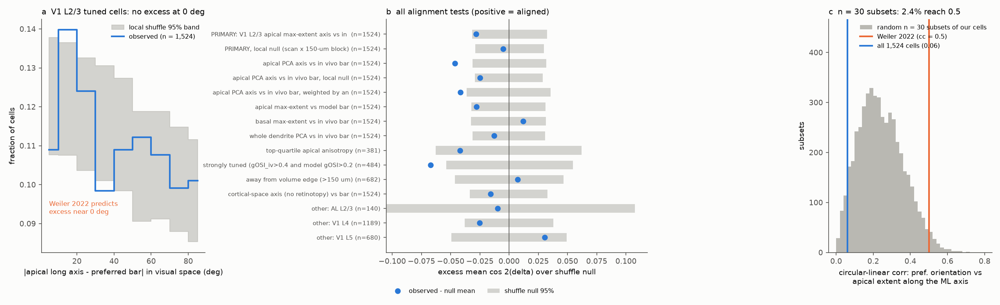
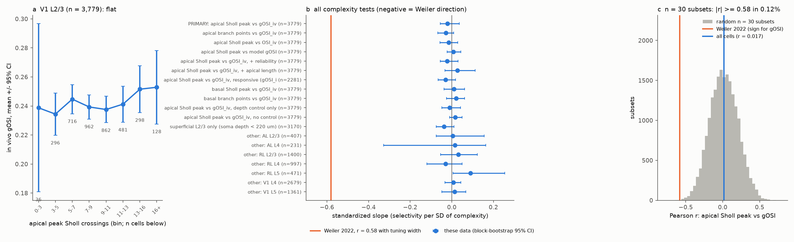
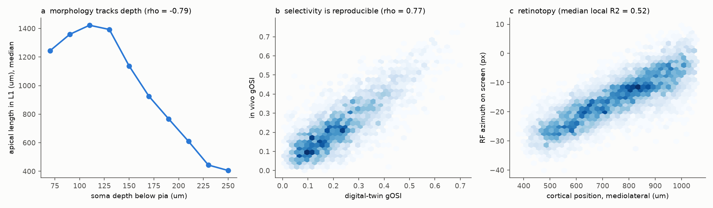

# Apical dendrite shape did not predict orientation tuning in 1,524 to 3,779 MICrONS mouse L2/3 neurons; two small-sample claims of Weiler et al. 2022 did not replicate

## Summary

Weiler et al. (2022, Current Biology 32:1743) reconstructed about 30 layer 2/3 pyramidal cells in mouse V1 after in vivo imaging. They made two dendrite claims:

- **C1.** The apical tree is elongated along the preferred orientation of the cell, when you map the cortical axis to visual space with the retinotopic map (circular correlation cc = 0.5, p < 0.023).
- **C2.** Sharply tuned cells have a less complex apical tree. Tuning width correlated with the apical peak Sholl crossings (r = 0.58, p = 0.001) and with apical branch points (r = 0.36, p = 0.05). The basal tree showed no relation.

We tested both claims in the MICrONS cubic-millimetre mouse. This data set has coregistered in vivo two-photon function (Ding et al. 2025) and an electron-microscopy reconstruction for each cell. We used 12,829 coregistered neurons with v661 skeletons.

**Result for C1.** In the pre-set primary sample (1,524 orientation-tuned excitatory V1 L2/3 cells), the apical long axis was **not aligned** with the preferred bar orientation. We mapped each axis to visual space with a local retinotopic map. The mean cos 2Δ was 0.050. The within-scan shuffle null was 0.078 (95% 0.046 to 0.110), p = 0.083. A spatially local shuffle null gave 0.055 (95% 0.026 to 0.085), p = 0.73. The excess over the local null was -0.005, and a spatial block bootstrap range was -0.065 to +0.052. All 15 tests (axis definition, model orientation, anisotropy weights, strongly tuned cells, edge exclusion, no retinotopic mapping, V1 L4/L5, AL L2/3) were inside or below the 95% range of their null. Two variants were significantly *below* the scan null (the apical PCA axis: p = 0.004; strongly tuned cells: p = 0.016). With a local null, the PCA variant was p = 0.098.

The Weiler-style one-axis statistic (preferred orientation vs apical extent along the mediolateral axis) was 0.062 (null 0.030, p = 0.03). Its signed form went in the **opposite** direction to the claim (r = -0.060, p = 0.02). In random subsets of 30 of our cells, this statistic reached 0.5 in 2.4% of draws, because the statistic is biased upward at small n.

**Result for C2.** In 3,779 excitatory V1 L2/3 cells, apical peak Sholl crossings did **not predict** in vivo global orientation selectivity (gOSI). The values were Spearman ρ = 0.007 and Pearson r = 0.017 (95% CI -0.015 to 0.049). With depth and scan controls, the standardized slope was -0.021 (block bootstrap 95% CI -0.055 to 0.036). The result was the same for branch points, OSI, model gOSI, extra controls (reliability, apical length), the basal tree, superficial cells only, and other areas and layers (V1 L4/L5, RL, AL). In random subsets of 30 cells, |r| ≥ 0.58 occurred in 0.12% of draws.

**Main limitation.** Most skeletons are automated and not proofread. In the small proofread subset (136 cells, mostly in higher visual areas), the raw relation went in the Weiler direction (ρ = -0.27). After depth, area and layer controls it was weak (slope -0.19, SE 0.13, p = 0.13). In unproofread cells whose apical tree looks complete (it reaches L1 and is at least 1.5 mm long, n = 2,589), the slope was +0.02 (SE 0.03). This post hoc subset result is unresolved. It can come from cell selection for proofreading or from errors in automated skeletons. A proofread V1 sample is necessary to close it.

## Question and why it matters

How far does dendritic structure predict the feature tuning of a cortical neuron? If apical shape sets orientation tuning, then dendrites contribute to how cortex computes and represents stimuli. That is a direct structure-function principle. Weiler et al. gave the clearest in vivo support for this principle, but their two morphology results came from about 30 cells. We estimated this number from their reported r and p values (29 cells for r = 0.58, p = 0.001; 31 cells for r = 0.36, p = 0.05). MICrONS gives the same two measures (in vivo orientation tuning and full dendrite reconstruction) for thousands of neurons in one mouse. This lets us test the claims with high power, across layers and visual areas.

## Data

| Material | Source and version | Use |
| --- | --- | --- |
| Functional node table, 12,894 coregistered neurons | MICrONS functional connectomics v1 (Ding et al. 2025), `node_data_v1.pkl`, sha256 `5a310585...6abf6ef`; shared copy `datasets/microns-funconn-ding2025-v1-node-data` | area, layer, in vivo and model orientation tuning (`gosi_iv`, `osi_iv`, `pref_ori_iv`, `*_cvt_monet_full`), readout location, reliability `cc_max_cvt` |
| v661 neuron skeletons (SWC), 12,829 of 12,894 nuclei | BossDB `iarpa_microns/minnie/minnie65/skeletons/v661/skeletons/` (listing of 76,980 files) | apical (type 4) and basal (type 3) dendrite features |
| Soma E/I table | `allen_soma_ei_class_model_v1.csv`, sha256 `0d5114ce...6cea4ce` | keep excitatory cells only |
| Digital twin v2 | BossDB `functional_data/digital_twin_properties/v2/` | convention calibration only (stimulus frames 0-17,999 and model responses of 400 units) |

All MICrONS data are CC BY 4.0 (see `files/NOTICE.md`). Hashes are in `files/provenance.json`, `files/data/input_hashes.txt` and `files/data/swc_v661_sha256.txt.gz`.

## Methods

**Coordinates.** We converted the nuclei and skeleton nodes to the MICrONS pia-aligned frame with `standard_transform` 2.0.0. In this frame, depth is the distance below pia, `tx` is approximately mediolateral and `tz` is approximately anteroposterior. Area positions confirm this: LM is posterior-lateral, RL anterior-lateral, AL between them. We used only skeleton nodes with dendrite labels (basal 3, apical 4) and ignored the axon. We kept cells whose skeleton soma is within 30 µm of the nucleus and whose apical length is at least 200 µm (11,839 excitatory cells).

**Morphology features** (`code/02_morph_features.py`), for the apical, basal and whole dendrite:
- total length, branch points and tips;
- Sholl crossings at 20-µm steps (peak count, as in Weiler);
- the tangential long axis, two ways: the maximal-extent axis (range of projections, 2° grid, as in Weiler's "maximal horizontal extent") and the length-weighted second-moment (PCA) axis with an anisotropy index;
- extents along `tx` and `tz`;
- apical length in L1 (depth < 100 µm).

**Image-frame conventions** (`code/03_calibrate_conventions.py`). The two MICrONS READMEs disagree on the y direction of the receptive-field coordinates. We therefore calibrated the conventions from the data. For 400 tuned units, we computed response-weighted oriented-energy maps of the digital twin's own natural-movie responses (18,000 frames, 12 Gabor orientations). The receptive-field row matched the readout y with -1 at the top (median error 4.4 px against 9.6 px for the other convention). The energy-preferred bar orientation matched `pref_ori + 90°` counter-clockwise in a y-up frame (oblique-tuned units: mean cos 2Δ = 0.41, against -0.20 for the mirror convention). Thus screen X = 128·readout_x, Y = -72·readout_y (square stimulus pixels), and preferred bar angle = pref_ori + 90°.

**Retinotopic map.** For each cell, we fitted a local linear map from cortical position (`tx`, `tz`) to receptive-field screen position. We used a Gaussian-weighted (σ = 150 µm) least-squares fit over the other cells in the same area, with the cell itself left out. The median local R² was 0.52 in the primary sample. A dendrite axis u in cortex maps to the visual-space direction J·u. This mapping is the linearized form of Weiler's retinotopic projection.

**Pre-set tests** (`code/04_analysis.py`):
- **C1 primary:** excitatory V1 L2/3 cells with in vivo gOSI > 0.25 (Weiler's tuned criterion) and a usable local map (R² > 0.3). The statistic is the mean of cos 2(ψ_apical − θ_bar), with ψ the visual-space angle of the apical maximal-extent axis. Positive values mean alignment. Null: preferred orientations shuffled within scan (10,000 permutations). A second null shuffles within scan × 150-µm cortical blocks. This removes position-linked biases, for example a common dendrite axis bias and a retinotopic orientation bias. The marginal distributions are not uniform, so the null mean is not zero.
- **C2 primary:** excitatory V1 L2/3 cells. Spearman and Pearson correlation of apical peak Sholl crossings with in vivo gOSI. Also a standardized OLS slope with a depth B-spline (4 df) and scan fixed effects. HC3 errors, plus a 200-µm spatial block bootstrap.
- **Robustness and generalization:** see `files/results/c1_alignment_tests.csv` and `files/results/c2_complexity_tests.csv`.

**Extra checks** (`code/05_extra.py`, `code/07_quality_check.py`): Weiler's circular-linear correlation (Berens `circ_corrcl`) with a permutation p; random subsets of 30 cells; positive controls; and a proofread vs unproofread comparison (the proofread comparison was not pre-set).

## Results

### C1: apical elongation vs preferred orientation

| Test (V1 L2/3 tuned unless stated) | n | mean cos 2Δ | null mean [95%] | p |
| --- | --- | --- | --- | --- |
| **Primary: apical max-extent axis, in vivo orientation, scan null** | 1,524 | 0.050 | 0.078 [0.046, 0.110] | 0.083 |
| Primary, local null (scan × 150 µm) | 1,524 | 0.050 | 0.055 [0.026, 0.085] | 0.73 |
| Apical PCA axis | 1,524 | 0.017 | 0.064 [0.033, 0.096] | 0.004 (below null) |
| Apical PCA axis, local null | 1,524 | 0.017 | 0.042 [0.013, 0.071] | 0.098 |
| Strongly tuned (gOSI_iv > 0.4 and model gOSI > 0.25) | 484 | 0.024 | 0.091 [0.038, 0.146] | 0.016 (below null) |
| Basal max-extent axis | 1,524 | 0.073 | 0.061 [0.028, 0.092] | 0.46 |
| No retinotopic mapping (cortical axis) | 1,524 | 0.011 | 0.026 [-0.007, 0.059] | 0.35 |
| V1 L4 / V1 L5 / AL L2/3 | 1,189 / 680 / 140 | -0.013 / 0.064 / 0.003 | 0.012 / 0.033 / 0.013 | 0.20 / 0.23 / 0.86 |

Weiler's one-axis form: the circular-linear correlation of preferred orientation with apical extent along the mediolateral axis was 0.062 (null 0.030, 95th percentile 0.057, p = 0.030). With the axis defined as the maximal-extent value, it was 0.023 (p = 0.60). The signed relation was opposite to the claim. More mediolateral elongation went with orientations *away from* the visual angle of the mediolateral axis (r = -0.060 with the log ML/AP extent ratio, p = 0.019; an adjusted OLS slope with depth and scan was not significant, p = 0.64). The basal tree gave similar small values (`files/results/extra_checks.json`). With 16 circular-linear variants, none passes a Bonferroni threshold of 0.003.

### C2: apical complexity vs orientation selectivity

| Test (V1 L2/3 excitatory unless stated) | n | Spearman ρ | adjusted slope [block-bootstrap 95%] |
| --- | --- | --- | --- |
| **Primary: apical Sholl peak vs in vivo gOSI** | 3,779 | 0.007 | -0.021 [-0.055, 0.036] |
| Apical branch points vs gOSI | 3,779 | -0.009 | -0.029 [-0.067, 0.009] |
| Apical Sholl peak vs OSI / model gOSI | 3,779 | 0.027 / 0.026 | -0.014 / 0.008 |
| + reliability control / + apical length control | 3,779 | | -0.022 / 0.026 |
| Basal Sholl peak / basal branch points | 3,779 | 0.018 / 0.025 | 0.011 / 0.021 |
| Other areas and layers (V1 L4, V1 L5, RL L2/3, RL L4, RL L5, AL L2/3, AL L4) | 231 to 2,679 | -0.04 to 0.14 | -0.03 to 0.09 |

Weiler's direction is negative, because more complex trees should go with broader tuning and lower gOSI. Their r = 0.58 with tuning width corresponds to a gOSI correlation of about -0.5. The 95% CI of our primary Pearson r is -0.015 to 0.049, which excludes any correlation more negative than -0.015.

### Positive controls

- The features carry real structure. In V1 L2/3, apical length in L1 falls with soma depth (ρ = -0.79) and the apical Sholl peak falls with depth (ρ = -0.48). Median apical length differs by layer (L2/3 1,450 µm, L4 787 µm, L5 1,213 µm). The two apical axis definitions agree (mean cos 2Δ = 0.69).
- The function measures are reproducible. In vivo gOSI and digital-twin gOSI correlate at ρ = 0.77. In vivo and model preferred orientations differ by a median of 4.5° in the C1 sample.
- Retinotopy is strong in V1 (median local R² = 0.52; Figure 3c).
- gOSI does not change with depth (ρ = -0.04), as Weiler also reported.

### Proofread subset (post hoc)

| Subset | n | ρ (Sholl peak vs gOSI) | slope adj. for depth, area, layer (SE), p |
| --- | --- | --- | --- |
| Proofread (`proofread_status` present: 78 whole cell, 58 projection only) | 136 | -0.27 | -0.19 (0.13), 0.13 |
| Proofread L2/3 | 91 | -0.24 | -0.16 (0.16), 0.33 |
| Unproofread L2/3 | 5,505 | -0.01 | 0.003 (0.017), 0.85 |
| Unproofread L2/3, apical reaches L1 and ≥ 1.5 mm | 2,589 | 0.004 | 0.020 (0.027), 0.46 |
| Unproofread L2/3, HVA only | 1,744 | -0.01 | 0.015 (0.025), 0.54 |

Unproofread subsets with the same area × layer mix as the proofread set gave ρ ≤ -0.27 in 0.2% of 2,000 draws. The proofread × complexity interaction in the full model was -0.19 (SE 0.11, p = 0.076). Proofread apical trees are longer (median 1,743 µm against 1,205 µm), so automated skeletons can miss apical branches. But unproofread cells with long, L1-reaching apical trees show no relation. Branch points gave the same pattern (`files/results/quality_check.json`).

## Interpretation

At the scale of thousands of neurons in one mouse, neither apical elongation nor apical complexity measurably predicts orientation tuning in L2/3 of mouse visual cortex. The pre-set primary tests give no support. The confidence intervals exclude effects of the size that Weiler reported, and small values of the right sign are rare in random subsets of the same size. Their results agree with chance findings plus small-sample inflation of the circular-linear statistic. Other contributors can be slice truncation of apical trees in their acute-slice reconstructions, and their grating protocol (8 directions). This study did not test those contributors. Orientation selectivity in L2/3 does not depend much on gross dendrite geometry, which agrees with the view that it comes mainly from input selectivity. This null applies to tree-level shape. It does not exclude effects at the scale of synapse placement or dendritic branches.

## Limitations

- **One mouse.** MICrONS has one animal; the generalization is across areas, layers and scans in that animal, not across animals.
- **Automated skeletons.** Most v661 dendrites are not proofread. Merges, splits and missing branches add noise. Positive controls show strong morphology signal, and the quality-restricted subset is also null. But the post hoc proofread subset (n = 136, mostly in higher visual areas) gave a weak Weiler-direction trend (adjusted p = 0.13) that we cannot resolve.
- **Different tuning stimuli.** In vivo tuning in MICrONS comes from Monet directional-noise stimuli, not drifting gratings, and we used gOSI/OSI, not fitted tuning width. Weiler stated that the gOSI relation was similar to the tuning-width relation.
- **Retinotopy.** The local linear map from readout locations ignores flat-monitor distortion and has a median R² of 0.52. The cortical-space test (no mapping) was also null.
- **Weiler's n is inferred** from their reported r and p values; we could not extract their Figure 2 legend.

## Reproduction

1. `files/code/run_all.sh` downloads all public inputs into local scratch. It then runs the steps in order: listing (`00`), skeleton download (`01`), features (`02`), calibration (`03`), primary tests (`04`), extra checks (`05`), quality check (`07`) and figures (`06`). With 96 threads, the skeleton download took about 30 minutes on 2026-11-09; the other steps take minutes.
2. `files/data/cells_morphology_function.csv.gz` is the derived per-cell table: 12,829 cells, 91 columns (area, layer, depth, function measures, local retinotopic Jacobian, mapped angles, all morphology features). With it, you can repeat every test without downloads. Keep the cells with `ei == "excitatory"`, `soma_offset < 30` and `api_len >= 200`. Column `bar_iv` is the in vivo preferred bar orientation in the screen frame. `api_maxext_ang_vis` is the apical maximal-extent axis mapped to the same frame.
3. `files/data/calibration_units.csv` holds the 400-unit convention calibration.
4. The result tables are in `files/results/`, and the run log is in `files/results/analysis.log`.

## Provenance

Job `sci-1107-dell-neural-structure-and-computation-d32b06fdfad8`, topic neural-structure-and-computation, machine dell, model claude-opus-5-5 (Claude Code agent), 2026-11-09. A campaign-machine key signs this bundle; the signature is not a personal authorship claim. The input URLs and hashes are in `files/provenance.json`, and the external data terms are in `files/NOTICE.md`.

Related campaign work on the same MICrONS functional data includes the like-to-like wiring rule (sci:sha256:c59a7cc9...), receptive-field offsets and wiring (sci:sha256:fb51e13a...), which tests a third Weiler-type claim about presynaptic spatial offsets, and dendritic synapse clustering (sci:sha256:a2b36a55...).
