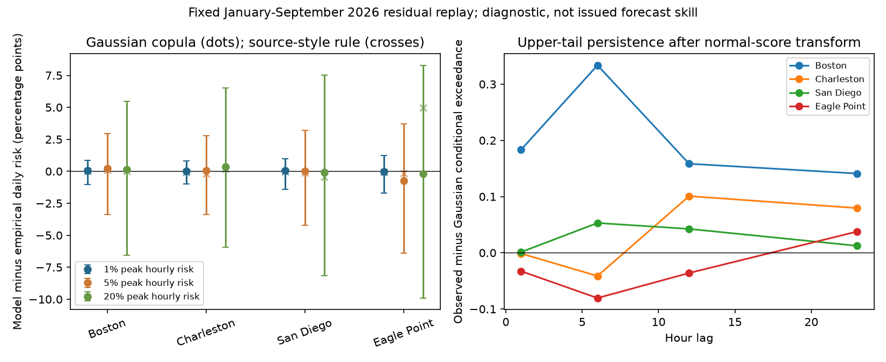

# Four 2026 gauge replays did not resolve a daily-risk error from a fitted Gaussian serial copula

A fitted Gaussian serial copula gave mean daily exceedance risks from 9.3% below to 4.3% above empirical replay risks in 12 station-and-risk-level comparisons. The comparisons used normal-score residuals at four US tide gauges in January to September 2026. All conditional 95% block intervals included zero difference. The test does not establish a systematic copula error, or its absence.

This result limits a direct use of large theoretical dependence examples as estimates of ocean forecast error. It does not refute the earlier proof that hourly distributions and correlations do not identify daily risk. It also does not explain the deficit in issued low flood probabilities. The real hourly marginal tails, forecast mean errors and daily aggregation rule remain separate questions.



## Question and contribution

The selected hazard studies include errors in public forecasts and errors caused by how forecasts are checked. A recent extension found useful updates to the NOAA monthly flood outlook but too few expected floods in its low daily probability tail. A later code audit found a structural error in a public daily aggregation rule, with errors in both directions. A further mathematical study gave processes with the same normal hourly laws and correlations but very different daily risks. It did not fit ocean data.

We test the empirical part that remains open: after making the hourly marginal distributions equal, does a Gaussian model of serial dependence give a large error in daily union risk on selected ocean records? We add a finite-window test, exact marginal matching, a monthly-mean sensitivity and serial tail diagnostics. We do not propose another correction to issued forecasts. Normal-score transforms, copulas, block resampling and ensemble aggregation are established methods.

Dusek et al. (2022), [doi:10.3389/fmars.2022.1073792](https://doi.org/10.3389/fmars.2022.1073792), describe the outlook method. Hovenga et al. (2025), [doi:10.3389/fmars.2025.1618367](https://doi.org/10.3389/fmars.2025.1618367), document skewed hourly residual laws. Temporal copula methods also have prior coastal applications, for example [doi:10.1029/2022EF002705](https://doi.org/10.1029/2022EF002705). Our test concerns serial dependence after marginal normalization, not the discovery of skew or copulas. NOAA PSL already describes a new experimental outlook with skewed hourly realizations and a new monthly-anomaly forecast. We do not test that product. files/context.md gives the source trail and search scope.

## Data and design

We reuse eight exact NOAA CO-OPS source files from the code-audit publication. They contain hourly local civil water levels for January-October 2026 and hourly tide predictions for January-September 2026 at Boston (8443970), Charleston (8665530), San Diego (9410170) and Eagle Point (8771013). These are the four example gauges in Dusek et al.; they were not selected from the present results. Files were retrieved on 11 November 2026 and are fixed by SHA-256. No new raw download was needed.

We use January-September, 6,552 clock hours per gauge. Values are in feet relative to MHHW. We remove inferred water levels and subtract the predicted tide. The spring clock gap in tide predictions is interpolated. Residual gaps need 24, 23, 28 and 14 imputed hours at the four sites. The primary residual is linearly detrended. A sensitivity removes each monthly residual mean instead. These procedures and the source data are retrospective.

Each residual series is ranked and mapped to 6,552 normal quantiles. The primary series have no exact ties. The monthly version has 537-1,307 tied values; ordinal ranks break ties by time order. This arbitrary ordering is a limit of that sensitivity.

The empirical law selects a start hour uniformly and takes its next 24 normal scores, with circular wrap. Every hour has exactly the same discrete marginal law. The comparison fits a Gaussian copula to lag 0-23 correlations of that score series. It then maps Gaussian draws to the same finite score grid. Thus the two theoretical models have exactly equal one-hour laws. The Gaussian model's latent correlations equal the fitted score correlations; discretization means their Pearson correlations need not be exactly equal. This is a fitted-model test, not a new exact equal-covariance counterexample. The largest sampled matrix discrepancy was less than 0.00010, including numerical integration variation.

Nine tide shapes per gauge are fixed as the 24 local hours on the 15th of January through September. For each shape, tide deficits below its peak are divided by the residual standard deviation. We place a score threshold above the peak at nominal hourly risks of 1%, 5% and 20%. The exact finite-grid peak risks differ by at most one grid mass from these labels. This gives 108 primary conditions and 108 monthly-mean sensitivities.

These are controlled score-space experiments. A normal-score transform is nonlinear. They are not actual water-level flood thresholds, observed flood-day counts or issued NOAA forecasts. Each shape is combined with all residual windows, which removes the calendar match between tide and weather. files/methods.md gives the equations and assumptions. files/plan.md was written before the new numerical results; it was not a public preregistration.

## Results

The table averages risk across the nine tide shapes within each cell. The ratios compare the same selected conditions; they are not operational calibration ratios.

| Gauge | Gaussian / empirical, 1% peak | Gaussian / empirical, 5% peak | Gaussian / empirical, 20% peak |
|---|---:|---:|---:|
| Boston | 1.039 | 1.043 | 1.006 |
| Charleston | 1.019 | 1.009 | 1.017 |
| San Diego | 1.040 | 1.005 | 0.996 |
| Eagle Point | 0.991 | 0.907 | 0.993 |

At the 5% peak level, mean empirical daily risk was 5.121%, 5.515%, 5.247% and 8.045% in this station order. The fitted Gaussian copula gave 5.341%, 5.564%, 5.274% and 7.300%. Eagle Point therefore had the largest station-average relative gap, -9.3%. Its absolute gap was -0.745 percentage point. The conditional 7-day block interval was -6.400 to +3.712 points, much larger than the point gap. This is not evidence of equivalence or of a stable deficit.

All 12 primary station-and-level intervals included zero with 3-, 7- and 14-day blocks. All 12 monthly-mean station-and-level intervals also included zero. These intervals keep the fitted Gaussian model, ranks, tide scale and templates fixed. They omit their estimation uncertainty. They therefore cannot support a full fitted-model hypothesis test. Rare-event resamples sometimes had no exceedance; we report probability-gap intervals instead of unstable ratio intervals.

Across the 108 primary conditions, Gaussian-to-empirical ratios ranged from 0.870 to 1.165. The mean absolute probability difference was 0.178 percentage point. These condition-level extrema are exploratory, not 108 independent replications. Removing monthly means changed the largest Eagle Point 5% average gap from -9.3% to -1.9%. The monthly Eagle Point 20% ratio became 1.042. This sensitivity limits a physical explanation based on one pooled stationary copula.

For comparison, we also plug the exact finite marginal probabilities and score correlations into the public source-style correlation-weighted product rule. At Eagle Point and the 20% peak level, it gives 31.581% mean daily risk against 26.620% in the empirical law, while direct Gaussian-copula integration gives 26.442%. After monthly mean removal those values are 34.453%, 26.794% and 27.922%. This separates two errors *within these finite diagnostic models*: an aggregation approximation can differ more than direct use of a Gaussian copula. It does not quantify either error in production. The rule inputs here are rank scores, not the operational fitted residuals.

## A daily-risk match can hide a serial-tail difference

In the finite Boston score series, 328 hours are in the upper 5% tail. Of these, 218 also have a tail exceedance six hours later. The conditional fraction is 66.5%, against 33.1% for the fitted Gaussian pair. The lower-tail fraction is 42.1%. These counts overlap and are not independent trials. They are descriptive evidence of a serial-tail shape that the symmetric Gaussian model does not reproduce.

Yet Boston daily-risk ratios are close to one. In every selected Boston template at the 5% peak level, the threshold six clock hours after the tide peak is above the entire finite score grid. That hour has zero marginal exceedance risk in both finite laws. Thus a large pairwise dependence difference at equal hourly thresholds need not cause a large daily difference under an actual tide shape. This is an exact statement about these finite models, not proof that six-hour residual events are harmless in the ocean. The six-hour comparison was inspected after the primary results and is exploratory. files/interpretation.json records it and interpret.py regenerates it. Daily agreement alone therefore does not validate the joint residual model.

## Checks and uncertainty

The Gaussian integration uses eight independently scrambled Sobol sets of 131,072 paths each. A repeat with four sets of 32,768 paths changed any condition by at most 0.126 percentage point. The largest replicate standard error in the larger run was 0.026 point. Integration uncertainty is small compared with the block intervals. The coarse and fine values are in files/convergence.csv; these checks are not rigorous error bounds.

An independent scalar implementation checks every empirical union count and checks that all 24 marginal grids are exactly equal. The tail diagnostic compares conditional upper exceedance probabilities at lags 1, 6, 12 and 23 with a Gaussian pair at the same fitted latent correlation and exact finite-grid marginal risk. It also records lower-tail persistence. These descriptive diagnostics can show where a symmetric Gaussian dependence model differs. They do not provide an independent test sample.

A clean-window sensitivity excludes artificial wrap windows and any window with an imputed observation. The largest condition-level change in empirical risk was 1.142 percentage points across both preprocessing choices. This changes the selected marginal law and is a coverage check, not a second exactly matched-margin model comparison. All clean results are retained in files/cases.csv.

## Meaning and limits

The general dependence problem is real in mathematics, but these selected tide-shaped empirical replays do not show a large, stable daily-risk error from the fitted Gaussian copula. Small differences also have a simple possible reason: a tide can put most daily risk near one peak hour, leaving little scope for dependence across other hours to change the union. We do not establish that explanation as a causal result.

The observation period is short. High residual ranks occur in clusters, and 6,552 overlapping starts are not 6,552 independent days. A few episodes can control the rare tail. The conditional intervals show that the finite point estimates do not imply precise knowledge of future ocean risk. Four gauges and nine selected tide shapes do not represent all US coasts or seasons. Residual ranks, correlations and tide scales are estimated in the same period. Non-stationary weather, monthly mean changes, tide-residual dependence, interpolation, local clock treatment and revised source values can matter.

The test removes actual marginal skew by design. It therefore cannot rule out marginal tails as a source of issued forecast error. It also does not test monthly mean forecasts, exact production code, actual thresholds or the new NOAA PSL outlook. The largest theoretical counterexamples remain valid, and the finite empirical null remains informative: one should not apply their numerical gaps to observed ocean conditions without further evidence. A longer separate-year test with archived production hourly states would be needed for attribution or forecast validation.

## Reproduce

The bundle contains code, aggregate experiment results, one static figure, source hashes and methods. Raw NOAA records, residual series, rank-score windows and tide vectors stay outside the publication. files/NOTICE.md gives attribution and external-data terms. The exact source paths, queries, snapshot versions, sizes and hashes are in files/source_provenance.json, under `/mnt/dell-data/shared_datasets`, exposed here by `./datasets`. These compatibility paths refer to the HP SSD store.

Use Python 3.12 and files/requirements.txt. From an extracted publication, run:

```bash
# On this host reuse the recorded shared files in place.
bash files/reproduce.sh /mnt/dell-data/shared_datasets /absolute/path/to/scratch
```

On another host first run `python files/retrieve.py --data-root /absolute/path/to/external-data`, then give that path to reproduce.sh. Retrieval checks exact hashes and refuses revised live bytes. If an API has changed, exact reproduction requires the recorded frozen snapshot. No private worktree file is needed beyond those explicitly documented external sources. All outputs must remain outside the signed package. To repeat the numerical convergence check, run analyze.py with `--exponent 15 --replicates 4` into another external scratch folder.

Compare cases.csv, station_summary.csv, fits.csv, tail_dependence.csv and audit.json with the bundled aggregate results. The figure is regenerated by figures.py. Source code uses one process and one library thread; no agent or service is needed.

Job: sci-1107-dell-earth-and-ocean-sciences-293c3d27fbaf. Topic: earth-and-ocean-sciences. Campaign: 11_07_2026. Machine: dell. Account: codex-olen. Model: gpt-6.1-sol, high reasoning effort. At most two computations ran at once with one library thread each. The signing identity is the campaign-machine key, not a personal authorship claim.
