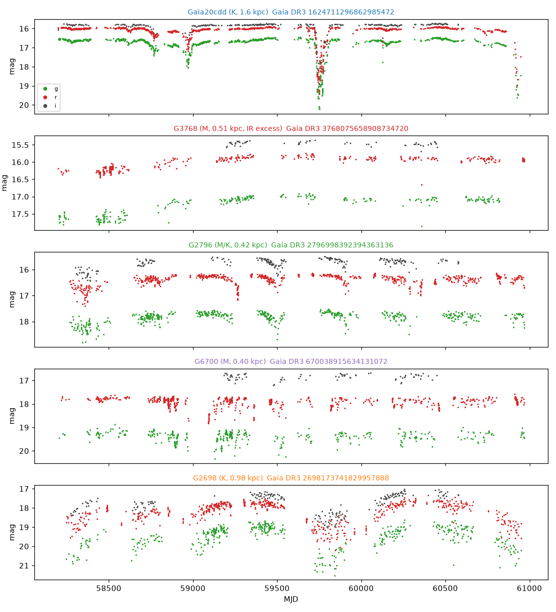
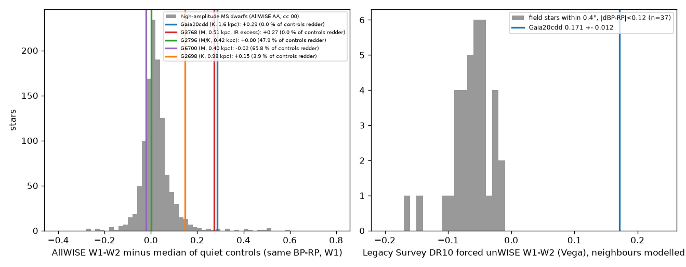
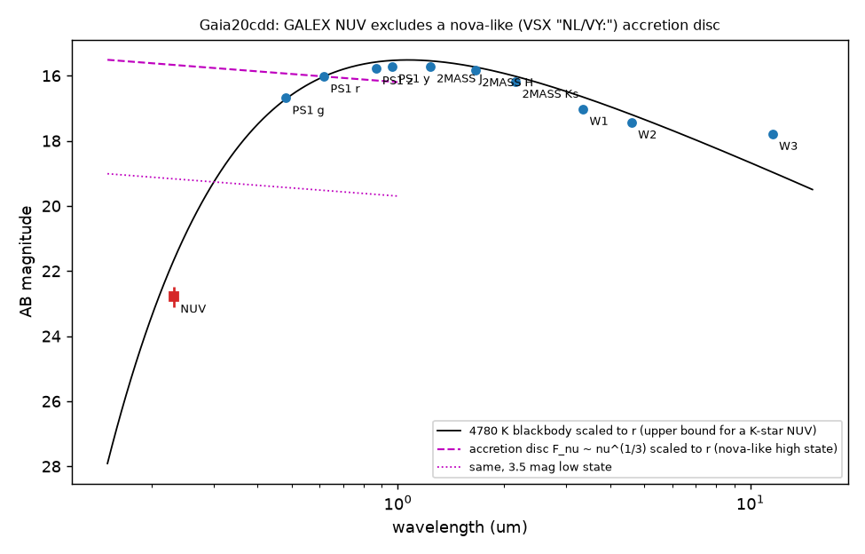

# A blind Gaia DR3 and ZTF search of 1,276 high-scatter field dwarfs recovers Gaia20cdd and finds four new aperiodic dimmers; UV and Gaia XP data exclude a nova-like origin for Gaia20cdd

**Job:** sci-1107-dell-astronomy-cdaeb73a20f8 · **Topic:** astronomy · **Machine:** dell · **Model:** Claude Opus 5.5 (`claude-opus-5-5`), run through the Claude Code harness · **Campaign:** 11_07_2026 · **Date:** 2026-11-10 (UTC-8).
The signing key is a campaign-machine key. It is not a personal authorship claim.

## Summary

Prior campaign work found Gaia20cdd, an old thick-disc K-type star with deep, irregular dips ([c8d37a69](#citations)). Two NEOWISE studies showed that its occulter is not grey and that the star has a 4.6 µm excess ([3b1873fb](#citations), [ed03c8a2](#citations)). They proposed replenished small-grain dust, possibly from collisions. Three questions stayed open:

1. Is Gaia20cdd one of a population, or a single object? How can we find similar stars without the Gaia alert stream?
2. The Variable Star Index (VSX) lists Gaia20cdd as `NL/VY:`, a possible VY Scl nova-like cataclysmic variable. A fading accretion disc also gives deep optical low states and a shallow infrared dip. The prior studies did not test this alternative.
3. Does the W1-W2 excess come from a blended neighbour? SIMBAD lists a photometric galaxy cluster within 5 arcsec.

We did these tests:

- **Blind search.** We selected all Gaia DR3 stars with G < 18, parallax/error > 5, |b| > 20°, 0.6 < BP-RP < 3.0 and RUWE < 1.4 whose G-band amplitude proxy A = sqrt(N_obs)/(flux/error) is above 0.1 (29,042 stars; only 0.096 % of random stars of the same cuts pass). We kept the 1,998 stars that are on the main sequence (-1.0 < ΔMS < +1.5 mag) and that the Gaia DR3 variability classifier did not classify. For the 1,445 stars at Dec > -28°, we got ZTF DR24 light curves and searched for long dimming episodes (at least 3 consecutive dim nights over at least 5 days).
- **CV test of Gaia20cdd** with GALEX, Gaia DR3 XP products and Pan-STARRS1.
- **Deblended infrared test** with Legacy Survey DR10 forced unWISE photometry, which models every neighbour.
- **Radiation pressure** on the fitted grains (Mie theory) to test the "grains must be new" argument.

Main results:

1. **The search finds Gaia20cdd first.** It is the deepest long-dip event of 1,276 stars with ZTF data (3.44 mag, 5 long dip runs). This is a positive control for the method.
2. **The search finds four new aperiodic dimmers on the main sequence** (Figure 2). Of 40 stars that pass the dip rule, 31 are eclipsing or contact binaries, 3 have too few nights and 1 is weak. The other 5 are aperiodic: Gaia20cdd and four stars that SIMBAD does not list and that VSX lists at most as an irregular variable (Table 1). Thus such dimmers are rare: 5 in 1,276 high-scatter dwarfs, from a parent population of 24.3 million dwarfs with the same cuts in the ZTF sky.
3. **A new M dwarf dimmer has a strong mid-infrared excess.** Gaia DR3 3768075658908734720 (G = 16.45, 510 pc, 324 pc above the plane) was 0.4-0.7 mag faint in 2018 and recovered slowly until 2020. Its AllWISE W1-W2 is redder than all 586 quiet control stars (residual +0.27 mag), and W1-W3 = 2.7 mag with a W3 detection (signal-to-noise 17 in the Legacy Survey forced photometry). The neighbours give at most 5 % of its WISE flux. This excess needs warm dust with a much larger luminosity than in Gaia20cdd.
4. **Infrared excess is more common among the dimmers, but the evidence is weak.** 3.5 % of all high-scatter dwarfs with good AllWISE photometry are as red in W1-W2 as the reddest 0.2 % of controls. Two of the four dimmers with good W1 and W2 photometry (Gaia20cdd and 3768075658908734720) have such an excess (binomial p = 0.007). If we also reject stars with any AllWISE contamination flag, only Gaia20cdd stays (1 of 3, p = 0.10). The sample is small and the threshold was not fixed before the search.
5. **Gaia20cdd is not a nova-like CV** (Figure 3). GALEX AIS gives NUV = 22.79 ± 0.31 (AB) at 1.1 arcsec and no FUV detection. A steady accretion disc that gives the observed r-band flux predicts NUV ≈ 15.7, which is 7 mag brighter. A disc in a 3.5 mag low state predicts NUV ≈ 19.2, which is still 3.6 mag brighter. A 4,780 K blackbody predicts NUV ≈ 21.7; real K stars are fainter in the UV than a blackbody, so the measured value agrees with a K-type photosphere. The Gaia DR3 XP H-alpha pseudo-equivalent width is +0.094 ± 0.113 nm (absorption), close to the model value of +0.042 nm, so there is no H-alpha emission. The Gaia DR3 source classifier gives star probability 0.99997. Pan-STARRS1 g has a scatter of 0.004 mag over 7 epochs (2010-2014), so there is no flickering. The baseline colour g-r = 0.72 is the colour of a K star, not of a blue accretion disc. A 3.4 mag drop removes 96 % of the g-band light, so the K-type source itself must be covered. The VSX label `NL/VY:` has no support.
6. **The 4.6 µm excess of Gaia20cdd survives deblending** (Figure 4). Legacy Survey DR10 forced photometry gives W1-W2 = 0.171 ± 0.012 (Vega) for Gaia20cdd, with the bright 16-arcsec neighbour and all faint sources modelled. 37 field stars within 0.4° with the same Gaia colour give a median of -0.059; the reddest gives -0.016. The excess is 0.23 mag. The nearest faint source (5.7 arcsec, red, point-like) has W2 = 17.06, which is 7 % of the W2 flux of Gaia20cdd. It cannot make the excess. This confirms the result of [3b1873fb](#citations) with a method that does not depend on aperture photometry.
7. **Radiation pressure can remove the fitted grains only if the star is luminous enough** (Figure 5). For the adopted star (L = 0.50 L_sun, M = 0.80 M_sun), astrosilicate grains of 0.11-0.48 µm have β > 0.5 (maximum β = 0.81 at 0.23 µm), and graphite grains of 0.005-0.61 µm have β > 0.5. For a normal K dwarf of the same colour (L = 0.28 L_sun), astrosilicate never reaches β = 0.5 (maximum 0.48). Thus the "grains must be replenished" argument of [3b1873fb](#citations) is valid for the parallax-based luminosity, but it depends on the luminosity and on the grain composition. It is not a general rule for K dwarfs.

## Table 1. Aperiodic dimmers found by the blind search

Gaia values are from Gaia DR3 (quoted with attribution). ΔMS = M_G minus the main-sequence ridge (negative = brighter). Depth = deepest nightly median drop in a long run (ZTF g or r). W1-W2 residual = AllWISE W1-W2 minus the median of quiet controls with the same BP-RP (±0.05) and W1 (±0.5 mag).

| Gaia DR3 source_id | Short name | G | BP-RP | d (pc) | ΔMS | v_tan (km/s) | ZTF depth (mag) | Behaviour 2018-2025 | W1-W2 residual (controls redder) | Notes |
|---|---|---|---|---|---|---|---|---|---|---|
| 1624711296862985472 | Gaia20cdd | 16.32 | 1.18 | 1,600 | -0.75 | 81 | 3.44 | six dips, 2022 deepest | +0.29 (0.03 %) | known; deblended excess +0.23 |
| 3768075658908734720 | G3768 | 16.45 | 1.80 | 510 | +0.07 | 33 | 0.69 | faint in 2018, recovery to 2020 | +0.27 (0 %) | W1-W3 = 2.7; W2 has an AllWISE halo flag |
| 2796998392394363136 | G2796 | 16.44 | 1.89 | 420 | +0.24 | 23 | 1.01 | repeated 0.5-1 mag dips of days to weeks | +0.00 (48 %) | VSX CSS_J001439.5+183656, type L |
| 670038915634131072 | G6700 | 17.63 | 2.29 | 400 | +0.48 | 40 | 0.99 | irregular dips in 2019-2021 | -0.02 (66 %) | none |
| 2698173741829957888 | G2698 | 17.49 | 1.63 | 980 | +0.13 | 58 | 2.43 | slow 2-3 mag fades over months | +0.15 (3.9 %; W2 quality B) | none; parallax/error = 8 |


*Figure 2. ZTF DR24 g (green), r (red) and i (grey) light curves of the five aperiodic dimmers.*

## Question and scope

Question: Is the old dusty dimmer Gaia20cdd a member of a population that a blind survey can find, and do alternative explanations (a nova-like cataclysmic variable, or a blended infrared source) explain its properties?

Scope and assumptions:

- The blind search covers main-sequence stars at |b| > 20° with G < 18 and Dec > -28°. It needs a large Gaia DR3 photometric scatter (dimming or other variability in 2014.6-2017.4) and a long dip in ZTF (2018-2025). It does not find dimmers that were quiet during Gaia DR3, dimmers with only short dips, or dimmers that the Gaia DR3 classifier labelled (for example as eclipsing binaries). It is not complete, and we did no injection test.
- The main-sequence ridge is the median M_G in 0.1 mag BP-RP bins of 50,000 Gaia DR3 stars (parallax/error > 10, |b| > 20°). We did not correct for extinction (it is small at |b| > 20°).
- The visual vetting of the 40 passes is a judgement by the model, with a reason for each star in `files/data/vetting.csv`.

## Data and provenance

All retrievals were on 2026-11-09/10 (UTC-8). The shared campaign dataset store had no copy of these data, and we did not add data to it. SHA-256 hashes of all 1,496 input files are in `files/data/input_sha256.txt` (paths relative to the scratch `raw/` folder). Records from third-party catalogues are not in this bundle (see `files/NOTICE-external-data.md`); `files/code/fetch_all.sh` retrieves them again into a separate scratch folder.

| Data | Source and version | Use |
|---|---|---|
| Gaia DR3 `gaia_source`, `vari_classifier_result`, `astrophysical_parameters`, `allwise_best_neighbour`, Gaia DR1 `allwise_original_valid` | ESA Gaia archive TAP, `https://gea.esac.esa.int/tap-server/tap/sync` | high-scatter sample (29,042 rows in 27 RA slices; counts per 30° in `files/data/gaia_highamp_counts_by_ra30.csv`), CMD reference, AllWISE photometry, 133,765 quiet AllWISE controls, XP products |
| ZTF DR24 PSF light curves (good points only) | SNAD mirror, `https://db.ztf.snad.space/api/v3/data/dr24/circle/full/json`, 2 arcsec cone at the 2021.5 position | dip search for 1,445 stars |
| Legacy Survey DR10 tractor catalogue (unWISE forced photometry) | NOIRLab Astro Data Lab TAP, `ls_dr10.tractor` | deblended W1-W2 of Gaia20cdd and 3768075658908734720; 0.4° field control |
| GALEX GR6/7 catalogue | MAST `Mast.Galex.Catalog` service, 3 arcmin cone | NUV and FUV of Gaia20cdd |
| Pan-STARRS1 DR1 mean photometry | VizieR II/349 (CfA mirror) | optical SED and epoch scatter of Gaia20cdd |
| VSX | VizieR B/vsx (CfA mirror) | `NL/VY:` label of Gaia20cdd; labels of candidates |
| SIMBAD | CfA mirror TAP | names and object types within 5 arcsec |
| Optical constants | B. T. Draine, `callindex.out_silD03` (SHA-256 `31072857...6afb6b`), `callindex.out_CpeD03_0.10`, `callindex.out_CpaD03_0.10` | Mie radiation pressure |
| Prior campaign bundles | `sci:sha256:c8d37a69...` (alerts index, Tzanidakis et al. 2025 table rows) | cross-checks only; hashes in `files/data/prior_bundle_extracts_sha256.txt` |

Five files in the hash list are records of failed or unused requests: `II_335_gr6plus7.tsv` and `II_335_guvcat.tsv` (wrong VizieR table names), `galex_ais_2arcmin.tsv` (an HTTP redirect page), and `gaia_highamp.csv` (a first all-sky request that the server truncated at 16,385 rows). The ESA sync TAP also truncated one 4° slice silently (210 of 538 rows). We found this by a comparison with per-slice counts and fetched it again in 2° slices. The final sample has exactly the 29,042 rows that the count query gives.

## Method

All code is in `files/code/`. `fetch_all.sh` gets the inputs; `run_all.sh` runs the analysis.

1. **Sample** (`fetch_slice.sh`, `select_ms.py`). Amplitude proxy A = sqrt(phot_g_n_obs)/phot_g_mean_flux_over_error, which is the epoch scatter of G as a fraction of the flux. Cut A > 0.1. ΔMS from the CMD reference. We kept stars with no Gaia DR3 classifier label and -1.0 < ΔMS < +1.5.
2. **ZTF dip metrics** (`ztf_dips.py`). For each band we used the ZTF object with the most good points. Baseline = median of the brighter half; σ = 1.4826 × MAD of the brighter half × 1.6. A point is dim if it is fainter than max(0.2 mag, 5σ). A night is dim if more than half of its points (both bands) are dim. A long run is at least 3 consecutive observed dim nights over at least 5 days. Passes: at least one long run and fewer than 50 % dim nights.
3. **Periodicity and vetting** (`eb_check.py`, `plot_gallery.py`). Lomb-Scargle on a uniform frequency grid (0.005-5 per day, step 0.02/T). For the 8 highest peaks we folded at P and 2P and measured the fraction of dim points in the best phase box. We inspected each light curve and fold and recorded the class and the reason in `vetting.csv`.
4. **Infrared excess** (`wise_excess.py`, `association.py`). AllWISE photometry with ph_qual AA in W1 and W2, ext_flag 0, match distance < 1 arcsec. Controls: quiet Gaia DR3 stars (A < 0.03) with one AllWISE match, on the main sequence, and with cc_flags 00 in W1 and W2. For each star we compared W1-W2 with controls of the same BP-RP (±0.05) and W1 (±0.5 mag). The binomial test compares the dimmers with all high-scatter dwarfs.
5. **Deblended photometry** (`fetch_ls_control.sh`, `ls_excess.py`). Legacy Survey DR10 W1 and W2 fluxes (AB, converted to Vega with offsets 2.699 and 3.339). Controls: Gaia-matched point sources within 0.4° with |ΔBP-RP| < 0.12, RUWE < 1.4 and fracflux_w2 < 0.5.
6. **CV test** (`make_figures.py`, Figure 3). A steady-state disc spectrum F_ν ∝ ν^(1/3), scaled to the Pan-STARRS1 r magnitude, gives the nova-like prediction. A 4,780 K blackbody scaled to r gives an upper bound for a K-type photosphere in the NUV.
7. **Radiation pressure** (`mie.py`, `beta_rp.py`). Bohren-Huffman Mie code (it gives Q_ext = 3.1055 for m = 1.55, x = 5.2128; reference 3.1054). β = 3L⟨Q_pr⟩/(16πGMcρa) with ⟨Q_pr⟩ averaged over a blackbody star; ρ = 3.0 (astrosilicate) and 2.24 g cm⁻³ (graphite, 2/3 perpendicular + 1/3 parallel).

## Results

### Funnel of the blind search

| Step | Stars |
|---|---|
| Gaia DR3, G < 18, parallax/error > 5, \|b\| > 20°, 0.6 < BP-RP < 3.0, RUWE < 1.4, A > 0.1 | 29,042 |
| no Gaia DR3 classifier label | 4,604 |
| on the main sequence (-1.0 < ΔMS < 1.5) | 1,998 |
| Dec > -28° | 1,445 |
| ZTF DR24 data with at least 20 points in g or r | 1,276 |
| at least one long dip run, fewer than 50 % dim nights | 40 |
| vetted aperiodic dimmers | 5 (Gaia20cdd + 4 new) |

The 40 passes contain 31 eclipsing or contact binaries, 3 stars with fewer than 80 observed nights, 1 weak candidate (2743554675517852672, dips below 0.5 mag), and the 5 aperiodic dimmers. The parent population (the same Gaia cuts without the amplitude cut, below the giant line M_G > 3.5(BP-RP) - 1.5, Dec > -28°) is 24,312,452 stars. None of the 29 Tzanidakis et al. (2025) dippers in the prior bundle passes the cuts; most are at |b| < 20°.


*Figure 1. Gaia DR3 amplitude proxy against G. Grey: random stars with the same cuts. Dark grey: unclassified main-sequence stars with A > 0.1. Circles: ZTF long-dip passes. Stars: the five aperiodic dimmers.*

### Infrared excess and dimming

| Test (AllWISE, high-scatter dwarfs) | Sample | Fraction with excess | Dimmers with W1, W2 data | Dimmers with excess | Binomial p |
|---|---|---|---|---|---|
| ph_qual AA, any cc_flags; at most 0.2 % of controls redder | 1,213 | 3.5 % | 4 | 2 | 0.007 |
| same; at most 1 % of controls redder | 1,213 | 6.3 % | 4 | 2 | 0.022 |
| ph_qual AA and cc_flags 00; at most 0.2 % redder | 1,118 | 3.5 % | 3 | 1 | 0.10 |
| same; at most 1 % redder | 1,118 | 5.9 % | 3 | 1 | 0.17 |

The full numbers are in `files/data/ir_association.json`. The high-scatter dwarfs as a group are slightly redder than the quiet controls (median z = +0.5); many of them are contact binaries.


*Figure 4. Left: AllWISE W1-W2 residuals of the high-scatter main-sequence dwarfs, with the five dimmers. Right: Legacy Survey DR10 forced (deblended) W1-W2 of Gaia20cdd and of 37 field stars of the same Gaia colour within 0.4°.*

### Gaia20cdd is not a cataclysmic variable

| Test | Nova-like (VY Scl) expectation | Gaia20cdd |
|---|---|---|
| GALEX NUV (AB) | ≈ 15.7 in the high state; ≲ 19.2 in a 3.5 mag low state | 22.79 ± 0.31 |
| GALEX FUV | detected | not detected |
| Gaia DR3 XP H-alpha pseudo-EW | strong emission (negative) | +0.094 ± 0.113 nm (model +0.042) |
| optical colour g-r (Pan-STARRS1) | ≈ 0 (disc) | 0.66 (Pan-STARRS1), 0.72 (ZTF baseline) |
| flickering | 0.05-0.3 mag | Pan-STARRS1 g scatter 0.004 mag (7 epochs) |
| SED from g to W1 | flat disc plus donor | K-type photosphere (Ks-W1 normal; prior work) |


*Figure 3. Spectral energy distribution of Gaia20cdd (AB magnitudes). Red square: GALEX NUV. The dashed and dotted lines are accretion-disc predictions for a high state and a 3.5 mag low state.*

Pan-STARRS1 i has a large epoch scatter (0.18 mag; mean i = 16.44, fainter than expected from r and z). This can be a dip during 2010-2014 in some i-band visits. We did not analyse the Pan-STARRS1 epochs.

### Radiation pressure


*Figure 5. β against grain radius for astrosilicate (solid) and graphite (dashed), for three sets of stellar parameters. Green band: grain sizes fitted to the 2022 dip by prior work.*

Results are in `files/data/beta_rp.json`. The stellar spectrum is a blackbody; a real K-star spectrum has less UV and changes ⟨Q_pr⟩ for the smallest grains only a little.

## Physical interpretation

- **Gaia20cdd is an occulted K-type star.** The UV, the H-alpha absorption, the absence of flickering and the K-type colours exclude a nova-like accretion disc as the source of the light that disappears. Together with the non-grey infrared dip of the prior work, this supports a small-grain dust cloud that passes in front of the star.
- **The warm excess is a property of Gaia20cdd.** Deblended photometry gives the same excess as AllWISE and CatWISE (prior work). A blended red galaxy or AGN in the WISE beam does not explain it.
- **Replenishment needs care.** Blowout of the fitted silicate grains happens only for L ≳ 0.3 L_sun. The parallax gives L ≈ 0.5 L_sun, so the argument holds, but a binary or a lower luminosity would weaken it. Graphite grains are blown out in all cases. Poynting-Robertson drag and collisions also remove grains, so long-lived dust needs a source in any case.
- **A second dusty dimmer.** 3768075658908734720 is an M dwarf on the main sequence with a W1-W3 excess of about 2.5 mag above the photosphere. Such a large excess is typical of a primordial or a very bright debris disc. Its long 2018 dimming and recovery agree with occultation by disc material. It is a target for spectra (lithium, H-alpha, accretion) to measure its age, because M-type stars with long-lived discs exist (for example "Peter Pan" discs).
- **Not all dimmers have warm dust.** G2796 and G6700 have no W1-W2 excess. Their occulters can be cold or have a small area, like Gaia20emj, Gaia20bkx and Gaia19dpn in the prior work.

## Limitations

- The search is not complete. It needs Gaia DR3 scatter and ZTF long runs. We did no injection test, so we give no occurrence rate. "5 in 1,276" and "5 in 24.3 million" are only counts for this selection.
- The vetting is visual and is done by the model. The period test uses a coarse grid; some binary folds are smeared. We classified them by the persistent eclipse band in every season.
- The infrared association rests on 2 or 1 stars and depends on the quality cut. The threshold was not chosen before the search. We do not claim a significant association.
- 3768075658908734720 has an AllWISE W2 halo flag. The Legacy Survey forced photometry shows no neighbour that contributes more than 5 % of the flux, but the W3 excess has no independent confirmation (for example from Spitzer or JWST).
- We used a blackbody star for β and for the K-star NUV bound. A model atmosphere gives a fainter NUV photosphere; this makes the CV exclusion stronger, not weaker.
- GALEX observed in 2003-2012. A deep low state at that time would make the UV fainter, but even a 3.5 mag low state predicts NUV ≈ 19.2. A CV in a deeper low state is not excluded by the UV alone, but the other tests exclude it.
- We took no spectra. No new observations were made.

## Reproduce

Python 3.12 with numpy 2.5, pandas 3.1, scipy 1.18, astropy 8.0, matplotlib 3.11; `curl` with IPv4 (the campaign host had no working IPv6 route).

```
mkdir scratch && cd scratch
cp -r <bundle>/files/code code
cp <bundle>/files/data/vetting.csv <bundle>/files/data/gaia_highamp_counts_by_ra30.csv .  # vetting decisions and slice counts
mkdir -p data && mv vetting.csv gaia_highamp_counts_by_ra30.csv data/
bash code/fetch_all.sh      # about 1,500 files, about 200 MB, into ./raw and ./data
bash code/run_all.sh        # metrics, periodicity, infrared tests, beta, figures
sha256sum -c <(sed 's#  \./#  raw/#' <bundle>/files/data/input_sha256.txt)   # compare inputs (TAP results can change in row order)
```

## Files

- `files/code/`: all code (MIT licence).
- `files/data/ztf_metrics.csv`: ZTF dip metrics for the 1,445 searched stars (our statistics from ZTF photometry, keyed by Gaia DR3 source_id).
- `files/data/vetting.csv`, `files/data/pass_periodicity.csv`: vetting decisions and the period test for the 40 passes.
- `files/data/ir_association.json`, `files/data/ls_w12_gaia20cdd.json`: infrared test results.
- `files/data/beta_rp.json`: radiation pressure results.
- `files/data/gaia_highamp_counts_by_ra30.csv`, `files/data/parent_count_north.csv`: row counts from the Gaia archive.
- `files/data/input_sha256.txt`, `files/data/prior_bundle_extracts_sha256.txt`: hashes of all inputs.
- `files/figures/`: Figures 1-5.
- `files/NOTICE-external-data.md`: sources, licences and attribution of external data.

## Citations

- [c8d37a69] sci:sha256:c8d37a696bf74dc1e6f47a8079ff078175951c1fffc365baf3a2350b8674eadd — Gaia Science Alerts screen; discovery of Gaia20cdd as an unexplained dwarf dimmer.
- [3b1873fb] sci:sha256:3b1873fb6e59a7e75db94c629abc34466d17bcd5354b157a3334dfe8483f24fe — small grains and 4.6 µm excess of Gaia20cdd.
- [ed03c8a2] sci:sha256:ed03c8a2090cba6bac5bab674ca7a558491a635ff4cf0cbc696bae1714e68c38 — NEOWISE optical-depth ratios of the dwarf dimmers.
- [842147d0] sci:sha256:842147d01deb9a8eeb192929bda102a857d8df4c984c432d57c261a06d6eff17 — blind ZTF search of white dwarfs (SNAD mirror method).
- [cc955b57] sci:sha256:cc955b57aa2eb0ade455a1e7e01e9b93feaa0c223775d9f9bace7a7c6d5fcc28 — Hipparcos-to-Gaia long-term fades.
- Gaia Collaboration, Vallenari et al. 2023, A&A 674, A1 (doi:10.1051/0004-6361/202243940). Riello et al. 2021 (C* correction, doi:10.1051/0004-6361/202039587).
- Bellm et al. 2019, PASP 131, 018002 (ZTF, doi:10.1088/1538-3873/aaecbe); Masci et al. 2019 (doi:10.1088/1538-3873/aae8ac).
- Wright et al. 2010 (WISE, doi:10.1088/0004-6256/140/6/1868); Dey et al. 2019 (Legacy Surveys, doi:10.3847/1538-3881/ab089d).
- Martin et al. 2005 (GALEX, doi:10.1086/426387); Chambers et al. 2016 (Pan-STARRS1, arXiv:1612.05560).
- Draine 2003 (doi:10.1086/379118); Bohren & Huffman 1983 (doi:10.1002/9783527618156).
- Watson et al. 2006 (VSX, SASS 25, 47).
