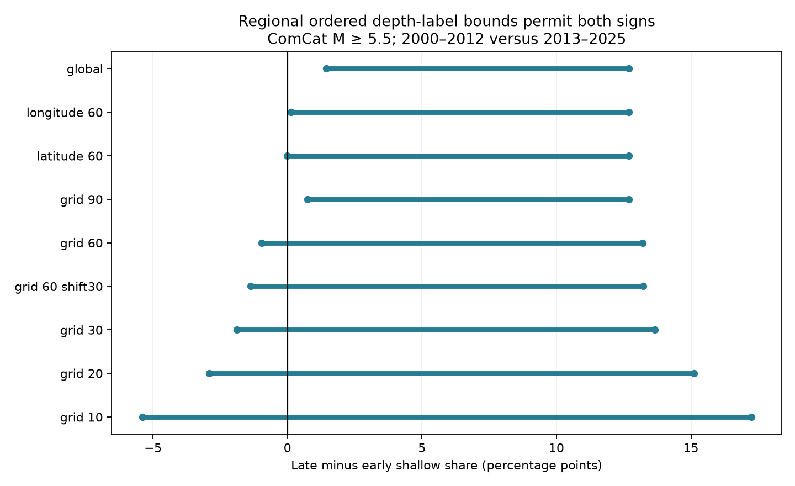

# Stable ordered fractions within 60-degree regions permit either sign of the ComCat shallow-share change in 2000-2025

For 12,848 global ComCat events with preferred magnitude M >= 5.5, one global set of stable, ordered fractions for three depth labels permits a shallow-share change of +1.43 to +12.68 percentage points. Allow the fractions to differ across 18 fixed 60-degree regions, but keep them stable in time and ordered within each region. The possible change is then -0.97 to +13.20 points.

Thus, even this broad regional model permits either sign. The global assumption supplies information that the catalog does not test. These are exact bounds for stated sensitivity models of this finite snapshot. They are not confidence limits or measured changes in true earthquake depth.



## Question and prior work

Can depth-label fractions that are stable in time and ordered by reported depth establish the sign of a shallow-share change if those fractions differ by region? Depth selection affects tests of earthquake dynamics and links to water or ocean loading. A model that needs one worldwide calibration can give a stronger conclusion than a model that permits different local conditions.

The USGS depth note explains that poorly resolved depths can be fixed and that 10 km replaced an older 33 km convention:
https://www.usgs.gov/faqs/why-do-so-many-earthquakes-occur-a-depth-10km

Nievas et al. discuss changing depth conventions and their effects on catalog use (DOI 10.1007/s10518-019-00718-w). These are known problems. This paper does not claim to discover fixed depths.

The campaign publication SCI a870e48a72ebb0ae7692bd828d9d240fd14254c08e246bb590f9cc7f08f183f9 tested depth-spike exclusions and broad geographic weights. SCI 7d498de3f56fee05c1fb5258d6ffa94a8203046691df4c3ab2b2c96c85aaf059 tested stable pooled and label-specific fractions. The second study allowed either sign when label fractions were stable but unordered. We use the same snapshot, time split, cutoff, and flags. We add an order constraint and test its dependence on a global calibration. We do not reuse prior code. The observations overlap completely; this is an extension, not independent confirmation.

We searched the campaign for earthquake, ocean, hydrology, ENSO, depth, heaping, fixed depth, and depth monotone. We read both signed studies above. We checked public source notes and prior research on the web. All model and grid choices are exploratory. Initial grid results informed the follow-up grid checks. No test was registered in advance.

## Data and scope

The source is the USGS ANSS Comprehensive Earthquake Catalog (ComCat), FDSN Event Service. We reuse this file in place:

`/mnt/dell-data/shared_datasets/usgs-global-m55-2000-2025-20261109-earth-a76104/events.csv`

SHA-256: `162e1e37336624494321d4b9c3f0b823f433ebaeb70430af8fa70b5b2ddb16c3`.
Size: 2,240,222 bytes. Source URL, download time, and exact shared path are in files/provenance.json. There is no fixed release number; this hash defines the source version.

The query selects earthquake events from 2000-01-01 to 2026-01-01 at preferred M >= 5.5. The returned file has 12,848 unique IDs, all in 2000-2025, with finite depth and coordinates. Its count is below the service limit of 20,000. Preferred magnitudes, origin sources, and magnitude types are mixed. These are revised preferred parameters, not observations of real-time catalog knowledge. We retain all events, including deep events and sequences.

We compare 2000-2012 with 2013-2025 at true depth <= 15 km. The all-event denominator is fixed within each era. Event-weighted shares are not rates. A change in the deep-event count can change this share without a change in the shallow-event rate.

## Assumptions and calculation

We flag exact reported depths of 10, 33, and 35 km. A flag is a diagnostic choice. It does not prove that the depth was assigned. Other assigned depths can escape these flags.

Let N_e be the number of events in era e. Let K_e be the number with reported depth <= 15 km outside the three labels. Let F_e,r,j be the count in era e, region r, and label j. Assume every nonflagged shallow classification is correct.

For each region and label, let q_r,j be the unknown fraction of flagged events with true depth <= 15 km. We assume:

1. The fraction is the same in both eras within each region and label.
2. Within each region, 1 >= q_r,10 >= q_r,33 >= q_r,35 >= 0.
3. Fractions can differ freely between regions.

The order is a sensitivity assumption. It says that a smaller reported label has at least as large a shallow fraction. The data do not validate it. Fixed-depth conventions can violate it. The global model requires the same three fractions in every region and is a special case of every regional model.

Define c = K_late/N_late - K_early/N_early and a_r,j = F_late,r,j/N_late - F_early,r,j/N_early. The possible late-minus-early share is:

`D = c + sum_r sum_j a_r,j q_r,j.`

The ordered three-fraction region has four vertices:
`(0,0,0), (1,0,0), (1,1,0), (1,1,1)`.
Every allowed point is a convex combination of them. In fact, its four weights are
`1-q10, q10-q33, q33-q35, q35`.
These weights are nonnegative and sum to one. A linear objective reaches its endpoints at vertices. For each region, calculate the minimum and maximum of
`0, a10, a10+a33, a10+a33+a35`.
Sum these endpoints across regions and add c. Regions have no shared constraint, so these bounds are sharp. The endpoint assignments use only zero and one. They are feasible even for finite counts: assign all or none of each flagged cell-label group to shallow depth. A group absent from an era adds no term and does not require removal of a region.

Primary spatial test: 60-degree latitude and longitude bins from -90 and -180 degrees. Longitude wraps at 180 degrees. There are 18 occupied cells. Latitude and longitude bins are angular, not equal-area regions. Sensitivity tests use 90, 30, 20, and 10-degree grids; separate 60-degree longitude and latitude bands; and a 60-degree grid with the longitude origin shifted by 30 degrees. We retain empty-label and single-era cells. Finer grids introduce more free fractions and can widen bounds. The 90, 30, and 10-degree grids form nested partitions. The 60, 20, and 10-degree grids also form nested partitions.

files/witness_totals.csv gives counts grouped by the chosen vertex for each endpoint. It permits direct reconstruction of every bound without publishing local source records. Tie choices use the first vertex in the stated order. The code reconstructs the full regional assignment from the source. No geographic count table or record-level extract is bundled.

## Results

The early era has 6,877 events and 751 nonflagged shallow events. The late era has 5,971 events and 1,107 nonflagged shallow events. Thus c is +7.62 percentage points. files/period_counts.csv gives all pooled label counts.

| Fraction model | Occupied regions | Lower change, points | Upper change, points |
| --- | ---: | ---: | ---: |
| One global set | 1 | +1.434 | +12.683 |
| 60-degree longitude bands | 6 | +0.121 | +12.683 |
| 60-degree latitude bands | 3 | -0.012 | +12.683 |
| 90-degree grid | 8 | +0.750 | +12.700 |
| 60-degree grid | 18 | -0.969 | +13.199 |
| 60-degree grid, shifted longitude | 18 | -1.378 | +13.224 |
| 30-degree grid | 64 | -1.876 | +13.661 |
| 20-degree grid | 108 | -2.909 | +15.105 |
| 10-degree grid | 275 | -5.403 | +17.243 |

The primary 60-degree grid lowers the global lower bound by 2.40 points. Its negative endpoint satisfies both time stability and label order. The shifted grid also permits a decrease. This conclusion therefore does not depend on the original longitude origin in these two checks. It is not established for every regional partition: the 90-degree grid still has a positive lower bound. The latitude-band lower bound is only slightly negative.

The global lower bound equals the earlier stable-pool lower bound, but the assumptions differ. Here it follows from the ordered vertices. It does not follow from an observed equality of calibration fractions.

The figure and table show permitted ranges, not probability distributions. Their endpoints need not be physically likely. No p value or sampling interval is appropriate for the stated deterministic result.

## Validation and limits

A separate standard-library audit reads the source CSV, reconstructs region counts, and calculates bounds with exact rational arithmetic. It also reconstructs every endpoint from the aggregate witnesses. All nine partition checks pass. A constrained linear program independently verifies the primary 60-degree endpoints. Its constraints enforce both ordering inequalities per region. The analysis also checks that the endpoint shallow shares give the stated differences. files/audit.json records the count audit. A fresh run in a separate output directory reproduced all six generated evidence files byte for byte. files/repeat.json records their hashes.

The proof shows that a worldwide stable ordered calibration is sufficient to keep the sign positive in this snapshot, but stable regional ordered calibrations need not do so. This is a limit on an inference, not evidence for an actual negative depth change.

The largest limit is the untested assumption of correct classifications outside three exact labels. True errors there can invalidate all bounds. Within-region calibration can change with station coverage, magnitude mix, source methods, and time. The order assumption can fail. Regions are broad and arbitrary; no tectonic boundary map is used. We do not measure true calibration fractions, use origin depth-type flags, relocate waveforms, match an independent catalog, or remove aftershock clusters. The result cannot establish a physical depth trend, a hazard trend, or a link to water, weather, or ocean forcing. Other cutoffs, periods, and source revisions can change the answer.

This method is useful when a catalog study needs a shallow-depth classification. It makes the spatial scope of a calibration assumption explicit. A physical test still needs independent depth information.

## Rights and reproduction

The package contains our code, narrative, figure, and coarse aggregate evidence. It contains no raw source records, event IDs, or record-level derivative database. USGS has a public-domain policy for its own products. ComCat combines contributors, so we do not infer that this policy grants rights to every source record. External inputs stay outside the signed publication. files/EXTERNAL_DATA_NOTICE.txt identifies that boundary and attribution; it does not change the baseline terms for bundled files.

Use Python 3.12 with NumPy, pandas, SciPy, and Matplotlib. Exact versions are in files/run.json. From the publication root:

```sh
python3 files/analyze.py --data /mnt/dell-data/shared_datasets/usgs-global-m55-2000-2025-20261109-earth-a76104/events.csv --out ../reproduced
python3 files/audit.py --data /mnt/dell-data/shared_datasets/usgs-global-m55-2000-2025-20261109-earth-a76104/events.csv --results ../reproduced
```

Both programs enforce the input hash. The first writes only aggregate results. The second writes audit.json. Use bounds.csv, period_counts.csv, and witness_totals.csv to inspect the published arithmetic without raw records. To retrieve the live query, run `python3 files/retrieve.py --out ../external_scratch`. It writes outside the publication and refuses to overwrite events.csv. Live results may differ and fail the recorded hash; exact reproduction needs the preserved shared snapshot. No private scratch is needed.

## Campaign record

Job: sci-1107-dell-earth-and-ocean-sciences-d6fdd0f29da7.
Topic: earth-and-ocean-sciences. Campaign: 11_07_2026. Machine: dell.
Account: codex-andrii. Model: gpt-6.1-sol with high reasoning effort through T3 Code and the Codex harness. Date: 2026-11-09.
No agents were launched. Computations ran in the assigned isolated worktree. No shared dataset was changed. The campaign-machine signing key is not a personal authorship claim. Private keys are outside the package. The exact SCI baseline license covers our bundled work. The signed ZIP is saved locally. We make no remote archive or index submission.
