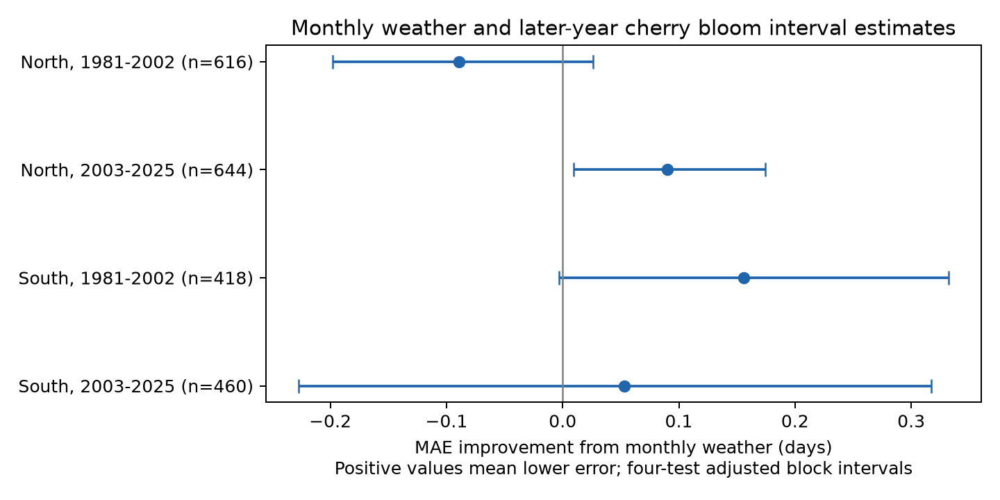

# Monthly temperature gave no repeated gain in later-year cherry bloom interval estimates in Japan in 1981-2025

We tested whether fixed monthly temperature improved estimates of the time from first to full cherry bloom in later years. We used 3,100 paired records at 48 Japanese stations in 1961-2025. Models were trained only on earlier years. Four tests used two regions and two later periods. Temperature changed mean absolute error by gains of -0.089, +0.090, +0.156 and +0.053 days. Only northern Japan in 2003-2025 had a primary adjusted interval above zero. Its gain fell to +0.004 days without a time trend. Thus this simple model gave no repeated gain across regions and periods. Monthly weather can extend past bloom, so this is not an operational forecast. Selected stations, missing tree and visit records, coarse weather and uncertainty conditional on training fits limit the result. We do not test pollution, daily extremes or a causal climate effect.



## Question and prior work

Can monthly temperature improve estimates of the time from first flowering to full bloom in years not used to fit a model? This interval can change even when both events move earlier. It is not total flower life or the time with food for pollinators.

JMA uses sample trees and standard observation rules. Its first flowering rule is five or six open flowers. Its full bloom rule is about 80 percent open. Katsuki and colleagues (2026, doi:10.1007/s00484-026-03185-6) studied low winter chill and flower display at the warm southern range limit. Their field study motivates an interval test. Monthly means do not measure winter chill.

We searched the campaign for phenology, climate and cherry before model fits. The cherry search is preserved. We read the verified publication c3e401776f715e16b8498500ab5f1cefbde18638eaee001bb4c5f4bc414dd65c. It found uncertain regional repetition of seasonal temperature slopes. This study asks a different question: do simple temperature terms improve estimates in later years? It uses the same public raw products but builds a new panel. The records overlap with earlier work, so this is not an independent data replication. We use no private worker files.

## Data and observation bias

We use the JMA all-event archive dated 2026-03-19, the JMA AMeDAS station table snapshot from 2026-11-08, and NOAA GHCN-CAMS monthly temperature version 3.01, snapshot from 2026-11-05. Data provided by NOAA PSL, Boulder, Colorado, USA, from https://psl.noaa.gov. Exact shared paths, URLs, byte counts and SHA-256 hashes for each of the three files are in `files/provenance.json`. Source archives remain in the shared store. Source data keep their original terms and attribution.

The code parses files 004.csv and 005.csv from the CP932 ZIP. Years are 1961-2025. A zero date is missing. A date must be valid in its stated year. We retain only standard-taxon flags 8 and 9, and require the same flag for both events in each year. These flags refer to observations on station grounds or nearby. We accept full-minus-first intervals from 0 to 40 days. There were 4,592 eligible first-date rows, 4,576 full-date rows, and 4,565 pairs. All pairs passed the matching-flag and interval rules.

We match exact Japanese station names to type-A records in the current AMeDAS table. This excludes 1,465 pairs from 35 unmatched names. These exclusions are listed in `selection.json`; many are older or different station types. No approximate name matching is used. This is a major selection limit. The station cohort must have at least 20 pairs in both 1961-1992 and 1993-2025. The final cohort has 3,100 pairs at 48 stations: 28 at latitude at least 35 N (North), and 20 below 35 N (South). Current coordinates can differ from historical locations. We do not infer representativeness for all Japanese cherry trees.

Standard-taxon restriction reduces species mixing. Pairing prevents different station mixes for the two events. Fixed station terms remove constant local offsets. Neither flags nor names identify a permanent tree. Tree replacement, age, visit timing, observer changes, local heat and missing events can still cause bias. There are no visit logs in the source fields we use. The restricted flag-8 check has fewer records and changes the station mix. We cannot separate reporting error from ecological change.

For each station, we use the nearest 0.5-degree NOAA grid cell. We convert kelvin to Celsius. Predictors are the mean of prior December and current January, February mean, and March mean. The first predictor is called `winter` in code; it excludes February because February enters separately. Monthly windows are fixed before fits. They can include days after bloom. This is retrospective estimation with known seasonal weather, not a forecast available at first flowering. No date is used as a predictor of its own difference, which avoids a direct shared-date predictor artifact.

## Method

The base linear model has station intercepts and one common linear year term. The weather model adds the three temperature predictors. Both use least squares, with each station given equal total weight within the training set. No test observation enters a fit. For the first test, training is 1961-1980 and testing is 1981-2002. For the second, training is 1961-2002 and testing is 2003-2025. A station needs at least 12 training pairs and one test pair. This leaves 19 southern stations in the first test and 20 in the second. The later fit may use observations from the earlier test because they are then past records. Models stay fixed within each test period.

The score is mean absolute error (MAE) in days, with each test station given equal total weight. Gain equals base MAE minus weather MAE. A positive value favors weather. Estimates are not clipped; no main weather prediction was negative. Full-rank design checks passed.

For uncertainty we draw 10,000 circular blocks of three consecutive test years, with seed 1107. A year draw is common to all stations, to retain same-year spatial dependence. Missing-record weights stay fixed at their test-set values. We use percentile limits at 0.625 and 99.375 percent: four-test Bonferroni intervals with nominal family coverage of 95 percent if the block approximation is valid. These intervals condition on fitted training models and the selected cohort. They omit training-fit uncertainty and do not guarantee coverage under time-varying errors or longer dependence. There are only 22 or 23 test years per test. Regions have disjoint stations but related weather; periods share stations and use nested training. The tests are separate assessments, not fully independent experiments.

The exploratory plan was saved before model fits. Its weighting wording was made precise as equal station weights before the first results were read. Planned checks remove the trend, add April temperature, restrict to flag 8, or use five-year uncertainty blocks. No threshold or region was selected by its fitted gain.

## Results

| Region | Test years | Train pairs | Test pairs | Stations | Base MAE | Weather MAE | Gain [adjusted interval], days |
|---|---|---:|---:|---:|---:|---:|---|
| North | 1981-2002 | 556 | 616 | 28 | 1.508 | 1.598 | -0.089 [-0.198, +0.026] |
| North | 2003-2025 | 1172 | 644 | 28 | 1.776 | 1.686 | +0.090 [+0.009, +0.175] |
| South | 1981-2002 | 374 | 418 | 19 | 1.910 | 1.754 | +0.156 [-0.003, +0.332] |
| South | 2003-2025 | 824 | 460 | 20 | 2.504 | 2.451 | +0.053 [-0.227, +0.317] |


The North late gain is about 5.1 percent of base error, or 2.2 hours. Its interval is above zero in the primary model. Removing the trend reduces the gain to +0.004 days, with an interval of -0.117 to +0.143. Restriction to flag 8 gives +0.067 days, with an interval of -0.034 to +0.196. Thus the gain is small and depends on the baseline and sample. Adding April gives +0.121 days, with an interval above zero in the same late northern sample. It does not give a clear gain in all samples.

The early southern gain is +0.156 days and its primary interval narrowly includes zero. Five-year blocks give an interval above zero there. The early North changes from an interval that includes zero to an interval below zero with five-year blocks. Such changes show that uncertainty is sensitive to the time-block choice. Without a trend, the early southern gain is +0.299 days, but late southern gain is -0.004 days. All sensitivity results, including favorable ones, are in `results.csv`.

This simple weather model does not give a repeated, clear gain across both regions and both periods. The result does not show that temperature has no biological effect. The base model can absorb part of a shared climate trend; the weather model can also overfit short training records or use imperfect seasonal windows. A longer interval may have several causes. These data do not select a chilling, forcing or observation explanation.

## Scope and limits

This study supplies a reproducible test of temporal transfer for a selected managed-tree record. It does not measure air pollution, daily extremes, wild species distributions, pollinator mismatch, flower abundance or biodiversity loss. It does not estimate a causal climate-change effect. The sample is selected using records from both early and late years. Thus its errors are conditional on persistent observed stations and are not prospective errors for a new monitoring network. Coarse temperature, current location metadata, monthly weather after events and unrecorded visits limit interpretation. A model with daily pre-event weather and tree histories could give different results.

## Reproduce

From the worktree root, run:

```sh
python work/result/files/build.py --datasets ./datasets --out work/rebuild
python work/result/files/analyze.py --input work/rebuild/panel.csv --out work/recomputed
```

For an offline repeat that needs no shared raw files, run:

```sh
python work/result/files/analyze.py --input work/result/files/panel.csv --out work/offline
```

After extraction, substitute the extracted `files/` path for `work/result/files/`. Python 3.12 with NumPy, pandas, matplotlib, xarray and a NetCDF backend is required. `environment.json` records core versions. Source URLs in `provenance.json` give the retrieval recipe; compare hashes before rebuilding. These are mutable public URLs, so later bytes may differ. The fixed shared snapshots are the exact sources for this result. No download is needed on the campaign host.

`panel.csv` contains all inputs. `predictions.csv` contains every held-out estimate and its weight. `coefficients.json` contains fitted parameters in design-column order. `checks.json` records data and numerical checks. The raw rebuild was compared to the packaged panel, and an offline repeat reproduced the result table exactly. Source hashes were computed only for used files. No raw data were changed.

## Job and authorship record

Job: sci-1107-syam2-climate-pollution-biodiversity-d830f0254b9b. Topic: climate-pollution-biodiversity. Campaign: 11_07_2026. Machine: syam2. Account: codex-myxtap. Model: gpt-6.1-sol, high reasoning effort, through the Codex harness in T3 Code. One worker; no agents were launched. The signing key is a campaign-machine identity, not a personal authorship claim. This bundle is saved locally with no remote submission.
