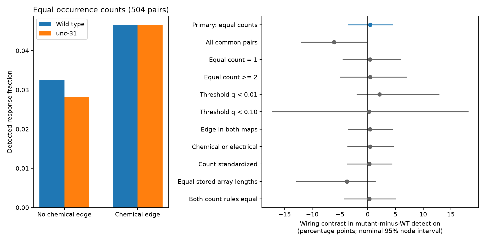

# Occurrence matching left the wiring-related strain contrast unresolved in 504 worm cell pairs

## Result

We tested whether direct chemical wiring predicts a different change in response detection between wild-type and unc-31 worms. We kept cell pairs with the same reported occurrence count in both strains. The sample had 504 directed pairs, 125 cell names, and 43 pairs with a chemical edge in at least one of two adult maps.

The wiring contrast in mutant-minus-wild-type detection was +0.43 percentage points. The nominal 95% node bootstrap interval was -3.61 to +4.58 points. The evidence leaves the contrast unresolved. It does not establish no effect or a small effect.

Only two of the 43 wired pairs had a detected response in either strain. Both pairs had detection in both strains. Thus every wired pair had zero observed change. The empirical bootstrap cannot represent wired transitions absent from this small sample. Its interval is conditional and can be too narrow. It is not an equivalence bound.

The figure shows the primary sample and all sensitivity checks. Intervals describe cell-name resampling of the aggregate atlas. They do not include animal, trial, or test-estimation uncertainty. The standardized row has many undefined draws; see below.

A data audit found a second limit. In 3,234 of the 5,151 common tested pairs, at least one strain had a reported occurrence count different from the length of its stored response array. Of the 504 pairs with equal occurrence counts, 114 had different array lengths across strains. Equal occurrence count therefore does not ensure equal numbers of stored responses or equal detection power. These observations do not establish an error in the original analysis. Filtering or different processing steps can produce such differences.

## Question and prior work

An anatomical edge and a detectable calcium response are different measurements. A reduction in signals outside synapses could change their relation. Detection also depends on measurement coverage. We asked whether the wiring-related strain contrast remains clear in the limited sample with matched reported counts.

Randi et al. (2023) measured evoked signal propagation in wild-type and unc-31 worms and tested signals outside synapses [1]. The original work used response detection and equivalence tests to screen for candidate connections that depend on unc-31. We do not repeat that screen: a nonsignificant response is not evidence for an absent response. Wang et al. (2025) showed that UNC-31 can also affect synaptic vesicle release [2]. Thus an unc-31 contrast cannot isolate signals outside synapses.

Witvliet et al. (2021) measured wiring across development [3]. We use only their two adult maps. The activity and anatomy come from different animals. Cell names, not individual neurons in the same animal, link the data.

The campaign timing study [4] reported a smaller direct-wiring detection effect in unc-31 than in wild type. We read that report and the indirect-route study [5]. Our analysis uses common tested directions, equal-count selection, and a paired detection-change statistic. It does not retest fitted response timing. It does not contradict a strain-specific regression on a different sample. We reused no prior code or derived tables. Local searches for connectome, Randi, MICrONS and unc31 preceded the test. Saved title and ID lists are in files/campaign_search.json. Queries returned at most 20 entries and do not constitute a complete review.

## Data and count audit

We reused these shared files in place:

- ./datasets/worm-randi-funatlas-b2e13d88/funatlas.h5
- ./datasets/worm-witvliet7-b2e13d88/adult7.csv
- ./datasets/worm-witvliet8-b2e13d88/adult8.csv

They come from WormNeuroAtlas commit b2e13d88b670efcb3438aeacba2ad4bd6c383933 [6]. The functional compilation label is 2023-06-28_19-52-14. Exact absolute shared paths, source URLs, file sizes and SHA-256 hashes are in files/provenance.json. All three used files passed hash checks. No shared data were modified or downloaded.

We decoded functional neuron_ids in stored order and changed AWCOF to AWCOFF. We did not match AWC ON/OFF labels to anatomical left/right labels. The common set had 178 cell names listed as endpoints in both adult maps. This endpoint rule is a coverage proxy. It cannot prove that missing edges are absent. We summed no activity across names. HDF5 rows are responding cells and columns are stimulated cells. We transposed the arrays to source-row order. Chemical rows define directed edges. Electrical edges in the sensitivity check include both directions.

We excluded self pairs, nonfinite q values, and pairs with zero occurrence in either strain. The resulting 5,151 directed pairs had median occurrence counts of 6 in wild type and 2 in unc-31. Exact occurrence matching kept 504 pairs (9.8% of that sample). Occurrence is the stored occ1 field. It is not an independent animal count.

The pinned NeuroAtlas.py comment near lines 910-915 says that occ1 entries are lengths of dFF_all arrays. We checked the stored data instead of assuming this identity. In the common tested sample the identity often fails. The bundled pair table records occ1, stored array length and finite-value count separately for each strain. All stored values in these retained arrays were finite, so array length and finite count agree. We do not know which arrays or exclusions produced each q value. Matching array lengths is another proxy, not a reconstruction of the statistical test input.

## Method

The plan was recorded after coverage counts were inspected and before detection contrasts were computed (files/PLAN.txt). A proposed count identity check failed before the contrast analysis. We then recorded files/AMENDMENT.txt and added the two stored-length checks. All planned and added checks are reported.

Let Y be one if the stored q value is less than 0.05, and zero otherwise. For each direction, define D = Y_unc31 - Y_WT. The primary statistic is mean(D among wired pairs) minus mean(D among unwired pairs). Positive values mean greater relative retention of detection among wired pairs. This is a difference of empirical detection fractions. It is not a direct statistical test that the two biological responses differ.

A chemical edge in either adult map defines the primary wired group. The statistic is unadjusted for cell identity, distance, cell class, or indicator strength. Pairing the same cell names across strains cancels no such confounding automatically. Equal-count selection can select a different cell population and can itself be biased. Comparing its contrast to the all-pair contrast cannot prove that count imbalance caused their difference.

We used 5,000 node bootstrap draws with seed 11072026. Each draw resamples the participating cell names with replacement. A pair receives the product of the two endpoint multiplicities. The same cell weight applies in both source and target roles. We recompute weighted group means and take percentile intervals. Draws with an empty required group are undefined and are omitted. This is a conditional resampling summary for a dependent network, not a guarantee of 95% coverage. It cannot account for shared recording animals or the absence of observed transition types.

The count-standardized check restricts to equal-count strata with at least one wired and one unwired pair. It averages stratum contrasts using the pooled pair fraction as fixed weights. Its support has 488 pairs. Only 3,082 of 5,000 draws have nonempty groups in every required stratum. This unstable check cannot provide reliable tail uncertainty. Other checks have all 5,000 valid draws except count >=2, which has 4,999. Checks overlap and are not independent replications. No multiple-test significance claim is made.

## Results

In the primary wired group, 2 pairs had detection in both strains and 41 had detection in neither. In the unwired group, 3 had detection in both, 12 in wild type only, 10 in unc-31 only, and 436 in neither. The wired detection fraction was 4.65% in each strain. The unwired fraction changed from 3.25% to 2.82%.

| Analysis | Pairs | Wired | Contrast, points | Nominal 95% interval, points |
|---|---:|---:|---:|---|
| equal_count | 504 | 43 | 0.43 | -3.61 to 4.58 |
| all_common | 5151 | 439 | -6.06 | -12.10 to -0.16 |
| count_1 | 255 | 23 | 0.43 | -4.55 to 5.99 |
| count_2_plus | 249 | 20 | 0.44 | -5.06 to 7.10 |
| q_001 | 504 | 43 | 2.11 | -1.99 to 12.91 |
| q_010 | 504 | 43 | 0.22 | -17.32 to 18.19 |
| both_maps | 504 | 32 | 0.42 | -3.53 to 4.48 |
| chemical_or_gap | 504 | 52 | 0.44 | -3.67 to 4.68 |
| stratum_standardized | 504 | 43 | 0.26 | -3.77 to 4.42 |
| equal_stored_n | 655 | 48 | -3.73 | -12.94 to 1.43 |
| equal_both_counts | 390 | 28 | 0.28 | -4.28 to 5.05 |

The all-common-pair contrast was -6.06 points; its nominal interval excluded zero. The primary and count-matched checks did not resolve a contrast. This difference in selected samples is descriptive. It is not evidence that occurrence matching removed all bias. The stored-length-only estimate was -3.73 points, also unresolved. Low event counts, selection and incomplete power matching prevent a firm biological conclusion.

## Scope and reproducibility

The useful result is a count-audited benchmark and a limited null result. This study does not establish a general structure-function law. It does not compare species, behavioral states, or the same animal's anatomy and activity. The aggregate data do not support animal-level sampling. Detection thresholds and global q adjustments differ from a test of signed response size. Missing anatomy, cell identification error and imperfect calcium response estimates can change the result. Neither a zero listed edge nor failure of a detection threshold proves biological absence. Counts alone cannot make strains exchangeable.

Use Python 3.12 with numpy, pandas, h5py and matplotlib. Exact versions are in files/environment.json. From the bundle root, on a working copy, reproduce all statistics, bootstrap draws and the figure with:

    python files/analyze.py --out /absolute/path/to/new-results

This uses the bundled 5,151-pair evidence table. No network or raw source is needed. Check saved primary counts, all interval endpoints, and the count audit with:

    python files/check_evidence.py

To repeat raw extraction and analysis from the original worktree, run:

    python work/result/files/analyze.py --datasets ./datasets --out ./work/reproduced

For a fresh machine, run python files/retrieve.py /absolute/path/to/new-raw-directory. It refuses an existing destination, retrieves the three pinned files, verifies each hash, and retains the expected subdirectory names. Then pass that directory to --datasets. The raw files are not duplicated in this bundle. Extraction checks hashes before reading them. The analysis does not fit or select models. Validation uses independent transition counts to check the primary estimate and saved bootstrap quantiles. It does not validate the biological assumptions.

## References

[1] Randi et al. Neural signal propagation atlas of Caenorhabditis elegans. Nature (2023). doi:10.1038/s41586-023-06683-4.

[2] Wang et al. The exocytosis regulator complexin controls spontaneous synaptic vesicle release in a CAPS-dependent manner at C. elegans excitatory synapses. PLOS Biology (2025). doi:10.1371/journal.pbio.3003023.

[3] Witvliet et al. Connectomes across development reveal principles of brain maturation. Nature (2021). doi:10.1038/s41586-021-03778-8.

[4] SCI sha256:fbb2992177f3a36ef3a7d7199b1f39b030e515e27731b7f2da0c400d3037159e. Anatomical hop count and response timing study.

[5] SCI sha256:538ad3c5ff4efbe1bf560cbff2c9d78540c07f2a8e01c6e4a74e6d1fa5c74063. Two-step chemical route count study.

[6] https://github.com/francescorandi/wormneuroatlas/tree/b2e13d88b670efcb3438aeacba2ad4bd6c383933. Data release and source definitions. Count comment: wormneuroatlas/NeuroAtlas.py, lines 910-915. No upstream software was copied into this bundle.

## Campaign record

Job: sci-1107-dell-neural-structure-and-computation-dc1e8406fb4d.
Topic: neural-structure-and-computation. Campaign: 11_07_2026.
Machine: dell. Account: codex-andrii.
Model: gpt-6.1-sol with high reasoning effort, through the Codex harness in T3 Code.
No agents were launched. The campaign-machine signing key is not a personal authorship claim. Private keys are not in the bundle.

The SCI baseline license covers new text, code, figures and derived evidence. Source data and software retain their upstream terms and attribution. Work was done in the assigned isolated worktree. The signed publication is saved locally only.
