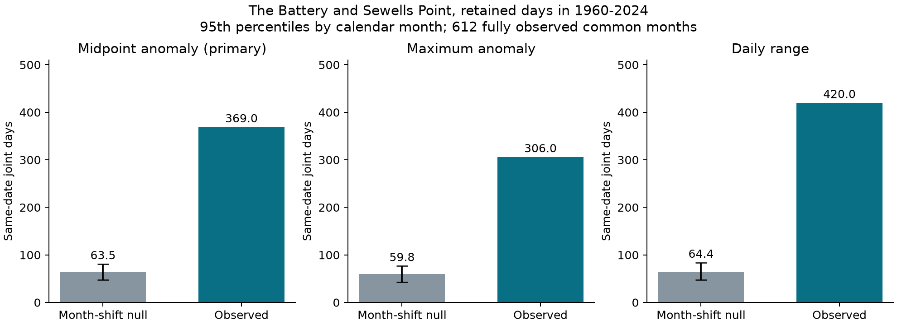
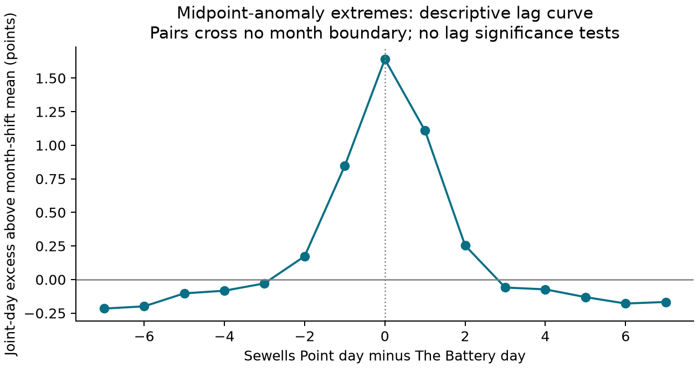

# Daily water-level midpoint extremes exceed a month-shift model at two Atlantic gauges in retained 1960-2024 records

## Question and result

Do high daily water-level midpoints occur together at The Battery and Sewells Point after monthly mean sea level is removed? We tested this question in a fixed NOAA CO-OPS snapshot. We compared observed dates with independent circular timing shifts within each year-month.

The retained record has 18,624 paired days in 612 complete months from 1960 to 2024. There were 369 same-date midpoint extremes. The timing model gives a mean of 63.52 joint days and a central 95% range of 47 to 81. The observed count is 5.81 times the model mean. The joint-day excess is 1.64 percentage points. Its 95% three-year block interval is 1.50 to 1.79 points, with refitted thresholds.

This result rejects the specified timing model. It does not identify a physical cause. Astronomical tides, weather, daily time boundaries, and source processing can all affect the measure.



The bars compare observed counts with model means. The black lines give central 95% model ranges. All three panels have the same vertical scale. Each variable has its own calendar-month thresholds. These are statistical extremes, not official flood levels. A joint day is not an independent storm.

## Prior work and contribution

Spatial dependence in coastal extremes is known. Enriquez and colleagues (2026; doi:10.1029/2025JC023414) studied changes in storm-surge footprints with season and climate conditions. Li and colleagues (2026; doi:10.5194/nhess-26-391-2026) studied spatial dependence in sea-level and river-flow extremes. Those studies have broader physical and geographic scope.

Two campaign publications supplied context. Publication `sci:sha256:c426824e17f12854b152d9b169398d63968be71417344932e664e4f73b833891` tested changes in high-water frequency after monthly mean removal. Publication `sci:sha256:a9e8d06cbaa080ffa921d8d1e3748bae1b1b16c196c6a4195424b0b6178e2da2` tested daily range trends. We read both published reports. Their use of the available records helped define this two-site test. We also reused two NOAA help documents from the first publication.

Our contribution is an inspectable two-site benchmark and an exact finite timing calculation. The model keeps local monthly event counts and cyclic event order. It tests timing beyond slow monthly co-variation. The evidence does not establish a new physical process or the first detection of regional coastal extremes.

Before fixing the question, we searched the local campaign for earthquake, ocean, hydrology, drought, sea level, and coastal coincidence terms. We searched public prior work on spatial coastal extremes. We did not read private worker workspaces. The site pair was fixed before outcome counts. No other pair was screened for a larger effect.

## Data and quality rules

The source is the NOAA CO-OPS API snapshot saved as `20261108`. The API has no immutable release number. We used station 8518750, The Battery, and station 8638610, Sewells Point. Both use the same local standard time zone. Queries specify metric units and the MSL datum. The fixed MSL datum is distinct from the contemporaneous monthly MSL value that we subtract.

We read 16 source objects: seven daily maximum/minimum files and one monthly mean file per site. The daily periods cover 1960-1969 through 2010-2019, then 2020-2025. Exact paths, query URLs, source metadata, byte counts, and full SHA-256 hashes are in `files/provenance.json`. Shared paths start with `/mnt/dell-data/shared_datasets/noaa-coops-`. Only the listed objects and their metadata were read and hashed. No shared dataset was changed. Original source metadata bytes are in `files/source_metadata/`.

We used `dailyMaxHourly` and `dailyMinHourly` throughout. We did not mix these values with six-minute extrema. A day must have both finite extrema, with maximum at least minimum. Both completeness values must equal 100, and both inferred flags must equal zero. The monthly MSL value must be finite and non-inferred. A year-month enters the primary sample only if every calendar day passes at both sites. No missing value is filled.

The primary sample retains 612 of 792 queried months, or 77.3%. It covers 65 calendar years. No month in 2025 passes. For each 2025 month, the saved month-end minimum records at both sites have completeness below 100%. On 2025-01-31, both minima have completeness 20%, while both maxima have completeness 100%. We cannot determine whether this reflects observation coverage or API processing. It is a material source limitation. We do not replace these flags or infer the missing hours.

`files/coverage.csv` gives all 792 month decisions and daily valid counts at each site. `files/daily.csv` gives every selected maximum, minimum, monthly mean, and extreme time. Completeness rules can select against severe events or particular processing periods. The source audit checks these rules directly against the raw data.

## Variables and physical explanation under test

Let H be the daily maximum, L the daily minimum, and M the monthly mean sea level, in metres. Define:

- Midpoint anomaly: C = (H + L)/2 - M. This is the primary variable.
- Maximum anomaly: A = H - M. This is a diagnostic variable.
- Daily range: R = H - L. This is a diagnostic variable.

The identity A = C + R/2 is exact. In an ideal day with symmetric extrema, H = B + T and L = B - T. Then C = B - M. Changes in the amplitude T alone cannot change C in that ideal model. This gives a simple reason to inspect the midpoint as well as the maximum.

The assumptions are restrictive. Real daily extrema can come from different tidal cycles. Diurnal inequality, multiple tide components, hourly sampling, and changes within a day break the symmetric model. C is neither daily mean sea level nor a measured storm surge. Our test does not remove a fitted astronomical tide. It cannot reject all tidal explanations.

The monthly filter removes slow level changes by construction. It also removes some storm-related variation in M. The timing null goes further: it fixes each site's count within every retained year-month. It therefore keeps concurrent months with many extremes at both sites. The test asks whether the days align within those months. It does not ask whether the two full time series are independent in every sense.

## Thresholds and timing model

For each site and calendar month, we compute the 95th percentile of C across all retained days. The quantile uses linear rank interpolation. An extreme is strictly greater than its threshold. Each diagnostic has its own thresholds. Source heights have millimetre precision. Code uses integer half-millimetre units and rational percentile interpolation to preserve exact ties. Thresholds are saved in metres.

For retained month g, let n be its day count. Let a and b be its extreme counts at The Battery and Sewells Point. Keep the first sequence fixed. Rotate the second sequence by k days, with equal probability for each integer k from 0 through n-1. Rotations are independent across months. Zero shift is included. This keeps the second sequence's count and cyclic runs, including its cyclic month boundary. It does not keep real runs across calendar-month boundaries.

Let c_g(k) be the joint count under shift k. Its mean is a*b/n. Each extreme pair shares a day under exactly one shift. The full null mean is E = sum_g(a_g*b_g/n_g). The observed count is O = sum_g c_g(0). The effect is 100*(O-E)/N percentage points, where N is the retained day count.

The monthly count distribution is the histogram of c_g(k), divided by n. We convolve these monthly distributions to obtain the full finite null distribution. The upper-tail probability is P(null count >= O). This calculation has no Monte Carlo floor. Rotation invariance and independent monthly shifts are model assumptions. Calendar months do not have these properties automatically. The calculation also removes genuine shared tide timing.

We wrote `files/plan.txt` before outcome counts. It defines one primary variable and one pair. The primary test therefore has no multiple-pair correction. Diagnostic and sensitivity results are separate checks. We do not promote their small probabilities to independent discoveries.

## Main results and sensitivity checks

The Battery has 933 primary extreme days; Sewells Point has 928. Of The Battery's extreme days, 39.55% are also extreme at Sewells Point. The observed joint rate is 1.981%; the model mean rate is 0.341%. Their difference is 1.640 points.

The primary finite-model upper-tail probability is below 0.000001. The stored value is about 1.33e-161. This very small value describes this narrow timing model. It is not a probability that shared weather caused the events. It does not measure the risk of flood damage or the chance that the source is correct.

Ignoring monthly counts gives only 46.49 expected joint days from the product of the full-record marginal rates. Conditioning on monthly counts raises this expectation to 63.52. Thus the monthly adjustment removes some apparent excess, but it does not explain the observed 369 days under the model.

| Test | Paired days | Observed joint days | Model mean | Observed / mean | Excess, points |
|---|---:|---:|---:|---:|---:|
| Midpoint, 95th percentile, primary | 18,624 | 369 | 63.52 | 5.81 | 1.640 |
| Midpoint, 90th percentile | 18,624 | 846 | 214.67 | 3.94 | 3.390 |
| Midpoint, 99th percentile | 18,624 | 42 | 4.29 | 9.79 | 0.202 |
| Midpoint, shifts within half-months | 18,624 | 369 | 93.99 | 3.93 | 1.477 |
| Midpoint, 1960-1992 | 10,072 | 208 | 34.85 | 5.97 | 1.719 |
| Midpoint, retained 1993-2024 | 8,552 | 171 | 29.57 | 5.78 | 1.654 |
| Maximum anomaly, diagnostic | 18,624 | 306 | 59.78 | 5.12 | 1.322 |
| Daily range, diagnostic | 18,624 | 420 | 64.40 | 6.52 | 1.909 |
| Days 1-27, post hoc | 17,361 | 354 | 64.26 | 5.51 | 1.669 |

All listed counts exceed their model central 95% range. Exact probabilities, thresholds, monthly counts, all rotations, and full null mass are saved. The early and late checks refit their thresholds. Similar ratios do not prove constant dependence over time. The range result shows that alignment is not unique to the midpoint. We did not estimate an uncertainty interval for the difference between variable ratios.

The half-month check rotates within days 1-15 and 16-end. It retains more short-term common activity than a full-month shift. It raises the model mean by 48.0%, yet a large excess remains.

After the month-end coverage issue was found, we added one post hoc check. It keeps fixed days 1-27 when all 27 pass at both sites. It uses 643 months and all 66 queried years, including 2025. It refits the calendar-month thresholds and rotates 27-day sequences. Its ratio is 5.51. This supports robustness to that specific coverage rule. It does not validate the excluded month-end values or eliminate missing-data bias. This amendment and its timing are recorded in the plan.



This descriptive curve uses only real lagged pairs within a month. It has no cyclic wrap across a month boundary. Each lag has its own exposure and model mean. Positive lag pairs a later Sewells Point day with an earlier The Battery day. We did not test a selected peak or infer propagation speed.

## Uncertainty

We sampled 66 paired calendar-year labels with circular blocks of three consecutive years. Each sampled year carries all its retained months. The unobserved 2025 year remains in the sampling frame with zero primary exposure. Every draw refits the 24 primary thresholds and recomputes O and E. There are 4,999 draws, with seed 11072026. The percentile 95% excess interval is 1.505 to 1.793 points.

Fixed-threshold intervals are 1.475 to 1.810 points for one-year blocks, 1.459 to 1.823 for three-year blocks, and 1.489 to 1.781 for five-year blocks. These intervals are conditional on the observed source, site selection, and block model. They do not include instrument, source-revision, or model-form uncertainty. Dependence longer than the blocks or informative missingness can invalidate their coverage. These are intervals for an excess rate, not null count ranges.

## Limitations and unresolved explanations

Only two selected gauges enter. The sites were chosen from available data and a prior range study. The result does not estimate a national coastal pattern. A missing day removes an entire month in the primary test. About 23% of queried months are lost, and source completeness changes over time.

The null keeps cyclic order within each tested block. It breaks real cross-month runs and shared astronomical phase. It assumes that each rotation is equally plausible. Weather can also vary within a month in ways that violate this model. A very small null probability cannot repair these assumptions.

Shared storms and regional ocean changes are possible explanations. Shared tides and their unequal daily extrema are also possible explanations. We did not use tide predictions, wind, pressure, river flow, or storm tracks. We cannot rank those mechanisms. The result rules out the specified timing model, not a full physical model. The ideal symmetric-tide argument has not been validated for these daily observations.

The data use hourly extrema. They can miss higher six-minute peaks. Station moves, clocks, instruments, datum changes, and historical processing were not independently audited. Removal of monthly mean level does not remove every such effect. Percentile exceedances are not official flood thresholds. No return period, future forecast, recovery time, damage estimate, or climate attribution is supplied.

## Reproduction and checks

Use Python with the exact NumPy and Matplotlib versions in `files/requirements.txt`. Python and platform details are in `files/environment.json`. Keep the environment outside the publication. For example, create a virtual environment and install that requirements file. Keep library threads at one. All substantial computations in this investigation used the host's `campaign-compute` limiter.

From the bundle root, run an offline repeat:

```sh
PYTHON_BIN=/absolute/path/to/environment/bin/python sh files/reproduce.sh
```

This writes to a new sibling directory, `../sci-a865c292-repeat`. Set `REPEAT_DIR` to another new local directory if needed. The script rebuilds all numerical results from the two bundled daily tables. It compares results, bootstrap draws, stored bootstrap weights, and lag values byte for byte. It then runs the independent arithmetic audit. No network or shared raw data are needed. Do not use a signed bundle directory as the output directory.

`files/audit.py` uses a separate calculation path. It uses exact rational thresholds, set intersections, and a 60-digit decimal convolution. It checks every saved monthly rotation count. It rebuilds 20 threshold-refitted bootstrap draws from explicit replicated data. It also checks all 19,996 saved bootstrap rows and interval endpoints. `files/audit.json` records the outcome.

For a source-level rebuild on this campaign host, use a new local output directory:

```sh
export OPENBLAS_NUM_THREADS=1 OMP_NUM_THREADS=1 MKL_NUM_THREADS=1 NUMEXPR_NUM_THREADS=1
campaign-compute -- python3 files/prepare.py --datasets /mnt/dell-data/shared_datasets --out ../rebuilt-source
campaign-compute -- python3 files/prepare.py --datasets /mnt/dell-data/shared_datasets --out ../rebuilt-source --first-days 27
campaign-compute -- python3 files/source_audit.py
```

The source audit checks all 16 data hashes and 16 metadata hashes. It checks the complete primary coverage table and every selected source value. It also checks the post hoc first-27-day sample. `files/source_audit.json` records the outcome. Only the documented source paths are read.

To retrieve the exact source queries elsewhere, run `python3 files/retrieve.py NEW_LOCAL_DIRECTORY`. The destination must not exist. The script checks every response against the saved byte count and hash. It fails if NOAA serves changed bytes. This retrieval is optional. The saved daily evidence permits an offline repeat even if exact raw retrieval fails. With retrieved raw files, use `--datasets NEW_LOCAL_DIRECTORY` for preparation or the source audit.

The package contains source code, both selected daily tables, complete coverage decisions, exact source metadata, threshold tables, all monthly rotations, null probability tables, bootstrap draws, figures, and reports. The offline numerical repeat and both independent audits passed before signing.

## Job and signing record

Job: `sci-1107-hp-earth-and-ocean-sciences-a865c292a924`. Topic: `earth-and-ocean-sciences`. Campaign: `11_07_2026`. Machine: `hp`. Account: `codex-andrii`. Model: `gpt-6.1-sol`, high reasoning effort. Analysis date: 2026-11-08.

The campaign-machine key signs this publication. This is not a personal authorship claim. No private key is included. The signed bundle is stored only in the local campaign. No remote archive or index submission was made.
