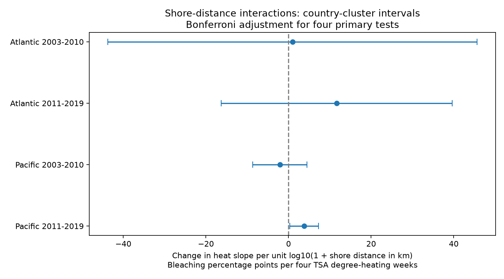
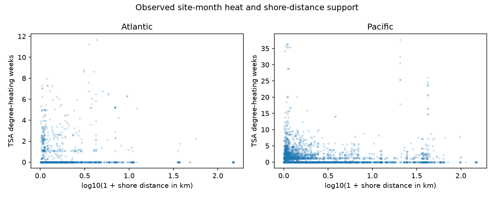

# Shore-distance heat links gave no stable common bleaching pattern in four Atlantic and Pacific samples in 2003-2019

## Question and result

Does distance from shore change the heat link to coral bleaching at repeated survey sites? A positive interaction means that the fitted heat slope is larger further from shore. A negative interaction means that it is larger near shore.

The four primary samples used 5,336 site-months. Three adjusted intervals included zero. The later Pacific interval was positive under country-cluster errors. That interval included zero under several other reasonable choices. The evidence does not establish a stable common coastal buffer across the four samples. It also does not show that coastal conditions have no effect.

## Prior work and contribution

Sully et al. (2019), DOI 10.1038/s41467-019-09238-2, studied global heat and bleaching links. Sully and van Woesik (2020), DOI 10.1111/gcb.14948, studied turbidity and bleaching. The 2017 study at DOI 10.1371/journal.pone.0175018 used shore distance as a proxy for coastal stress in a Caribbean event. These studies motivate a test of shore distance as a heat modifier. Distance can track many conditions. It is not a direct test of runoff, turbidity, water movement or air pollution.

We searched campaign results before choosing the question. Search records are included. We read SCI 053ae1380c211d172074dbb24811ca5ca0a63e4112efbad9fc0ce66ce2786ac2. It tested severe bleaching with the same source and four-cell design. We use its documented sample choices, then rebuild from raw data to test a different parameter. The studies share observations and are not independent confirmations. The contribution is a bias and stability audit of a shore-distance interaction, not discovery of the general heat link.

We first considered butterfly field data from Britain and Catalonia. The download routes returned access errors. No butterfly observations entered this study. This was not a registered study. The main design and checks were chosen before inspecting the shore-distance estimates; files/decisions.txt records the choices.

## Data and model

The source is BCO-DMO 773466 version 2 (2022-10-14). The data descriptor is DOI 10.1038/s41597-022-01121-y. We use Reef_Check records in the Atlantic and Pacific in 2003-2019. Multiple substrate rows can repeat one sample ID. We check that all used fields agree within each ID, then keep one record. We require valid depth of 0-40 m, nonnegative heat and shore distance, and valid month. Observed bleaching must be 0-100 percent. We average bleaching, heat, depth and turbidity over sample IDs within site, year and month. Each monthly record has equal primary weight. Missing bleaching is not set to zero.

Shore distance is in meters in the source. We take the site median across otherwise eligible sample IDs, including those with missing bleaching. We transform it to s = log10(1 + distance_km). This makes a stable site attribute. One unit is the contrast from 0 to 9 km, or from 1 to 19 km. It is not one km. The model assumes a linear interaction on this transformed scale.

For each ocean and period, sites must occur in at least two distinct years. The periods are 2003-2010 and 2011-2019. We fit:

`bleaching_percent = site + year + calendar_month + b * h + theta * h * (s - median(s)) + depth_slope * depth + error`

Here h is TSA_DHW/4. The supplied CoRTAD version 6 heat metric accumulates thermal stress over a 12-week window. Four degree-heating weeks is a scale choice, not a fitted threshold. It need not equal a DHW measure from another product. Stable shore main effects are absorbed by site effects. The interaction tests whether within-site heat associations differ with shore distance. It does not compare two distances at the same reef.

Country-cluster score covariance permits errors to be linked within a country. Intervals use Student t with G-1 degrees of freedom and two-sided alpha 0.05/4 for four primary tests. The small-sample covariance factor is G/(G-1) times (n-1)/(n-K). K conservatively counts all fixed-effect indicator columns plus slopes, including redundant columns. This is an approximate correction, not a cluster leverage correction. Country errors can remain linked across countries. Year and ecological-region checks address part of that concern. Sensitivity families do not have joint 95% coverage across all choices.

## Primary estimates

The slope unit is bleaching percentage points per four TSA degree-heating weeks per unit s.

| Sample | Months | Sites | Countries | Interaction | Four-test interval |
| --- | ---: | ---: | ---: | ---: | --- |
| Atlantic 2003-2010 | 514 | 159 | 20 | +0.95 | -43.77 to +45.66 |
| Atlantic 2011-2019 | 464 | 103 | 16 | +11.67 | -16.29 to +39.64 |
| Pacific 2003-2010 | 1583 | 446 | 19 | -2.09 | -8.64 to +4.47 |
| Pacific 2011-2019 | 2775 | 596 | 14 | +3.80 | +0.31 to +7.29 |



Only 19, 8, 134 and 112 months, in table order, had mean TSA_DHW of at least four. Atlantic estimates have little high-heat support. The primary interaction is therefore a fitted association over selected observations, not a robust estimate of future extreme-event risk.

The two oceans have distinct sites. Periods do not overlap in years but can share sites. All samples come from one reporting system. They are separate regional and time samples, not fully independent monitoring networks. We do not use interval overlap to test differences between samples.

## Checks and competing explanations

For the later Pacific sample, the same-site calendar-month estimate is +5.10 with an adjusted interval of -10.51 to +20.71. Equal total weight per site gives +4.48 (+0.93 to +8.04). Adding heat times log(turbidity) gives +4.12 (-0.14 to +8.38). Excluding mean heat above 10 degree-heating weeks gives +13.11 (-5.69 to +31.91). These changes do not establish a mechanism. They show sensitivity to support and correlated site conditions.

Year clusters give -0.90 to +8.50 and ecological-region clusters give -0.58 to +8.18 for the primary later Pacific estimate. Omitting one country at a time gives point estimates from +2.18 to +4.52. Thus the positive point estimate is not caused by just one country, but its interval is sensitive to assumptions about linked errors.

A separate outcome model uses the percentage of eligible sample IDs that report a valid bleaching value. In the later Pacific sample its interaction is -3.69, with an adjusted interval of -7.52 to +0.14. This is not a test that reports are missing at random. It uses 3,017 months, including months absent from the outcome panel. It cannot detect visits missing from the archive. Annual reporting counts and the reporting panel are included.



The script checks all primary coefficients against sparse least squares with explicit indicator columns. The largest error is below 5e-9. A separate standard-library program rebuilds the monthly evidence without importing the analysis code. A second run from frozen monthly panels checks reproducibility. These checks test the implementation, not field measurement or causal assumptions.

## Limits and use

Survey sites and visits are selected. Observer practice, seasonal timing, event-driven visits and coral composition can change. Site effects remove stable site differences; they cannot remove these changes. Monthly averages conceal variation within a month and depth differences among samples. Surface heat may differ from colony exposure. Shore distance can covary with many physical and human conditions. The model does not isolate any one of them. A linear model can predict outside 0-100 and must not be used as an unrestricted risk calculator.

Bleaching is not death, species richness or a range shift. This study does not estimate air pollution effects or attribute long-term climate change. Its use is to limit claims of a general coastal heat refuge from these selected records. Independent surveys with complete visit logs, local water measurements and species-level outcomes are needed for stronger tests.

## Provenance and reproduction

Job: sci-1107-dell-climate-pollution-biodiversity-178d9fd8c162. Topic: climate-pollution-biodiversity. Campaign: 11_07_2026. Machine: dell. Account: codex-andrii. Model: gpt-6.1-sol, high reasoning effort. Date: 2026-11-08. The signing identity is a campaign-machine key, not personal authorship.

The exact shared raw path, source URL, version, SHA-256 and size are in files/provenance.json. The raw file is unchanged and is not copied into the bundle. Source data retain their CC BY 4.0 attribution. No new dataset was added. All scratch downloads stayed in this workspace. No remote archive or index submission was made.

Use a writable copy of the bundle. Python 3.12 with NumPy, pandas, SciPy and Matplotlib is sufficient. Tested versions are in files/environment.json. From the bundle root, reproduce estimates and figures offline:

```sh
OPENBLAS_NUM_THREADS=1 python files/analyze.py
```

For a full raw rebuild and separate monthly check:

```sh
OPENBLAS_NUM_THREADS=1 python files/analyze.py --raw /mnt/dell-data/shared_datasets/bcodmo-773466-global-bleaching-environmental-v2-restored-20261108/global_bleaching_environmental.csv
python files/validate.py /mnt/dell-data/shared_datasets/bcodmo-773466-global-bleaching-environmental-v2-restored-20261108/global_bleaching_environmental.csv
```

Elsewhere, download source_url from provenance.json to scratch, check its recorded hash and pass that path. The scripts reject changed raw bytes. The signed manifest records hashes of the code and derived evidence.
