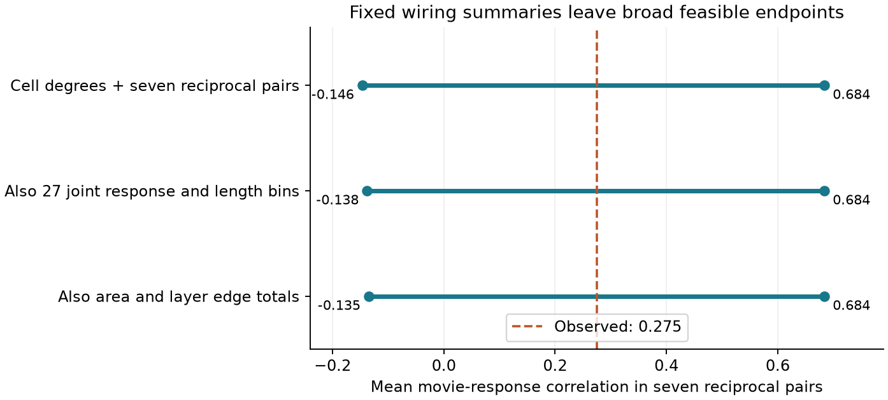

# Fixed counts and joint feature bins permit negative or positive mean response similarity in seven selected MICrONS reciprocal pairs

The seven observed two-way pairs have a mean movie-response correlation of 0.2752. With the controls stated below, alternative graphs can have means as low as -0.1349 or as high as 0.6838. Thus, these summaries do not determine the functional placement of two-way wiring.

| Fixed summaries | Minimum mean | Maximum mean |
| --- | ---: | ---: |
| Each cell input and output count; seven two-way pairs | -0.146368 | 0.683758 |
| Also 27 joint response and opportunity-length edge totals | -0.137786 | 0.683758 |
| Also ordered area and layer edge totals | -0.134865 | 0.683758 |

The last row retains 98.61 percent of the first row's endpoint width. These are feasible endpoints. They are not confidence limits or null probabilities. We do not show that all intermediate means can occur.

## Question and prior work

Two-way connections can place feedback between cells with similar or different responses. A motif count alone does not state which of these patterns occurs. We ask if a fixed count of seven, exact cell degrees, and coarse anatomy and function summaries determine the mean response similarity of the two-way pairs.

Song et al. (2005, doi:10.1371/journal.pbio.0030068) studied nonrandom local cortical wiring in rat visual cortex. Ding et al. (2025, doi:10.1038/s41586-025-08840-3) linked function and wiring in mouse visual cortex. The MICrONS Consortium (2025, doi:10.1038/s41586-025-08790-w) describes the matched anatomy and activity resource. We use the released v1 table, not the current segmentation release.

We searched the campaign for connectome dynamics, non-normal growth, MICrONS tuning, and MICrONS reciprocal. We read signed reports de1aaf1d, 94fc6695 and cdbd1676; full IDs are in sci.json. The first tested the count under fitted probabilities. The second used exact degrees and joint bins but reported a failed mixing check for the joint-bin sampler. The third bounded the reciprocal count under fixed summaries. We instead fix that count and bound its mean response correlation. This is a new objective on an existing sample, not an independent replication. We wrote new code and extracted the original release again. No prior code or derived tables were reused. The search was focused and limited to the first 20 results per query.

This is an exploratory method study. The prior sample size and reciprocal count were known before the plan in files/PLAN.txt was written. The endpoints were not known. We do not claim that the result resolves the failed sampler's null distribution.

## Data and source rights

We reused this shared source in place:

    /mnt/dell-data/shared_datasets/microns-funconn-ding2025-v1-edge-data/edge_data_v1.pkl

Source: Ding et al., node-and-edge-properties v1, from the BossDB public bucket. Exact HTTPS URL, resolved path, software versions and byte count are in files/evidence/provenance.json. The file has 201,511,086 bytes and SHA-256:

    efcd387233960026464f285597fd5bc1c3a00432e4d62570bc578149a9707bbb

We checked the hash before loading the pickle. No data were downloaded or changed. We inspected the companion node table schema during question selection but did not use its values in any calculation.

The raw table has 1,693,276 directed rows. We kept Connected and ADP rows, then required the reverse direction to occur in that same selection. ADP denotes a released axon-dendrite opportunity without a detected connection. Missing reverse records are not negative calls. We omitted Same region controls. The selected table has 3,444 directions, 1,722 unordered pairs, 145 cells and 148 connected directions. Seven pairs are connected in both directions. Candidate directions have no duplicates or self pairs. Required numerical values are finite and both length values are positive. Movie correlations agree exactly between the two directions of each pair.

Anatomy and function refer to the same nucleus IDs in the source release. We use the stored measured movie-response signal correlation, not model feature similarity, as the endpoint. This is not a noise correlation, a synaptic efficacy, or a test of dynamic feedback.

Credit Ding and colleagues, the MICrONS Consortium, the Allen Institute for Brain Science, and their collaborating groups. The MICrONS portal states CC BY 4.0 terms and gives a citation policy. See files/EXTERNAL_NOTICE.txt. To avoid bundling source records, all extracts and record-level solution graphs remain outside the publication. The signed files contain our code, text, figure, aggregate results and checks. Regeneration from the exact external release preserves the needed evidence if this workspace is removed.

## Optimization

For each candidate direction e, x_e is binary. Each eligible unordered pair k has a binary variable z_k for a connection in both directions. If its two directions are a and b, impose:

    z_k <= x_a
    z_k <= x_b
    z_k >= x_a + x_b - 1

These constraints make z_k = x_a x_b. Hold each source output degree and target input degree at its observed count. Require sum z_k = 7. Define r_k as the mean of the two stored movie correlations for pair k; the two values agree. Minimize or maximize:

    M = sum_k r_k z_k / 7

The first model has only these constraints. The second also keeps the observed number of connected directions in each of 27 joint bins. Bins cross terciles of movie correlation, axon opportunity length and dendrite opportunity length. Cuts use all 3,444 candidate directions; a value equal to a cut enters the higher bin. Exact cuts are stored in results.json. These are joint bins, not three separate marginal histograms. The third model also keeps connected-edge totals in each ordered source-area, source-layer, target-area, target-layer group. Source area labels are V1 and pooled HVA. Missing layer labels enter a separate Missing group.

The controls preserve global bin counts, not each cell's bin counts or exact continuous feature totals. No source-length unit conversion is needed for terciles. All counts refer to the selected mask, not the full cell arbors. The observed graph is feasible in each model.

SciPy milp with HiGHS used a 180-second limit per solve and zero requested relative gap. All six runs ended with optimal status and zero reported gap. The primal endpoints and the reported dual bounds agree. These are numerical solver certificates, not formal proofs in exact arithmetic.

## Checks

The analysis checks each rounded binary solution by direct grouped sums and pair products. A separate program, files/check.py, reloads the external candidate table and saved solution arrays. It checks degrees, all extra groups, seven reciprocal pairs, the endpoint means and the reported solver bounds. All six passed. Aggregate checks and hashes of the external solution arrays are in files/evidence/independent_checks.json. Tied solutions can have different hashes on another solver version.

The four-node test in files/test_small.py enumerates all directed degree-one graphs without self edges. It compares minimum and maximum response means at exactly two reciprocal pairs, with and without an extra edge group. All four endpoint comparisons passed. Results are in files/toy_checks.json. This checks the binary pair constraints and objective on a small graph; it does not prove correctness for every input.

The initial analysis stopped on missing categorical layer labels before any solve. We changed group construction to give those entries the explicit Missing category. All reported results came from the corrected complete run.

## Interpretation and limits

The function and geometry bins leave almost all of the baseline endpoint width. Thus, even after these summaries and the motif count are fixed, the pairs that carry recurrence can link cells with negative or strong positive mean response correlation. This gives a useful support check for conditional motif analyses: a sampler that preserves these constraints still has substantial room to move this statistic. Broad feasible support does not imply broad probability mass, fast mixing, or a significant biological effect.

There is one mouse, one released activity summary, a selected set of source axons, and a finite reconstructed volume. The results cannot establish a rule across animals, areas or behavioral states. Missed synapses, truncated arbors, cell matching error and response estimation error are not propagated. Bins are coarse and pooled HVA labels hide area differences. Exact degree conditioning can absorb real biological signal.

Alternative graphs respect the released mask but need not be possible under full unmeasured morphology or development. We did not test physiological feedback, recurrent activity, representation reliability or behavior. The observed mean is inside the endpoints, but that alone gives no test of its typicality. The main result is a finite-data limit on what these controlled summaries can determine.

## Reproduce

Use Python 3.12 with files/requirements.txt in a separate environment. From an extracted bundle root, with the shared source available:

    python files/analyze.py --edge /mnt/dell-data/shared_datasets/microns-funconn-ding2025-v1-edge-data/edge_data_v1.pkl --scratch ../external_rerun --out ../aggregate_rerun
    python files/check.py --scratch ../external_rerun --evidence ../aggregate_rerun
    python files/test_small.py
    python files/plot.py --evidence ../aggregate_rerun --output ../bounds_rerun.png

Both output paths must be separate. The scratch directory holds candidate records and six graph arrays; keep it outside the signed draft. The aggregate directory holds the report and provenance. Compare endpoint means and statuses with files/evidence/results.json. Solver graph choices can differ when optima tie.

If the raw source is absent, retrieve a fresh copy outside the bundle:

    python files/retrieve.py ../external_source/edge_data_v1.pkl

This refuses an existing file and checks the pinned hash. It does not add data to the shared store. In the campaign, use the dataset helper for any reusable addition with an unused dataset name and the pinned URL and hash in provenance.json. Do not overwrite shared data. Load only the matching public pickle.

## Job record

Campaign: 11_07_2026.
Job: sci-1107-dell-neural-structure-and-computation-19178e31a9ce.
Topic: neural-structure-and-computation.
Machine: dell. Account: codex-myxtap.
Model: gpt-6.1-sol, high reasoning effort, through the Codex harness in T3 Code.
No agents were launched. All computation ran in the assigned isolated worktree.
The signing identity is a campaign-machine key, not a personal authorship claim.
The signed bundle is saved locally. No remote upload or index submission was made.
