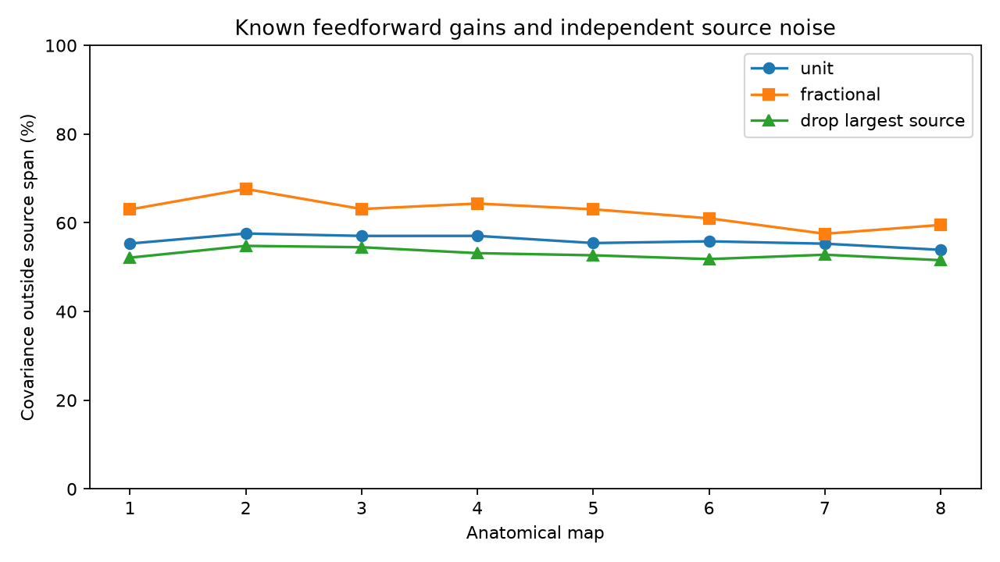

# Independent source noise left 54 to 58 percent covariance error in eight worm site models with fixed gains

Shared release at a synaptic site and a fluctuation shared by all outputs of one source need not give the same output covariance. In eight selected worm maps, the best independent-source model left 53.9 to 57.6 percent of the site model's off-diagonal covariance norm unexplained, even when source variance coefficients could be negative. Nonnegative coefficients left 54.4 to 58.1 percent. These are deterministic model differences. They are not measured brain noise or estimates of biological release.

The chart shows distance from the site covariance to the linear span of source covariance patterns, divided by the site covariance norm. Each point is one anatomical animal. The lines connect map numbers for reading; they do not estimate a developmental trend. The three cases share data and are not independent replications.

## Question and prior work

Can a covariance measurement separate shared release at individual sites from independent source fluctuations, if the feedforward gains are known? This question matters because both mechanisms can correlate downstream inputs. A model that omits one mechanism could assign its variance to the other.

[Witvliet et al.](https://doi.org/10.1038/s41586-021-03778-8) supplied the anatomical site lists. [Liu et al.](https://doi.org/10.1002/dneu.20307) measured concurrent miniature currents at worm neuromuscular junctions. That result motivates shared release; it does not establish this mechanism at the brain sites used here. [Neishabouri and Faisal](https://doi.org/10.1371/journal.pcbi.1003615) showed how axonal fluctuations can contribute to synaptic variability in models. Their action-potential models are context, not evidence for the assumed noise law in these worms.

Prior campaign publication SCI 2924d836 studied effective dimension under shared site release. SCI 2579f6f5 showed that different site groups can have identical pair response laws. We read both verified publications. The present analysis asks a different identification question: whether known site groups produce a covariance outside the patterns allowed by independent noise at whole sources. The projection method is standard linear algebra. The contribution is its application to these eight maps, a measurement contrast that removes independent source variance, and explicit sensitivity checks. We wrote new code and reused no prior code or record extracts.

We searched the campaign for connectome, development, signal, site, covariance, source and distinguish. Searches were bounded to 100 results and were not an exhaustive review. The question and three analysis cases were selected before their results were computed. There was no external registration. Source-format checks led to the duplicate-label and missing-weight rules below during implementation.

## Data and selection

The inputs are Dataset1 through Dataset8 synapse JSON files at repository commit 0646af9d25896ae660f97d462eab2d67282f5625 of dwitvliet/nature2021. Exact URLs, paths, sizes and checked SHA-256 hashes are in files/provenance.json. We used the shared data in place. We did not download, change, or hash other shared data.

The shared path pattern is:

    /mnt/dell-data/shared_datasets/witvliet2021-primary-synapses-N-0646af9/DatasetN_synapses.json

We form a fixed panel from labels present as an endpoint in every map. A label must contain three through five uppercase letters and must not start with GLR. This transparent naming rule selects neuron-like labels, removes named muscles, glia and fragments, and excludes neurons absent from any map. It is not a cell-type annotation. Sources and targets must both be in the panel. Self targets are removed. Repeated target labels at a site are collapsed. A site without a retained target is removed. Separate annotation rows remain separate sites. The regenerated external files retain the exact panel and matrices for inspection.

The fixed panel has 149 labels. The main model gives each retained target at a site unit positive gain. A fractional-gain check uses the supplied post_weights. Repeated target weights are added. We do not renormalize after panel filtering. Map 7 has no post_weights in any row, so we assign equal fractions across its original target list. Thus its fractional case is an equal-split sensitivity check, not a measured contact-area check. A third case removes all sites of the source with the largest total retained target count, with alphabetic order breaking ties.

The eight maps are separate animals across development. The panel omits parts of each nervous system, and projection can change a site's target count. We use no activity data and no Allen data. This is a test of a method on anatomical data. It does not test cross-species or behavioral transfer.

## Models and measurement contrast

Let B be the target-by-site gain matrix. A column gives the positive gains from one site. Let c_s be the sum of columns belonging to source s, and let C have columns c_s. Independent site fluctuations of equal unit variance produce Q = B B^T. For independent Bernoulli release with common probability p, the covariance is p(1-p)Q. This common factor cancels in our relative error. The model assumes a shared event across a site's targets. It does not assert that annotations prove shared release.

Independent scalar source fluctuations with variances v_s produce C diag(v) C^T. Additional independent target noise changes only the diagonal. We therefore use only upper-triangle entries with distinct targets. If q is this vector from Q, define a matrix D whose column s is the upper triangle of c_s c_s^T. The source model vector is Dv. Rows with all-zero D are omitted. Since gains are nonnegative, those rows also have q=0 and their omission changes no distance.

The unconstrained best fit is the orthogonal projection onto the column span of D. Let P be this projector and r = (I-P)q. The primary score is ||r|| / ||q||. It is the least relative Euclidean error over all real source coefficients. Allowing negative coefficients expands the physical model and gives a conservative lower bound on its error. A separate nonnegative least-squares fit enforces v_s >= 0. Unknown independent target variance is removed by use of off-diagonal entries. The score is a relative norm, not a fraction of variance or a fraction of pairs explained.

When r is nonzero, the vector w = r/||r|| is a useful linear measurement contrast:

    w^T Dv = 0 for every v,
    w^T q = ||r||.

For a mixture q_obs = alpha*q + Dv + e, the estimate w^T q_obs / ||r|| equals alpha plus w^T e / ||r||. Its absolute error is at most ||e||/||r||. Here e includes covariance measurement error and all unmodeled mechanisms. This algebra does not give a sampling distribution. It supplies a contrast for a future experiment with repeated trials, known gains and an explicit error model. Arbitrary diagonal target noise does not enter this contrast.

The source model assumes that a fluctuation multiplies all outputs according to c_s. Local axonal fluctuations, correlated sources, feedback, electrical coupling, uncertain gains and optical mixing are not removed by this contrast. No claim is made against those larger model classes.

## Computation and checks

We normalize nonzero columns of D to unit length and compute a thin singular value decomposition. The rank cutoff is 1e-11 times the largest singular value. Normalization changes neither the span nor the nonnegative cone. We also use an independent least-squares driver to check the projection. The code checks orthogonality, r^Tq = r^Tr, positive semidefiniteness of Q, and that the nonnegative error is no smaller than the span error.

A separate validation program rebuilds each source count by direct sums and checks 300 covariance entries per run against direct site sums. Two synthetic cases check the contrast. With sites {0,1} and {0,2} at one source, q=(1,1,0), D=(2,2,1)^T, and r=(1,1,-4)/9. With two sites both facing all three targets, the residual is zero. Thus the method can report both separation and confounding. No stochastic simulation is needed. Numerical checks concern the given input files, not annotation accuracy.

## Results

The map-level table below gives the main unit-gain case. Full aggregate results for all 24 runs and numerical check errors are in files/summary.json. No animal confidence interval or p value is reported because these are exact conditional model computations, not a random sample of biological release measurements.

| Map | Sites | Sources | Pair entries | Span rank | Span error (%) | Nonnegative error (%) |
|---|---:|---:|---:|---:|---:|---:|
| 1 | 551 | 128 | 1151 | 117 | 55.32 | 55.60 |
| 2 | 737 | 129 | 1907 | 122 | 57.59 | 57.85 |
| 3 | 847 | 129 | 1823 | 125 | 57.04 | 58.10 |
| 4 | 1174 | 128 | 2192 | 124 | 57.05 | 57.47 |
| 5 | 1655 | 129 | 3126 | 127 | 55.44 | 56.07 |
| 6 | 1739 | 128 | 3011 | 127 | 55.83 | 56.54 |
| 7 | 2947 | 128 | 4582 | 127 | 55.29 | 55.66 |
| 8 | 3042 | 128 | 4614 | 128 | 53.90 | 54.38 |

The fractional-gain span errors ranged from 57.5 to 67.6 percent. Removing the largest source gave 51.6 to 54.8 percent. These checks show that the separation persists for these choices. They do not establish robustness to arbitrary contact gains, source correlation or missing anatomy. In particular, equal positive gains suppress transmitter and receptor differences.

## Meaning and limits

In these selected anatomical models, independent fluctuations at whole sources cannot exactly imitate equal site noise, even with arbitrary independent noise at targets. The contrast uses the covariance pattern across many output pairs rather than only covariance magnitude. It can help design a noise-source measurement under the stated assumptions.

This result does not identify the source of measured neural noise. We measured no neural activity, release probability, representation reliability or behavior. Site events need not be independent or have equal variance. The summed count vector need not be the correct transfer gain for source fluctuations. Nonlinear dynamics and filtering can change both patterns. Cross-source covariance can add patterns absent from D. Annotation errors and partial coverage may change the contrast. The eight animals share a study and annotation process; repetition across maps is not broad biological validation. A future test needs trial data linked to anatomy, calibrated transfer gains, and checks for source dependence and recurrent propagation.

## Rights and reproduction

The source repository API returned license=null on 2026-11-09. We assume no broad redistribution grant for the records. Only our independent code, original narrative, figure, map-level aggregate statistics and provenance are bundled. Raw files, label panels, site tables, pair tables and matrices stay outside this baseline publication. files/EXTERNAL_NOTICE.txt records attribution and external source terms. The exact baseline LICENSE applies to included material; it grants no rights in external data.

Use Python and the package versions in files/environment.json. From the original workspace:

    python work/result/files/analyze.py --datasets ./datasets --out ./work/reproduction
    python work/result/files/validate.py ./work/reproduction

From an extracted publication, use a new private path for the external inputs:

    python files/retrieve.py /absolute/new_private_raw
    python files/analyze.py --datasets /absolute/new_private_raw --out /absolute/private_run
    python files/validate.py /absolute/private_run

Retrieval verifies the pinned hashes and writes provenance. The analysis rechecks each hash. Outputs must be outside the publication. Compare summary.json and checks.json with the bundled versions; small numerical variation is possible with other linear algebra libraries. external_map*.npz files contain B, C, Q, D, residuals, endpoint indices, panel labels and source indices. They permit complete record-level inspection after regeneration but must remain separate from the baseline bundle. No private scratch is needed for reproduction.

## Campaign record

Job: sci-1107-dell-neural-structure-and-computation-7c48d79f63a3.
Topic: neural-structure-and-computation. Campaign: 11_07_2026.
Machine: dell. Account: codex-myxtap.
Model: gpt-6.1-sol with high reasoning effort, through Codex in T3 Code.
No child agent was used. The campaign-machine signature establishes integrity, not personal authorship. This publication is saved locally. No remote archive upload or index submission was made.
