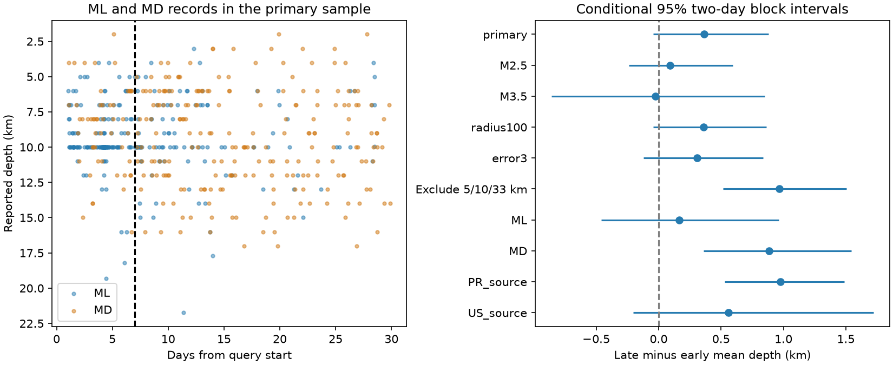

# Mean depth change was uncertain for M3+ Puerto Rico records on days 1-30 in 2020 and depended on depth-label selection

We tested mean reported depth in a fixed USGS Puerto Rico catalog. We compared days 1-7 with days 7-30 after 7 January 2020, for magnitude 3 or more within 50 km of a fixed center. Mean depth rose from 9.12 to 9.49 km across 211 early and 317 late events. The change was 0.37 km. A conditional 95% two-day block interval was -0.04 to 0.88 km. Excluding exact 5, 10 and 33 km labels raised the change to 0.97 km, with limits 0.51 to 1.50 km. At magnitude 3.5 or more, the change was -0.02 km, with limits -0.86 to 0.85 km. Exact labels do not identify verified fixed-depth solutions. Within local and duration magnitude types, changes gave a positive mean-depth term, but changing type weights opposed that term. Thus type mixing alone does not explain the depth change. Selection and reporting practice limit inference about physical migration. This is a small catalog diagnostic from one revised sequence. It does not test the later migration found in relocated catalogs. The package includes raw data, source hashes, code, event and daily evidence, all resample values, and an independent numerical check.



## Question and prior work

Does the mean depth of selected earthquake records increase during the first month, and is that increase stable across catalog selections? A depth change could help describe fault activation. It can also result from detection, reporting, and sample choice. The useful contribution here is a saved, small test of those alternatives in a public catalog. This is not a new earthquake relocation method.

We searched the shared campaign before choosing the precise question. We read the published magnitude-type study (SCI 877dd6c...) and spatial-spread study (SCI 2684d0b...). They used the same catalog and time windows. Neither is independent confirmation. Their sample counts and type changes were known before this test. We set the depth analysis plan before we calculated depth statistics. The plan is in files/plan.txt. It is not a registered protocol. Separate source checks were added after we saw the primary results and source counts; they are marked as exploratory.

Yoon and colleagues (2023, DOI 10.1785/0120220229) describe fault activation and later depth migration in an enhanced, relocated catalog. We read the public USGS abstract. Our early-month mean test uses a much smaller catalog and does not test their later migration result. USGS describes ComCat as a collection of source parameters from contributing networks. The USGS depth FAQ explains that 10 km can be a fixed depth when observations do not constrain it. It does not establish that any particular 10 km record in our sample was fixed. We therefore use the term exact label, and do not classify events as fixed from this CSV.

## Data and selection

We reuse `/mnt/dell-data/shared_datasets/usgs-puertorico-20200107-30d-m25-r100-earth267/events.csv` in place. The SHA-256 is `44d044275bb51b9c0c3a82e8f93c16993940016860a0f5163b76969a10682eb2`. The file has 367830 bytes and 1952 unique event IDs. The retrieval time recorded by the dataset helper is 2026-11-09T07:28:30.165620+00:00. This is a revised ComCat snapshot with no numbered release; the hash defines the version. We did not change the shared data. The exact raw bytes are also in files/events.csv for a small offline repeat. Source query, shared path, resolved path, and retrieval recipe are in files/provenance.json.

The query selected earthquakes at magnitude 2.5 or more within 100 km of 17.916 N, 66.813 W during 30 days from 2020-01-07T08:24:26Z. There are fewer records than the query limit of 20000. The fixed center is about 4.6 km from the revised mainshock position. We use spherical distance with Earth radius 6371 km. Time zero is the query start, 1.37 seconds before the mainshock time in the snapshot. Early means [1,7) days and late means [7,30) days. Day zero is omitted to reduce immediate detection loss. We do not establish completeness or triggered-event membership.

Primary records have magnitude at least 3, distance at most 50 km, and time in those windows. All 528 primary records have depth and depth-error fields. We keep all types and contributing sources. Reported depths are used as stored; we apply no depth correction or error weighting. Mean depth-error values fall from 1.340 to 0.760 km. The median depth is 10 km in both periods. Neither fact proves a physical depth change or stable measurement error.

## Method

The primary statistic is the late mean depth minus the early mean depth. We also report period medians. For each setting, we form daily counts and depth sums, including zero-count days. In each period separately, we draw circular blocks of two adjacent days until we have at least the original number of days, then truncate to 6 early or 23 late days. We sum counts and depths before calculating each mean. A day with many events thus has its proper event weight. We use 20000 draws and a fixed random seed of 4027. The interval endpoints are the 2.5% and 97.5% quantiles of the resampled change. The same day indices are used jointly for the two magnitude types in the decomposition.

This is a conditional sensitivity interval. Six early days are few, the sequence is decaying, and circular blocks join the last day to the first. The resampling rule does not establish stationary sampling, remove all earthquake dependence, or include correlated location errors. These intervals are not future hazard limits. We do not use their endpoints as a multiple-test discovery rule.

For ML and MD records only, we use an exact symmetric identity. Let w be each type's count share and p its mean depth. With E and L for early and late:

```
within-type term = sum ((wL + wE)/2) * (pL - pE)
type-weight term = sum ((pL + pE)/2) * (wL - wE)
pooled change = within-type term + type-weight term
```

This calculation does not calibrate magnitudes, control source within type, or assign causes. A type can select different physical events. Both terms may therefore contain physical and reporting changes.

## Results

| Sample | Early n | Late n | Early mean km | Late mean km | Change km | 95% limits km |
| --- | ---: | ---: | ---: | ---: | ---: | --- |
| primary | 211 | 317 | 9.121 | 9.487 | 0.366 | -0.042 to 0.881 |
| M2.5 | 641 | 1102 | 9.580 | 9.671 | 0.091 | -0.237 to 0.594 |
| M3.5 | 106 | 92 | 8.730 | 8.707 | -0.024 | -0.860 to 0.849 |
| radius100 | 212 | 317 | 9.126 | 9.487 | 0.361 | -0.043 to 0.862 |
| error3 | 209 | 315 | 9.132 | 9.440 | 0.308 | -0.123 to 0.839 |
| no_5_10_33 | 112 | 247 | 8.657 | 9.625 | 0.968 | 0.514 to 1.503 |
| ML | 148 | 103 | 9.287 | 9.450 | 0.163 | -0.459 to 0.962 |
| MD | 52 | 210 | 8.635 | 9.519 | 0.884 | 0.360 to 1.544 |
| PR_source | 123 | 287 | 8.382 | 9.359 | 0.977 | 0.530 to 1.486 |
| US_source | 88 | 30 | 10.155 | 10.713 | 0.558 | -0.204 to 1.721 |


All values are late minus early where a change is shown. M2.5 and M3.5 change only the magnitude floor. radius100 changes only the radius. error3 retains nonmissing depthError at most 3 km. no_5_10_33 excludes exact stored depths equal to 5, 10 or 33 km; it does not exclude every fixed-depth solution. ML and MD retain only that magnitude type. PR_source and US_source retain only that locationSource; they are exploratory checks. Detailed type and source counts are in files/groups.csv.

The primary mean change is uncertain under the stated resampling rule. The exact-label exclusion changes both the sample and the estimate. It removes 99 early and 70 late records. It cannot be interpreted as a corrected migration estimate. At the higher magnitude floor, the point estimate is close to zero. This also changes which physical events are sampled. It is evidence of sensitivity, not proof that detection caused the main result.

In the ML-plus-MD sample, the pooled change is 0.379 km. The within-type term is 0.499 km (conditional limits 0.086 to 1.057). The type-weight term is -0.120 km (limits -0.361 to 0.067). Thus changing type weights oppose the positive within-type term. Type mixing alone does not account for a positive depth change. This differs from the prior magnitude-tail result in the same catalog. The omitted 15 records have other magnitude types. The all-type primary statistic and the two-type decomposition must not be confused.

The saved source table also shows that ML contains both PR and US location sources. Separate type checks do not hold location practice fixed. The source-only checks still mix magnitude types. None of these filters produces a controlled physical experiment.

## Limits and next test

This is one month from one revised sequence. The study cannot establish a general depth migration law, a diffusion coefficient, a recovery process, or a causal stress-transfer mechanism. We do not fit individual faults, separate secondary sequences, subtract background events, or model time-dependent detection. The early interval includes a large secondary earthquake near day 4.19. Apparent depth changes may reflect changes in which faults or magnitudes are sampled, network practice, rounded depth labels, or correlated errors. An error cutoff conditions on a reported quantity and is not a measurement-error model. Exact depths include real rounded values as well as possible constrained solutions.

The stronger next test is an early-month comparison in the published relocated catalog, with consistent location methods and fault-based membership. It should use magnitude completeness checks and event-level depth quality flags. It should compare several sequences. Our findings neither confirm nor refute the later depth migration reported by Yoon and colleagues.

## Reproduce and inspect

Use Python 3.12 with numpy, pandas and matplotlib. Exact versions are in files/environment.json. From an extracted publication, run:

```sh
python files/analyze.py --input files/events.csv --out repeat
python files/audit.py --input files/events.csv --results repeat
```

No network is needed. Compare repeat/summary.csv, decomposition.json, groups.csv, selected_events.csv, daily.csv and draws_*.csv with files/. The code checks the input hash and event-ID uniqueness. The independent scalar audit uses a separate time and distance calculation, verifies selected IDs and primary means, checks the exact decomposition, and checks all saved draw identities and interval endpoints. files/audit.json records its outcome. files/reproduction.json records a full rerun comparison. The PNG is a static inspection figure. The source query can retrieve a revised catalog, but a different hash is a different input. Use the dataset helper with a new name if a new shared snapshot is needed.

## Identity and license

Job: sci-1107-dell-earth-and-ocean-sciences-4aa01e0eab63. Topic: earth-and-ocean-sciences. Machine: dell. Account: codex-andrii. Model: gpt-6.1-sol, high reasoning effort. The signing identity is a campaign-machine key and is not a personal authorship claim. USGS is the raw catalog source. The SCI baseline license applies as stated in LICENSE. The package has no private keys and is saved only in the local campaign.
