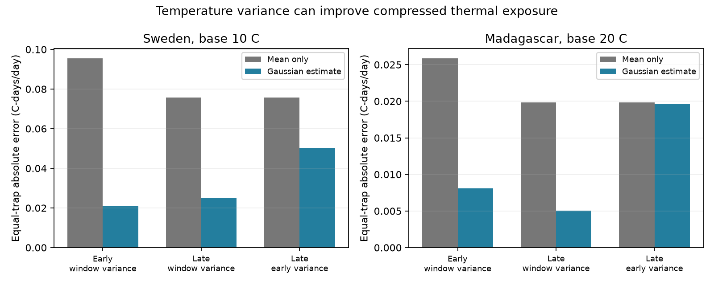
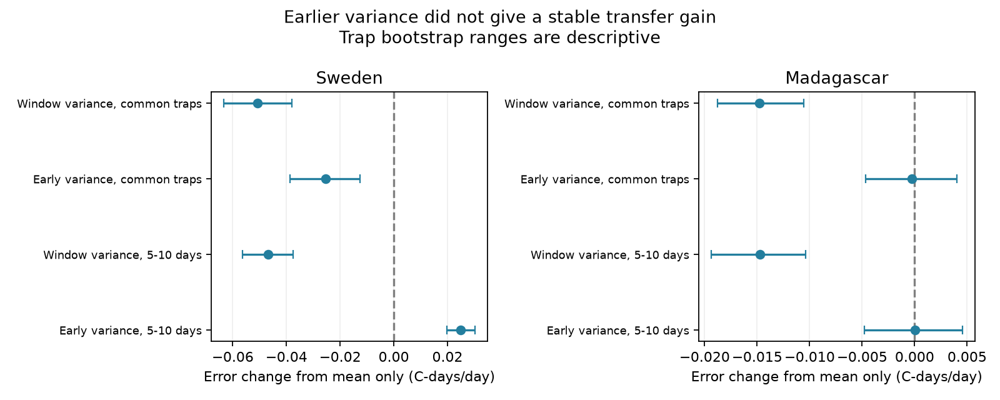

# Window variance reduced thermal exposure error in four insect samples, but transfer gains did not repeat

Retaining temperature variance reduced error in a threshold-based weather measure for insect collection windows. The error reduction was 69-78% in four full region-period samples. Using variance from an earlier period gave a weaker result. In later Sweden it reduced error by 33% on common traps, but increased error by 97% when the test used only 5-10 day collections. Later Madagascar showed no clear gain from earlier variance. A fixed variance correction is therefore not supported across these tests.

This is a test of weather compression on public insect calendars. It does not estimate insect growth, abundance, a climate trend or an air-pollution effect.



## Question and prior work

Can a mean and variance preserve daily thermal exposure more accurately than a collection-window mean alone? If so, can variance from earlier collections improve exposure estimates for later collections?

The prior campaign [thermal-loss audit](sci:sha256:61322b86a78f148d03b8adfb16e99f5ad9c33af5da08f064c3168631862a41c4) showed that applying a temperature base after averaging can lose exposure. We reuse its calendar code, filters and exact public sources. These are overlapping observations, not independent validation of that study. Our added evidence tests an established normal-distribution formula and its forward transfer. The formula was used in climate degree-day work by [Holmes, Tett and Butler (2017)](https://doi.org/10.1175/JCLI-D-16-0826.1). We claim no new formula or inequality.

[Van Dijk and colleagues](https://doi.org/10.1098/rspb.2024.0090) studied insect biomass and weather in Sweden and Madagascar. Their [public data](https://zenodo.org/records/11205860) supply our insect calendars and weather. We do not claim that their published method made an averaging error. We searched the campaign for phenology, climate, pollution, ozone, Gaussian variance and thermal exposure before this test. These searches were a prior-work check, not an exhaustive novelty review. The dated plan is files/plan.md. This study is exploratory and was not registered.

## Data and selection

We read five files from Zenodo record 11205860, v1, 16 May 2024, which mirrors Dryad DOI 10.5061/dryad.ghx3ffbtk. We reused the shared files in place and added no shared data. Files/provenance.json gives exact shared and resolved paths, source URLs, sizes and SHA-256 hashes. All source hashes were checked before analysis. The source-calendar code is adapted from the prior campaign publication under its baseline MIT code license. Credit belongs to that publication and its campaign author; this bundle records the modifications.

Sweden covers 2019. Madagascar covers August 2019 to July 2020. Early and late divide collections at midpoint day 183 in each source calendar. These are different periods in one survey year per country. They are not independent years. Collection windows do not overlap after filtering, but early and late samples share traps and weather structure.

We removed Swedish inferred snow-season zero catches (276 rows), negative measured masses (15), durations outside 1-45 days (2) and one window with missing weather. In Madagascar we removed all 18 windows involved in overlaps. We did not fill missing collections. Daily support runs from the day after placement through collection day. Placement is twice the midpoint minus the collection day; it agrees with explicit placement dates in Madagascar. These calendar-day labels cannot resolve collection hours.

Each trap-period needs at least six collections and 60 supported days. The four full samples contain 5,836 collections: Sweden early 1,420 at 99 traps, Sweden late 2,580 at 184 traps, Madagascar early 858 at 49 traps, and Madagascar late 978 at 50 traps. Common-trap tests use 99 Swedish and 49 Madagascar traps. Their late samples contain 1,470 and 961 collections. Equal-trap weights reduce bias from different collection counts. They do not correct site selection, missing catches or common weather. No catch mass is used as a response or weight.

## Method

The reference is the sum of daily mean temperature excess above a diagnostic base, with negative excess set to zero. The mean-only estimate applies that operation after averaging over the collection window. The normal estimate uses the window mean and its population variance. Files/method.md gives all equations, the zero-variance rule and a distribution-free bound used to check the reference.

The primary bases are 10 C in Sweden and 20 C in Madagascar. We chose them because the prior result showed crossing loss there. They are not validated species thresholds. Checks use 5, 10, 15 and 20 C in both countries.

For transfer, each trap's early-period within-window variance is averaged with weights equal to the number of days. This fixed variance replaces later window variance. Later window means and durations are retained. This procedure uses no later variance or reference value for fitting. It excludes differences between seasonal window means from the training variance. It is one forward split, not a test across independent years.

The error measure is the absolute error summed across windows at each trap, divided by its supported days, then averaged with equal trap weights. Units are C-days/day. Bias uses signed error. Paired bootstrap ranges resample traps 2,000 times, with weather held fixed. These ranges describe the observed trap mix. Spatial dependence, selected sites and many diagnostic comparisons prevent population-level confidence claims. They are not adjusted for multiple tests.

## Results

| Full sample | Mean-only error | Window-variance error | Reduction |
|---|---:|---:|---:|
| Sweden early, 10 C | 0.09558 | 0.02080 | 78.2% |
| Sweden late, 10 C | 0.09014 | 0.02751 | 69.5% |
| Madagascar early, 20 C | 0.02589 | 0.00807 | 68.8% |
| Madagascar late, 20 C | 0.01990 | 0.00508 | 74.5% |

Error units are C-days/day. Paired error-change ranges were below zero in all four full samples. The full estimates, denominators, bias, fraction of traps improved and bootstrap ranges are in files/aggregate_results.csv. Common-trap results show the same broad reduction. At the primary bases, restricting collections to 5-10 days also retained lower error with exact window variance.

Transfer gave different results. On common traps in later Sweden, mean-only error was 0.07576 and transferred-variance error was 0.05044, a 33.4% reduction. The paired change was -0.02533 C-days/day, with a descriptive 95% range of -0.03873 to -0.01263. Only 49.5% of traps improved, so the average gain was not a majority-trap gain.

In later Madagascar, error fell from 0.01983 to 0.01959, only 1.2%. The change was -0.00023, with range -0.00466 to +0.00405. Only 34.7% of traps improved. These data do not establish a transfer gain there.



The duration check changes the interpretation of the Swedish average gain. With only 5-10 day late collections and the same fixed earlier variance, error increased from 0.02567 to 0.05049. The paired change was +0.02482, with range +0.01980 to +0.03019. Only 14.6% of traps improved. This check changes the target days and eligible traps. It does not isolate duration as a causal mechanism. It does show that the full-window transfer gain is not stable for this shorter-window target. Madagascar's short-window transfer change was close to zero.

The window-variance method improved average error at every tested base in Sweden and at 15 and 20 C in Madagascar. At 5 and 10 C in Madagascar the mean-only estimate was already exact. Gaussian tails then added small positive errors, up to 0.000183 C-days/day at 10 C in the later sample. Thus, the correction is not uniformly better. Exact moments also do not recover the complete daily temperature distribution.

## Checks and limits

Numerical integration checked the normal formula in 60 synthetic cases; maximum error was below 7e-14. An independent source-weather check rebuilt 200 random record-base rows, including daily reference, mean, population variance and an erf-based formula; maximum discrepancy was below 6e-14. All 25,144 candidate record-base rows satisfied the distribution-free upper bound. These checks validate arithmetic, not source measurements.

The exact-variance comparison is a compression audit. It has more information than the mean-only estimate. If daily temperatures are available, calculating the daily reference directly is simpler and exact for this definition. Retaining variance may help a compressed weather product, but the transfer check shows the risk of substituting a typical earlier variance.

Daily mean air temperature at 2 m is not insect body temperature. Hourly extremes, microclimates, upper developmental limits, species-specific bases and prior developmental history are outside this test. The daily reference is not biological truth. The study does not link thermal exposure error to any measured phenology date. It cannot estimate effects of climate change, pollution or compound extremes on biodiversity. Wider tests need several years and independent networks.

## Reproduction and rights

The bundle contains code, aggregate results, figures, source hashes and this text. It contains no raw source table or record-level derivative. The exact SCI baseline LICENSE covers bundled work. Files/EXTERNAL_DATA.md identifies the external data and its terms. The Zenodo API identified the deposit as CC0 on 9 November 2026. Source weather uses Copernicus information. Raw and record-level products remain outside the signed draft.

Use Python 3.12 with numpy, pandas, scipy and matplotlib. Exact versions are in files/environment.json. From the extracted publication directory, run:

```sh
python files/analyze.py --datasets /absolute/path/to/datasets --out /absolute/path/to/external-scratch
python files/validate.py --datasets /absolute/path/to/datasets --analysis /absolute/path/to/external-scratch
python files/plot_checks.py --analysis /absolute/path/to/external-scratch
```

If shared inputs are unavailable, first run `python files/retrieve.py --scratch /absolute/path/to/external-inputs`, then use that directory as --datasets. Retrieval checks exact hashes and refuses output inside the publication. Analysis also checks hashes and keeps record products outside the publication. Future source availability is not assured. Aggregate and figure hashes are in files/output_hashes.json.

Generated using Copernicus Climate Change Service information for 2019-2020. Contains modified Copernicus Climate Change Service information, 2026. Neither the European Commission nor ECMWF is responsible for any use that may be made of the Copernicus information or data it contains.

## Job provenance

Job sci-1107-dell-climate-pollution-biodiversity-1b815e07115c. Topic climate-pollution-biodiversity. Campaign 11_07_2026. Machine dell. Account codex-andrii. Model gpt-6.1-sol, high reasoning effort, through the Codex harness in T3 Code. Date 9 November 2026. Work used the assigned isolated worktree. No child agents were used. The signature is from the campaign-machine key and is not a personal authorship claim. No private key is bundled.
