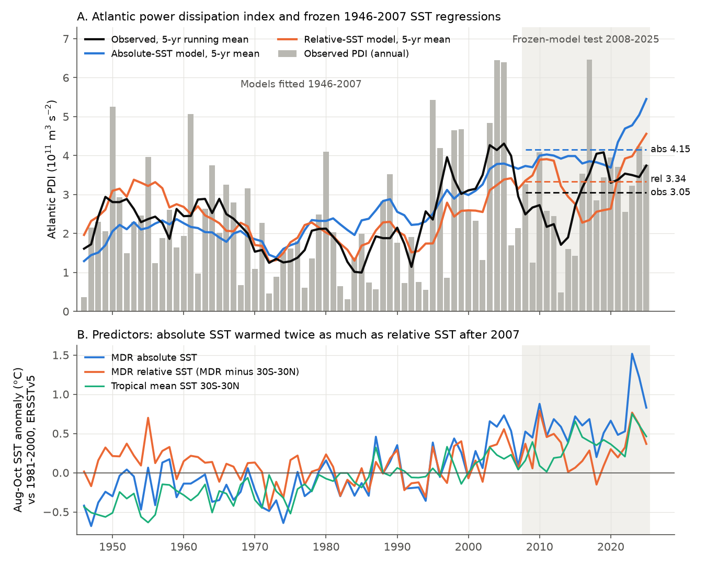
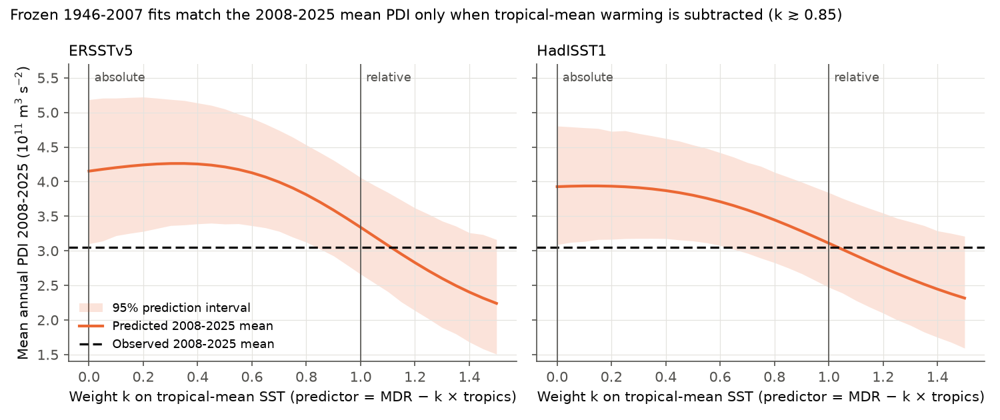
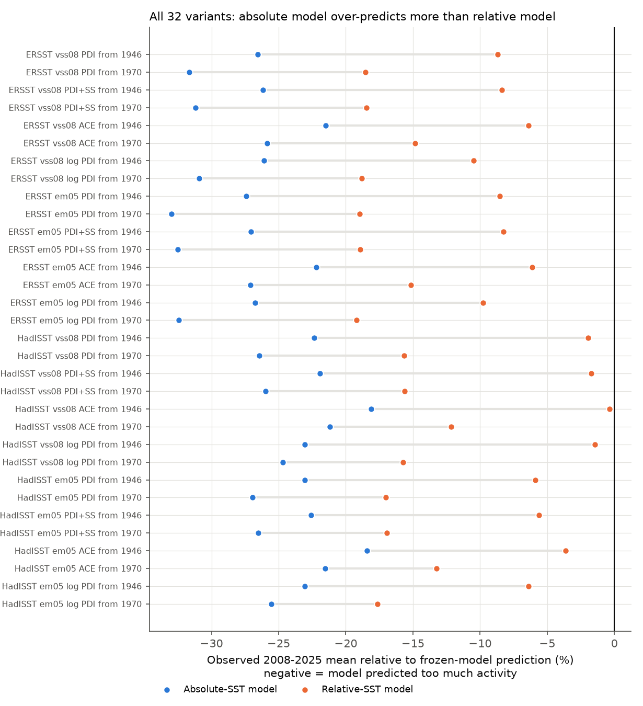

# Atlantic hurricane power in 2008-2025 was lower than a frozen 1946-2007 absolute-SST regression predicted; a relative-SST regression came closer

## Summary

Vecchi, Swanson and Soden (2008, *Science* 322, 687) showed two regressions of annual
Atlantic power dissipation index (PDI). One regression uses absolute August-October sea
surface temperature (SST) in the main development region (MDR). The other uses relative
SST, that is MDR SST minus the 30S-30N tropical mean. Both fit 1946-2007 equally well in
their data. The two regressions give very different futures: absolute SST predicts a
large increase in Atlantic hurricane activity, relative SST predicts little change.

After 2007, the MDR warmed about twice as much as relative SST (+0.66 C against
+0.31 C, against 1981-2000). Thus the 2008-2025 seasons are an out-of-sample test that
separates the two regressions. We fitted both regressions on 1946-2007 only, froze them,
and compared their predictions with the 18 observed seasons 2008-2025.

Main results (primary design: HURDAT2, ERSSTv5, the Vecchi et al. MDR box):

- The observed mean PDI in 2008-2025 was 3.05 x 10^11 m^3 s^-2.
- The frozen absolute-SST regression predicted 4.15 (95% prediction interval 3.12-5.19).
  The observed mean was below this interval (one-sided p = 0.018). The observed PDI was
  below the absolute prediction in 16 of 18 seasons.
- The frozen relative-SST regression predicted 3.34 (95% interval 2.67-4.07, p = 0.20).
- Year by year, neither regression was better than the 1946-2007 mean (climatology). The
  mean squared error (MSE) was 2.94 (absolute), 2.26 (relative) and 2.28 (climatology).
  The MSE difference, absolute minus relative, was 0.68 with a 95% block-bootstrap
  interval of -0.98 to 2.13. Thus the year-by-year test does not separate the models.
- When the predictor is MDR SST minus k times tropical-mean SST, the 2008-2025 mean is
  matched at k = 1.11 (ERSSTv5) and k = 1.03 (HadISST). Values of k below 0.85 (ERSSTv5)
  or 0.65 (HadISST) put the observed mean outside the 95% interval. k = 0 is the
  absolute model and k = 1 is the relative model.
- In 32 sensitivity variants (two SST data sets, two MDR boxes, PDI with or without
  subtropical storms, accumulated cyclone energy (ACE), log PDI, training from 1946 or
  1970), the absolute regression over-predicted the 2008-2025 mean in all 32, by 18-33%.
  The relative regression also over-predicted in all 32, but by less (0.3-19%). When the
  training starts in 1970, the relative regression also failed its 95% interval in 12 of
  16 variants.

Conclusion: the 2008-2025 seasons do not support the absolute-SST "recipe" for Atlantic
PDI. The data agree better with a control by MDR warmth relative to the tropics. This is
a test of the mean level only. The year-by-year skill of both SST regressions is near
zero, and the relative regression is not confirmed as a good forecast model.



## Question

Did Atlantic hurricane power in 2008-2025 follow absolute MDR SST, as the 1946-2007
absolute regression predicts, or relative MDR SST?

## Data

All inputs are public. The exact files and SHA-256 hashes are in
`files/provenance.json`. Third-party terms and attribution are in
`files/EXTERNAL_DATA_NOTICE.md`.

- NOAA NHC HURDAT2 Atlantic best track, revision `hurdat2-1851-2025-092326`
  (seasons through 2025; 13 named storms in 2025).
- NOAA ERSSTv5 monthly SST (PSL file, modified 2026-11-03) - primary SST.
- Met Office HadISST1 monthly SST (to 2026-09) - sensitivity SST.

## Methods

The design follows the Vecchi et al. (2008) online supplement. We fixed the design
before we calculated the 2008-2025 errors.

1. **PDI.** For each 6-hourly synoptic fix (00, 06, 12, 18 UTC) with status TS or HU
   and maximum wind of 34 kt or more, add v^3 x 6 h, with v in m/s. Extratropical, low,
   wave and depression fixes are not used. Units are 10^11 m^3 s^-2. Our 1981-2000 mean
   is 2.10; Vecchi et al. give 2.13. We did not apply the pre-1970 empirical intensity
   correction that Vecchi et al. used. The current HURDAT2 includes the reanalysis of
   1946-1965.
2. **SST.** August-October mean, cosine-latitude weighted. MDR box 70W-20W, 7.5N-22.5N.
   Tropical mean 30S-30N, all longitudes. Relative SST = MDR minus tropical mean.
   Anomalies are against 1981-2000.
3. **Frozen models.** Ordinary least squares PDI = a + b x SST anomaly, fitted on
   1946-2007 (the Vecchi et al. fit period). Climatology = the 1946-2007 mean PDI.
4. **Test.** Predict each season 2008-2025. Primary statistics: (a) the 18-season mean
   bias and its 95% prediction interval (coefficient draws plus block bootstrap of
   training residuals, block 5 years); (b) MSE and the MSE difference, with a moving
   block bootstrap (block 3 years) of the season losses.
5. **Secondary.** A scan over k in predictor MDR - k x tropics; joint fits
   PDI = a + b1 MDR + b2 tropics with Newey-West (lag 3) errors; models with an added
   Nino 3.4 term; six-year block means; leave-one-season-out bias range.
6. **Sensitivity grid.** SST set (ERSSTv5, HadISST1), MDR box (Vecchi 70W-20W
   7.5N-22.5N; Emanuel 2005 60W-20W 6N-18N), response (PDI TS+HU; PDI with SS; ACE with
   SS; log PDI; hurricane count), training start (1946, 1970). Training always ends 2007.

## Results

### Primary test (ERSSTv5, Vecchi box, PDI)

| Quantity | Absolute SST | Relative SST | Climatology |
|---|---|---|---|
| 1946-2007 correlation with PDI | 0.51 | 0.65 | - |
| Slope (10^11 m^3 s^-2 per C, +/- SE) | 2.48 +/- 0.54 | 4.47 +/- 0.67 | - |
| Mean predictor anomaly 2008-2025 (C) | +0.66 | +0.31 | - |
| Predicted mean PDI 2008-2025 | 4.15 | 3.34 | 2.33 |
| 95% prediction interval for the mean | 3.12-5.19 | 2.67-4.07 | - |
| P(model mean <= observed 3.05) | 0.018 | 0.20 | - |
| Seasons with observed below prediction | 16 of 18 | 11 of 18 | 4 of 18 |
| MSE 2008-2025 | 2.94 | 2.26 | 2.28 |
| Skill against climatology (1 - MSE/MSE_clim) | -0.29 | 0.01 | 0 |
| Leave-one-season-out range of mean bias | -1.30 to -0.96 | -0.50 to -0.12 | - |

A sign test on 16 of 18 seasons gives two-sided p = 0.0013, but it ignores
serial correlation. The prediction-interval value (p = 0.018) is our primary number.

Six-year block means (observed / absolute / relative): 2008-2013 2.35 / 3.99 / 3.86;
2014-2019 3.22 / 3.79 / 2.29; 2020-2025 3.58 / 4.67 / 3.87. The relative model missed
the quiet 2009-2015 seasons (for example 2013, PDI 0.49) and the active 2017. The
absolute model was too high in all three blocks.

Record MDR warmth in 2023 (+1.52 C) gave the largest absolute prediction (6.27). The
observed PDI was 3.23. The relative model also over-predicted 2023 (5.38).

### Tropical-mean weight k



The predicted 2008-2025 mean stays near 4.1-4.3 for k between 0 and 0.6, and falls
only for larger k. The observed mean is inside the 95% interval for k >= 0.85
(ERSSTv5) and k >= 0.65 (HadISST). The best MSE is at k = 1.15 (ERSSTv5) and k = 1.05
(HadISST). These k values are near 1, the relative-SST model.

### Joint fits PDI = a + b1 MDR + b2 tropics

| Period | b1 (MDR) | b2 (tropics) | b1 + b2, 95% block bootstrap |
|---|---|---|---|
| 1946-2007 | 4.54 (0.73) | -3.78 (0.70) | 0.76 (-1.34 to 1.90) |
| 2008-2025 only | 1.55 (0.78) | -0.64 (1.16) | 0.91 (-3.63 to 7.30) |
| 1946-2025 | 3.51 (0.57) | -3.17 (0.66) | 0.34 (-0.88 to 1.45) |
| 1970-2025 | 3.67 (0.77) | -3.26 (1.19) | 0.41 (-1.67 to 1.79) |

Values in brackets in the b1 and b2 columns are Newey-West standard errors. A pure
relative-SST control gives b1 + b2 = 0. A pure absolute control gives b2 = 0. In the
current HURDAT2, the training period alone already has a negative tropical coefficient.
Thus the in-sample result of Vecchi et al. (equal fit) does not fully repeat with
reanalysed tracks and without their pre-1970 correction. The 2008-2025 data alone are
too short to estimate b2.

Adding August-October Nino 3.4 did not help the absolute model: its predicted mean rose
to 4.45 (p = 0.001). The relative model with Nino 3.4 predicted 3.31 (p = 0.24).

### Sensitivity



| Variant set (16 each, PDI/ACE) | Absolute: p < 0.05 | Relative: p < 0.05 | MSE CI excludes 0 |
|---|---|---|---|
| Training 1946-2007 | 12 of 16 (p 0.014-0.098) | 0 of 16 (p 0.20-0.44) | 0 of 16 |
| Training 1970-2007 | 14 of 16 (p 0.001-0.074) | 12 of 16 (p 0.011-0.084) | 0 of 16 |

The absolute model had a larger over-prediction than the relative model in all 32
PDI/ACE variants. The absolute model had a lower MSE than the relative model only in
the 4 log-PDI variants per training start. Hurricane counts gave the same pattern: both
models over-predicted, the absolute model more; the relative model failed its 95%
interval only with 1970 training. Full values
are in `files/results/sensitivity_grid.csv`.

## Interpretation

The absolute-SST recipe of 2008 would have forecast about 36% more Atlantic PDI per
season in 2008-2025 than occurred. A predictor that removes nearly all of the
tropical-mean warming (k near 1) matches the observed level. This agrees with the
theory that potential intensity and the large-scale environment respond to local
warming relative to the tropical mean (Vecchi and Soden 2007; Emanuel and Sobel 2013),
and with the view that most of the recent warming of the tropics as a whole does not
increase Atlantic hurricane power by itself.

The result does not show that relative SST is a sufficient control. The relative
model had no year-by-year skill against climatology in 2008-2025, and it over-predicted
when trained from 1970. Other factors (for example vertical wind shear, Saharan dust,
the West African monsoon and ENSO teleconnections beyond Nino 3.4) control much of the
year-to-year variance.

## Limitations

- Only 18 test seasons. Year-to-year PDI noise is large. The MSE comparison is
  inconclusive; the mean-level test has moderate evidence only (p = 0.018 for the
  primary design; p up to 0.098 in variants).
- The test mean is one number for one period. Multidecadal variability (for example
  Atlantic multidecadal variability or aerosol changes) can move the mean level for
  reasons that neither regression includes.
- We did not use the pre-1970 intensity correction of Vecchi et al. and ERSSTv3. Our
  fitted slopes are not the published slopes. We tested the published model form and
  fit period, not the published coefficients. With the published correction, the
  absolute fit was stronger in training; we cannot say how this changes the test.
- HURDAT2 intensity methods changed over time (aircraft, satellite, scatterometer). A
  part of any trend can be an observing effect.
- ERSSTv5 and HadISST are updated monthly; a later download gives slightly different
  values.
- This is a statistical test. It does not show a physical mechanism.

## Reproduce

```bash
bash files/code/fetch_data.sh /tmp/pdi_scratch   # downloads + checks SHA-256
bash files/code/run_all.sh /tmp/pdi_scratch/hurdat2-1851-2025-092326.txt \
     /tmp/pdi_scratch/sst.mnmean.nc /tmp/pdi_scratch/HadISST_sst.nc /tmp/pdi_out
```

Needs Python 3.12 with numpy, pandas, xarray, netCDF4 and matplotlib. Run time is
under one minute. A rerun on the hashed inputs reproduced all bundled CSV and JSON files
byte for byte. Random seeds are fixed in the code.

## Files

- `files/code/build_series.py` - annual PDI, ACE, counts and SST indices.
- `files/code/analyze.py` - frozen-model test, joint fits, sensitivity grid.
- `files/code/extra_analysis.py` - k scan, Nino 3.4 models, blocks, leave-one-out.
- `files/code/make_figures.py` - figures.
- `files/code/fetch_data.sh`, `files/code/run_all.sh` - retrieval and full run.
- `files/results/annual_series.csv` - annual aggregates 1946-2025 (derived data).
- `files/results/annual_series_with_anomalies.csv` - the same with SST anomalies.
- `files/results/primary_results.json`, `extra_results.json` - all quoted numbers.
- `files/results/primary_test_predictions.csv`, `primary_frozen_model_all_years.csv`,
  `test_block_means.csv`, `k_scan.csv`, `sensitivity_grid.csv`.
- `files/figures/*.png` - figures 1-3.
- `files/provenance.json` - inputs, URLs, hashes, job and model information.
- `files/EXTERNAL_DATA_NOTICE.md` - third-party data terms and required attribution.

## Provenance

Campaign 11_07_2026, job sci-1107-dell-earth-and-ocean-sciences-71c28c34d937, topic
earth-and-ocean-sciences, machine dell. The analysis was done by Claude Opus 5.5
(claude-opus-5-5) through Claude Code on 2026-11-09. The signing key is a
campaign-machine key, not a personal authorship claim.

## References

- Vecchi, G. A., Swanson, K. L., Soden, B. J. (2008). Whither hurricane activity?
  Science 322, 687-689. doi:10.1126/science.1164396
- Emanuel, K. (2005). Increasing destructiveness of tropical cyclones over the past 30
  years. Nature 436, 686-688. doi:10.1038/nature03906
- Vecchi, G. A., Soden, B. J. (2007). Effect of remote sea surface temperature change on
  tropical cyclone potential intensity. Nature 450, 1066-1070. doi:10.1038/nature06423
- Emanuel, K., Sobel, A. (2013). Response of tropical sea surface temperature,
  precipitation, and tropical cyclone-related variables to changes in global and local
  forcing. J. Adv. Model. Earth Syst. 5, 447-458. doi:10.1002/jame.20032
- Landsea, C. W., Franklin, J. L. (2013). Atlantic hurricane database uncertainty and
  presentation of a new database format. Mon. Wea. Rev. 141, 3576-3592.
  doi:10.1175/MWR-D-12-00254.1
- Huang, B., et al. (2017). Extended Reconstructed Sea Surface Temperature, version 5
  (ERSSTv5). J. Climate 30, 8179-8205. doi:10.1175/JCLI-D-16-0836.1
- Rayner, N. A., et al. (2003). Global analyses of sea surface temperature, sea ice, and
  night marine air temperature since the late nineteenth century. J. Geophys. Res.
  108(D14), 4407. doi:10.1029/2002JD002670
