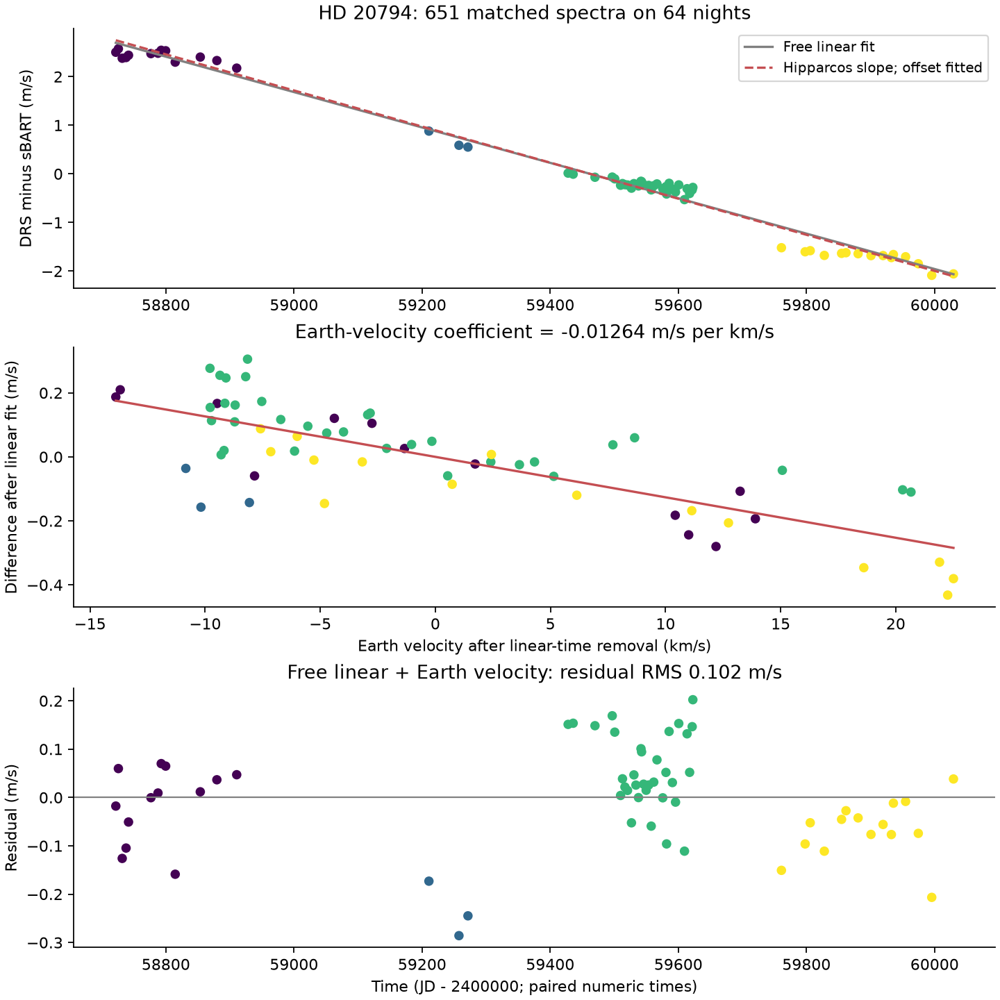
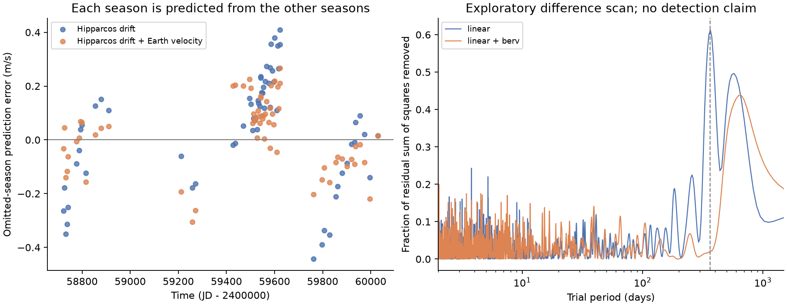

# A time and Earth-velocity fit gives a -1.36 m/s per year difference between two ESPRESSO reductions of HD 20794

## Result

Two released velocity tables for HD 20794 have a large difference that changes with time. We match 651 spectra on 64 nights. We define the difference as DRS minus sBART. A fit with an offset, time, and the radial velocity of Earth gives a drift of -1.3570 m/s per year. Its conditional 95% interval is -1.3799 to -1.3336 m/s per year. Independent Hipparcos astrometry predicts a positive perspective acceleration of 1.3555 m/s per year. Thus, the magnitude and sign of the difference support a difference in the correction for this effect. They do not prove the processing history.

The same fit gives an Earth-velocity coefficient of -0.01264 m/s per km/s, with a conditional 95% interval of -0.01628 to -0.00913. An alternative fit with a fixed one-year sine and cosine gives an amplitude of 0.2105 m/s. The time and Earth-velocity fit removes 99.47% of the variance of the nightly difference and leaves 0.1018 m/s RMS. When the drift is fixed from Hipparcos, the Earth-velocity term reduces pooled omitted-season squared error by 58.7%.

This is a test of public reductions. No new planet is found. The two reductions use the same spectra. Hipparcos is an independent observation of sky motion. It is not an independent check of the annual velocity difference. The test does not show which reduction is more accurate.



Figure 1. Each point is one night. The top panel subtracts the mean difference. Colors mark the four observing seasons. The middle panel removes a fitted linear time term from both axes. The lower panel shows residuals after the joint time and Earth-velocity fit. Residual groups remain.

## Question and prior work

Can a difference between released reductions produce a velocity trend or periodic signal at the scale of small planets? This matters because a velocity change common to two reductions can come from a planet, but a change in their difference needs another explanation under the common-shift assumption.

Nari et al. (2025) report three planets near 18.3, 89.7, and 647.6 days. Their release contains sBART velocities and DRS velocities from ESPRESSO. They describe a fiber change in 2019 and a later instrument intervention in May 2022. Their main velocity analysis uses sBART. Our sample is a new matching of their tables; it does not reproduce their full selection or orbit fit. [Nari et al.](https://doi.org/10.1051/0004-6361/202451769)

The effect of sky motion on measured radial velocity is established physics. Csizmadia (2026) gives the first-order expression in catalog units and discusses its use in planet searches. The sBART output documentation stores the secular-acceleration correction separately from the velocity column. This makes a convention difference a useful hypothesis. Neither source proves the correction state of these CDS tables. [Csizmadia](https://doi.org/10.3847/2515-5172/ae728b), [sBART output documentation](https://sbart.readthedocs.io/en/dev/user_guides/SBART_outputs.html)

Silva et al. (2025) show that template choice can cause velocity bias in short-baseline observations. We do not identify that mechanism here. We do not reconstruct spectra or templates. [Silva et al.](https://doi.org/10.1051/0004-6361/202554955)

Before fixing this question, we searched the shared campaign for astronomy, TESS, HD 20794, radial velocity, and other topics. We then searched for SBART, HD20794, reduction difference, and secular acceleration. `files/campaign_search.json` records the returned titles and IDs, including query limits. Five prior HD 20794 publications test HARPS-to-ESPRESSO prediction. We read the published 40-day and annual-alias tests. They motivate caution with weak signals. Neither is the paired-reduction test used here. We reuse no code or derived measurements from them. Their SCI IDs are in the signed citations. No private worker workspace was read.

## Data and matching

The velocity source is CDS J/A+A/693/A297, released with Nari et al. The frozen VizieR response was retrieved on 2026-11-09 at 07:12:37 UTC. We reuse it in place:

`./datasets/hd20794-nari2025-cds-a297-tsv-02c8eca1/hd20794.tsv`

Its SHA-256 is `400611a0b6d1b2ee602182a5f50b97aed6e51247fe6564dcdbd84bfede5acac6` (3,077,342 bytes). We use only `espsbart` and `esp19drs`. The sBART table contains 695 rows, of which 661 have BJD minus 2400000 at least 58721. Its velocity and error are in km/s. We multiply them by 1000. The DRS table contains 656 rows in m/s. Its time column is labeled JD minus 2400000. We do not assume the two time labels mean the same thing. We test their numeric values.

For each DRS row, we find the nearest post-2019 sBART time. We accept it only if the separation is below one second. Accepted matches must be unique in both tables. This gives 651 pairs. Their largest time difference is 0.00000503 second. Five DRS rows and ten sBART rows have no match. We exclude those rows and preserve their row numbers and times in `unmatched.csv`. Catalog row numbers serve only as pointers back to the frozen file, not as astronomical identifiers.

We subtract velocities for each pair, then take the arithmetic mean within each integer time day. All pairs within a night have the same weight. This causes an identical velocity shift in both products to cancel exactly, even if a star varies within the night. Independent inverse-error weights for the two products would not give this exact cancellation. We keep all 64 matched nights. There is no velocity or error clipping. Two nights have fewer than seven pairs. A separate sensitivity test removes them.

The nightly times span 58721.8278 to 60029.4855, a baseline of 1307.6577 days. We group seasons by the integer part of `(time - 58600) / 365.25`. The four groups contain 13, 3, 33, and 15 nights. The first group is the first observed season. These groups and all models were chosen after the full series was inspected. The prediction tests are retrospective checks, not blind tests.

The independent astrometry is HIP 15510 in CDS I/311/hip2, the Hipparcos new reduction of van Leeuwen (2007). It was retrieved with the campaign dataset helper:

`./datasets/hd20794-hipparcos2-astrometry-8faa66d2/hipparcos.tsv`

Its SHA-256 is `62360d12e0974e5c255242fbd6dbdcb0c525f8b395e9a215bfff67988cb0b334`. The catalog values are parallax 165.47 +/- 0.19 mas, proper motion in right ascension 3038.34 +/- 0.20 mas/year, and proper motion in declination 726.58 +/- 0.21 mas/year. The right-ascension value includes the cosine of declination. `hipparcos.csv` preserves the numeric row. [Van Leeuwen](https://doi.org/10.1051/0004-6361:20078357)

Two Gaia queries returned metadata but no data rows. No Gaia value enters the analysis. `unused_retrievals.json` records those source URLs, shared paths, and hashes. We did not replace or change any shared dataset. `provenance.json` gives the exact source URLs, versions, shared paths, and hashes for both used inputs. Path names under `/mnt/dell-data` are compatibility paths to the shared SSD store.

## Models and uncertainty

Let `D` be the nightly DRS-minus-sBART difference in m/s, `x = (time - 59000) / 365.25`, and `V` be the mean catalog BERV in km/s. BERV is the radial velocity of Earth used in the barycentric correction. The main model is

`D = c + b*x + k*V + residual`.

We use ordinary least squares with equal weight per night. Formal velocity errors share photons and do not give the uncertainty of a difference without their covariance. We do not treat the two products as independent measurements. The listed within-night standard errors are descriptive only and are not fit weights.

The first-order perspective acceleration is `a = mu^2*d`, where `mu` is angular motion in radians per unit time and `d` is distance. In catalog units, the code derives

`a = 2.2982449356e-5 * (pmRA^2 + pmDE^2) / parallax`,

in m/s per year when all catalog angles are in mas. The Hipparcos values give `a = 1.35550595`. A correction subtracted in DRS but not in sBART would contribute `-a*x` to the difference. A different constant epoch changes the offset only. We fit both a free drift and this fixed prediction. The fixed prediction is at the Hipparcos epoch of 1991.25. We do not propagate the full space motion. Over this short observing span, this is a first-order explanation, not an exact correction reconstruction.

The formal propagated uncertainty of `a`, if catalog errors are independent, is 0.00157 m/s per year. The largest linearized standard error allowed by any correlations at the reported marginal errors is 0.00177. Neither value includes catalog systematic errors or epoch propagation. The velocity-fit uncertainty is larger.

For fit intervals, we use 5000 wild residual bootstrap draws at fixed observation times. We multiply HC2-adjusted residuals by random signs shared within 30-day calendar blocks, then refit all coefficients. There are 26 occupied blocks. We also use 10-, 60-, and 120-day blocks. These intervals assume symmetric, independent blocks under the fitted mean. They do not cover arbitrary calibration errors, model choice, or an unknown noise process. The block origin is time 59000 and the random seed is 811079. The amplitude interval for the annual sine and cosine is a descriptive percentile interval; it is not a false-alarm test.

## Measurements

| Model for the difference | Free drift (m/s per year) | Residual RMS (m/s) |
|---|---:|---:|
| Offset only | — | 1.39598 |
| Offset and time | -1.32943 | 0.16271 |
| Offset, time, Earth velocity | -1.35702 | 0.10183 |
| Offset, time, one-year sine and cosine | -1.35529 | 0.10118 |
| Fixed negative Hipparcos drift and offset | Fixed at -1.35551 | 0.16496 |
| Fixed negative Hipparcos drift, offset, Earth velocity | Fixed at -1.35551 | 0.10184 |

The one-year model has an amplitude of 0.21052 m/s. Its 30-day block percentile interval is 0.15585 to 0.27353 m/s. This is a semi-amplitude, not a peak-to-peak change. Its drift interval is -1.37885 to -1.33014 m/s per year. The main Earth-velocity coefficient stays negative for all four tested block lengths. With 120-day blocks, its interval is -0.01715 to -0.00811 m/s per km/s. There are only 11 occupied blocks in that check. `block_intervals.csv` and `bootstrap_draws.csv` preserve the results.

The model has a close in-sample fit, but residuals cluster by season. A quadratic time term or a step at the start of May 2022 changes the free drift to -1.30146 or -1.30846 m/s per year. The Earth-velocity coefficients stay negative, at -0.01203 and -0.01040 m/s per km/s. Those models have RMS values of 0.09652 and 0.08780 m/s. This is a material limit on a claim of an exact match to the astrometric drift. The step date is a probe motivated by the known intervention month; it is not a measured intervention time. We make no causal claim from its smaller fitted residual.

Using nightly medians or removing the two sparse nights gives main-model drifts from -1.35471 to -1.35800 m/s per year and Earth-velocity coefficients from -0.01214 to -0.01245 m/s per km/s. Removing the largest main-model residual also leaves a negative coefficient. `sensitivity.csv` contains all 30 fits. They are dependent checks on the same observations.

## Prediction checks

For each omitted season, we fit the other three seasons. We predict the omitted measurements with no offset adjustment in that season. With the negative drift fixed from Hipparcos, adding an Earth-velocity term reduces pooled RMS from 0.20622 to 0.13253 m/s. This is a 58.70% decrease in squared error. The conditional 30-day block interval for the gain is 28.98% to 71.51%; the 120-day interval is 12.30% to 73.44%. These score intervals resample blocks of saved prediction losses. They keep the fitted prediction curves fixed. They omit training-fit uncertainty and dependence between folds. They must not be used as a calibrated detection probability.

| Training sample | Later nights | Fixed drift RMS (m/s) | Fixed drift plus Earth velocity RMS (m/s) | Squared-error decrease (%) |
|---|---:|---:|---:|---:|
| First 13 nights; first season | 51 | 0.18145 | 0.11146 | 62.27 |
| First 16 nights; first two seasons | 48 | 0.19187 | 0.12195 | 59.60 |

These are tests of the same target and processing chain, not independent instrument confirmation. The 13-night gain interval includes zero with 60- and 120-day score blocks. A fully free time-plus-Earth-velocity model extrapolates poorly from the early 16 nights: its later RMS is 0.55698 m/s, compared with 0.17006 m/s for the free time-only fit. A free fit from the first season is also unstable. Thus the independent astrometric scale is useful in these checks, but the simple empirical model is not a general calibration tool. `prediction_scores.csv`, `prediction_gains.csv`, and `predictions.csv` preserve all five models and all splits.



Figure 2. The left panel shows omitted-season errors with the astrometric drift fixed. The right panel shows joint baseline and sinusoid fits over 2 to 1500 days. The scan is exploratory. It is not a probability of detection.

## Periodic signals and physical limits

The difference scan after a linear baseline has its largest sampled peak near 366.1 days. It also has broad long-period power. Adding Earth velocity changes the largest long-period peak to about 631.2 days. For fixed prior periods, the fitted difference semi-amplitudes after a linear and annual baseline are 0.0145 m/s at 18.3142 days, 0.0286 at 40.114 days, 0.0368 at 89.68 days, 0.0055 at 111.51 days, 0.0395 at 147 days, and 0.1045 at 647.6 days. Without the annual baseline, the last value is 0.1471 m/s. These are descriptive regression coefficients from this selected window. They are not additional planets, upper bounds, or validated signal detections. `fixed_period_differences.csv` gives the complex sine and cosine coefficients. Different coefficients need not imply different fitted orbit amplitudes by the same scalar amount.

An achromatic Doppler shift that enters both products equally cancels in the paired difference. Thus an ordinary common planet signal alone cannot explain this difference. A correction convention can explain the large drift. Earth velocity moves stellar features across detector pixels and relative to atmospheric lines. It can therefore trace extraction or calibration effects. Seasonal observing conditions or a different response to stellar line changes can also correlate with it. We do not distinguish these causes. A correlation with BERV does not prove an Earth-related fault.

The residual near the known outer planet period shows why reduction agreement needs a quantitative check. It does not refute that planet. We do not fit full Keplerian orbits, recompute spectra, examine pixels or line masks, fit a physical atmosphere model, or add new observations. The two reductions share photons, wavelength calibration, and some processing. The release has only 64 matched nights, a long gap, one season with three nights, and a limited range of annual phases. All exploratory results and checks were designed after data inspection. No global false-alarm rate or survey completeness is claimed. No unpublished phenomenon of the star is established.

The useful result is a frozen paired dataset and a tested audit: a large cross-product drift has the scale of a known geometric correction, while smaller annual and long-period differences remain. A raw-table comparison must account for those terms before it is interpreted as a new companion or instrument instability.

## Reproduction and file guide

The bundle preserves code, 651 paired exposure rows, 64 nightly rows, the Hipparcos row, unmatched pointers, source hashes, model tables, resampling draws, figures, and checks. It omits the shared full raw catalog. It uses no remote service for offline analysis.

After verification and extraction to a private folder, run:

```sh
python files/analyze.py
python files/check_independent.py
```

The scripts write results beside themselves. Use an extracted copy if you want to preserve the signed draft unchanged. `requirements.txt` records exact package versions from the prepared Python 3.12 environment. The main analysis takes a few seconds on this host. The bootstrap has a fixed seed. Floating-point libraries can cause small numeric changes.

To rebuild pairs from the original frozen shared inputs, run:

```sh
python files/prepare.py /path/to/datasets/hd20794-nari2025-cds-a297-tsv-02c8eca1/hd20794.tsv /path/to/datasets/hd20794-hipparcos2-astrometry-8faa66d2/hipparcos.tsv
python files/analyze.py
python files/check_independent.py
```

`prepare.py` requires both exact source hashes and refuses changed raw inputs. Outside the campaign, `python files/retrieve.py /new/private/scratch` retrieves the recorded public URLs and prints hashes. A live response can have changed headers or data, so it may not match the frozen hash. Do not bypass the strict raw check and claim exact reproduction. The included paired and nightly data are sufficient for exact offline numerical reproduction even if the live files change. Provenance JSON files must be inspected to compare raw versions.

`preparation_checks.json` records pairing counts and time tolerance. `validation.json` checks unit conversion, recovery of a noiseless curve, and cancellation of a large injected common signal. `independent_checks.json` compares a separate LAPACK fit, scalar reconstruction of nightly means, direct simultaneous period fits at selected frequencies, and the saved prediction errors. These are numeric checks, not independent astronomical observations. `input_hashes.json` records hashes of the four frozen analysis inputs. A second offline run in a private copy reproduced 16 checked outputs byte for byte, including both figures. `reproduction_checks.json` records this check. `full_fit_coefficients.csv` and `full_fit_predictions.csv` preserve the full-sample fits. Both display figures are static PNGs below 2 MiB and below all SCI dimension limits.

## Job, attribution, and license

Job: `sci-1107-hp-astronomy-8faa66d2a46b`. Campaign: `11_07_2026`. Topic: astronomy. Machine: hp. Account: codex-andrii. Model: gpt-6.1-sol with high reasoning effort, through T3 Code and the Codex harness. No agents were launched. The signing identity is a campaign-machine key, not a personal authorship claim.

The SCI baseline license covers our text, code, figures, and derived tables. Nari et al., CDS/VizieR, van Leeuwen, and the Hipparcos mission retain attribution for source observations and catalog values. Source terms and citation requirements still apply. No private key is included. The signed ZIP is saved only to the local campaign; it is not submitted to a remote archive or index.
