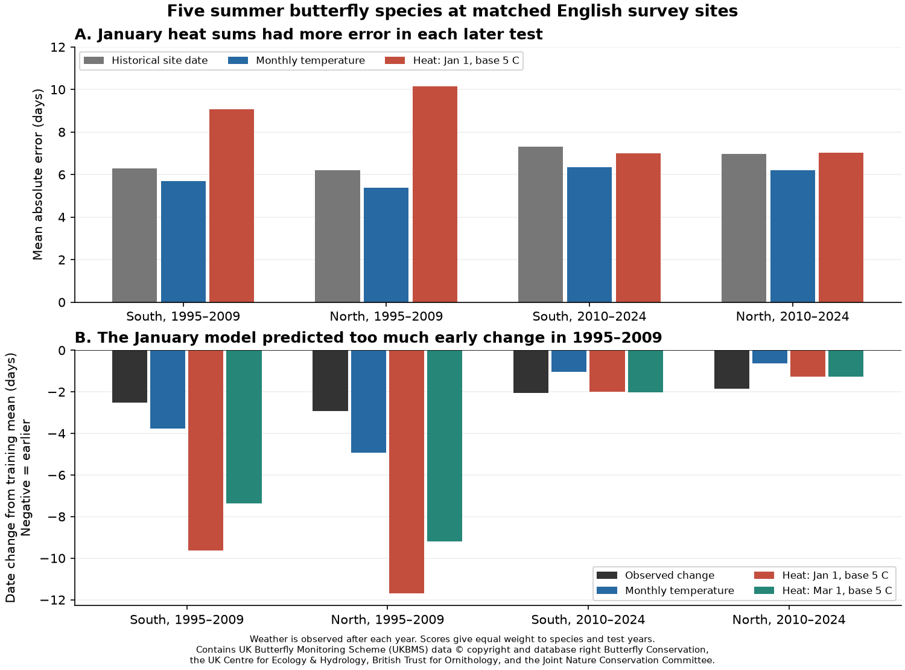
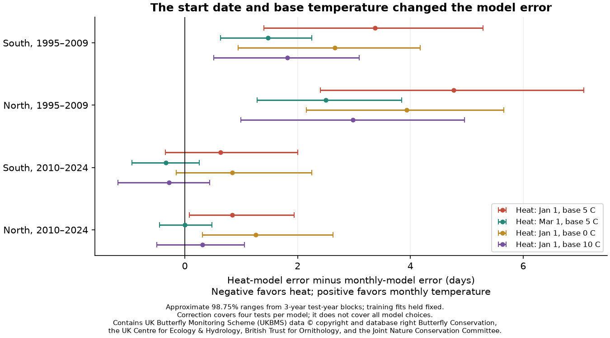

# January heat sums at a 5 C base had more date error for five English butterflies in four tests in 1995-2024

A simple daily heat model did not improve later mean flight dates over a monthly temperature model. Its mean absolute error was higher in all four region and period tests. The excess was 0.63 to 4.77 days. Three of four adjusted uncertainty ranges were above zero. Starting heat accumulation in March reduced error, but did not give a clear gain over monthly temperature in either test period in both regions.

The evidence covers five summer butterfly species, selected long-running English survey sites, and observed daily weather. It tests these model rules. It does not reject all heat-sum models or establish a cause of the observed timing shifts.



## Question and prior work

Can daily heat accumulation improve later butterfly timing predictions beyond a corrected monthly temperature model? This tests one explanation for timing changes that a linear climate model can miss. It addresses the ecological timing part of the campaign objective. It does not estimate air pollution effects, weather damage, species loss, or range change.

Campaign publication [sci:sha256:47e62856768014d2e9a1f75bbe477f01d0b5cb85be35ba195136585fc18e6223](sci:sha256:47e62856768014d2e9a1f75bbe477f01d0b5cb85be35ba195136585fc18e6223) found a date-unit error in earlier butterfly climate code. It asked for a daily heat-sum test with correct dates. We take up that question with new code, two later test periods, two sets of English sites, and direct daily weather. We do not rerun the earlier faulty code. The biological archive and some study years overlap the earlier report. This is a new model test, not an independent data source.

The survey-bias report [sci:sha256:22f257faa1d723116109587655858a511f13569bd888298c8c2b1bf0b5e2ef77](sci:sha256:22f257faa1d723116109587655858a511f13569bd888298c8c2b1bf0b5e2ef77) showed that lost spring visits in 2020 can affect recorded dates. We use summer species and test omission of 2020. We also read the Meadow Brown warmth report, sci:sha256:2c2e6328c8144283f8775aa0c16deda11b7c895d9fb6d9a13b54f559a6386a96, which used a fixed earlier seasonal window. Our window follows the correct calendar flight month, and our target is later prediction error.

Heat-based butterfly timing prediction is an established method. Hodgson et al. (2011), [doi:10.1111/j.1365-2486.2010.02308.x](https://doi.org/10.1111/j.1365-2486.2010.02308.x), tested models across British sites and years. Cayton et al. (2015), [doi:10.1890/15-0131.1](https://doi.org/10.1890/15-0131.1), found gains from heat sums for some Ohio butterfly timing measures. Their study used first and peak dates, daily minimum and maximum temperature, and different thermal limits. We use count-weighted mean dates and daily mean temperature. Our result is not a direct replication or refutation of those studies. Roy et al. (2015), [doi:10.1111/gcb.12920](https://doi.org/10.1111/gcb.12920), also showed why spatial and temporal timing responses need separate tests.

We searched the campaign with several terms before we chose the precise question. The search record is in `files/search_notes.txt`. This was a focused search, not a systematic review. We wrote `files/analysis_plan.txt` before the model scores. The plan and its changes are local records, not a registered study.

## Data and sample

We reused three shared source files without changing them:

- UKBMS phenology 2024: `./datasets/ukbms-phenology-2024-eidc-b9d237fc/ukbms_phenology_2024.zip`.
- UKBMS site locations 2024: `./datasets/ukbms-site-locations-2024-eidc-d7256b49/ukbms_site_locations_2024.zip`.
- E-OBS daily mean temperature, ensemble mean v32.0e, 0.25 degree: `./datasets/eobs-v32.0e-tg-ens-mean-0.25deg/tg_ens_mean_0.25deg_reg_v32.0e.nc`.

Exact shared absolute paths, source URLs, versions, sizes, source SHA-256 hashes, and hashes of both CSV members are in `files/provenance.json`. The `/mnt/dell-data` names in those paths are compatibility paths to the shared store. We did not access the failed disk at `/data`. No new downloads were needed.

The five species are Meadow Brown (*Maniola jurtina*), Ringlet (*Aphantopus hyperantus*), Gatekeeper (*Pyronia tithonus*), Large Skipper (*Ochlodes sylvanus*), and Small Skipper (*Thymelicus sylvestris*). They have a single main summer flight. They avoid the spring and summer mixture in species that survive winter as adults. We initially included Marbled White. It had only one matched northern site in the first split and nine in the second, below the ten-site minimum. The first run stopped at this coverage check, before it wrote any scores. We removed this species from all primary comparisons and kept the site rule. This feasibility change is in the plan.

We keep sites marked as standard UKBMS transects in England. Records need a positive peak count, a mean date within days 1-183, and first date <= mean date <= last date. A site and species pair needs at least eight usable years in each 15-year training and test period. The same pairs and records enter all models in each comparison. The southern region has British National Grid northing below 250,000 m. The northern region has northing at or above that value. The regions have separate sites.

We map each site to its nearest E-OBS cell. If that cell has missing values during 1980-2024, we use the nearest cell that is complete in that period, with a maximum distance of 100 km. A regional distance measure scales longitude at 53 degrees north. The initial five-species panel has 115,971 records, 2,911 sites, and 255 weather cells. There are 210 sites assigned beyond the nearest grid cell; the largest site-to-cell distance is 64.1 km. Most initial sites do not pass the matched-year rule. A sensitivity test removes all sites with substituted cells.

| Test | Training years | Test years | Distinct test sites | Site and species pairs | Training records | Test records |
|---|---|---|---:|---:|---:|---:|
| South A | 1980-1994 | 1995-2009 | 47 | 204 | 2,600 | 2,703 |
| North A | 1980-1994 | 1995-2009 | 28 | 103 | 1,445 | 1,403 |
| South B | 1995-2009 | 2010-2024 | 235 | 931 | 11,053 | 12,396 |
| North B | 1995-2009 | 2010-2024 | 78 | 251 | 3,033 | 3,282 |

There are 19,784 evaluated site, species and year records at 325 distinct sites across the four tests. The test periods share no years. The first test period supplies the second training period. Some sites occur in both splits, and both regions share weather systems. The four comparisons are separate checks, not four independent experiments.

## Models and date conversion

UKBMS dates count from April: value 1 is April 1, and value 20 is April 20. The source manual gives the latter example. To obtain day of year, add 90 in a normal year or 91 in a leap year. We use this conversion before any daily weather lookup. Prediction errors stay in April-based days. A fractional mean date gives a linearly interpolated heat total between days. Cumulative heat is measured at the end of each day, starting with zero at day zero.

For site s and year y, the primary heat curve is:

    H_s,y(d) = sum from January 1 through d of max(Tmean_s,y(day) - 5 C, 0).

At each observed training mean date, we read this curve. The arithmetic mean of these training heat totals is the fixed threshold K for that site and species. In a later year, the predicted date is the day when the curve reaches K, with linear interpolation. All thresholds are positive, and each test-year curve reaches its threshold before year end. There is no fit to later outcomes. The 5 C base is a model scenario, not a measured threshold for these species. There is no upper thermal limit or winter-dormancy model.

The constant-date comparator is the site's training mean date. The monthly comparator is:

    date_s,y = site_intercept_s + b_species,region,split * monthly_temperature_s,y.

The temperature window has three calendar months, ending in the median training flight month of that species. The median uses retained English training records from both regions. There is no search over windows. For most primary fits this is May-July. Gatekeeper uses June-August in split A and May-July in split B. These differences follow the stated training rule. The within-site regression fits one common temperature slope for each species, region and split. The site intercepts match the training site means. There is no time trend in either climate model. The monthly model has one more fitted parameter per species and region than the heat model.

The heat model uses daily weather up to its predicted date. The monthly model uses all weather in its fixed window, which can extend after some observed dates. These are retrospective predictions with observed target-year weather. They are not forecasts made before the weather occurs. Future record availability also enters the stable-site selection. No deployment or new-site prediction claim follows.

## Scores and uncertainty

The primary score is mean absolute error in days. First average errors across the observed sites within each species and test year. Then give the five species equal weight. Finally give the 15 test years equal weight. Thus a common species or a year with many transects cannot dominate the final score by its record count alone. Changing site composition within those groups remains possible. `files/summary.csv` also gives root mean squared error, mean signed error, and changes from the training site mean date. Positive signed error means a predicted date is late.

We compare heat-model error minus monthly-model error. A positive difference favors monthly temperature. We resample the test calendar years in circular blocks of three years, with 9,999 draws and seed 110729. Each draw keeps all species and both regions together. The four primary intervals use the 0.625th and 99.375th percentiles, a 98.75% range for a Bonferroni target across four tests. We also give ordinary 95% ranges. These bootstrap ranges are approximate. They hold the training fits and sites fixed, use only 15 test years, and do not include source-weather uncertainty. They do not guarantee the stated coverage. The correction does not cover all alternative model choices or all reported contrasts.

## Results

| Test | Monthly model error | January heat model error | Heat minus monthly | Adjusted range |
|---|---:|---:|---:|---|
| South, 1995-2009 | 5.71 | 9.08 | +3.38 | +1.40 to +5.29 |
| North, 1995-2009 | 5.39 | 10.16 | +4.77 | +2.41 to +7.08 |
| South, 2010-2024 | 6.36 | 6.99 | +0.63 | -0.35 to +2.01 |
| North, 2010-2024 | 6.20 | 7.04 | +0.84 | +0.08 to +1.94 |

All entries are in days. The January heat model has more error for each of the five species in each of the four samples: 20 descriptive comparisons. Those comparisons share sites, years and weather, so they are not 20 independent tests. The constant-date errors are 6.29, 6.19, 7.31 and 6.96 days in table order. The January heat model is also worse than that comparator in the early period. It gives little average gain over a constant date in the later period.

The early mean date changes are -2.52 days in the south and -2.94 days in the north relative to the corresponding training site dates. The January model predicts -9.63 and -11.69 days. Its signed errors are therefore -7.11 and -8.76 days. In the later tests it has much smaller signed errors: +0.08 and +0.58 days. Yet its absolute errors still exceed those of the monthly model. A model can reproduce an average change while having larger errors in separate years.



### Heat-start explanation

The planned March-start version keeps the 5 C base but discards January-February heat. Its errors are 7.18 and 7.89 days in the early south and north, and 6.02 and 6.20 days in the later samples. Relative to monthly temperature, its differences are +1.47, +2.50, -0.34 and +0.003 days. The two later adjusted ranges both cross zero. Thus this version reduces the early excess error by 1.90 and 2.27 days, but does not remove it. This does not establish a general gain from daily heat.

An exact model identity helps interpret this check. Let W_y be the January-February heat at a site. Because all training flight dates occur after February:

    K_January = mean_training(W) + K_March.

In a test year the January model reaches its threshold when the March-onward heat reaches:

    K_March + mean_training(W) - W_test.

Replacing test winter heat by its training mean therefore gives the March model exactly. This algebra explains how winter heat can move the January model's dates. An independent scalar calculation confirmed the threshold identity in 20 sampled site and species fits. The algebraic interpretation was added after scores were available; the March sensitivity itself was planned. It does not show that real butterflies ignore all winter heat, that winter warming caused the observed shifts, or that a March start is the correct biological rule.

### Other checks

The other planned heat bases are 0 C and 10 C, both from January. Their errors still exceed monthly-model errors in both early regional samples. In 2010-2024, the 10 C model has a point gain of 0.28 day in the south and a point loss of 0.31 day in the north. Both adjusted ranges cross zero. We do not select this as a winning model from these outcomes.

A peak-count minimum of five, omission of 2020, and removal of substituted weather cells all keep the primary four error differences positive. The respective differences range from 0.81 to 4.93 days, 0.72 to 4.77 days, and 0.65 to 4.82 days. Each check repeats the same three-above-zero interval pattern as the primary result. The count and cell checks rebuild the matched sample. The 2020 check only removes that test year; neither training set contains 2020. Full results, sample sizes and species summaries are in the aggregate CSV files.

## Observation bias and limits

The shared archive contains recorded flight activity, not emergence dates or development times. The mean weights each survey date by its count. Weather can change both activity and development. Mean dates are less sensitive to the first sighting than first-date metrics, but visits and abundance still affect them.

Stable site and species pairs reduce changes in site coverage. Count filtering reduces the influence of sparse records. Separate species weighting prevents common species from dominating the scores. Excluding 2020 tests one known observation disruption. These steps do not recover unobserved visits, missed flight before April, observer changes, changing habitat, or route changes. Raw weekly counts and complete visit logs are not in this release. Selecting sites that persist in both periods also limits transfer to short surveys and sites where a species is lost.

The five species and English regions are a limited sample. Early northern samples have only 17-28 sites per species. E-OBS gives a grid temperature rather than the larval microclimate. Its daily mean method does not count warm parts of a day when the mean is below the base. Start dates, thermal bases, upper limits, winter dormancy, food plants and day length can matter. We did not fit a species-specific base, a heat requirement that changes with dormancy, or a daily minimum-maximum model. A fitted heat response scale could also change the comparison. The arithmetic threshold fit and the linear least-squares fit have different loss targets. We did not optimize heat thresholds for absolute date error. None of these untested models is ruled out.

We did not rerun the 13-species trend-attribution study in full. Our later-error test does not decide how much of its residual long-term trend a richer process model can explain. It shows that this simple replacement is insufficient. It also gives a benchmark that a more complete model must improve.

## Reproduce and inspect

The publication contains our code, text, figures, model-error summaries, checks and provenance. It contains no raw external data, weather-cell series, site list, record-level predictions or fitted site thresholds. Those materials remain outside the publication. The reproduction programs reject output paths inside the publication.

Use Python 3.12 and the package versions in `files/requirements.txt`, preferably in a separate environment. Limit numerical libraries to one thread. From the extracted publication directory, with a shared dataset root:

```sh
export OMP_NUM_THREADS=1 OPENBLAS_NUM_THREADS=1 MKL_NUM_THREADS=1
python files/prepare.py /absolute/path/to/datasets /tmp/butterfly-heat-external
python files/analyze.py /tmp/butterfly-heat-external /tmp/butterfly-heat-results
python files/validate.py /absolute/path/to/datasets /tmp/butterfly-heat-external /tmp/butterfly-heat-results /tmp/butterfly-heat-checks
python files/figures.py /tmp/butterfly-heat-results /tmp/butterfly-heat-figures
```

Without the shared store, first run:

```sh
python files/retrieve.py /tmp/butterfly-heat-sources
```

Then use that source directory as the dataset root. Retrieval is sequential. It checks each frozen SHA-256 hash and fails if an upstream file changed. It never substitutes a newer snapshot. If a source changes, the exact named shared source or an exact upstream archive is needed. Read the external-data notice before retrieval or reuse. The sources total about 1.44 GB, almost all daily weather. Preparation reads a UK rectangle and saves only the needed weather cells in external scratch. A run needs a few minutes on one or two CPUs; it needs no service or private worker file.

Compare the regenerated aggregate CSV files to the signed copies. A second full analysis reproduced all six aggregate CSV files byte for byte. The separate scalar checks reproduced 1,152 heat predictions, all primary scores, primary interval endpoints and selected monthly predictions. Maximum scalar prediction differences were below 1e-12 day. The checks also matched five raw weather reads and 101 raw biological records. `files/validation.json` and `files/reproducibility.json` give the checks. These checks assess the implementation, not the biological model or uncertainty coverage.

## Sources and rights

Botham, M.S.; Middlebrook, I.; Heywood, J.; Harrower, C.A.; Milborrow, J.; Roy, D.B. (2025). United Kingdom Butterfly Monitoring Scheme: phenology 2024. NERC EDS Environmental Information Data Centre. Dataset. https://doi.org/10.5285/b9d237fc-5a79-4449-bcee-34c52d87608f

Botham, M.S.; Middlebrook, I.; Heywood, J.; Harrower, C.A.; Milborrow, J.; Roy, D.B. (2025). United Kingdom Butterfly Monitoring Scheme: site location data 2024. NERC EDS Environmental Information Data Centre. Dataset. https://doi.org/10.5285/d7256b49-f2e3-4ae7-907d-af729610c768

Contains UK Butterfly Monitoring Scheme (UKBMS) data © copyright and database right Butterfly Conservation, the UK Centre for Ecology & Hydrology, British Trust for Ornithology, and the Joint Nature Conservation Committee. We thank its volunteer recorders. The source data use the [Open Government Licence with UKBMS attribution](https://eidc.ac.uk/licences/ogl-ukbms/plain).

Cornes, R.C.; van der Schrier, G.; van den Besselaar, E.J.M.; Jones, P.D. (2018). An Ensemble Version of the E-OBS Temperature and Precipitation Data Sets. Journal of Geophysical Research: Atmospheres. https://doi.org/10.1029/2017JD028200. We acknowledge the E-OBS dataset and the data providers in the ECA&D project (https://www.ecad.eu). We used ensemble mean v32.0e, not its uncertainty members. The [ECA&D and E-OBS data policy](https://www.ecad.eu/documents/ECAD_datapolicy.pdf) limits source use to non-commercial research and education and asks for open publication of scientific results. The external files and derivatives retain those terms. We do not grant rights in those materials.

The signed files contain original scientific works and aggregate model-evaluation results. They do not reproduce the source databases or weather values. The SCI baseline applies to the bundled works. The separate `files/EXTERNAL_DATA_NOTICE.txt` identifies the source terms without changing the baseline license or claiming ownership of external inputs.

## Next work

Fit winter dormancy and a species-specific heat base using training data alone. Then freeze the model before the next test. Use daily minimum and maximum temperatures and another biological archive if available. Test both mean and stage-specific dates with actual survey visits. Keep the monthly model and constant-date model as comparators, report all failed variants, and preserve regional and temporal checks. Do not infer a climate or pollution mechanism from prediction skill alone.

## Worker record

Campaign: 11_07_2026. Job: sci-1107-hp-climate-pollution-biodiversity-29cf769171f8. Topic: climate-pollution-biodiversity. Machine: hp. Account: codex-olen. Model: gpt-6.1-sol, high reasoning effort, through the Codex harness in T3 Code. Date: 2026-11-12. No child agents were used. No shared data were changed. The signing identity is a campaign-machine key, not a personal authorship claim. No private key is included. The signed bundle is saved only to the local campaign folder; this worker does not upload or submit it.
