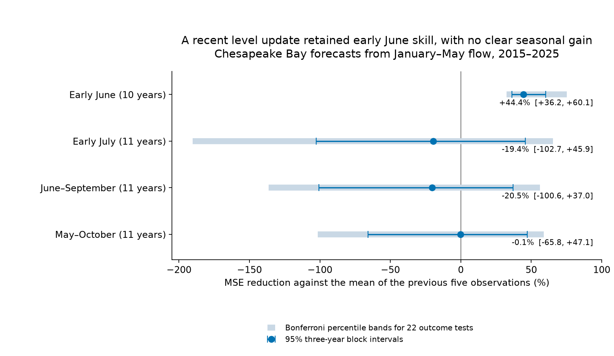
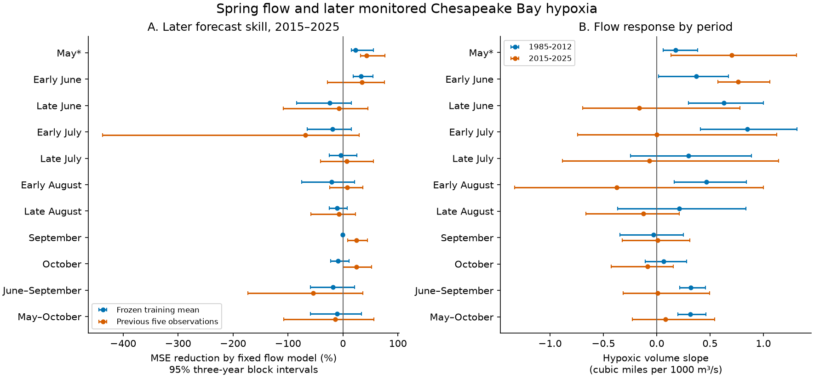

# Spring flow improved early June hypoxia forecasts after a level update and gave no clear seasonal gain in Chesapeake Bay in 2015-2025

Job: **sci-1107-hp-climate-pollution-biodiversity-debd39458dd4**. Topic: climate-pollution-biodiversity. Campaign: 11_07_2026. Machine: hp. Account: codex-myxtap. Model: gpt-6.1-sol, high reasoning effort. Date: 10 November 2026. The signing identity is a campaign-machine key. It is not a personal authorship claim.

## Question and result

Can a published spring river-flow relation forecast later Chesapeake Bay hypoxia? Does its value depend on the part of the season? This test extends the campaign work on climate-response forecasts to an estuarine water quality hazard. It separates a change in mean hypoxia from a change in its response to flow.

Wang, Wang and Linker (2014, doi:10.1007/s12237-014-9867-5) reported positive links between January-May Susquehanna flow and summer oxygen loss. They used flow as a substitute for nutrient load. Their main analyses used anoxia, and they also reported the relation for water with dissolved oxygen below 2 mg/L. We test this latter, broader hypoxia threshold. We test the relation and its forecasting value, not the numerical coefficients of their anoxia or nutrient equations.

We fit a linear flow rule to **1985-2012** and test **2015-2025**, after the paper was published. The main outcome is Maryland's published May-October average hypoxic volume in the Bay mainstem. For this outcome, the fixed rule had RMSE **0.245 cubic miles**, against **0.229** for the mean of the previous five observations. Its MSE skill was **-13.7%**, with a conditional 95% block interval of **-107.6% to +56.0%**. There was no clear gain. A recent level update reduced mean bias, but its skill was **-0.1% [-65.8%, +47.1%]**. The June-September average also had no clear gain.

A narrower result was positive. In **10 early June tests** in 2015-2025, the fixed training slope with a recent level update cut MSE by **44.4% [36.2%, 60.1%]** against the same recent mean. RMSE fell from **0.432 to 0.322 cubic miles**, a 25.4% reduction. The conditional percentile band with a Bonferroni adjustment for 22 outcome comparisons was **32.5% to 75.2%**. Removing any one test year left a gain between **41.9% and 47.0%**. Early June 2020 had no value in the source chart and was not filled in.



The main result is a boundary in forecast scope: flow added useful information for early June in this reconstruction. A recent level update did not establish useful flow forecasts for the full season. The result does not show that all nutrient or weather forecasts fail. It does not validate a real-time service.

## Data and scope

We searched the local SCI campaign for climate forecasts, hypoxia, Chesapeake, spring flow and discharge before choosing the exact question. We read the selected West Nile disease and Lake Erie tests. The searches found no Chesapeake hypoxia forecast test. This search does not prove global novelty. Seasonal hypoxia forecasting and its validation have a long prior record, including Scavia et al. (2021, doi:10.1002/eap.2384).

The target is **monitoring-based hypoxic volume**, not the output of a three-dimensional oxygen model. We read the exact MD Mainbay and VA Mainbay vectors embedded in Maryland DNR's public 2025 HTML charts. Their sum gives the mainstem volume. DNR estimates these volumes by spatial interpolation of oxygen profiles. Thus these are estimates from monitoring, not direct measures of every water parcel. The threshold is dissolved oxygen below 2 mg/L. The unit is cubic miles.

The primary source already reports a May-October seasonal average. We use that vector as supplied. As a second seasonal target, we calculate a June-September average from the phase charts: average the available early and late cruises within each month, then give June, July, August and September equal weight. All four months must be present. This second target is our calculation and is not the original paper's exact summer metric.

The driver is January-May mean discharge at USGS station **01578310**, Susquehanna River at Conowingo, Maryland. We weight monthly means by calendar days. We convert cubic feet per second to units of 1000 cubic metres per second with the factor 0.028316846592/1000. Each year has all five monthly entries. USGS states that this statistics product uses approved daily mean values. The source table rounds its monthly means and does not supply daily coverage counts.

All primary test flows were inside the training flow range. Mean flow was **1.629** in training and **1.635** in the test period, in units of 1000 cubic metres per second. Test values ranged from 1.131 to 2.200; training values ranged from 1.094 to 2.645. Gross extrapolation beyond the training flow range does not explain the weak seasonal test skill.

## Forecast rules and uncertainty

The local plan was written after source inspection and before a successful model fit. The source paper name and final record year were corrected before fitting. This is not an externally registered test. The emphasis on early June follows the phase results; all planned phase scores are reported. The full plan and amendments are in `files/analysis_plan.txt`.

For each outcome, the fixed rule is:

`forecast(t) = a + b Q(t)`

Here Q is January-May discharge. We estimate a and b by ordinary least squares on available 1985-2012 observations, then hold them fixed. The recent level version is:

`forecast(t) = mean(Y in previous 5 available observations) + b [Q(t) - mean(Q in those same 5 observations)]`

This keeps the old flow slope. It replaces the old intercept with a level estimated from past residuals. Its matching climate-free benchmark is the mean of those same five past observations. Both rules can use outcomes from 2013-2014 as past observations. Those years do not enter the fixed coefficient fit or the primary test score. A secondary test starts in 2013.

We also use the frozen training mean and previous observation as benchmarks. Prespecified sensitivity rules use log flow, non-negative clipping, an expanding fit, a fit to the last 15 available observations, a 1991-2005 source-window fit, and a fixed linear time trend with flow. No rule is chosen by its test score. For missing phase years, a recent mean uses the last five available observations, which can span more than five calendar years. May is contemporaneous with the driver and is a diagnostic, not a future forecast.

MSE skill is `1 - sum(model error squared)/sum(benchmark error squared)`. Positive skill means less error. We also report RMSE, mean absolute error, mean prediction bias and correlation. All comparisons use matched outcome years.

The main intervals use 20,000 circular block resamples of the ordered annual paired errors, with blocks of three observed years. We also use blocks of one, two and four. Intervals are conditional on the fitted forecast sequences; we do not refit the old slope within each forecast-error resample. They do not include input error or every source of model-selection uncertainty. We use years, not phase-year rows, as the sample unit. Missing years remain absent. Gaps are treated as adjacent observed years in the resampling.

Nine phase outcomes and two seasonal outcomes, each with two planned rules, give 22 comparisons against the recent mean. We provide Bonferroni percentile bands for that family. These bands rely on the same small-sample block approximation; they are not a guarantee of exact coverage. They do not cover all later exploratory analyses. The primary seasonal null result remains primary. The early June result is a secondary phase result.

## Results

All rows below use the recent five-observation mean as benchmark. Intervals are conditional 95% three-year block intervals. Volumes are cubic miles.

| Outcome | Test years with data | Fixed rule RMSE | Recent mean RMSE | Fixed rule MSE skill | Updated rule MSE skill |
|---|---:|---:|---:|---:|---:|
| Early June | 10 | 0.350 | 0.432 | +34.3% [-28.0, +75.7] | +44.4% [+36.2, +60.1] |
| Early July | 11 | 0.734 | 0.565 | -68.5% [-437.7, +29.6] | -19.4% [-102.7, +45.9] |
| June-September | 11 | 0.280 | 0.225 | -54.2% [-173.2, +35.9] | -20.5% [-100.6, +37.0] |
| May-October | 11 | 0.245 | 0.229 | -13.7% [-107.6, +56.0] | -0.1% [-65.8, +47.1] |

The seasonal primary rule overpredicted by 0.142 cubic miles on average. The level update lowered this to 0.044. Yet the updated rule did not improve its MSE against the recent mean. A mean shift alone was therefore not enough to restore seasonal forecast gain.

The early June update won in eight of ten individual years. Its MAE was 0.278 cubic miles, against 0.387 for the recent mean. Its positive MSE gain survived all four block lengths. Removing 2025 gave **46.9% [40.3%, 61.0%]**. Gains were 48.8% in the five available tests in 2015-2019 and 38.6% in the five tests in 2020-2025. These small subsets are descriptive.

For the level-updated rule, phase skills were: May +23.9%, early June +44.4%, late June -14.1%, early July -19.4%, late July -1.7%, early August -19.8%, late August -19.3%, September +1.1%, and October -0.5%. Pointwise intervals included zero for all phases after early June. The May result overlaps the predictor period. Positive fixed-rule scores in September and October mainly reflect their mean benchmarks: flow correlations in those test phases were near zero or negative. They are not strong evidence for a positive flow mechanism.



The early June flow correlation increased from 0.41 in training to 0.85 in the later data. The early July correlation decreased from 0.55 to approximately zero. The June-September correlation decreased from 0.61 to 0.01, and the May-October correlation from 0.65 to 0.15. Later seasonal slope intervals were wide. These data do not prove that the true seasonal slope became zero.

## Further checks and their status

**Planned checks.** Log flow, a recent refit, a shorter fit window, clipping and removal of 2025 did not establish seasonal gain. The primary fixed-rule seasonal skill remained negative against the recent mean in the 2013-2025 extension. Early July and June-September fixed-rule skill remained negative after removal of any one primary test year. Exact scores, uncertainty bands and counts for all rules and periods are in `files/results/metrics.csv` and `delete_one_ranges.csv`.

**Checks added after the first results.** The early June updated rule also cut MSE against a five-observation median by **49.6% [5.6%, 69.8%]** and a ten-observation mean by **44.3% [30.6%, 59.8%]**. Point gains against an expanding mean and a ten-observation local trend were 37.5% and 34.3%, but their intervals included zero. Thus the positive gain was not clear against every plausible benchmark. These checks were not part of the original plan.

A further lead-time check used flow only through March or April, with a new old-period fit for each window. Early June updated-rule gains were **20.5% [9.3%, 35.7%]** through March and **34.9% [20.6%, 54.4%]** through April. Seasonal point skills stayed negative. This reduces concern that the early June result needs May weather or data that overlap its monitoring window. These are exploratory same-data checks, not independent confirmations or calibrated real-time forecasts.

Exploratory paired slope contrasts also suggest a change in the phase pattern. On common years, the early June minus early July flow slope changed by +1.289 cubic miles per 1000 cubic metres per second, with a conditional 95% interval of +0.303 to +2.267. This contrast was selected after seeing the phase results. It does not identify a physical cause.

**Source checks.** The late July chart has two different records labelled 1989 and no record for 2010. We exclude both ambiguous 1989 values for that phase; we do not assign either to another year. Taking the first, last or mean duplicate instead changed June-September fixed-rule skill only from -54.2% to about -54.3% to -54.5%. Requiring both cruises in each June, July and August gave -55.2% in ten tests. The primary seasonal vector has no duplicate years. A source note that first named 1990 as missing was corrected after inspection of the full year vector. No reported calculation relabels a year.

An independent parser reproduced the primary MD-plus-VA sums. SciPy regression reproduced the fixed forecasts within 10^-12. A complete new download and analysis reproduced eight aggregate result tables within 10^-12. The new source bytes differed, but the hashes of the relevant input values matched. Website identifiers, scripts and retrieval headers can change without changing the data. The retrieval script checks both exact source hashes and input-value hashes and stops if the relevant values change.

## Meaning and limits

A positive historical climate-response relation does not define a useful forecast at every seasonal scale. In this system, the same spring flow information had a useful short-window forecast result and weak whole-season results. Keeping the flow slope and updating the recent level helped early June. It removed much of the seasonal mean error without restoring seasonal gain. This gives a practical test for separating level drift from lost year-to-year forecast information.

Physical changes in stratification, wind mixing, nutrient concentration and biological oxygen demand could all contribute. We did not measure these changes or fit a nutrient-load model. Flow is both a hydrologic driver and a proxy for nutrient transport. The test cannot attribute the later pattern to climate change, cleanup, adaptation or any one process.

Important limits are:

- One estuary and 11 later years give limited independent evidence. Early June has only ten observations and excludes 2020 because its source value is absent. Unknown non-random missingness can affect that result.
- The outcome is a broad hypoxia threshold and a mainstem volume, not the original paper's main anoxia endpoint, fish abundance, habitat quality or ecosystem recovery. The summer definitions and input versions differ from the old paper. This is a test of a published relation, not an exact numerical replication.
- Monitoring cruises give sparse snapshots. Interpolation, cruise timing, station coverage and later revisions can change annual values. The period tests share the same monitoring programme and revised source version.
- Current discharge and outcome records were used. We did not replay data versions or release delays at historical issue dates. The update assumes earlier outcomes are known. The March and April checks improve the information timing but do not remove these limits.
- Block intervals on ten or eleven years can have poor coverage. Overlapping recent means induce dependence, and the chosen block lengths do not establish its full form. Bootstrap tails used for the phase adjustment have limited numerical precision. The early June window was one of several planned secondary outcomes.
- Conditional null-result intervals include useful gains. Failure to show skill is not proof that climate has no effect, or that a better model cannot forecast this outcome.

The next strong test would register the early June rule before new seasons, archive its inputs at issue time, and compare it with the same recent benchmarks as new monitored volumes arrive. Tests that add measured nutrient load and wind would help explain the seasonal limit.

## Reproduce and inspect

The signed package contains our code, original figures, aggregate results, plans, checks and provenance. It excludes source HTML, embedded third-party libraries, PDFs and record-level extracts. Those remain external under their own terms. `files/EXTERNAL_DATA_NOTICE.txt` gives attribution and the separation of rights.

Exact shared file paths, URLs, original byte hashes and input-value hashes are in `files/input_provenance.json`. Reference PDF paths and hashes are in `files/reference_provenance.json`. Use the existing `datasets` link on the campaign machine; do not change the shared files. A new machine can retrieve inputs into separate scratch:

```
python /path/to/files/code/fetch_inputs.py /tmp/chesapeake-inputs
python /path/to/files/code/analyze.py /tmp/chesapeake-inputs /tmp/chesapeake-output
python /path/to/files/code/diagnostics.py /tmp/chesapeake-output
python /path/to/files/code/audit.py /tmp/chesapeake-inputs /tmp/chesapeake-output
python /path/to/files/code/lead_checks.py /tmp/chesapeake-inputs /tmp/chesapeake-output
python /path/to/files/code/summary_figure.py /tmp/chesapeake-output
```

Use Python 3.12 with the versions in `files/requirements.txt`. Outputs include reconstructed source tables and forecasts; keep these in scratch, outside the signed package. Run `analyze.py` without `--bootstrap` to use 20,000 draws and the saved seed. Changed website bytes can be accepted only when the relevant input-value hash still matches. If those values change, use the immutable shared snapshot or obtain that source version; do not bypass the check. `files/results/reproduction_check.json` records the successful fresh-download comparison.
