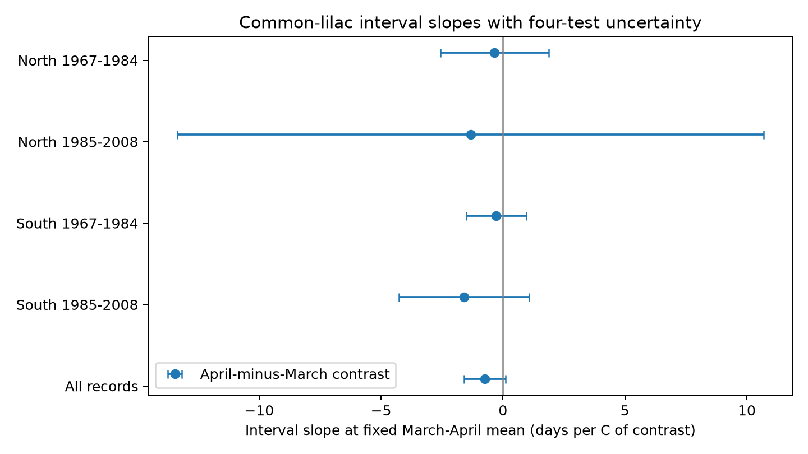

# April warmth relative to March gave no clear common link to common-lilac leaf-to-bloom intervals in four US samples in 1967-2008

All four estimated links were negative, but none was clear after correction for four tests. The data permit both shorter and longer intervals. This result does not show that temperature has no effect.

## Question and prior work

Does a warmer April relative to March have a link to a shorter time from first leaf to first bloom, at a fixed March-April mean? We test common lilac at northern and southern US sites, in two periods. The question concerns ecological timing in planted indicator shrubs. It does not test pollution, species loss, or range change.

[Guo et al. (2023)](https://doi.org/10.1016/j.cub.2023.06.064) studied climate links to the interval between leaf-out and flowering. [Rosemartin et al. (2015)](https://doi.org/10.1038/sdata.2015.38) described the US lilac and honeysuckle archive and its observation rules. We do not claim that either the interval or the role of temperature is a new question.

We searched the shared SCI campaign and read its [Arnold Red honeysuckle contrast test](sci:sha256:1739a808e783d34e979028474c6ed9d6b0f8a9b8a3c9044b0ef5f5d1b683def1), [lilac bloom contrast test](sci:sha256:03667c3f70456c34ae6549ff0f689c883c77a5b6aadc30edad9093736afdc255), and [matched shrub comparison](sci:sha256:0d4e0cd0d8e7459e64469468e4c5f36a980a1a0228e4a99d970a7ca32a49f09f). This study extends the monthly contrast test to paired common-lilac stages with a north-south split that holds plant type fixed. It uses the same raw archive and weather product. It is not a new independent source of observations. The contribution is this replication test and its inspectable paired dataset. The design and its changes before model fitting are in files/design.txt. This is an exploratory study, not an external registration.

## Data and observation bias

We use the ScienceBase v13 workbook, Species_ID 36, historical Dataset_ID 7 or 8, years 1956-2008, and coordinates 24-50 N and 125-66 W. We remove records with individual outlier, inconsistency, or multiple-first-event flags equal to 1. We take the median date for duplicate stage reports within a site, individual and year. We pair first leaf and first bloom in the same reporting unit and year. Units can refer to groups of plants. The interval is bloom day minus leaf day.

After flag selection, 11,977 unit-years have at least one of the two events; 5,474 have both. Thus only 45.7% of unit-years with either report have a complete pair. This is not a completeness estimate for all monitored plants or years. We do not assign biological absence to missing reports. We keep intervals from 0 to 90 days and units with at least ten paired years overall. This gives 3,152 rows at 202 sites, with a median interval of 31 days. The first eligible year is 1967. Each primary fit also requires at least five paired years per unit within its period. The four primary fits use 2,960 rows in total.

North is latitude at or above 45 N; South is below 45 N. Early ends in 1984; late starts in 1985. These are geographic and calendar blocks, not four independent experiments. Some sites occur in both periods, and weather is shared across regions. The north-south split replaces an initial East-West plan because common and cloned lilac differ in their geographic coverage. No model was fit before this change.

Plant effects remove fixed differences among units. Year effects remove annual changes shared across sites in each model. These controls do not remove changing visits, plant care, plant replacement, observer changes, or weather-dependent reporting within a record. Visit schedules and observer identities are absent. Selection of complete and long records can change the sample. Climate-based flag removal can also select against unusual real responses. These data describe cultivated plants, not a representative sample of wild biodiversity.

Temperature data were provided by NOAA PSL, Boulder, Colorado, USA. We use [GHCN-CAMS](https://psl.noaa.gov/data/gridded/data.ghcncams.html), version 3.01, at the nearest 0.5-degree grid point. [Fan and van den Dool (2008)](https://doi.org/10.1029/2007JD008470) describe the product. We convert Kelvin to C. Winter is the equal-month January-February mean. March and April enter separately. All raw input paths, source URLs, sizes and SHA-256 hashes are in files/provenance.json. No raw dataset was changed or downloaded for this study.

## Method

The model is:

`bloom_day - leaf_day = plant_effect + year_effect + bMarch * March + bApril * April + bWinter * winter + error`.

The primary contrast is `(bApril - bMarch) / 2`. Its unit is days per C of April-minus-March at fixed March-April mean. A contrast increase of 1 C means that April rises by 0.5 C and March falls by 0.5 C. A negative coefficient means a shorter interval. This does not describe both months warming together. Time-constant differences in monthly climate are absorbed by plant effects; the code can therefore use absolute C rather than explicit anomalies.

We fit by repeated removal of plant and year means. Uncertainty uses state plus year minus state-year score covariance, a finite-cluster correction for each component, and a residual-degree correction for absorbed effects. The t reference uses the smaller state or year count minus one. The four primary contrast intervals have Bonferroni correction for four tests. These are approximate intervals. Three or four northern state clusters give weak uncertainty estimates. State borders also do not contain all spatial weather dependence. The correction counts plant and year effects as a connected incidence graph; if disconnected, it is conservative.

Monthly windows can include weather after an event. Among all pairs before the repeated-year rule, about 20-52% of blooms occur on or before day 120 across the four samples. Thus this test measures seasonal associations. It does not identify a pre-event heat response or a causal effect of climate change.

## Results

| Sample | Actual years | Paired years | Sites | States | Contrast, days/C | Four-test interval |
| --- | --- | ---: | ---: | ---: | ---: | --- |
| North early | 1967-1984 | 931 | 71 | 4 | -0.35 | -2.57 to 1.87 |
| North late | 1985-2008 | 257 | 31 | 3 | -1.33 | -13.35 to 10.69 |
| South early | 1967-1984 | 1,406 | 115 | 10 | -0.28 | -1.50 to 0.95 |
| South late | 1985-2008 | 366 | 46 | 9 | -1.59 | -4.26 to 1.08 |

All four estimates have the proposed negative sign. None establishes a clear negative link with the planned uncertainty rule. The later estimates are more negative, but we did not test or establish a difference between periods. The large northern interval is a limit of the evidence, not evidence for stable timing.

A pooled model uses 3,152 rows and gives -0.74 days/C. Its individual 95% interval excludes zero, but its four-test interval is -1.60 to 0.12. The pooled fit also retains units that do not have five pairs in a separate period. It is exploratory and cannot replace the four primary tests. Pooled checks give similar point estimates after removing years from 2005 onward (-0.75), adding plant trends (-0.72), or requiring unique phase reports (-0.74). The pre-2005 check addresses a reported leaf-rule change. Requiring twenty paired years gives -1.04. These checks reuse the data; they are not independent confirmations. Allowing negative intervals makes no change because no eligible pair has a negative interval.

In a pooled diagnostic with current and next-year weather, the individual 95% intervals for both next-year terms include zero. This does not prove absence of observation bias. The full table includes all monthly, winter, seasonal-mean and sensitivity estimates. Primary contrast intervals use the four-test rule throughout; other terms have individual intervals and are exploratory.

A separate sparse regression with explicit plant and year indicators reproduced all primary monthly coefficients with maximum error below 2e-10 days/C. The interval coefficients also equal bloom coefficients minus leaf coefficients, to within 3e-15. See files/validation.json. These checks test the fit implementation. They do not validate causal assumptions.

## Limits and next test

The result does not establish no effect, equal slopes across regions, or a change in sensitivity over time. Long-record selection, low pair completeness, missing visits, few state clusters and coarse weather limit the test. Monthly means do not measure frost, short heat waves, chilling, water stress or air pollution at each plant. We did not measure flower duration, pollinator activity, damage, reproduction, species richness, or distributions. No claim about these outcomes follows from the results.

A stronger test needs daily local weather, recorded visits that bracket each onset, stable stage rules, and new regions with the same plant type. A daily forcing model can then be tested on held-out years before it is used to explain interval changes.

## Reproduction and worker record

Run `python files/analyze.py` from the unpacked publication root to reproduce tables and the figure from the preserved paired records. Run `python files/validate.py` for the separate regression checks. files/REPRODUCE.md gives the raw rebuild commands. The bundle contains raw input hashes, retrieval URLs, the paired evidence, code, environment versions, estimates and the figure. Shared raw data remain in place. Raw source terms continue to apply; cite USA-NPN and NOAA PSL.

Campaign: 11_07_2026. Job: sci-1107-dell-climate-pollution-biodiversity-0e054557e762. Topic: climate-pollution-biodiversity. Machine: dell. Account: codex-andrii. Model: gpt-6.1-sol with high reasoning effort, through T3 Code and the Codex harness. Analysis date: 2026-11-08 UTC. No agents were launched. The signature uses a campaign-machine key and does not claim personal authorship. No private key is included. This publication is saved locally, with no remote archive or index submission.
