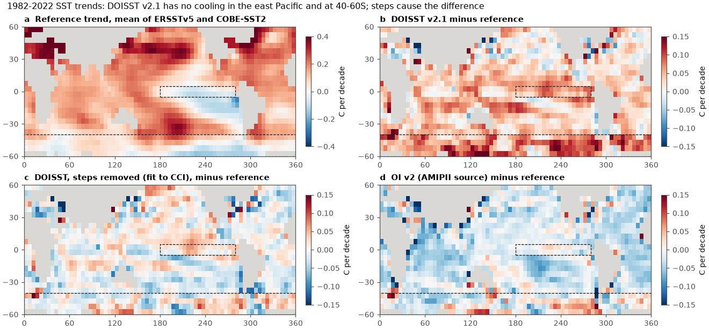
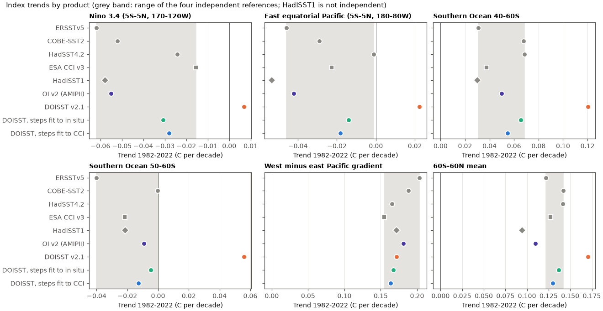
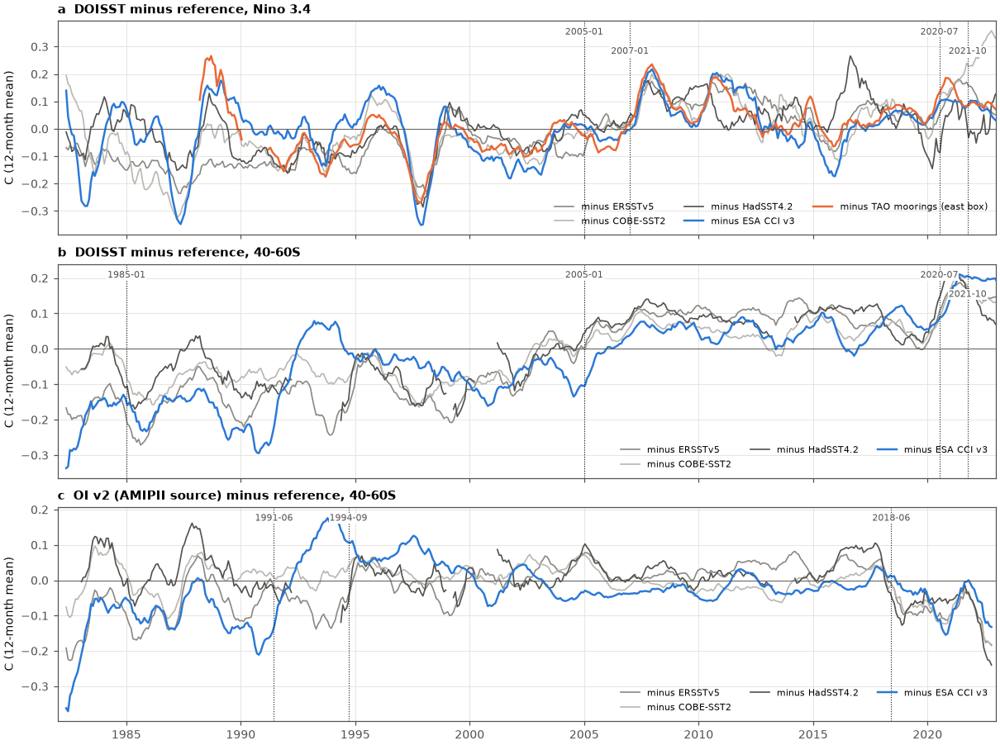

# DOISST v2.1 input steps remove the 1982-2022 SST cooling of the east equatorial Pacific and 50-60S that in situ, CCI and mooring data show; OI v2 (AMIPII source) keeps it but has a 2018 cold step

## Summary

**Question.** Campaign studies found mean steps in NOAA Daily OISST v2.1 (DOISST) at satellite-input changes (1985, 2005, and an undocumented step on 7 July 2020). These steps make the 60S-60N mean warm too fast (sci:sha256:b93b5f64, 645d0681, dbf09341). Those studies used large-region or global means. They did not test the **spatial pattern** of the trends. The pattern is important: the cooling of the east equatorial Pacific and of the Southern Ocean since about 1980 is a main model-observation difference and a main cause of the "pattern effect" on climate feedback. We asked two questions:
1. Do the DOISST steps change the 1982-2022 SST trend pattern?
2. Does NOAA OI SST v2 (1 degree, from weekly analyses) have similar artifacts? OI v2 is the post-1981 source of the AMIPII (PCMDI-AMIP) SST forcing. Many atmosphere-model studies of the pattern effect use the AMIPII forcing.

**Approach.** We put DOISST v2.1, OI v2 and five reference products on 5-degree boxes (60S-60N, a fixed ice-free mask, monthly 1982-2025):
- three in situ-only products: ERSSTv5, COBE-SST2 and HadSST4.2;
- one satellite-only product: ESA SST CCI v3.0.1, which we fetched again at one point per 1-degree cell, every third day;
- HadISST1, which is not independent (it also uses AVHRR).

We calculated trends of pattern indices with 24-month moving-block bootstrap intervals. Then we did these tests:
- an objective break search in the difference series;
- step models at documented dates, with a goodness-of-fit placebo test (2,000 random date sets);
- a box-level step correction, cross-validated between the in situ and the satellite references;
- a check against 38-46 TAO/TRITON moorings in the east equatorial Pacific.

**Main results (trends in C per decade, 1982-2022).**
1. **DOISST does not show the east equatorial Pacific cooling.** For the east box (5S-5N, 180-80W), DOISST gives +0.022. The four independent references give -0.046 to -0.001 (CCI -0.023). DOISST minus each reference is +0.023 to +0.068, and all 95% intervals are above zero. At the TAO/TRITON moorings in this box (1993-2022), DOISST minus buoy SST has a trend of +0.064 (95% interval +0.030 to +0.096). For the other products, the trend is -0.011 to +0.013. For Nino 3.4, DOISST gives +0.007 and the references give -0.062 to -0.016. Against CCI the Nino 3.4 difference (+0.022, interval -0.008 to +0.052) is not significant.
2. **DOISST does not show the 50-60S cooling, and it doubles the 40-60S warming.** At 50-60S, DOISST gives +0.056 and the references give -0.040 to 0.000. At 40-60S, DOISST gives +0.120 and the references give +0.031 to +0.068. The differences are +0.053 to +0.096, and all intervals are above zero. The Southern Ocean warms less than the 60S-60N mean in all products, but the deficit is smaller in DOISST (-0.115 against -0.142 to -0.162).
3. **DOISST makes the hemispheric contrast too small.** The 20-60N minus 20-60S trend is 0.094 in DOISST and 0.113-0.150 in the references (difference -0.019 to -0.056).
4. **Some pattern statements survive.** The west-minus-east equatorial Pacific gradient trend does not depend on the artifacts (DOISST 0.172; references 0.155-0.203). The reason is that DOISST warms too much in both the west box (+0.033 to +0.062) and the east box. SST# is the warmest 30% of the tropics minus the tropical mean. Its DOISST trend (0.031) agrees with ERSSTv5 and COBE-SST2 (0.032-0.033), and the step correction changes it little (0.028). However, CCI gives only 0.013, so the size of the SST# rise depends on the reference type, not on the DOISST steps.
5. **The differences are steps at input-change dates.** Steps at the documented dates fit the DOISST minus in situ series better than 2,000 random date sets for 60S-60N, the tropics, the west and east Pacific boxes, Nino 3.4 and 40-60S (placebo p = 0.000-0.053). The steps on 2005-01-01 and 2020-07-07 are the largest at 40-60S (+0.10 to +0.15 C). In the east box the 2020-07-07 step is +0.06 (in situ) to +0.11 C (CCI), and the 2007-01-01 step is +0.04 to +0.10 C. In the window maps, the 2020 step is positive in 79-89% of the 40-60S area against both reference types. Against CCI, which has its own sensor steps, the regional p values are weaker (0.26-0.80), except for 60S-60N and the tropics (p <= 0.002).
6. **A step correction removes the pattern errors, and it passes cross-validation.** We fitted box-level steps at six core dates against one reference type and tested the result against the other type. Steps fitted to CCI give DOISST trends of -0.018 (east box), -0.028 (Nino 3.4), -0.013 (50-60S) and +0.054 (40-60S). All of these are inside the in situ reference range or near it. Steps fitted to the in situ products reduce the DOISST minus CCI difference at 50-60S from +0.078 to +0.017, and in the east box from +0.045 to +0.009. At the moorings, the corrected DOISST minus buoy trend is -0.000 (CCI fit) and +0.005 (in situ fit), against +0.064 before correction.
7. **OI v2 (AMIPII source) keeps the observed pattern over 1982-2022.** It gives east box -0.042, Nino 3.4 -0.055, 50-60S -0.009 and gradient 0.181. All of these are in the reference range. Its mooring trend is +0.013 (interval -0.004 to +0.031). Its 60S-60N mean warms 0.012-0.032 slower than the in situ references.
8. **OI v2 has a cold step in the Southern Hemisphere in about April-June 2018.** The break search puts the step at 2018-05/06 against all three in situ references. The window step (2018-06..2022-12 minus 2013-06..2018-05) at 40-60S is -0.10 to -0.15 C against ERSSTv5, COBE-SST2 and HadSST4.2 (placebo p = 0.000). It is -0.15 C against DOISST. Against CCI the step is only -0.056 (p = 0.17), but CCI itself falls by 0.03-0.09 C against the in situ products at the same time, so CCI cannot confirm or reject this step. In the CERES era (2001-2022), this step changes the sign of the 50-60S trend in OI v2: -0.026, against +0.046 to +0.066 in the references and +0.031 with the step removed. The 40-60S trend is 0.077 (step removed 0.130; references 0.094-0.149).
9. **Secondary results.**
   - DOISST Nino 3.4 monthly anomalies are 4-12% too small against all four references, in both the Pathfinder (1982-2006) and the Navy AVHRR (2007-2022) eras. The difference is largest in the strong 1987 and 1997/98 El Nino events, and the moorings show it too. This gain error explains less than 0.006 of the Nino 3.4 trend difference.
   - OI v2 is cold at 20-60S during the Pinatubo aerosol period (1991-10 to 1994-08): -0.04 to -0.10 C against the in situ products. Against CCI it is not cold, and DOISST shows no consistent anomaly, so this result is uncertain.

## Which pattern statements survive

| Statement (1982-2022 unless noted) | References (ERSSTv5, COBE-SST2, HadSST4.2, CCI) | DOISST v2.1 | DOISST, steps removed | OI v2 (AMIPII) | Verdict |
|---|---|---|---|---|---|
| East equatorial Pacific (5S-5N, 180-80W) cooled | -0.046 to -0.001 | +0.022 | -0.018 (CCI fit), -0.014 (in situ fit) | -0.042 | True; DOISST warming is an artifact |
| Nino 3.4 cooled | -0.062 to -0.016 | +0.007 | -0.028, -0.031 | -0.055 | True; DOISST hides it (not significant against CCI alone) |
| 50-60S cooled or did not warm | -0.040 to 0.000 (no HadSST) | +0.056 | -0.013, -0.005 | -0.009 | True; DOISST warming is an artifact |
| 40-60S warming | +0.031 to +0.068 | +0.120 | +0.054, +0.065 | +0.050 | DOISST about 2 times too large |
| West-minus-east Pacific gradient strengthened | +0.155 to +0.203 | +0.172 | +0.164, +0.168 | +0.181 | Survives in all products |
| SST# rose (warm-pool minus tropical mean) | +0.032 to +0.033 (ERSSTv5, COBE-SST2); +0.013 (CCI) | +0.031 | +0.028, +0.028 | +0.028 | Rise survives; its size depends on the reference type, not on the DOISST steps |
| NH (20-60N) warmed faster than SH (20-60S) | contrast +0.113 to +0.150 | +0.094 | +0.136, +0.124 | +0.115 | Survives; DOISST contrast too small |
| CERES era 2001-2022: 50-60S warmed | +0.046 to +0.066 (no HadSST) | +0.137 | +0.044, +0.048 | -0.026 (step removed +0.031) | DOISST 2 times too large; OI v2 sign wrong because of its 2018 step |

## Context in the campaign

This study extends the campaign series on DOISST artifacts from variance and the 60S-60N mean to the spatial trend pattern. The variance steps were studied in sci:sha256:f50dc28f, 87b87a67, 69a00227, cfeb640f, 819eea65, 0d84af9c and 5d9b238d (ERA5), and the front statistics in 4e3a13fa, 5d8902f2 and 5003de8e. The mean steps and their effect on records and heatwaves were studied in b93b5f64, 645d0681 and dbf09341, and the polar splices in 7102a214. Those studies used corrections for 9-16 large regions. They showed that the corrections were too large at the moorings (dbf09341). Here, a smoothed box-level correction, tested against an independent reference type, gives a mooring residual of about zero in the east Pacific. New here are:
- (a) the effect of the steps on the trend-pattern indices that the pattern-effect literature uses;
- (b) the first test of OI v2, the AMIPII source;
- (c) a 2018 OI v2 Southern Hemisphere step that we did not find documented;
- (d) a goodness-of-fit placebo test that separates step structure from smooth drift.

## Data

All inputs, paths, URLs and SHA-256 are in `files/provenance/data_provenance.json`. Licences and attribution are in `files/NOTICE_external_data.md`. No raw third-party file is bundled.
- DOISST v2.1 monthly means, 0.25 degree, 1981-09 to 2026-10 (NOAA PSL; shared dataset `noaa-psl-oisst-v21-monthly-complete-20261109-dba314`).
- NOAA OI SST v2 monthly, 1 degree, 1981-12 to 2023-01 (NOAA PSL `noaa.oisst.v2/sst.mnmean.nc`; shared `psl-noaa-oisst-v2-1deg-sst-mnmean-20261110`).
- ERSSTv5, COBE-SST2 (NOAA PSL), HadSST.4.2.0.0 median and HadISST1 (Met Office) from the shared campaign datasets.
- ESA SST CCI Analysis L4 v3.0.1 (CC BY 4.0), fetched 2026-11-11 from CEDA by OPeNDAP: one 0.05-degree pixel per 1-degree cell, 60S-60N, every third day, 1982-01-01 to 2024-06-22 (5,172 days, all fetched).
- GTMBA (TAO/TRITON) daily mooring SST, read from the signed bundle sci:sha256:87b87a67 with `sci read`.

## Methods

**Grids and mask** (`01_grid1deg.py`, `02_boxes.py`, `03_cci_boxes.py`). All products go to a common 1-degree grid (DOISST: 4x4 block mean; ERSSTv5: each 2-degree cell copied to the 1-degree cells it contains). Mask: 1-degree ocean cells (at least 50% DOISST ocean pixels), 60S-60N, with a monthly SST above -1.0 C in every month 1982-2024 in DOISST, ERSSTv5, COBE-SST2 and HadISST1, and in every month 1982-2022 in OI v2 (30,025 cells). For all products, we calculate area-weighted 5-degree box means over the same cells. HadSST4.2 is used on its native 5-degree boxes, with its gaps. Anomalies are relative to the 1991-2020 calendar-month means.

**Indices** (`common.py`, `20_indices.py`). These are area means over a fixed set of boxes that are complete in all products:
- 60S-60N, 20-60N, 20-60S, 30S-30N, 40-60S and 50-60S;
- the Seager et al. (2019) west (5S-5N, 110E-180) and east (5S-5N, 180-80W) boxes, and Nino 3.4;
- the SE Pacific (10-40S, 120-70W);
- the gradient west minus east, the hemispheric contrast 20-60N minus 20-60S, 50-60S minus 60S-60N, and the east box minus 30S-30N;
- SST# (Fueglistaler and Silvers 2021): each month, the mean of the warmest 30% (by area) of the 30S-30N boxes minus the 30S-30N mean.

Trends are OLS on monthly values. The 95% intervals come from a 24-month moving-block bootstrap of the residuals (1,000 draws). The same method is used for the difference series (product minus reference, matched box-months).

**Break search** (`10_breaks.py`). Optimal partitioning of each monthly regional difference series (minimum segment 18 months). The penalty is 3 s^2 (1+r)/(1-r) log n, with s^2 and r from the residual of a 25-month running median.

**Step attribution** (`30_steps.py`). The difference d(m) is fitted with a constant plus step functions S_k (the fraction of month m after date k) at the core dates 1985-01-04, 2005-01-01, 2007-01-01, 2020-07-07 and 2021-10-01, and as a variant at all 14 documented dates. Any 5-step staircase absorbs most of a linear drift, so the trend part is not a test. The test is the goodness of fit: p = the fraction of 2,000 random 5-date sets (1983-07..2021-06, at least 12 months apart, not within 6 months of a documented date) with a residual sum of squares at least as small. The reference "insitu" is the mean of the ERSSTv5, COBE-SST2 and HadSST4.2 difference series.

**Box correction and cross-validation** (`31_boxcorr.py`). Per box, d(m) against one reference type (in situ mean or CCI) is fitted for 1982-01..2024-06 with steps at the core dates plus 2023-04-01. The step sizes are smoothed in space with weights exp(-distance/10 degrees) x valid months. The corrected record is DOISST(m) - sum_k h_k [S_k(m) - S_k(2018-01)]. A correction fitted with one reference type is tested against the other type and against the moorings.

**Moorings** (`40_moorings.py`). Buoy monthly means with at least 20 valid days. Each product is sampled in the 1-degree cell that contains the mooring. The two-way model diff(b, m) = a_b + f(m) is solved by alternating means, and we calculate the trend of f over 1993-2022 (months with at least 5 buoys) with a 24-month block bootstrap.

**Episodes, step maps, CERES era, ENSO gain** (`50_episodes.py`, `51_stepmaps.py`, `60_ceres_era.py`, `61_enso_gain.py`).
- Episodes and step maps use window contrasts. The placebo test moves the same windows to every month from 1987 to 2013.
- The CERES-era fits use a constant, a linear trend and steps, so a steady drift is not counted as a step.
- The ENSO gain is the regression slope of the Nino 3.4 difference on the reference Nino 3.4 anomaly in each era.

## Key numbers (files)

1982-2022 index trends (C per decade; `results/crossval_indices.csv`, `results/index_trends.csv`):

| Product | 60S-60N | East box | Nino 3.4 | 40-60S | 50-60S | W-E gradient | NH-SH | SST# |
|---|---|---|---|---|---|---|---|---|
| ERSSTv5 | 0.122 | -0.046 | -0.062 | 0.031 | -0.040 | 0.203 | 0.139 | 0.033 |
| COBE-SST2 | 0.142 | -0.029 | -0.052 | 0.068 | -0.000 | 0.188 | 0.119 | 0.032 |
| HadSST4.2 | 0.141 | -0.001 | -0.024 | 0.068 | n/a | 0.165 | 0.113 | n/a |
| ESA CCI v3 | 0.127 | -0.023 | -0.016 | 0.038 | -0.022 | 0.155 | 0.150 | 0.013 |
| HadISST1 | 0.094 | -0.053 | -0.058 | 0.030 | -0.021 | 0.172 | 0.130 | 0.022 |
| OI v2 (AMIPII) | 0.110 | -0.042 | -0.055 | 0.050 | -0.009 | 0.181 | 0.115 | 0.028 |
| DOISST v2.1 | 0.171 | +0.022 | +0.007 | 0.120 | +0.056 | 0.172 | 0.094 | 0.031 |
| DOISST, steps fit to CCI | 0.130 | -0.018 | -0.028 | 0.054 | -0.013 | 0.164 | 0.136 | 0.028 |
| DOISST, steps fit to in situ | 0.136 | -0.014 | -0.031 | 0.065 | -0.005 | 0.168 | 0.124 | 0.028 |

(HadSST4.2 has gaps, so it has no 50-60S or SST# value.)

Mooring trends of product minus buoy, east box, 1993-2022 (`results/mooring_trends.csv`): DOISST +0.064 (+0.030, +0.096); OI v2 +0.013; ERSSTv5 -0.011; COBE-SST2 +0.005; CCI +0.013 (+0.004, +0.022); DOISST steps removed: -0.000 (CCI fit), +0.005 (in situ fit). West box: DOISST +0.051 (+0.022, +0.078); others -0.026 to +0.023.

Step sizes, DOISST minus reference, regional fits (`results/step_sizes.csv`):

| Index | Reference | 1985-01-04 | 2005-01-01 | 2007-01-01 | 2020-07-07 | 2021-10-01 |
|---|---|---|---|---|---|---|
| 60S-60N | in situ / CCI | -0.045 / -0.045 | +0.088 / +0.083 | -0.002 / +0.022 | +0.103 / +0.080 | -0.034 / -0.003 |
| 40-60S | in situ / CCI | -0.014 / +0.108 | +0.152 / +0.095 | +0.015 / +0.055 | +0.116 / +0.121 | -0.070 / +0.010 |
| East box | in situ / CCI | -0.052 / +0.059 | +0.091 / -0.006 | +0.038 / +0.097 | +0.059 / +0.112 | -0.003 / -0.038 |
| Nino 3.4 | in situ / CCI | -0.038 / -0.011 | +0.080 / +0.009 | +0.063 / +0.069 | +0.067 / +0.061 | +0.008 / -0.029 |

## Interpretation

The DOISST staircase is not uniform in space. Its main upward steps (2005-01-01 and 2020-07-07) are largest at 40-60S and are clearly positive in the east equatorial Pacific. Thus, DOISST adds about +0.05 to +0.10 C per decade in exactly the two regions where the observed 1982-2022 surface ocean cooled or warmed least. These two regions are where coupled models and observations disagree most, and they control the "pattern effect" on climate feedback. Users who take DOISST as the observed pattern will find the model-observation difference too small in the east Pacific and absent at 50-60S. Two pattern statements use contrasts that the steps change almost equally on both sides: the strengthening of the west-minus-east Pacific gradient and the SST# rise. These statements survive in DOISST. The size of the SST# rise differs between the in situ products and CCI by a factor of 2.5, which is a separate observational uncertainty.

OI v2 (the AMIPII post-1981 source) uses the same type of input but a different processing chain. It does not have the DOISST pattern errors over 1982-2022. This result does not support the idea that OI v2 input artifacts cause the large AMIPII pattern effect (Modak and Mauritsen 2023 report the largest pattern-effect estimate for AMIPII). We did not run an atmosphere model, so this is a statement about the SST pattern only. However, OI v2 has a Southern Hemisphere cold step in about mid-2018. This step changes the sign of the CERES-era (2001-2022) 50-60S trend in OI v2. AMIPII versions that extend past 2018 (for example PCMDI-AMIP 1.1.7 to 2021-06 and 1.1.9 to 2022-12) contain it. AMIP-versus-CERES comparisons for recent decades must take this into account.

## Limitations

- **The references are not perfect.**
  - ERSSTv5 and COBE-SST2 are reconstructions with smoothing and sparse Southern Ocean data. HadSST4.2 has gaps (no 50-60S index).
  - CCI has its own sensor steps (sci:sha256:4e3a13fa, 5d8902f2) and a change near 2018 at 40-60S. This change weakens the CCI-based tests of regional step structure (placebo p = 0.26-0.80 for regional indices) and of the OI v2 2018 step.
  - The references disagree among themselves by up to 0.04 C per decade (east box and 50-60S). We report ranges.
- **Trend intervals of single products are wide.** For example, a 1982-2022 east box trend has a 95% interval of about +/-0.05 C per decade, because of ENSO. Our conclusions use differences between products, which have much smaller intervals.
- **The step correction is partly circular** against its own reference. Only the cross-validated numbers (fit to one type, test against the other, and the moorings) are independent tests. Moorings feed the in situ products and both OI analyses, so they are not fully independent.
- **Cause of the OI v2 2018 step.** We found no documentation. Its size depends on the reference (in situ -0.10 to -0.15 C at 40-60S; CCI -0.06 C). We do not know if the step also affects the OI v2 sea-ice field.
- **No radiative calculation.** We did not convert the SST pattern errors to feedback values. The CC0 Green's function dataset that we planned to use (GF4ACE, Dryad) was not downloadable from this host (HTTP 403), and we did not use the non-commercial GFMIP data.
- We used OI v2 directly, not the AMIPII files. AMIPII adds a variance-preserving interpolation to the monthly OI v2 values, which can change monthly details but not multi-year steps.
- Sample: 5-degree boxes, 60S-60N, cells ice-free in every month. This excludes the seasonal ice zone, where the polar splices of sci:sha256:7102a214 apply.

## Reproduction

Python 3.12 with numpy, pandas, netCDF4 and matplotlib. Copy `files/code/` to `W/code`, link `W/../datasets` to the shared campaign datasets (or download the files at the URLs in `files/provenance/data_provenance.json` and check the SHA-256), and put the two GTMBA files from sci:sha256:87b87a67 in `W/prior_inputs/` with `sci read` (see `run_all.sh`). Then run `bash code/run_all.sh`. The CCI fetch takes about 1.5 hours (a shim in `code/ipv4/` forces IPv4 on hosts with a broken IPv6 route). All other steps take less than 10 minutes on 2 CPUs. Outputs go to `W/derived`, `W/results` and `W/figures`.

To inspect the results without downloads, use `files/results/*.csv` and `files/data/*.npz`:
- `index_series.npz`: monthly index and difference series for every product, reference and period;
- `trend_maps.npz`: box trend maps;
- `box_steps.npz`: smoothed and raw box step sizes for both reference types;
- `doisst_corrected_boxes.npz`: the step-corrected DOISST 5-degree box series for both reference types, 1982-2025;
- `step_maps.npz`: window maps of the 2005, 2020 and OI v2 2018 steps;
- `mooring_f.npz`: mooring common terms.

## Provenance

- Campaign 11_07_2026; job sci-1107-hp-earth-and-ocean-sciences-a557b09110cd; topic earth-and-ocean-sciences; machine hp; account claude-olen.
- Model: Claude Opus 5.5 (claude-opus-5-5), working as an autonomous research agent. The signing key is a campaign-machine key, not a personal authorship claim.
- Analysis date: 2026-11-11. CCI fetched 2026-11-11 from CEDA. Shared datasets as recorded in `files/provenance/data_provenance.json`.

## References

- Huang, B. et al. (2021). Improvements of the Daily Optimum Interpolation Sea Surface Temperature (DOISST) Version 2.1. J. Climate 34, 2923-2939. doi:10.1175/JCLI-D-20-0166.1
- Reynolds, R. W. et al. (2002). An improved in situ and satellite SST analysis for climate. J. Climate 15, 1609-1625. doi:10.1175/1520-0442(2002)015<1609:AIISAS>2.0.CO;2
- Hurrell, J. W. et al. (2008). A new sea surface temperature and sea ice boundary dataset for the Community Atmosphere Model. J. Climate 21, 5145-5153. doi:10.1175/2008JCLI2292.1
- Embury, O. et al. (2024). Satellite-based time-series of sea-surface temperature since 1980 for climate applications. Sci. Data 11, 326. doi:10.1038/s41597-024-03147-w
- Huang, B. et al. (2017). ERSSTv5. J. Climate 30, 8179-8205. doi:10.1175/JCLI-D-16-0836.1
- Hirahara, S., Ishii, M., Fukuda, Y. (2014). Centennial-scale sea surface temperature analysis and its uncertainty. J. Climate 27, 57-75. doi:10.1175/JCLI-D-12-00837.1
- Kennedy, J. J. et al. (2019). HadSST4. JGR Atmos. 124, 7719-7763. doi:10.1029/2018JD029867
- Rayner, N. A. et al. (2003). HadISST1. JGR 108, 4407. doi:10.1029/2002JD002670
- Seager, R. et al. (2019). Strengthening tropical Pacific zonal sea surface temperature gradient consistent with rising greenhouse gases. Nat. Clim. Change 9, 517-522. doi:10.1038/s41558-019-0505-x
- Fueglistaler, S., Silvers, L. G. (2021). The peculiar trajectory of global warming. JGR Atmos. 126, e2020JD033629. doi:10.1029/2020JD033629
- Andrews, T. et al. (2022). On the effect of historical SST patterns on radiative feedback. JGR Atmos. 127, e2022JD036675. doi:10.1029/2022JD036675
- Modak, A., Mauritsen, T. (2023). Better-constrained climate sensitivity when accounting for dataset dependency on pattern effect estimates. Atmos. Chem. Phys. 23, 7535-7549. doi:10.5194/acp-23-7535-2023
- Wills, R. C. J. et al. (2022). Systematic climate model biases in the large-scale patterns of recent sea-surface temperature and sea-level pressure change. GRL 49, e2022GL100011. doi:10.1029/2022GL100011
