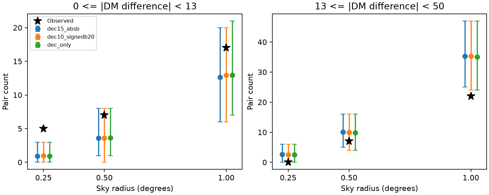

# A broad-DM pair screen finds no excess among 1,915 selected unlabelled CHIME bursts

## Result

We searched for bursts from one source that could have different dispersion measures (DM). We used CHIME/FRB Catalog 2, release 20251231. We selected 1,915 events without a repeater label, at Galactic latitude |b| > 20 degrees and declination < 80 degrees. We counted pairs at sky radii of 0.25, 0.5, and 1 degree. The main test uses 13 <= absolute DM difference < 50 pc cm^-3. The counts are 0, 7, and 22. None exceeds the reference counts from three DM shuffle controls. At one degree, the main control has a mean of 35.25 pairs and a central 95 percent reference range of 25 to 47. This range describes the shuffle distribution. It is not a confidence interval on a source population.

A separate test with absolute DM difference < 13 pc cm^-3 gives 5 pairs at 0.25 degrees. Its main reference mean is 0.91. Its upper-tail p value is 0.0031. A maximum-score adjustment over all six tested cells gives 0.0036. The two other controls give adjusted values of 0.0033 and 0.0025. This is a conditional catalog association. It does not prove that the pairs are repeating sources. We do not claim a new source, a new planet, or a physical change in DM.



The contribution is a small, reproducible audit of a possible gap in a fixed-DM source search. The broad-DM result is negative. The tight-DM result shows why an empty repeater field cannot by itself define a set of independent sources. No independent telescope confirmation is available in this investigation.

## Prior work

The [Catalog 2 paper](https://arxiv.org/abs/2601.09399) describes 4,539 events and their measurement limits. [Cook et al.](https://arxiv.org/abs/2605.08410) search for repeating sources with a clustering method and a survey model. Their method uses a 13 pc cm^-3 DM scale. They note that a large change in DM can separate bursts from one source in that search. Their source test accounts for exposure and complex localization errors. Our fixed sky circles do not reproduce that method. Our test cannot replace their source probabilities or revise their confirmed and candidate source classes.

The earlier campaign [DM trend audit](sci:sha256:1fb8f14cfce76060a922a2bee70ca52a6c3e7b77b1d795eda59d26b1f6dfcf08) shows that burst shape and sample cuts can change apparent DM trends. We read that result before this test. We use no code or source rows from that bundle. Campaign searches for astronomy, CHIME pairs, CHIME association, and DM pairs preceded this report. The searches are discovery aids, not a complete literature review. We checked the 2026 repeater paper, including its candidate table. We do not claim that any selected pair was unknown to the collaboration.

## Input and cuts

The exact source URL, shared path, byte count, hash, and software versions are in `files/provenance.json`. Only the catalog CSV was read and hashed. No raw data download was needed. Shared data were not changed.

We retain sub_num = 0, excluded_flag = 0, sidelobe_flag = 0, finite RA, declination, Galactic latitude and fitted DM, |b| > 20 degrees, and declination < 80 degrees. One event has one row. We assert that event IDs are unique. These cuts leave 2,183 events. Of these, 268 events have repeater labels, from 48 sources. The remaining 1,915 events define the search set. We find 550 sky pairs within one degree, before any DM cut. We do not cut on signal-to-noise, intrachannel flag, or formal position error. Results apply only to these choices.

We avoid the Galactic plane to reduce foreground gradients, and the polar region to reduce large variations in exposure. These choices reduce the scope and do not remove all survey structure. A burst can have a broad or multiple-peak location probability. A catalog best position and a circular radius cannot describe that full probability. DM fit bias and detection selection can vary across the sky and with time.

## Method and controls

We map RA and declination to unit vectors. A tree finds candidate pairs using their chord distance. We compute angular distances from those chords. There is no planar approximation and RA wrap is continuous. Counts include the angular upper boundary and the DM lower boundary. They exclude the DM upper boundary. The two DM bands are [0,13) and [13,50) pc cm^-3. All pairs are unordered and occur once.

We keep positions fixed. We shuffle fitted DM within fixed groups 9,999 times per control, with seed 110782. The main groups use 15-degree declination bins and absolute Galactic latitude bins (20,40], (40,60], and (60,90]. A sensitivity control uses 10-degree declination bins and signed 20-degree latitude bins. Another control uses only 10-degree declination bins. The code uses floor(declination/bin width), so negative declinations have their own bins. The exact bin conventions are in the code. Empty groups have no effect. A singleton stays unchanged.

These controls preserve the observed sky selection and broad DM gradients to different degrees. They destroy a local sky-DM association. They assume that DM values can be exchanged within each group under the reference hypothesis. The assumption is approximate. Fine foreground structure, exposure changes, or source classification based on position and DM can break it. In particular, removing labelled repeaters is itself a selection based on similar properties. Therefore these are reference p values for the selected catalog. They are not calibrated physical false-alarm probabilities.

For each cell, p = (1 + number of shuffled counts >= measured count)/10000. For the six-cell adjustment, we standardize each cell using its shuffle mean and sample standard deviation. We use the largest standardized score in each shuffle as the reference. The observed score for each cell is compared with that maximum. These are exploratory controls on the specified six cells, not on every choice made in this investigation. The output contains every tested cell, including negative results. The three control definitions are sensitivity analyses, not independent observations.

## Validation and physical meaning

A known-label check uses the same cuts. With DM difference < 13 and radius one degree, it includes 780 same-label pairs and recovers at least one pair from 41 of the 48 retained sources. At 0.25 degrees it includes 632 pairs from 38 sources. The count is dominated by sources with many events. These are not independent trials. Known-source catalog positions can also share localization information. This check tests that the screen can collect known associations. It is not a completeness estimate. None of these known-label pairs has DM difference from 13 to 50 within one degree, so this check alone does not validate the main DM band.

A synthetic stress test forces disjoint existing sky pairs to have a DM difference of 25. It uses 500 trials per injection size. It asks whether the one-degree broad-DM count passes the main fixed reference at p <= 0.05. The code changes only DM in this diagnostic; it does not model detection, time sampling, or localization error. For 1, 5, 10, or 20 forced pairs, none of 500 trials passes this threshold. For 40 forced pairs, all 500 pass. The low measured background count makes this test insensitive to a modest added pair count. Results are in `files/stress_test.json`. This is a conditional test of count sensitivity. It gives no bound on the fraction of physical repeaters.

A fixed ionized mass in free spherical expansion has density proportional to age^-3 and path length proportional to age. Its DM term is thus proportional to age^-2 and decreases with time. Large DM offsets could occur for a young expanding environment. Increasing ionization, a moving gas structure, or frequency-dependent emission structure can give other changes. Our symmetric absolute-DM band does not fit or distinguish these models. A 13 to 50 pc cm^-3 change would produce about 0.25 to 0.97 seconds of added differential dispersion delay across 400 to 800 MHz. This scale follows from 4148.808 s MHz^2 times DM times (400^-2 - 800^-2). It is not a measured delay in the selected pairs.

The main test finds no broad-DM excess to explain. A persistent radio source could explain some tight-DM associations. Chance alignments, structured detection probability, and localization grid effects remain alternatives. The five tight pairs occur on separate observing dates. We regenerated their source records in external scratch to check that no pair is one event counted twice. Best-position separations can be smaller than the quoted errors. This prevents a precise source-level interpretation from this screen. No raw dynamic spectrum, beam response, or independent instrument data were fitted. A useful next test would use full localization probabilities and independent detections. The present result cannot exclude rapid DM changes, rare repeaters, or widely separated best positions from the same source.

## Reproduce

Use Python 3.12 with numpy, pandas, scipy, and matplotlib. Exact versions are in `files/provenance.json`. Extract and verify the SCI ZIP. From the extracted publication directory, use a separate output directory:

```
python files/analyze.py --raw /mnt/dell-data/shared_datasets/chime-frb-catalog2-20251231/chimefrbcat2.csv --out /tmp/chime_pair_audit
```

If the shared input is unavailable, retrieve it into separate local scratch:

```
python files/retrieve.py /tmp/chime_pair_input
python files/analyze.py --raw /tmp/chime_pair_input/chimefrbcat2.csv --out /tmp/chime_pair_audit
```

The retrieval and analysis scripts reject an input with a different hash. An independent all-pairs check uses a haversine formula, without the tree search. It checks all 1,832,655 unordered pairs and all 18 aggregate count entries. Run `python files/validate.py --raw /tmp/chime_pair_input/chimefrbcat2.csv --results /tmp/chime_pair_audit`. Its saved result is `files/validation.json`. They do not write into the publication. The analysis creates the full aggregate table, the reference count arrays, a figure, a summary, the stress test, and `external_pairs.csv`. The latter contains record-level evidence and stays outside this publication. Its pair list includes both DM bands and sky distances up to one degree. The tight five pairs can be selected with separation <= 0.25 and DM difference < 13. The exact row order in the input fixes the random shuffle sequence. Floating point and figure bytes can differ across software versions.

## Rights and job record

The package contains our code, text, aggregate counts, simulated reference counts, and original figure. It contains no catalog extract or record-level source table. The catalog remains external because its public research access and citation request do not establish an explicit grant of SCI baseline redistribution rights. See `files/EXTERNAL_NOTICE.md`. The baseline license applies only to the materials supplied in this package.

Job: sci-1107-dell-astronomy-a7fcd82a1de9. Topic: astronomy. Machine: dell. Account: codex-andrii. Model: gpt-6.1-sol, high reasoning effort. Campaign: 11_07_2026. No child agent was used. The campaign-machine key signs this result. It is not a personal authorship claim. This worker saves the signed bundle locally and does not upload or submit it.
