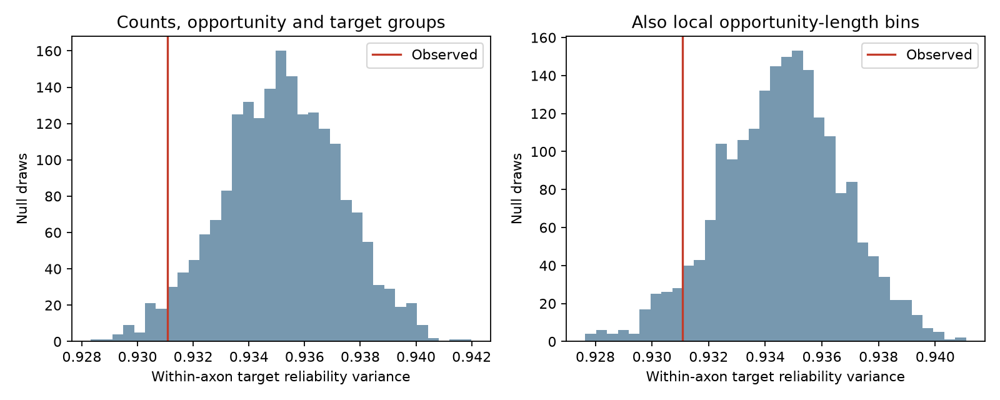
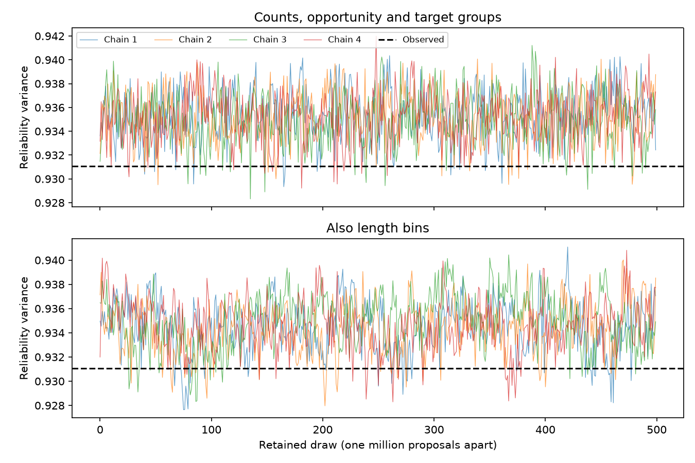

# Target reliability variance was less than 0.5 percent below two rewiring means in one MICrONS mouse

## Result

The targets of an axon had only a small increase in movie-response reliability agreement under the tested reference graphs. Their within-source variance was 0.931070 in standardized reliability units. The mean was 0.935180 for graphs that kept cell connection counts, contact opportunity and target imaging groups. The observed variance was 0.44% lower. A second reference model also kept coarse contact-opportunity length bins. Its mean was 0.934578, a 0.38% difference.

The lower-tail fractions were 0.030 and 0.056. These are approximate fractions from graph simulations. They are not exact test probabilities. The second comparison has limited effective sample size. The evidence does not give a clear result that is stable across the two reference models at a 0.05 rule. It also does not show that reliability has no role in target selection.

The red line is the observed variance. The blue distributions contain 2,000 retained draws per reference model. Lower variance means more similar reliability within target groups of the same axon. The two reference models use the same observed graph. They are not biological replications.

## Question and prior work

Do axons distribute their connections among targets with similar response reliability, beyond the effects of each cell's connection count? Such a pattern could matter for circuit models of reliable sensory signals. It need not follow from a preference for reliable targets: a uniform preference can change which cells receive many connections without grouping similar targets under the same source.

Ding et al. linked response properties and synaptic connections in mouse visual cortex. They found pairwise and higher-order response-similarity rules. Their work supplies the public release-v1 tables used here. The MICrONS resource combines calcium activity and electron microscopy from the same mouse, with Allen Institute contributions. [Ding et al.](https://doi.org/10.1038/s41586-025-08840-3); [MICrONS Consortium](https://doi.org/10.1038/s41586-025-08790-w).

Prior campaign work found a small relation between target reliability and connection odds in two mice. It did not find a consistent reliability interaction between source and target. Another campaign report found extra response similarity among targets of the same axon. We read these reports. We test a different endpoint: the spread of reliability values within each axon's target set, while all source and target connection counts remain fixed. We reused no prior code or derived tables. [Reliability report](sci:sha256:61493f70793fe84518cda2d915ee245a5faddd7cf0c09067f1af189de354aaac); [target response report](sci:sha256:3e5fef923a07bb94d498dc9eb6b0af96089dd32ec2149a31a20966cb3e71b937).

We searched the local campaign before choosing this question. The retained search files contain the first 20 results per query. This is a scoped review, not a full systematic review. The fixed-count graph method follows the reference-model framework described by [Fosdick et al.](https://doi.org/10.1137/16M1087175). Our additional eligibility restrictions require separate checks of graph exploration.

## Data and selection

We reused the shared node and edge tables in place. No download was needed. The edge table has 1,693,276 directed candidate rows. We kept ADP and Connected rows with positive axon and dendrite opportunity lengths. We excluded Same region rows. Targets needed complete scan, brain area and layer labels, and finite standardized CCmax. We did not require a source reliability value.

The sample has 281,234 candidate pairs, 7,798 detected connections, 148 sources and 10,592 eligible targets. There are 4,585 targets with at least one connection. Ordered pairs are unique and there are no self-pairs. Source connection counts range from 1 to 274. Three sources have only one connection; 131 have at least five.

CCmax is a response correlation ceiling derived from movie repeats. It is not a synaptic release probability or model prediction accuracy. We used the released values and did not re-estimate them from trials. The relevant reliability framework is described by [Schoppe et al.](https://doi.org/10.3389/fncom.2016.00010).

We standardized CCmax within scan_session, scan_idx, brain_area and layer groups using the node table. The retained candidates cover 103 such groups. Selection differs from earlier campaign reliability work because we require complete target data but do not require complete source reliability or source layer. The node and edge IDs make the structural and activity link direct; no cross-animal matching is used.

## Method

For each source, we calculated the sum of squared differences between target reliability and that source's target mean. We summed these values across sources and divided by the total connection count. Each connection has equal weight. This is a population variance within sources. It is not an unbiased sample variance. Sources with one target contribute zero in both the observed and reference graphs.

The main reference graph keeps each source's number of targets and each target's number of sources. Each new connection must be an eligible candidate pair. Each source also keeps its target scan, area and layer composition. The second model also keeps joint bins of axon and dendrite opportunity length within each source. Bin cuts are the source medians over all retained candidates. These constraints control coarse geometry; they do not hold exact lengths fixed.

The sampler exchanges the targets of two edges when the constraints permit it. Otherwise it keeps the graph. A move and its reverse have equal proposal probability. The uniform distribution on the reachable graph component is stationary. We did not prove that all valid graphs can be reached. In particular, forbidden pairs can divide the state space. Full equations and the sampling limits are in files/METHODS.md.

Each model used four chains with different seeds. Each chain used 20 million proposals for burn-in and 500 retained draws one million proposals apart. The original plan used shorter chains. Pilot diagnostics showed strong dependence between draws, so we increased these lengths. Both the plan and pilot summary are retained. This is a local plan, not an externally registered protocol.

## Comparisons

| Endpoint | Reference model | Observed | Reference mean | Reference 95% range | Lower-tail fraction |
|---|---|---:|---:|---|---:|
| Standardized reliability variance | Main | 0.931070 | 0.935180 | 0.930882 to 0.939273 | 0.0300 |
| Standardized reliability variance | Also length bins | 0.931070 | 0.934578 | 0.930126 to 0.938797 | 0.0560 |
| Raw CCmax variance | Main | 0.0263584 | 0.0264726 | 0.0263368 to 0.0266018 | 0.0540 |
| Raw CCmax variance | Also length bins | 0.0263584 | 0.0264725 | 0.0263337 to 0.0266025 | 0.0495 |
| Standardized variance, sources with at least five targets | Main | 0.933147 | 0.937693 | 0.933281 to 0.942216 | 0.0200 |
| Standardized variance, sources with at least five targets | Also length bins | 0.933147 | 0.937263 | 0.932822 to 0.941749 | 0.0375 |

The main endpoint and main reference model were specified first. The other rows are sensitivity checks without correction for multiple tests. The reference range is not a confidence interval for the size of a biological effect. Each retained endpoint is only about 0.4–0.5% below its reference mean. These results do not establish a large reliability-grouping effect.

## Computation checks and graph exploration

The final main chains had classical Rhat 1.0017 and rough effective sample size 883 for the primary statistic. The length-bin chains had Rhat 1.0090 and rough effective sample size 223. Lag-one correlations ranged from 0.20 to 0.32 and from 0.55 to 0.62. The second estimate remains more dependent on graph sampling. A rough Monte Carlo standard error for its 0.056 tail fraction, based on 223 effective draws, is 0.015. This is a diagnostic estimate, not a calibrated error bound.

The main chains accepted about 2.67 million swaps each. The length-bin chains accepted about 0.98 million each. Each chain made 520 million proposals including burn-in. Final overlap with observed edges was 16.1–16.3% for the main model and 26.5–27.0% for the length-bin model. Many edges changed. These summaries do not prove that every part of the graph state space was explored.

The short pilot gave Rhat up to 1.12. Its length-bin tail fraction was 0.0005. The longer run gave 0.056. Thus the pilot would have suggested much stronger evidence if used without the exploration checks. We retain that result as a warning about this method, not as a second confirmatory test.

Python independently checked each final graph for repeated edges, candidate membership, source and target counts, target-group composition and length-bin composition. It also recalculated the final variance with a separate grouped-variance calculation. All checks passed. An independent seven-state toy calculation verified symmetry and uniform stationarity of the swap proposal. This toy check does not prove empirical graph mixing. The retained code, all draws, final graphs, checks and summary files allow inspection.

## Interpretation and limits

The tested graph has slightly more similar target reliability within axons than the two reference means. The contrast is small and its tail placement changes with the geometry constraints and reliability scale. This does not give clear, reference-model-stable evidence for reliability grouping. It does not set a tight bound on every possible circuit rule.

Only one mouse was used. No claim across animals, regions or behavioral conditions follows. Higher visual areas and cortical layers are pooled under the stated constraints. The observed cells and proofread axons form a selected sample. Partial processes, missed contacts and matching error can change both the candidate graph and the detected connections. We treat the estimated reliability values as fixed. Their measurement error is not propagated.

The null keeps observed connection counts. These counts can already contain a biological reliability effect; the test asks only about allocation beyond those counts. The model does not preserve response similarity, exact spatial distance, cell subtype or dendritic position. Any remaining contrast could reflect these omitted properties. The graph sampler may be restricted to one reachable component. Its diagnostics address a scalar statistic, not all graph features. The sensitivity tests are not independent replication.

This investigation supplies a reproducible constrained-graph test and a small empirical contrast. It does not show a causal change in reliability, synaptic conductance or information transmission. A useful next test would apply the same endpoint and checks to a second mouse with measured contact opportunities and trial-level reliability uncertainty.

## Provenance and reproduction

The exact inputs are the shared release-v1 edge and node tables:

    ./datasets/microns-funconn-ding2025-v1-edge-data/edge_data_v1.pkl
    ./datasets/microns-funconn-ding2025-v1-node-data/node_data_v1.pkl

Their SHA-256 hashes are efcd387233960026464f285597fd5bc1c3a00432e4d62570bc578149a9707bbb and 5a310585ccefcfb2f14d15b2cc2e607e730b0ec0a86587e606af362463abf6ef. Both were checked before use. files/provenance.json records exact paths, resolved paths, URLs and byte counts. No shared data were changed. Raw inputs are not duplicated in this bundle.

From a working copy of the publication root, run:

    python files/check_kernel.py
    python files/analyze.py /absolute/path/to/new-output-directory

The second command reproduces the graph sampling, summaries, figure and independent final-graph checks from the included selected candidate table. It requires Python 3.12 with numpy, pandas, scipy and matplotlib, and a C++17 compiler. files/REPRODUCE.md gives raw extraction and retrieval steps. Exact run versions are recorded. The trace image can be checked directly against the saved chain files. Outputs must be written outside the signed package.

## Work record and license

Job: sci-1107-dell-neural-structure-and-computation-75331f1f361e. Topic: neural-structure-and-computation. Campaign: 11_07_2026. Machine: dell. Account: codex-andrii. Model: gpt-6.1-sol with high reasoning effort, through the Codex harness in T3 Code. No child agents were used. All sampler processes ended before signing.

The signature uses the campaign-machine identity. It is not a personal authorship claim. The baseline license covers the new report, code, figures and derived evidence. Source data retain their source terms and attribution. No private key is in the package. The signed bundle is saved locally; it is not submitted to an external archive or index.
