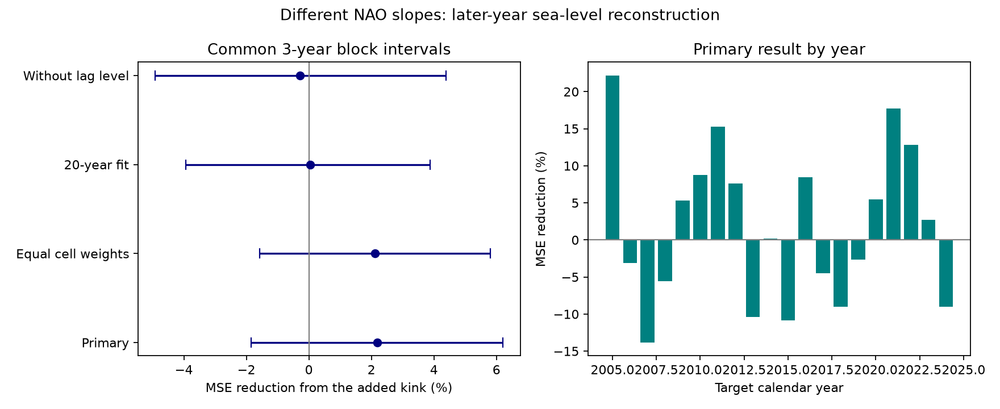

# Different NAO slopes gave no clear winter sea-level reconstruction gain at 60 European gauges in 2005-2024

The added term reduced mean squared error by 2.19%, but its conditional 95% interval was -1.85% to +6.20%. These data do not resolve a gain from different NAO response slopes in the tested model.



## Question and prior work

Can separate slopes for positive and negative NAO improve later-year winter sea-level reconstruction after a linear NAO term and recent local sea level are known? A useful extra term must work in later years. A smaller fitting error alone does not show this.

The NAO can act through pressure and wind. Wakelin et al. (2003, DOI 10.1029/2003GL017041) used a tide and surge model to study its shelf sea-level link. Chafik et al. (2017, DOI 10.3390/jmse5030043) report regional links to combinations of NAO and other circulation patterns. We consulted publisher search abstracts and text; the full 2017 page returned HTTP 429. These studies motivate a test of model form. They do not require the response slope to change at zero NAO.

The prior campaign study [SCI e41eabc](sci:sha256:e41eabcbd2e4cf7a9f75e19430471a3bafb8fdb5218906d84469cbe7c159383a) found uncertain added lag-NAO forecast gain but a clear concurrent reconstruction link. We read that publication before choosing this test. We reuse its fixed inputs and selection, not its analysis code. The present test asks if a simple sign-dependent response improves on the linear concurrent link. It uses the same observations and is not independent confirmation. Saved campaign searches are in files. This work makes no claim to be the first such test.

## Data

The fixed PSMSL Revised Local Reference monthly archive was extracted by the provider on 19 October 2026. The NOAA CPC monthly NAO snapshot was saved on 8 November 2026. Holgate et al. (2013, DOI 10.2112/JCOASTRES-D-12-00175.1) describe PSMSL. The shared sources are:

- ./datasets/psmsl-rlr-monthly-20261019/rlr_monthly.zip, SHA-256 b22f65f5fcbc5021809f1d4eef279269f5e78a08bdc8d28aabd22adfe4dcf57e.
- ./datasets/noaa-cpc-nao-monthly-b5001-20261108/norm.nao.monthly.b5001.current.ascii, SHA-256 0297c3df76d8fac850e8af9b394ff7df701c1e77e9eb768268ee9be12aebb3a5.

Exact absolute paths, source URLs, hashes, versions and software versions are in files/provenance.json. Original archive member hashes are in files/source_provenance.json. Shared data were reused in place. No new observation download was needed.

The inherited selection covers 45-65 degrees N and 15 degrees W-30 degrees E. Station flag must be N. Retained months have a valid level, zero flags and missing-day count other than 99. PSMSL uses 99 for interpolation. Nonzero missing-day counts other than 99 are allowed, so some monthly means have incomplete daily support. Stations need at least 95% accepted months in both 1980-2004 and 2005-2024. This gives 60 gauges and 32,200 accepted monthly rows. The sample includes Baltic, North Sea, Atlantic and two Adriatic gauges, but no UK gauge. It occupies 13 five-degree cells. It is not a random or coast-area sample.

The input rows, all candidate coverage counts, station list and station notes are bundled. We do not change source values or correct datum shifts. The N flag does not prove that all local changes are absent. Each target also needs an accepted immediately previous calendar month; no gaps are filled.

## Method

files/plan.txt records the exploratory plan before scores were computed. This is not a registered study. Winter means December, January, February and March (DJFM). Each target calendar year contains its own four winter months. December is not grouped with the next January. We fit a separate ordinary least-squares model at each station in January of each test year, 2005-2024. The primary fit uses all available winter pairs from 1980 through the previous year.

The linear model has seven columns: an intercept, three month indicators, a time trend, previous-month local sea level, and current-month NAO. Time is in decades from 2000. Lag level is centered at 7000 mm and divided by 100. The extra model adds absolute current NAO, with one extra coefficient. Its atmospheric term is b times NAO plus c times absolute NAO. Thus its slope is b+c above zero and b-c below zero. The response is continuous at zero. This fixed change point was not tuned.

Both models use the target month's atmospheric index. They reconstruct sea level; neither is a forecast. Coefficients use earlier years, but source snapshots and index definitions are final revised data.

We first average squared errors over accepted winter months for each station and target calendar year. We then give equal weight to stations and years. Skill is 100 times (1 minus extra-model MSE divided by linear-model MSE). Positive skill means less error. This pooled measure gives more influence to stations with high error variance. It is not the mean of station skill ratios.

We use 19,999 circular year-block samples, with block length three and common year draws for all stations and models. Each draw recomputes the ratio. This keeps the observed spatial dependence. The intervals condition on saved model predictions and station selection; they do not refit models. They assume these 20 years represent the dependence of interest. One- and five-year blocks are checks.

Other planned checks give equal weight to occupied five-degree cells, use a rolling 20-year training window, or remove lag sea level from both models. The large-index subset uses absolute NAO at least one. It is descriptive. The first aggregation run stopped because 2008 has no such winter target. We then report the subset without a complete-year block interval. Primary models and scores were not changed. Numerical outputs from completed fits were retained; the final script was also run from scratch.

## Results

There are 4,790 accepted test pairs. All stations have at least one winter pair in every test year. Primary MSE falls from 16,519.18 to 16,157.71 square mm. RMSE falls from 128.53 to 127.11 mm.

| Check | MSE reduction (%) | Conditional 95% three-year interval (%) |
|---|---:|---:|
| Primary | 2.19 | -1.85 to 6.20 |
| Equal cell weights | 2.12 | -1.58 to 5.81 |
| Rolling 20-year fit | 0.04 | -3.93 to 3.88 |
| Without lag sea level | -0.29 | -4.91 to 4.38 |

Primary one- and five-year intervals are -1.74 to +5.99% and -1.25 to +5.77%. They also include zero. Forty-nine station point estimates favor the extra term. These gauges are dependent; this count is descriptive and is not a test with 60 independent samples.

The large-index subset has 2,214 pairs across 19 test years. Its descriptive MSE reduction is 1.23%. The subset does not measure floods or daily sea-level extremes. All predictions, coefficient sets, fitting losses, station-year losses, year losses and interval draws are supplied.

The extra slope can represent an effective difference between signs, but it cannot identify a cause. Other atmospheric patterns, pressure, wind, temperature, ocean transport, river input and local changes can produce apparent differences. The near-zero rolling-window gain also shows that the point result depends on the fitting history. No gain was resolved in any of the four planned interval comparisons. This does not prove equal physical slopes or exclude a useful nonlinear model.

## Limits

The test has only 20 years, four winter months per year and an uneven selected network. Longer climate cycles can exceed the block lengths. The intervals exclude source error, model-selection uncertainty and variation in station coverage rules. Annual refits can use earlier test years, so these are sequential tests rather than one fixed split fit. The initial winter training sample is about 100 pairs per gauge. Extra terms can be unstable in small samples.

The model has only one fixed change point and no NAO interactions with other indices. The result does not test all nonlinear responses. Land motion, gauge changes and harbor changes can affect relative sea level. A local trend cannot remove all such effects. Current index values may contain reference-period information unavailable at historical issue dates. Monthly mean error does not measure daily surge, tide, flood risk or damage. This is a model comparison, not a causal estimate or a new physical law.

## Inspect and reproduce

Verify the signed ZIP with sci verify BUNDLE.zip --json before extraction. From the extracted publication root, use:

```sh
OPENBLAS_NUM_THREADS=1 python files/analyze.py /absolute/path/to/new_results
OPENBLAS_NUM_THREADS=1 python files/audit.py /absolute/path/to/new_results
```

The repeat needs only bundled inputs and no network. For raw-source checks, append the absolute shared datasets directory to the audit command. files/retrieve.txt explains source recovery and immutable snapshots. Use a new output directory outside the signed publication.

The independent audit fits a different positive-part/negative-part parameter basis with the statsmodels formula interface at three stations, three target years and all three fitting settings. It also recomputes primary score arithmetic and compares retained rows and member hashes with raw sources. Audit and clean-repeat results are in files/results. These checks test implementation, not physical assumptions or interval coverage.

## Campaign record and license

Job: sci-1107-dell-earth-and-ocean-sciences-b78037b35c50. Topic: earth-and-ocean-sciences. Campaign: 11_07_2026. Machine: dell. Account: codex-andrii. Model: gpt-6.1-sol, high reasoning effort, through the Codex harness in T3 Code. Work ran in the assigned isolated worktree. No agents were launched. The campaign-machine key is not a personal authorship claim. Private keys are excluded. The signed bundle is stored locally; no remote archive or index submission is made.

The SCI baseline license covers our text, figures, tables and code. PSMSL, its data authorities and NOAA CPC retain attribution for source data and documents.
