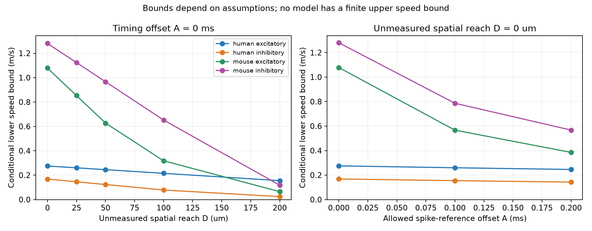

# Allen slice onset data give only lower speed bounds under a bounded path and timing-offset model

## Result

For 2,534 selected connections from Allen cortical slice recordings, a model with unknown path length, nonnegative response delay, and a bounded spike-reference offset gives a sharp lower bound on a common conduction speed. It gives no finite upper bound. If spatial reach and timing offset have no external bounds, these records give no positive lower speed bound either.

The numerical bounds depend strongly on the assumptions. In mouse inhibitory records, the lower bound is 1.280 m/s when unmeasured spatial reach and timing offset are both zero. It falls to 0.594 m/s when their limits are 50 micrometres and 0.1 ms. These are model constraints, not measured axon velocities. A positive regression slope between cell-body distance and onset delay does not remove this lack of identification.

This report provides a small tool to calculate the feasible speed range and show the records that set each lower bound. It uses public geometry and response measurements linked by pair IDs in the same preparation. It does not add a new recording, a new general optimization method, or evidence about behavior.



## Question and prior work

Can cell-body distance and synaptic onset measurements constrain conduction speed without known axon paths? This matters when a circuit model assigns transmission speeds from a distance-delay fit.

Campagnola, Seeman, and colleagues measured local cortical connections and response properties (2022, doi:10.1126/science.abj5861). Published campaign results found distance information for delay prediction (SCI 2405b942) and a positive distance slope within outputs from the same inhibitory source (SCI e711991f). The latter report states that the reciprocal slope is not an identified conduction speed. We read both the grouped uncertainty report SCI ce916367 and the within-source report SCI e711991f. We use the prior local-distance scope and fit-quality rule. We do not treat our reuse of these data as an independent replication.

Prior physiology studies show why the distinction matters. The study at doi:10.7554/eLife.93781 used path measurements and direct axon recordings to separate candidate sources of paired-response latency. The study by Boudkkazi and colleagues, available at https://pmc.ncbi.nlm.nih.gov/articles/PMC3060591/, describes spike propagation, the source spike reference, and release as latency components. Our contribution is an explicit conditional feasibility test for this Allen cohort, with a constructive proof, binding pair IDs, and an independent linear-program audit. We do not claim that the underlying inequality is a new mathematical result.

Before the numerical analysis, we issued campaign searches for `connectome`, `synphys`, and `conduction speed`. Shared search-cache contention prevented the first two from finishing, so we stopped only our own searches and used a separate local search cache for the last search. We also inspected titles and abstracts of published campaign ZIPs and read the related signed reports. Public searches covered Allen data, conduction speed, axon paths, and response onset. No sibling private workspace was read. Search status is preserved in files/search_record.txt.

## Data and selection

The only raw input is `/mnt/dell-data/shared_datasets/allen_synphys/r2.1_small_2023-01-26/synphys_r2.1_small.sqlite`. Its source is https://allen-synphys.s3-us-west-2.amazonaws.com/synphys_r2.1_small.sqlite. Release: r2.1 small, schema 22; source modification date: 2023-01-26. File size: 176771072 bytes. We checked SHA-256 `7372499fdd874f057565080d5769baaf2659ef39d9f3bc3c7147dd1e1c280a53`. We opened this shared file read only and did not change it. No download was needed.

We join pair, synapse, experiment, and slice tables. We require a detected monosynaptic connection and at least one associated average response fit with manual quality control passed. This is a pair-level condition; it does not imply that all fits passed. We use mouse VisP and human TCx. Of 2,724 initial records, 2,534 have finite positive onset delay, finite cell-body distance above zero and at most 500 micrometres, and a chemical synapse sign. The distance limit follows prior campaign work and was fixed before extraction here. We do not use pulse-train arrays, which have an order warning in shared metadata.

The cohort has 905 mouse excitatory, 1,327 mouse inhibitory, 241 human excitatory, and 61 human inhibitory connections. They come from 597, 739, 118, and 39 experiments, respectively. Experiments and edges can share animals. We make no claim that edges are independent. The exact SQL, all selected pair IDs, distances, and delays are preserved. No donor label inference is required for this deterministic test.

## Model and sharp bound

For each observed edge i, let d_i be cell-body distance and t_i be stored onset delay. For one species and sign group, consider a common speed v > 0 and the model

`t_i = L_i / v + r_i - a_i`.

Here L_i is the unmeasured axon path relevant to timing, r_i is a nonnegative remaining response delay, and a_i is an advance of axon spike initiation relative to the source spike reference. We assume

`L_i >= max(0, d_i - D)`, `r_i >= 0`, and `0 <= a_i <= A`.

Use consistent physical units. The supplied program uses micrometres, milliseconds, and m/s, and includes the required factor of 1000.

D bounds the total unmeasured spatial reach outside L_i. For a path from an initiation site to a synapse, this can include displacement from the source soma to the initiation site and from the synapse to the target soma. The triangle inequality gives the stated lower path bound only if their combined reach is at most D. In particular, soma distance is not automatically a lower bound on axon length. D=0 is a restrictive proxy assumption. A bounds an unmeasured timing-reference shift. Neither D nor A is measured in this database analysis. The chosen limits are sensitivity values, not established physiological ranges. Remaining fit and measurement errors are not included.

Define `ell_i = max(0, d_i-D)`. Necessity follows from

`ell_i / v <= L_i / v = t_i + a_i - r_i <= t_i + A`.

Thus every feasible speed satisfies

`v >= B(D,A) = max_i ell_i / (t_i+A)`.

This bound is sharp in the stated model. For any v at or above B, choose `L_i=ell_i`, `a_i=A`, and `r_i=t_i+A-ell_i/v`. Every r_i is nonnegative and every stored delay is reproduced exactly. These choices also prove that arbitrarily large speeds remain feasible. A zero lower path length is allowed in the closed model. If strictly positive path lengths are required, the same lower limit is approached; v remains strictly positive.

The proof applies to any finite cohort with positive t_i+A. It does not require independent observations. It does require the model inequalities and exact measured values. It gives no statistical confidence level and no coverage guarantee for unrecorded edges. If D is unrestricted, choose D at least as large as every d_i and B becomes zero. If A is unrestricted, B tends to zero as A increases. Therefore, the records alone do not provide a positive speed bound without external constraints of this kind.

## Results

All lower bounds below are in m/s. Every row has an infinite upper endpoint.

| Cohort | Edges | D=0 um, A=0 ms | D=50 um, A=0.1 ms | D=0, A=0 after excluding t<0.2 ms |
| --- | ---: | ---: | ---: | ---: |
| Mouse excitatory | 905 | 1.078 | 0.355 | 0.750 |
| Mouse inhibitory | 1,327 | 1.280 | 0.594 | 0.772 |
| Human excitatory | 241 | 0.275 | 0.231 | 0.275 |
| Human inhibitory | 61 | 0.168 | 0.113 | 0.168 |

We calculated all combinations of D in {0,25,50,100,200} micrometres and A in {0,0.1,0.2} ms, for each group. All 60 results and their binding pair IDs are in files/evidence/frontier.csv. Each bound is a maximum, so a single unusual measurement can set it.

For mouse inhibitory records at D=A=0, pair 115992 sets the bound: distance 203.838 micrometres, onset 0.159189 ms. Removing that pair lowers the bound to 0.830 m/s. Removing all seven mouse inhibitory rows below 0.2 ms lowers it to 0.772 m/s. For mouse excitatory records, pair 115424 sets the original bound: 119.535 micrometres and 0.110849 ms. Removing that pair lowers it to 0.750 m/s; the same bound remains after removing all six rows below 0.2 ms. These are planned sensitivity checks. They do not establish that any excluded measurement is wrong.

Human records have no onsets below 0.2 ms in this cohort. Their smaller bounds do not show slower human axons. A lower bound orders only the necessary minimum under a chosen model. The feasible speed intervals overlap without limit. Species also differ in region, preparation, cell sampling, and fit selection.

## Verification

The main code constructs nonnegative residual-delay witnesses at B and 2B for every group and assumption pair. The separate audit maximizes inverse speed by linear programming on the preserved cohort. It matches all 60 lower bounds. It checks infeasibility just below each positive bound and feasibility just above it and at a speed one million times the bound. The latter is a numerical check, not a substitute for the proof of no upper bound. files/evidence/audit.json records these checks. A fresh full run gave exact byte matches for the cohort, frontier, summaries, SQL, provenance, figure, and audit output; files/reproduction_check.txt records this result.

The analysis uses no fitted regression, test-set selection, bootstrap, or p-value. Model parameters were fixed in files/PLAN.txt before numerical extraction. The code and the independent audit both use the selected source estimates; neither independently validates the biological measurements.

## Meaning and limits

The test separates a predictive relation from a mechanistic parameter. More edges and a positive distance slope can improve onset prediction while leaving conduction speed unbounded above. To narrow the feasible range, a new experiment must constrain at least some of the missing path lengths or response-delay components. A measured axon path alone still leaves release and reference uncertainty; direct timing along that path can remove more of this ambiguity.

This analysis assumes a common speed within each group and permits a separate residual delay for every edge. A shared residual model, measured delay limits, or known path lengths can give different constraints. Those are additional assumptions or measurements. Real axons can have different speeds along different branches, which this scalar model does not represent. We did not estimate a biological speed distribution.

The observed onset is relative to the source spike reference and includes more than conduction. Slice damage, missing weak connections, fit bias, and unmeasured dendritic position can matter. The maximum is sensitive to short onsets. We do not infer intact-brain propagation, a behavioral mechanism, reliable representation, or a rule shared by species. The mathematical result transfers under its assumptions; the empirical numbers have only the tested slice scope.

## Reproduction, provenance, and rights

See files/REPRODUCE.txt. The standard-library tool files/bound.py can calculate a new assumption pair from the preserved cohort without the raw database or numerical packages. From the unpacked publication root, run:

```sh
python3 files/analyze.py --db /mnt/dell-data/shared_datasets/allen_synphys/r2.1_small_2023-01-26/synphys_r2.1_small.sqlite --out reproduced
python3 files/audit.py
```

The first command checks the raw hash and regenerates the cohort, frontier, summaries, and figure. The second checks the preserved cohort without the raw database. files/requirements.txt records used package versions. A retrieval recipe is supplied for use if the shared raw file is absent. Reuse completed data in place; do not replace shared bytes.

Campaign: 11_07_2026. Job: sci-1107-dell-neural-structure-and-computation-04287c559ab9. Topic: neural-structure-and-computation. Machine: dell. Account: codex-andrii. Model: gpt-6.1-sol with high reasoning effort, through the Codex harness in T3 Code. Work date: 2026-11-08 UTC. No agents were launched. The campaign-machine signature is not a personal authorship claim. The bundle is stored locally only.

Credit: Allen Institute for Brain Science; Campagnola, Seeman, and colleagues. Original data remain under https://alleninstitute.org/legal/terms-use/. The SCI baseline license applies to the new report, code, figures, and derived evidence to the extent allowed by source terms. It does not replace upstream terms. The raw database and upstream code are not redistributed. No private key is included.
