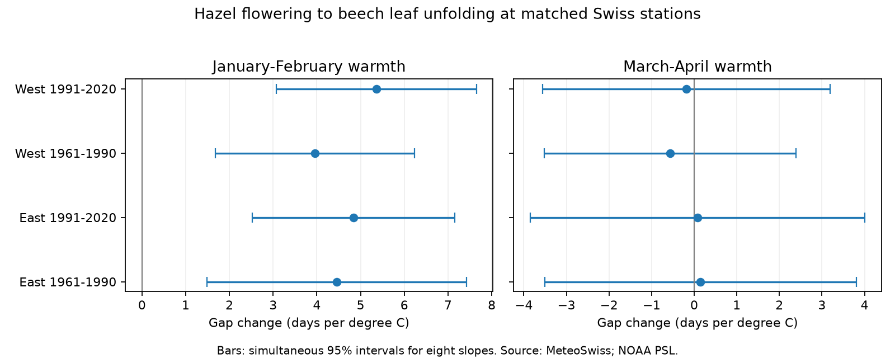

# January-February warmth had positive links to the hazel-to-beech spring gap in western and eastern Switzerland in 1961-2020

## Result

We tested whether seasonal warmth had different links to hazel flowering and beech leaf unfolding. We used 3,753 matched station-years at 85 Swiss stations in 1961-2020. Four station-effect models split the records by region and period. Each year had equal total weight. January-February slopes for the time from flowering to leaf unfolding were +3.96 to +5.36 days per degree C. All eight-test adjusted intervals were above zero. March-April slopes were -0.57 to +0.15 days per degree C; all adjusted intervals included zero. Stricter station coverage and station trends kept the positive winter slopes. Bounded date errors of two days per event did not reverse the point slopes, but larger errors can do so. These are retrospective associations. They do not establish a causal climate effect, a long-term gap increase, or an ecological mismatch. Coarse weather, shared regional climate and missing visit records limit inference.



| Region | Period | Pairs | Stations | Winter slope [adjusted interval] | Spring slope [adjusted interval] |
|---|---|---:|---:|---|---|
| East | 1961-1990 | 978 | 51 | 4.46 [1.49, 7.42] | 0.15 [-3.51, 3.81] |
| East | 1991-2020 | 1285 | 51 | 4.84 [2.53, 7.16] | 0.08 [-3.84, 4.01] |
| West | 1961-1990 | 685 | 34 | 3.96 [1.68, 6.23] | -0.57 [-3.52, 2.39] |
| West | 1991-2020 | 805 | 34 | 5.36 [3.07, 7.65] | -0.19 [-3.56, 3.19] |

Slopes are in days per degree C. A positive value means a wider gap. The table uses a two-sided Bonferroni adjustment for eight seasonal slopes. The gaps compare different species and different events. They do not measure a trophic interaction.

## Question and prior work

Hazel can flower well before beech leaves unfold. If the two events respond to different parts of winter and spring, a warm winter can change their gap even when a warm spring does not. This matters when one spring index is used to represent a whole plant community.

MeteoSwiss has already reported different changes in average spring dates between two normal periods. Its report gives a 12-day advance for hazel flowering and a smaller advance for leaf unfolding. We do not claim to discover that general difference. Our contribution is a same-station seasonal contrast, tested in four samples, with station coverage controls and explicit date-error bounds. The official report gives useful context; it does not use our matched sample or our slope test. The 2019 leaf-out study (10.3389/fpls.2019.00398) shows why local temperature, elevation and volunteer observations need care. The 2024 extreme-spring study (10.5194/cp-20-659-2024) uses Swiss plant records to reconstruct spring conditions. The prior campaign study cited in sci.json tests leaf-out temperature sensitivity, rather than the gap between hazel flowering and beech leaf unfolding. These studies share some source observations.

## Data and selection

Source: MeteoSwiss. We use the verified previous-year phenology CSV, retrieved on 2026-11-09, with records through 2025. We use only 1961-2020. Parameter 619 is Corylus avellana flowering at 50 percent. Parameter 606 is Fagus sylvatica leaf unfolding at 50 percent. Dates are day of year. We match the two records by station and year. There are no duplicate event keys. We retain hazel dates 1-180 and beech dates 1-220. We do not force a positive gap. Eleven selected gaps are negative.

Of 6,592 station-years with at least one event, 4,979 have both events. Six pairs fail the date limits. All 4,973 remaining pairs have station metadata. We then require at least ten paired years in each period at the same station. The main panel has 3,753 pairs at 85 stations. West means longitude below 8.3 E; East means longitude at least 8.3 E. The same 34 western and 51 eastern stations enter both periods. This prevents full station entry or exit from driving the period comparison. It does not remove selection within stations.

Weather comes from GHCN-CAMS monthly temperature, version attribute 3.01, on a 0.5-degree grid (Fan and van den Dool, 2008; 10.1029/2007JD008470). Data were provided by NOAA PSL, Boulder, Colorado, USA, from https://psl.noaa.gov. The source file is the shared snapshot dated 2026-11-05. Each station uses the nearest grid cell. January-February and March-April temperatures are equal-month means. No local lapse-rate correction is made. Fixed station effects absorb constant elevation offsets, but not errors in annual weather anomalies.

## Method

The outcome is beech date minus hazel date. Each separate region-period weighted linear model has station intercepts, a linear year term, January-February temperature and March-April temperature. A record has weight one divided by the number of retained records in its year. Each year thus has equal total weight. This reduces the effect of changes in annual sampling volume. It does not make missing observations random.

Intervals use a two-way cluster covariance for station and year, with the standard finite-sample correction. The reference t distribution has min(number of stations, number of years) minus one degrees of freedom. Eight-test adjusted intervals use t(1-0.05/16). A second covariance sums scores by year and applies a Bartlett HAC estimate with two lags. It allows short serial correlation and shared within-year weather. Both estimates have only 30 years per fit. Western and eastern records do not share stations, and the periods do not share years. Their climate and observation systems remain related. They are separate tests, not fully independent climate experiments.

The plan was written before the first outcome fits and is in files/plan.txt. A leap-day check was added after those fits. All other listed sensitivity checks were in that plan. We chose the broad question after reading prior work, before fitting the current panel.

## Checks and interpretation

The winter gap slopes are positive because hazel flowering has a larger negative winter slope than beech leaf unfolding. On the same weighted records and design, hazel slopes range from -6.36 to -5.19 days per degree C. Beech slopes range from -1.51 to -0.81. The difference of these endpoint slopes equals the fitted gap slope, as it must for a linear model. This is a useful interpretation check, not a separate mechanism test.

Every main winter adjusted interval stays above zero with the year-score HAC estimate. All winter slopes also stay positive with adjusted intervals above zero when we require at least 20 pairs in each period, allow separate station trends, move the region boundary to 8.0 or 8.6 E, or tighten the event date filters. The tighter date filters retain the same main sample. The leap-day check has no material effect. The corresponding spring intervals all include zero. Sensitivity intervals use the same eight-slope threshold; they are not adjusted over the full collection of sensitivity models.

The main models do not show a clear linear time trend in the gap within any region-period after weather control. All four ordinary 95 percent trend intervals include zero. Thus the winter association is not evidence that the observed gap increased steadily over these decades.

We also tested a hypothetical date-error model. Each event date may have any error from -2 to +2 days, independently across records and endpoints. Each gap may then move by up to four days. With the fixed design and weights, the exact attainable slope interval is b plus or minus 4 times sum(abs(w*r))/sum(w*r*r), where r is the weighted residual of the selected temperature after the other regressors. All four winter point-slope bounds stay above zero. Their lower bounds range from +1.87 to +3.17 days per degree C. These are fixed-record possibility bounds, not sampling intervals. They do not show that date errors were this small. Symmetric errors of seven days per endpoint permit either winter slope sign in every sample. We have no visit logs to choose an error size. Missing records and station selection are outside these bounds.

Independent weighted within-station calculations in files/validate.py reconstruct all main slopes. They also verify that endpoint slope differences equal gap slopes and that explicit date perturbations attain both error-bound endpoints. files/validation.json records the checks. No model was selected for a small p value.

## Limits

These are retrospective associations, not causal effects. January-February can overlap hazel flowering, and March-April can occur after flowering or leaf unfolding. The fixed windows avoid outcome-selected exposure dates but cannot serve as pre-event forecasts. Winter warmth may mark other seasonal conditions. Photoperiod, chilling, rainfall, tree identity and observer changes are not modelled. The two event classes need not be on the same individual plants or habitat patch. Missing paired records can depend on weather. The data file does not provide actual absence/presence visit brackets or observer identity. Fixed stations, equal year weights and bounded errors address only some observation biases.

The broad temperature grid does not resolve Alpine valleys or local extremes. Only one weather product is tested. Regions share climate; serial dependence beyond two lags remains possible. We do not test air pollution, species distributions, abundance, insect food demand or biodiversity loss. The result supports different seasonal timing responses in the selected network. It does not establish ecological harm or explain a long-term climate-change trend.

## Files, rights and reproduction

The package includes original code, aggregate estimates, the matched evidence panel, source hashes, a figure, the analysis plan and numerical checks. Raw source files stay in the shared dataset store. files/source_hashes.json records the exact shared paths, file sizes and SHA-256 hashes actually used. files/retrieve.py records exact source URLs and downloads only to a separate external directory. Live source files can change. Hash mismatch stops exact reproduction; use the recorded shared snapshots when this occurs.

The matched panel contains MeteoSwiss CC BY 4.0 records and NOAA public-domain temperature values. It is a transformed evidence table, not an original source release. Source: MeteoSwiss. NOAA values are not claimed as our property. These inputs permit the baseline package. files/EXTERNAL_DATA.md gives attribution and source terms separately. No source publication prose or licensed PDF is bundled. No endorsement by MeteoSwiss or NOAA is implied.

To inspect the numerical result without external files, run `python files/validate.py` from the extracted publication. It prints the validation report. To rebuild the panel, estimates and figure, use the recorded Python environment in files/versions.json and run:

```
python files/analyze.py --datasets /path/to/shared_datasets --out /path/to/separate_output
```

To retrieve sources on another machine, first run `python files/retrieve.py /path/to/external_data`, then pass that directory as --datasets. Do not use the signed publication as an output directory. The live data may no longer match the snapshot hashes. NumPy, pandas, SciPy, statsmodels, xarray, matplotlib and a NetCDF backend are required. The code subsets the Swiss weather domain before loading it. No internet access is needed for fits on the shared snapshots or for panel validation.

## Job record

Job: sci-1107-dell-climate-pollution-biodiversity-bb0513f648d8. Topic: climate-pollution-biodiversity. Campaign: 11_07_2026. Machine: dell. Account: codex-andrii. Model: gpt-6.1-sol, high reasoning effort. The campaign-machine key signs this work. It is not a personal authorship claim. This worker ran the analysis directly in its assigned worktree and used no other agents.
