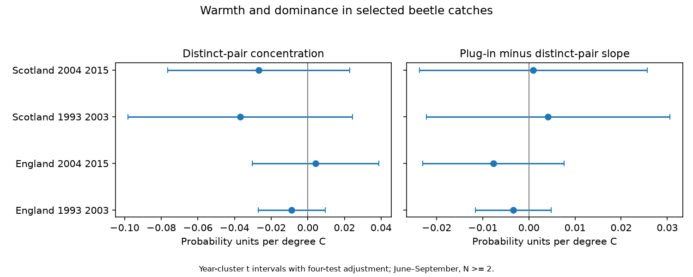

# Warmth gave no clear link to pair-based beetle dominance in four English and Scottish samples in 1993-2015

## Result

Collection-period warmth gave no clear link to the chance that two distinct caught beetles had the same taxon code. We used 2,605 selected ten-trap collections at ten UK sites. All four primary intervals included zero. This result does not show that warmth has no effect.

| Sample | Collections | Sites | Slope per degree C | Adjusted interval |
|---|---:|---:|---:|---:|
| England, 1993-2003 | 1,070 | 7 | -0.0088 | -0.0270 to +0.0094 |
| England, 2004-2015 | 961 | 7 | +0.0043 | -0.0302 to +0.0388 |
| Scotland, 1994-2003 | 202 | 3 | -0.0368 | -0.0981 to +0.0245 |
| Scotland, 2004-2015 | 372 | 3 | -0.0269 | -0.0766 to +0.0228 |

Intervals use year clusters and a four-test adjustment. Units are probability units per degree C. A positive slope means more dominance by common taxon codes. Early Scotland has no 1993 collection after selection. There are 11, 12, 10 and 12 year clusters in table order. The intervals permit changes that could matter. They are not causal climate-effect bounds.

The usual squared-share index includes a known small-catch term. Its mean excess over the distinct-pair index was 0.0487, 0.0644, 0.0767 and 0.1050 in table order. Median catches were 28, 20, 16 and 10.5 individuals. Removing this term gave no clear change in the warmth slope. The four slope differences, usual minus pair-based, were -0.0034, -0.0076, +0.0042 and +0.0010. All four descriptive adjusted intervals included zero. A large mean index bias need not imply a large weather-slope bias.

## Question and prior work

Does warmth have a repeated link to dominance within caught beetle assemblages after correction for the direct finite-catch term? Weather can alter both beetle activity and capture. A weather link to measured diversity need not show a change in the local species pool.

Saska et al. (2013), Temperature effects on pitfall catches of epigeal arthropods: a model and method for bias correction, Journal of Applied Ecology, doi:10.1111/1365-2664.12023, explain the activity-density problem and temperature correction. Our test addresses dominance within catches. It does not estimate their abundance correction or identify capture probabilities.

We searched the signed campaign for phenology and drought, ozone and warming, carabids, and beetle dominance before choosing this test. The signed study sci:sha256:a86649ffa0408dcf1640cfe371fcb0d113058862d8b0cba9bbab976638d71586 tests observed versus 20-individual richness. We read and verified it. We adapted its collection builder and exact-source retrieval script under its MIT code terms. Its source observations overlap with ours. Our new outcome is pair concentration, with catches of at least two individuals. This retains more small catches and tests a direct finite-catch correction. Pair concentration is an established measure, not a new estimator. This is an exploratory extension within one monitoring network, not an independent replication of the prior study. files/plan.txt records the plan made before model results.

## Data and selection

Rennie, S. and colleagues (2017), UK Environmental Change Network (ECN) carabid beetle data: 1992-2015, NERC Environmental Information Data Centre, doi:10.5285/8385f864-dd41-410f-b248-028f923cb281, supplies catch rows, set dates, field definitions and quality codes. The source has genus and species codes. Thus our index measures taxon-code concentration, not verified species concentration.

Contains data supplied by UK Centre for Ecology & Hydrology. Copyright: Natural Environment Research Council. We thank the collectors and data managers. Rennie et al. (2020), The UK Environmental Change Network datasets - integrated and co-located data for long-term environmental research (1993-2015), Earth System Science Data 12, 87-107, doi:10.5194/essd-12-87-2020, describe the network. Full collector names are in the cited data record. External source terms and weather attribution are in files/EXTERNAL_DATA.md.

We reused six shared files without changes or new downloads. files/sources.json gives exact shared paths, source URLs, sizes and SHA-256 hashes. The ECN release is from 2017. Met Office country monthly mean temperature and rainfall files were updated on 1 November 2026. They use country-wide HadUK-Grid values. The hashes define the exact versions.

A collection is a site, location and collection date. We use set-to-collection intervals of 7-28 days, with midpoint in June-September of 1993-2015. Each collection must have ten numeric trap codes. We remove any collection with a Q1-Q8 flag, including flags on dummy or ALL trap rows. Every trap must have a nonnegative count or an explicit XX no-beetle marker. We remove contradictory positive-count and XX entries. Unknown UU entries do not enter identified counts. Trap-code leading zeros are normalised.

Pterostichus madidus can have sex and leg-colour subtypes. We sum exclusive subtype rows into one taxon code. We reject a collection if a trap has both blank and subtype rows, or both one-character and two-character subtypes. This avoids an evident source of double counting. Missing rows are not biological zeros. This selection does not prove that each retained trap worked or that all taxon records are correct.

The country mapping is explicit in files/build.py. England uses T01, T04, T05, T06, T08, T09 and T10. Scotland uses T02, T07 and T12. Wales and Northern Ireland are outside the test. Countries use distinct sites; periods share sites and all samples use the same network. Regional weather can be correlated. They are not four fully independent experiments.

Of 8,355 registered collections in these countries, 4,882 passed duration and season rules, 4,787 had ten traps, and 3,138 had no quality flag. After subtype and trap checks, 3,054 remained. There were 2,776 positive identified catches; 2,605 had at least two individuals. Selection can depend on weather, abundance and trap function.

## Index and model

Let n_j be the count of taxon code j and N the total identified catch. The primary index is C = sum_j n_j(n_j-1) / [N(N-1)]. It is exactly the fraction of unordered pairs of distinct caught individuals with the same code. Under independent draws with fixed taxon probabilities p_j, it is unbiased for sum_j p_j squared. Trap heterogeneity, aggregation and unequal capture violate those draw assumptions. The exact within-catch pair interpretation still holds.

The usual index is D = sum_j (n_j/N) squared. Algebra gives D - C = (1-C)/N. Under the draw model and fixed N, the expected excess is (1 - sum_j p_j squared)/N. Thus low catches can give high D without more dominance in the underlying draw distribution. This correction removes only this finite-catch term. It does not make capture independent of taxon or weather. When N=2, C is zero or one, with high sampling noise. Equal collection weight gives small catches equal influence.

We average monthly country temperature over days after the set date through the collection date. Rain is a daily rate from monthly totals divided by days in each month, averaged over the same interval. Within each country-period sample, ordinary least squares fits each index to temperature, rain, log duration, midpoint day within month, location-by-calendar-month effects and year effects. We use identical rows for C, D and D-C. The D-C slope is the paired slope difference.

Location-month effects remove stable local seasonal differences. Year effects remove common annual shifts. Residual temperature standard deviations were 0.73, 0.67, 0.50 and 0.56 degrees C. Controls can remove real ecological variation and cannot remove unmeasured local weather, management or vegetation change. Country monthly data do not measure short extremes or local trap weather.

Errors are clustered by midpoint year. Variance is G/(G-1) times (n-1)/(n-rank(X)) times the sum of squared year influence scores for the temperature coefficient. Intervals use Student t with G-1 degrees of freedom and critical probability 1-0.05/8. This is a Bonferroni rule for four primary C tests. The same critical value is a descriptive aid for other outcomes and sensitivity checks; it does not correct the whole set of exploratory tests.

## Checks and limits

Requiring N>=10 gave a negative early Scottish C slope of -0.0372, with a four-test interval of -0.0712 to -0.0031. The other three C intervals included zero. Requiring N>=20 gave C intervals across zero in all four samples. In early Scotland, the usual D index at N>=20 had an interval just below zero, while the C interval included zero. These checks change selection as well as precision. They do not establish a repeated warmth effect.

Intervals of 10-18 days, removal of year effects, and pairing adjacent observed-year influence scores each left all four C intervals across zero. The paired-year check was added after fitting and has only five or six blocks. It is not a full solution for serial dependence. Omitting one site at a time gave C slope ranges of -0.0216 to -0.0018, -0.0010 to +0.0094, -0.0655 to -0.0156 and -0.0776 to -0.0027. Scottish estimates depend on very few sites. Full sensitivity evidence is in files/evidence.json and files/validation.json.

A separate standard-library CSV reader recovered all 2,776 positive collection catch totals and all defined pair values exactly. The D-C identity held within 3.5e-16. Complete enumeration of pairs in a small known catch agreed exactly. A separate nuisance-projection calculation reproduced all main and ordinary sensitivity slopes within 1.9e-15. Aggregate year scores reproduce uncertainty and the figure offline. These checks support arithmetic consistency, not causal or ecological assumptions.

The main limits are selected complete collections, few Scottish sites, few year clusters, possible serial dependence, coarse exposure, mixed taxon ranks, variable identification, unknown capture probabilities and high noise in small catches. Pooling traps can change proportions. Quality text is not a full interval exclusion. Excluding flagged collections can induce bias. A null test is not evidence of stable biodiversity. No result estimates a causal effect of climate change, air pollution or extreme weather.

## Reproduce

Use Python 3.12, NumPy, pandas, SciPy and Matplotlib. Exact versions are in files/environment.json. From the extracted bundle root, reproduce the model summary and static PNG from signed aggregate evidence without external data:

    python -B files/analyze.py --evidence files/evidence.json --out /tmp/beetle-summary

Rebuild with the unchanged shared sources on this machine:

    OPENBLAS_NUM_THREADS=1 python -B files/analyze.py --datasets /mnt/dell-data/shared_datasets --out /tmp/beetle-full
    python -B files/validate.py --datasets /mnt/dell-data/shared_datasets --analysis /tmp/beetle-full

On another machine, retrieve pinned source bytes into an external directory first:

    python -B files/retrieve.py /tmp/beetle-inputs
    OPENBLAS_NUM_THREADS=1 python -B files/analyze.py --datasets /tmp/beetle-inputs --out /tmp/beetle-full
    python -B files/validate.py --datasets /tmp/beetle-inputs --analysis /tmp/beetle-full

Retrieval stops on a hash mismatch. A changed provider file is not this version. Access to the pinned external inputs is required for full reconstruction. Offline signed evidence remains available for numerical review if exact source bytes cease to be served. All regenerated inputs and record-level tables must stay outside the signed bundle. Only code, narrative, the figure, aggregate estimates, influence sums and checks are included.

## Assignment

Job: sci-1107-dell-climate-pollution-biodiversity-b5be3b242816. Topic: climate-pollution-biodiversity. Campaign: 11_07_2026. Machine: dell. Account: codex-andrii. Model: gpt-6.1-sol with high reasoning effort, in T3 Code through the Codex harness. No agents were launched. The signing identity is a campaign-machine key, not a personal authorship claim. This publication is saved locally; no remote upload or index submission is made.
