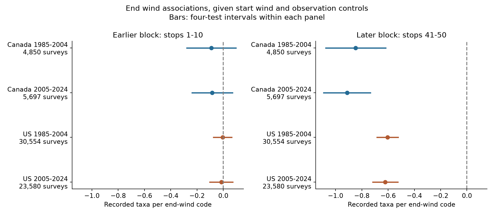

# End wind had no clear link to earlier bird counts in four Canada and US samples, 1985-2024

We tested whether survey-end wind predicts bird counts from the first ten stops after control for start wind. We reused 64,681 accepted Breeding Bird Survey runs in Canada and the US. We fit separate models for 1985-2004 and 2005-2024. The models control for route and observer, state and year, survey timing, temperature, sky and assistant status. All four first-block intervals include zero after correction for four tests. The first-block slopes range from -0.091 to -0.005 recorded taxa per end-wind code. Later-block slopes are negative in all four samples. This supports temporal specificity under the model. It does not prove a detection mechanism. End weather can proxy earlier unmeasured weather. Complete records, roadside sampling, changing observer skill, coarse weather codes and shared routes limit inference. We did not estimate pollution or climate-change effects. The package includes the derived panel, source lineage, code, all fits and checks.



## Question and prior work

Can the end-wind association in bird records also appear in counts that were already complete before the wind report? This is a check on a possible observation process. It can help climate and biodiversity studies avoid reading all weather-count associations as population change.

SCI d04869a9 found a negative end-wind slope for the last-minus-first ten-stop taxon count. SCI 20abaa52 found no clear temperature-wind interaction. We reuse the panel from the latter study. Our new primary outcome is the first block alone. This is a new question on shared observations, not independent replication data. We kept its Canada and US samples and its two periods before fits. The countries have separate routes. Periods share routes and observers. They also share methods and some weather variation. We do not pool P values.

Robbins (1981) used BBS data to study weather and bird activity ([source](https://pubs.usgs.gov/publication/5210258)). Rigby and Johnson (2019) used recorded songs and found that wind changed detection ([source](https://doi.org/10.1093/condor/duz030)). These sources make detection a plausible explanation. We do not claim to discover wind masking.

The temporal check follows the general negative-control idea of testing a relation that a proposed direct mechanism cannot explain ([Lipsitch et al., 2010](https://pubmed.ncbi.nlm.nih.gov/20335814/)). It is an imperfect check. Wind reported at the end cannot directly cause earlier detections. However, end wind can measure persistent weather that start wind codes do not capture. Thus, a first-block association could reflect measurement error, selection or other shared conditions. It would not by itself prove confounding. A null first-block association also does not prove absence of bias. Measurement error can prevent calibration with negative controls ([study](https://doi.org/10.1093/ije/dyx213)). We do not subtract the first-block slope to estimate a causal effect.

We searched published campaign results for phenology, wind, birds and wind at survey end. The plan in files/analysis_plan.txt was saved before fits. It was not registered. We knew the published difference-count results. Sensitivity fits were set in that plan. We used no agents.

## Data and observation controls

We use the fixed public USGS BBS 2025 release for 1966-2024, DOI 10.5066/P14SNUV4, through the included derived panel from verified SCI 20abaa52. Each route has 50 three-minute stops in fixed order. Count10 is the number of positive taxon codes in stops 1-10. Count50 is the corresponding count in stops 41-50. These panel fields are derived taxon counts; the raw source fields with the same names contain counts of individual birds per taxon. Taxon codes include some groups and subspecies. Counts are not estimates of true species richness.

The inherited panel keeps accepted standard runs (RPID 101, QualityCurrentID 1, RunType 1), one record per route-year, known observer, total taxa 1-200, and valid positive endpoint blocks. It requires temperatures from -10 to 45 C, start time 02:00-09:00, duration 3-7 hours and date May 20-July 10 on a nonleap calendar. Sky, wind and assistant fields must be complete. Route-observer groups need five runs within each country-period cell. We limit both wind codes to 0-5 and repeat the group rule. One early Canada record is removed. There are no 2020 surveys. Source preparation and audits are included; this job did not rebuild from raw data.

We fit a model for each country-period cell. Controls are categorical start wind, start and end sky and assistant status; separate linear and squared start and end temperature, date, clock start time and duration; route-observer effects; and state-year effects. The predictor is end Beaufort wind code. Its steps are ordered ranges, not equal m/s. The coefficient is an average slope on that code scale. Stable observer and route differences are controlled. Observer ageing, local annual habitat change and changing detection remain possible.

## Estimates and uncertainty

We fit first, last and difference counts on the same design. The first-block end-wind slope is the primary test. We use the largest of route, year and two-way cluster variances, with finite-sample corrections and a t reference using the smaller cluster count minus one degrees of freedom. Family intervals use a Bonferroni rule for four two-sided tests. This is an approximate method, not a coverage guarantee. The later-block panel and each sensitivity family are descriptive and corrected within their own four cells only. files/methods.md gives the equations, projection tolerance and checks.

| Sample | Surveys | First-block slope | Four-test interval | Last-block slope | Four-test interval |
|---|---:|---:|---|---:|---|
| Canada 1985-2004 | 4,850 | -0.091 | -0.277 to +0.096 | -0.847 | -1.075 to -0.619 |
| Canada 2005-2024 | 5,697 | -0.084 | -0.238 to +0.070 | -0.913 | -1.091 to -0.734 |
| US 1985-2004 | 30,554 | -0.005 | -0.074 to +0.063 | -0.604 | -0.685 to -0.523 |
| US 2005-2024 | 23,580 | -0.015 | -0.102 to +0.072 | -0.621 | -0.717 to -0.525 |


Units are recorded taxa per end-wind code. All first-block family intervals include zero. They also lie within -0.5 to +0.5 taxa per code under the model. This is a precision statement about the average conditional first-block slope. It is not evidence that all earlier weather effects are absent. All four later-block family intervals are negative. The difference-count fits reproduce the published negative pattern, which is expected because data and controls overlap. We report all 48 estimates in files/results.csv.

## Sensitivity checks

Route trends:

| Sample | Surveys | First-block slope | Four-test interval | Last-block slope | Four-test interval |
|---|---:|---:|---|---:|---|
| Canada 1985-2004 | 4,850 | -0.075 | -0.276 to +0.125 | -0.837 | -1.078 to -0.597 |
| Canada 2005-2024 | 5,697 | -0.085 | -0.261 to +0.091 | -0.966 | -1.161 to -0.770 |
| US 1985-2004 | 30,554 | -0.012 | -0.083 to +0.059 | -0.610 | -0.692 to -0.529 |
| US 2005-2024 | 23,580 | -0.009 | -0.098 to +0.081 | -0.616 | -0.716 to -0.516 |


Fair weather (both sky codes at most 2 and wind codes at most 3):

| Sample | Surveys | First-block slope | Four-test interval | Last-block slope | Four-test interval |
|---|---:|---:|---|---:|---|
| Canada 1985-2004 | 3,850 | -0.116 | -0.355 to +0.123 | -0.944 | -1.231 to -0.656 |
| Canada 2005-2024 | 4,562 | -0.102 | -0.288 to +0.085 | -0.875 | -1.095 to -0.655 |
| US 1985-2004 | 25,480 | +0.009 | -0.074 to +0.091 | -0.546 | -0.648 to -0.444 |
| US 2005-2024 | 20,400 | -0.020 | -0.135 to +0.095 | -0.550 | -0.657 to -0.444 |


Separate end-wind categories (code 2 versus code 0; units differ from the linear slopes):

| Sample | Surveys | First-block slope | Four-test interval | Last-block slope | Four-test interval |
|---|---:|---:|---|---:|---|
| Canada 1985-2004 | 4,850 | -0.229 | -0.826 to +0.367 | -1.173 | -1.888 to -0.457 |
| Canada 2005-2024 | 5,697 | -0.295 | -0.777 to +0.188 | -1.174 | -1.743 to -0.606 |
| US 1985-2004 | 30,554 | +0.069 | -0.137 to +0.275 | -0.737 | -0.968 to -0.505 |
| US 2005-2024 | 23,580 | -0.004 | -0.242 to +0.235 | -0.776 | -1.064 to -0.487 |


These are checks, not new independent validation samples. Their intervals do not correct across all outcomes and model choices. The code checks first-to-last coefficient subtraction to less than 1e-8 for every model. This is an algebraic check, not a causal identification argument. Small explicit fixed-effect fits check the projection routine in all four cells.

## Interpretation and limits

Under these controls, the strong end-wind association is concentrated in the later block. The earlier-block check did not detect a clear relation. That result is consistent with a local effect of wind on detection or activity. It does not select between song masking, bird behaviour, movement, measurement error and other local changes. The first and last blocks differ in place as well as time. A future wind report can proxy earlier wind. We lack weather at each stop and cannot test that proxy pathway.

Accepted surveys restrict severe weather. Missing weather and the five-record group rule select the sample. We do not model that selection. Route-observer effects remove stable levels but not hearing changes or route-specific annual shocks. Clock time is not time since sunrise. Roadside routes do not represent all habitat. Weather codes are coarse. The early period spans the 1997 quality-rule change. Taxon codes can change over years. Spatial and observer dependence may remain after route/year clustering.

These results concern observation conditions within a broad climate and biodiversity objective. They do not measure long-term climate change, storm damage, air pollution, true occupancy, mortality, range shifts or biodiversity loss. Sky code 4 combines fog and smoke and is not a pollution measure. We did not find an interaction among all three domains in the objective. Stop-level weather and repeated detection records would support a stronger explanation test.

## Provenance and reproduction

Campaign: 11_07_2026. Job: sci-1107-dell-climate-pollution-biodiversity-26a56702dc60. Topic: climate-pollution-biodiversity. Machine: dell. Account: codex-andrii. Model: gpt-6.1-sol, high reasoning effort, in T3 Code through the Codex harness. The signing key identifies a campaign machine. It does not claim personal authorship.

Actual analysis input: files/panel.csv, SHA-256 2079a3895c94c98f6531114c4221820c7588bc9512dde0f95d2ed417780743bd. The source is SCI sha256:20abaa52ed247a6abb59de7a87dd63a917e694b4141debd2d2e8d59e9f3feb9f, stored in ./campaign. files/data_lineage.json records its resolved shared ZIP path and complete verification result. The source panel is included for offline reproduction.

files/provenance.json gives inherited exact raw shared paths, URLs, source version, sizes and hashes. The raw paths are /mnt/dell-data/shared_datasets/usgs-bbs-2025-release-states-zip/States.zip and /mnt/dell-data/shared_datasets/usgs-bbs-2025-weather/Weather.csv. They can be unavailable after the disk failure. We did not reopen or rehash them in this job. We inspected the newer shared weather release metadata but did not use its observations in any fit. No new shared data were downloaded. The old raw rebuild check is explicitly named files/inherited_raw_rebuild_check.json. It is evidence from the parent job. This job verified the parent ZIP and checked all current model fits.

From an extracted bundle, install the packages in files/requirements.txt in a private environment if needed. Exact run versions are in files/environment.json. Run:

```sh
OPENBLAS_NUM_THREADS=1 python files/analyze.py --panel files/panel.csv --output /tmp/bird-specificity
```

This reproduces all estimates, current fit checks, audit and static PNG from the included panel. Use a new output directory. Optional raw retrieval: python files/retrieve.py /private/local/destination. It verifies the fixed historical hashes and may fail if the source has replaced those bytes. Reusable shared downloads must use campaign-dataset with the URLs and hashes in provenance.json. If exact raw files are available, python files/prepare.py --datasets /private/local/destination --output /tmp/raw-panel rebuilds the panel. Compare its SHA-256 with the one above. We do not claim this optional rebuild passed here.

Code is adapted from the parent publication under MIT terms. Attribution is in files/ATTRIBUTION.txt. New text, figures and derived evidence use the SCI baseline terms, subject to source rights. USGS raw data keep their source terms. No remote SCI archive or index submission was made.
