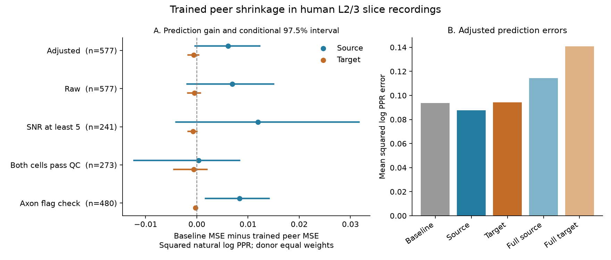

# Trained source peers cut mean prediction error by 6.5 percent in 22 human donors, with an uncertain corrected gain

## Result

A rule trained on other donors reduced the mean error for a missing paired-pulse ratio (PPR) by 6.5 percent in a selected human cortical sample. The rule combines a recording mean with measurements from other connections of the same source cell. The mean error fell from 0.09378 to 0.08768 squared natural log PPR units. The matched test had 577 connections from 22 donors. A target-cell rule gave an error of 0.09439.

The source gain was 0.00610. Its conditional 95 percent donor bootstrap interval was 0.00049 to 0.01158. Its conservative 97.5 percent interval for the two role tests was -0.00032 to 0.01228. Thus, the corrected interval does not establish a gain. When both cells passed the supplied cell quality filter, the mean gain was only 0.00032, with a 95 percent interval of -0.01013 to 0.00761. The result is a small mean prediction gain with important uncertainty and selection dependence.

Figure 1. A: Points give recording-baseline error minus trained-peer error. Positive values mean lower error with peers. Lines give conditional 97.5 percent donor bootstrap intervals. The primary source interval crosses zero. B: Mean errors in the primary adjusted test. Full means use the peer mean without shrinkage. Counts in A give test connections, not independent donors. All scores give each test donor equal weight. Credit for the external recordings: Planert, Mittermaier, Grosser and colleagues [1,2].

## Question and prior work

Synaptic response changes act as temporal filters on circuit edges. If one cell imposes related filters on its outputs, other outputs could help predict an unmeasured connection. A common target can also cause related measured responses. A useful circuit model must estimate these effects from few measured peers. A relative source advantage is not enough if either peer rule is worse than a broader recording mean.

The source paper describes human layer 2/3 pyramidal cells and their local synaptic connections [1]. Studies in rat cortex show that the target can affect synaptic transmission from one axon [3,4]. We do not test those mechanisms.

The direct campaign precursor is SCI sha256:bf38e4209a14677e50fd3fefa2b5c6ff4863cdc3b1d863a2aafc104810f70e67 [5]. In these same human tables, it found that full source peer means beat full target peer means, but did not beat the recording mean. It proposed training shrinkage as a next test. SCI sha256:10b5ccb2c660f6abf5d4e6163d9465f0139d2267f417d8f0e73cae2ad9a1ad7d [6] tested a scalar peer weight in a separate Allen 50 Hz sample. That sample had only 78 mouse and 12 human test connections after exact label matching. It found no mean gain.

We test the open prediction question in the larger human 20 Hz sample. We train a rule that depends on peer count and use a nested donor exclusion scheme. The new contribution is this test and its reproducible evidence, not a new shrinkage principle. It is a follow-up on the same human data as [5], not an independent replication of that report. It is independent of the Allen measurements in [6]. We wrote new code and did not reuse upstream software or prior numerical extracts.

Campaign searches included neural connectivity, connectome, Allen, receptive field, plasticity, synaptic bipartite, source peers, Planert shrinkage and paired pulse shrinkage. Some broad queries reached their result limits. The focused Planert shrinkage search returned only [5]. files/prior_search.json records selected searches and their limits. Search is not proof of priority. Initial searches with literal quote characters gave no matches; they were replaced by searches without quote characters. Only published campaign results were read. The saved design in files/design.txt preceded the peer error computation. This is an exploratory analysis, not a registered confirmatory study.

## Data link, source and selection

The external source is figshare article 28184126, version 1 [2]. We reused:

    ./datasets/planert2026-human-l23-figshare28184126-v1/humandata.zip

The campaign shared path is:

    /mnt/dell-data/shared_datasets/planert2026-human-l23-figshare28184126-v1/humandata.zip

This compatibility path points to the active shared store on HP. We did not read the failed disk at /data. The exact resolved path is in files/provenance.json.

The archive has 1,956,326 bytes. Its checked SHA-256 is:

    6b0d7244dec5c665a88d0d1828ae842d084bb737a6df9f86561d53d8564c4bfd

The two used members are humandata/data_tables/tconnection_all_psdn.csv and humandata/data_tables/tcell_all_psdn.csv. Their exact sizes and SHA-256 hashes are in files/provenance.json. No download or shared-data change was needed. Cell keys are unique. Both endpoint joins preserve all 10,784 connection-table rows and agree with the supplied donor and recording labels.

We select synapse_type == s11, connected == 1, disynaptic == 0, and finite positive EPSP amplitude and PPR. This retains 1,220 directed connections from 23 donors. No eligible source-target pair repeats. Cell IDs and recording IDs link wiring to physiology in the same recordings. These are detected physiological connections in local slice circuits. They are not a full anatomical connectome. No neuron identity is matched between datasets.

Each test connection must have at least one other eligible connection from its source cell and one other connection into its target cell, within its recording. Both peer methods use this same matched test set. Other eligible connections can be peers even if they are not test connections. This gives 577 test connections in 117 recordings from 22 donors. Each donor has 3 to 60 test connections. Both roles have 1 to 5 peer connections.

PPR is the supplied ratio of the second to the first EPSP amplitude at 20 Hz. The source paper computes amplitudes from averaged traces, usually with 30 to 50 included sweeps, followed by manual curation [1]. We use the processed values, not raw sweeps. Our outcome is the natural logarithm of PPR. The first EPSP amplitude is treated as known when PPR is missing. This is completion of a missing response-change measure, not prediction of all physiology from wiring alone.

## Methods

For each eligible connection, a fixed linear model predicts log PPR from log first EPSP amplitude, source and target e-type indicators, soma distance, and both cells' pia depth. Distance and depths are in millimetres in the analysis. Each training donor has equal total fit weight. Missing continuous values use the training-donor median plus a missing-value indicator. Category levels also come from training donors. Unknown e-types form an explicit category. Supplied e-types were defined from intrinsic physiology in the original study; they are not newly fitted here. An unpenalized minimum-norm least-squares solution handles redundant category columns.

We apply peer prediction to residuals after this model. Let b be the residual mean of all other eligible edges in the recording. Let s be the residual mean of other edges from the source cell. Let t be the residual mean of other edges into the target cell. The test connection is excluded from every mean. Adding back its nuisance prediction gives a log PPR prediction.

For a peer mean p with n peers, the trained prediction is:

    prediction = nuisance_prediction + b + n/(n+k) * (p-b).

The nonnegative k sets shrinkage toward b. Larger k gives more shrinkage. At k=0, the rule uses the full peer mean. At k=infinity, it uses only b. The fixed candidate set is 0, 0.5, 1, 2, 4, 8, 16, 32, 64 and infinity.

The outer test excludes one donor. Its nuisance model uses all eligible edges from the other donors. To train k, each remaining test donor supplies inner prediction examples. The nuisance model for those examples excludes both the inner donor and the outer donor. We select k by the mean of donor mean squared errors across those inner examples, separately for source and target. Ties within 1e-14 squared log units favor larger k. Thus, the outer donor supplies no outcomes or preprocessing values for either fit. Other measured responses from the outer donor supply its peer and baseline means by design.

For comparison, a scalar rule uses b + alpha*(p-b). We fit alpha in [0,1] by exact donor-weighted least squares on the same inner examples. This is a planned diagnostic. It differs from the count rule because it gives every test edge the same peer weight within an outer fold.

The primary score averages squared error within each test donor, then across donors. The primary contrast is baseline error minus source-rule error. The target gain and source-target contrast are secondary. A bootstrap resamples the 22 donor loss vectors 10,000 times. We give ordinary 95 percent intervals and conservative 97.5 percent intervals for the two role gains. All intervals condition on the fitted predictions. The training folds overlap; bootstrap coverage for the full training procedure is not established. We do not treat connections as independent animals or use these intervals to claim a general biological law.

## Results and sensitivity

Errors below are squared natural log PPR units. Each row refits the complete procedure and its peer graph. Intervals in this table are conditional 95 percent intervals.

| Test | Eligible / test edges | Test donors | Baseline MSE | Trained source MSE | Trained target MSE | Source gain [95 percent interval] |
|---|---:|---:|---:|---:|---:|---|
| Adjusted primary | 1220 / 577 | 22 | 0.09378 | 0.08768 | 0.09439 | 0.00610 [0.00049, 0.01158] |
| Raw log PPR | 1220 / 577 | 22 | 0.11983 | 0.11290 | 0.12028 | 0.00693 [-0.00068, 0.01409] |
| SNR at least 5 | 741 / 241 | 21 | 0.07569 | 0.06375 | 0.07645 | 0.01194 [-0.00228, 0.02896] |
| Both cells pass supplied QC | 695 / 273 | 22 | 0.09274 | 0.09242 | 0.09336 | 0.00032 [-0.01013, 0.00761] |
| Axon flag check | 1059 / 480 | 21 | 0.09385 | 0.08555 | 0.09409 | 0.00831 [0.00250, 0.01347] |

The primary source gain is positive in 15 of 22 donors. Mean source error is 6.51 percent below baseline. Target error is 0.65 percent above baseline. The source gain has a conservative 97.5 percent interval of [-0.00032, 0.01228]; the target gain interval is [-0.00172, 0.00037]. Neither role gain is resolved by that two-role interval criterion.

The trained source k is 2 in 19 outer folds and 4 in three. The median peer weight across test edges is one third. Target k is 16 in ten folds, 32 in eight and 64 in four. Its median weight is 0.0588. These weights describe this estimator and sample; they are not cell-level variance fractions.

Full peer means give primary source and target errors of 0.11437 and 0.14088. Both exceed the recording baseline. The trained source rule therefore changes the sign of the mean gain relative to using the full source mean. A scalar source weight gives a similar mean error of 0.08748, but its 95 percent gain interval includes zero. The count rule does not show a clear advantage over the scalar rule.

When connections, rather than donors, have equal weight, the adjusted baseline and trained-source errors are 0.09255 and 0.08442. This is an 8.79 percent mean reduction. It is a secondary weighting choice. Our raw, unshrunk, connection-weighted errors reproduce [5] within its reported four-decimal precision. Adjusted scores differ because our nuisance fit uses donor weights, training-only preprocessing and strict nested exclusions.

The cell QC check requires removal_boolean == 1 at both endpoints. The axon flag check excludes records with either axon_cut_pre == 1 or slice_not_parallel == 1. Unknown flags remain. That check does not prove intact axons. The SNR rule uses the supplied SNR. All quality checks change both the connections and the peer graph. They cannot isolate a cause for the different gains. Their intervals are exploratory, with no correction across subset tests.

A post hoc influence analysis removes each of the 23 eligible donors in turn and refits all primary nuisance and shrinkage models. All 23 source gains remain positive, from 0.00423 to 0.00938. Target gains range from -0.00068 to 0.00026. This tests sensitivity to one donor; it is not a confidence interval and does not address changes in cell selection. Aggregate evidence is in files/influence_summary.json.

## Checks and limits

files/check.py independently reconstructs each test edge's explicit peer exclusion, peer counts and prediction losses. It recomputes all aggregate MSEs and every inner donor grid risk. A dense alpha grid checks the analytic scalar optimum. Perturbing all outcomes in an outer donor leaves its nuisance fits unchanged, including every inner fit used to train its rule. Changing a single test outcome leaves its own peer means unchanged. Exact artificial examples check full-peer and zero-peer rule endpoints. The check also confirms agreement with the prior report's printed raw scores. files/validation.json records the completed checks.

The result concerns prediction of a processed PPR in selected acute human temporal-cortex slices. It does not identify release probability, a presynaptic mechanism, synaptic conductance, trial noise, recurrent dynamics, spike output or information transmission. First amplitude and PPR share a measurement component. Shared stimulation quality and electrode effects could contribute to the source signal. The target connection's first amplitude is available, so the analysis does not test a wiring-only predictor.

Few and unequal peers, curated missing measurements, detection thresholds, cut processes and the matched test rule affect selection. Coarse e-types do not remove all cell differences. The quality dependence is large. Trial-level error is not supplied. A fixed-prediction donor bootstrap omits nuisance and shrinkage training uncertainty. Whole-donor deletion does not repair this. Data from patients with epilepsy may not describe healthy intact cortex. Region, behavior, species and laboratory generalization are untested.

The Allen null in [6] and this small human mean gain should not be called a species difference. They use different frequencies, endpoints, cell mixtures, matching rules and sample sizes. No cross-dataset parameter transfer was tested. A useful next test would measure both response amplitudes and PPR on independent trials, use a separate laboratory, and retain enough output peers in high-quality cells. The nearly absent gain after the cell QC filter is a specific issue to resolve.

## Reproduction, rights and worker record

Keep the signed package unchanged. Use Python 3.12 and the package versions in files/requirements.txt. The reproduction steps are in files/REPRODUCE.md. The scripts check the archive hash and refuse to write analysis outputs into the publication. They recreate record evidence in separate scratch and the original aggregate findings and figure. No private workspace is needed once the public source is retrieved.

Version 1 metadata assigns GPL 3.0+ to the external archive. We include no raw data, CSV extracts, upstream code, per-connection predictions, donor tables or transformed record-level database. files/EXTERNAL_NOTICE.txt identifies external rights and attribution. The unchanged baseline license applies to the original code, text, aggregate scientific findings and original figures in this bundle. It does not grant rights in external materials. No data were changed to pass a license check.

Campaign: 11_07_2026. Job: sci-1107-hp-neural-structure-and-computation-fa9c6c27fcb4. Topic: neural-structure-and-computation. Machine: hp. Account: codex-olen. Model: gpt-6.1-sol, high reasoning effort, through the Codex harness in T3 Code. Date: 2026-11-12 UTC. No agents were launched. All computation used this worker with one numerical library thread per process, at most two compute processes at once. The campaign-machine key is not a personal authorship claim. The worker saves this bundle locally and does not upload or submit it.

## References

1. Planert, Mittermaier, Grosser and colleagues. Electrophysiological classification of human layer 2-3 pyramidal neurons reveals subtype-specific synaptic interactions. Nature Neuroscience 29, 455-466 (2026). doi:10.1038/s41593-025-02134-7.
2. Processed data tables and code, figshare 28184126 version 1. doi:10.6084/m9.figshare.28184126.v1.
3. Markram, Wang and Tsodyks. Differential signaling via the same axon of neocortical pyramidal neurons. PNAS (1998). doi:10.1073/pnas.95.9.5323.
4. Koester and Johnston. Target cell-dependent normalization of transmitter release at neocortical synapses. Science (2005). doi:10.1126/science.1100815.
5. Source peers predicted paired-pulse ratios better than target peers in 22 human cortical donors. sci:sha256:bf38e4209a14677e50fd3fefa2b5c6ff4863cdc3b1d863a2aafc104810f70e67.
6. Trained peer weights gave no mean 50 Hz prediction gain in selected Allen slice circuits. sci:sha256:10b5ccb2c660f6abf5d4e6163d9465f0139d2267f417d8f0e73cae2ad9a1ad7d.
