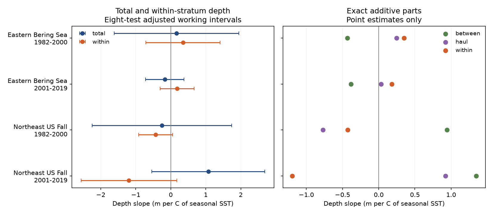

# Seasonal surface warmth gave no clear common link to deeper catches in four US trawl samples in 1982-2019

We tested whether warm survey seasons were linked to deeper catches after accounting for the depths sampled within survey strata. We used eastern Bering Sea and Northeast US fall trawls in 1982-2000 and 2001-2019. All eight main adjusted intervals included zero. Within-stratum slopes were positive in Bering and negative in the Northeast. The data did not establish a common link to deeper catches. This result does not show that temperature has no effect.



## Question and prior work

A catch-depth indicator can change when animals occur at different depths. It can also change when surveys sample different depths. These changes need separate checks before a warming explanation is used.

Pinsky et al. (2013; doi:10.1126/science.1239352) related marine distribution shifts to local climate velocity. This study tests a narrower annual association. It does not repeat their climate-velocity model. NOAA ERSST v5 supplies monthly surface temperature on a two-degree grid (Huang et al., 2017; doi:10.1175/JCLI-D-16-0836.1).

We searched existing campaign results for phenology, pollution, Breeding Bird Survey, bleaching, trawl, wildfire, rounding and drought. We read the published depth decomposition, SCI 7d56f1682eda1118cd6922fb408ff06187eaaeee5a05ce3992931fdb48496d0a, and the fixed-effort richness study, SCI 3551fe2177f2406d73e5b6fcb8046eed5e9d392af34b4b87cbdde5a73f3c2d7d. The first tested time trends, without a temperature predictor. The second tested richness, with fewer retained Northeast strata. We verified both bundles before use. We also read the published summaries of nearby trawl studies.

The new contribution is a temperature test of all depth components, with a fixed survey footprint, separate regions and periods, a survey-change control, and an independent numerical check. We reused the first study's depth code without changes. We adapted the second study's temperature-match method to the depth sample and rebuilt from raw data. The observations overlap those publications. This is a new analysis of existing observations, not an independent data confirmation. The local analysis plan is in files/design.txt. It was written before the first temperature-depth fit. It was not externally registered.

## Data and sample

We reused two shared files in place. We made no new data download and did not change shared data.

| Input | Shared path | Source version | Bytes | SHA-256 |
| --- | --- | --- | ---: | --- |
| Catch and haul table | datasets/oceanadapt-all-regions-full-fltr-0d4bcaffe6/all-regions-full-fltr.csv.gz | OceanAdapt commit 0d4bcaffe649e970674fe165fe892ab4d787e76a | 30884574 | cb632fe63d5dd0ff0000288673e59ebe59ae15e34a320b38e9308859353e2a41 |
| Monthly temperature | datasets/ersst-v5-psl-sst-mnmean-20261108-olen/sst.mnmean.nc | NOAA ERSST v5; shared snapshot downloaded 2026-11-08; source data_modified 2026-11-03 | 162376295 | 952fad739abab3e3c33c955b168f298b9884d2fe48ab259ebf19ac531d8d8386 |

The full shared paths start with `/mnt/dell-data/shared_datasets/`. These are compatibility paths to the HP SSD store. Exact absolute and resolved paths, source URLs and helper metadata are in files/raw_provenance.json. We did not access the failed disk at /data. Code checks both raw hashes before rebuilding.

The depth code retains strata with a valid, positive depth haul in every available year. There are 10 Bering strata with 13,427 hauls and 61 Northeast strata with 9,326 hauls. The Northeast source has no 2017 records. Two Northeast hauls with missing depth were removed. We did not fill missing years.

Each region-year-haul must have one depth, stratum and area. All unique recorded hauls define the sample denominator, including hauls without a retained taxon. A missing focal taxon row is treated as zero catch. This assumes that recorded hauls and positive catches are complete. Hauls absent from the table cannot be found by this method.

The code retains names in two-word genus-species form and taxa with positive catch in every available regional year. This gives 59 Bering taxa and 62 Northeast taxa, or 4,536 taxon-year records. These are selected persistent taxa, not all biodiversity. Name format is not a taxonomic validation. Selection uses the full record and can affect temperature associations. Conflicting haul-taxon catches remove a whole taxon: Platichthys stellatus in Bering and Placopecten magellanicus in the Northeast. Identical Northeast repeats are reduced to one. The audit in files/outputs/depth_provenance.json gives counts and taxon lists.

## What the depth parts measure

For a taxon and year, let Q_s be the sum of weight catch per unit effort in stratum s. Let QD_s be the sum of catch times depth. Let n_s be the number of all valid-depth hauls, A_s the fixed stratum area, and dbar_s the mean sampled haul depth. Let d0_s be the equal-year mean of dbar_s over the full record. Set b_s = A_s Q_s/n_s and Z = sum_s b_s.

- Total catch depth T = sum_s [(A_s/n_s) QD_s] / Z.
- Between-stratum part B = sum_s [b_s d0_s] / Z.
- Sampled-haul-depth part H = sum_s [b_s (dbar_s - d0_s)] / Z.
- Within-stratum part W = sum_s [(A_s/n_s)(QD_s - Q_s dbar_s)] / Z.

T = B + H + W holds for each taxon-year. We take equal means over the fixed taxon list within each region. The identity still holds. Positive slopes mean deeper water, in meters per C of seasonal surface temperature. Taxa do not count as independent regression replicates.

W measures catch depth relative to sampled depth within strata. Constant catch at each sampled haul gives W = 0. It removes that simple sampling-depth benchmark. It does not remove all observation bias. Unequal catchability, changed haul positions and habitat differences can change W. Changes in catch weights between strata can also change W when fixed taxon-specific depth offsets differ across strata. B can contain real redistribution; H can also reflect real changes in where taxa are caught. The parts separate arithmetic contributions. They do not identify causes or individual animal movement.

## Temperature and tests

For each retained stratum, we compute one fixed centroid from all depth-valid haul positions. Longitude uses a circular mean. We choose the nearest ERSST ocean cell with finite values in every month of 1982-2019, using a local cosine-latitude distance. The cell stays fixed. We average May-August in Bering and September-November in the Northeast. Fixed stratum areas weight the regional mean. The 71 cell choices and 32,376 monthly stratum values are saved.

This is a coarse surface-temperature proxy. It is not bottom temperature, catch temperature, a heatwave measure or temperature on the exact haul date. Part of a seasonal window can follow a haul. This prevents a direct exposure or time-order interpretation. The method cannot by itself test a thermal refuge at depth.

We fit each depth part to an intercept, seasonal temperature and linear calendar year in each region and period. The later Northeast model also includes a step for 2009 onward. NOAA documents a vessel, gear and protocol transition in 2009 after a calibration study. The step was included before results were fitted. It can absorb ecological changes as well as survey changes; it does not estimate a vessel cause.

There are 18 or 19 annual observations per fit. The main family contains eight temperature slopes: T and W in four samples. Intervals use a heteroskedasticity and autocorrelation consistent covariance estimate with three observed-year lags and the n/(n-p) correction. A t reference has n-p degrees of freedom. Bonferroni correction gives each interval nominal 99.375% coverage, for intended joint 95% coverage across eight slopes. These are approximate working intervals for short series. Observed-year lags span a two-year gap around the missing 2017 record. Survey sampling error and climate reconstruction error are not fully propagated.

B and H estimates explain the exact sum. They are not additional primary tests. Their intervals in models.csv are working outputs without a separate inference claim. We did not fit a formal regional slope contrast. Regions have separate surveys, but periods share taxa, strata and survey history. They are checks across distinct samples, not independent experiments.

## Results

The table shows meters per C. Brackets give the eight-test adjusted intervals. B + H + W equals T before rounding.

| Region and period | T: total | B: between strata | H: sampled haul depth | W: within strata |
| --- | ---: | ---: | ---: | ---: |
| Bering, 1982-2000 | 0.16 [-1.61, 1.94] | -0.43 | 0.25 | 0.35 [-0.71, 1.41] |
| Bering, 2001-2019 | -0.17 [-0.72, 0.38] | -0.38 | 0.03 | 0.18 [-0.31, 0.67] |
| Northeast, 1982-2000 | -0.25 [-2.25, 1.74] | 0.94 | -0.77 | -0.43 [-0.92, 0.06] |
| Northeast, 2001-2019 | 1.07 [-0.54, 2.69] | 1.35 | 0.92 | -1.20 [-2.56, 0.17] |

All eight main intervals include zero. W estimates have opposite signs in the two regions. Sign differences alone do not establish a regional difference. In the later Northeast sample, the positive total point estimate is the sum of positive B and H estimates and a negative W estimate. This illustrates why a total estimate alone does not describe all depth components. No component was assigned a causal interpretation.

Temperature variation remains after the controls. The residual temperature standard deviations are 0.59, 1.18, 0.64 and 0.49 C in table order. The null intervals do not arise from an exact lack of fitted temperature variation. Small samples, noise, confounding and exposure error can still prevent a clear estimate.

## Planned sensitivity checks

All eight main intervals still included zero with covariance lags one and five. Removing the later Northeast survey step gave T = 1.18 [-0.92, 3.28] and W = -1.18 [-2.45, 0.08]. Thus the step did not establish a common deeper-catch link.

We also fit changes between consecutive calendar years. A constant in the difference model controls a constant annual trend. The later Northeast model retains the difference of the survey step. We omit differences across the missing Northeast year. W slopes were 0.22, -0.05, 0.40 and -0.72 m per C in table order. All eight T and W adjusted difference intervals included zero. The early Northeast W sign changed. The level-model regional sign pattern is therefore not stable under this time-change check.

Removing each year or each taxon in turn kept all four level-model W signs. Year-omission W ranges were 0.06 to 0.52, 0.10 to 0.28, -0.54 to -0.30 and -1.48 to -0.97. Taxon-omission ranges were 0.04 to 0.43, 0.06 to 0.24, -0.53 to -0.33 and -1.25 to -1.00. These are point-estimate ranges, not confidence intervals. Total-slope signs were less stable in the early samples. All estimates and intervals are saved. Error control is not joint over all sensitivity choices.

## Meaning and limits

This selected sample did not establish a common annual link from warmer surface seasons to deeper catches relative to sampled depth. A negative or positive estimate can still reflect temperature effects, changes in catchability, fishing, habitat, recruitment, currents, sea ice or other conditions. We did not separate those explanations. The intervals do not prove no effect, equivalence, or no climate response. Annual surface-temperature variation is not a measure of long-term climate attribution.

Area weights hold stratum coverage fixed under representative sampling within strata. They do not fix within-stratum station locations, towing, identification or gear performance. Persistent-taxon selection can miss arrivals, losses and range edges. The survey boundaries omit movement beyond the footprint. The Northeast transition can have effects that a single common step does not capture. The two regions differ in season, habitat and design. Wider biological use requires bottom-temperature data, explicit catchability models and broader independent surveys.

The investigation addresses the climate, species-distribution and observation-bias parts of the objective. It makes no claim about air pollution, phenological dates or weather extremes.

## Reproduce and inspect

From the extracted bundle root, check the saved evidence without network access:

```sh
python files/verify_results.py
```

Refit all models, omission checks and the figure from bundled evidence:

```sh
python files/analyze.py --out refit
python files/verify_results.py refit
```

Rebuild into a separate directory from the two shared raw inputs:

```sh
python files/analyze.py --rebuild \
  --raw /mnt/dell-data/shared_datasets/oceanadapt-all-regions-full-fltr-0d4bcaffe6/all-regions-full-fltr.csv.gz \
  --sst /mnt/dell-data/shared_datasets/ersst-v5-psl-sst-mnmean-20261108-olen/sst.mnmean.nc \
  --out reproduced
python files/verify_results.py reproduced
```

Python 3.12 and dependencies are recorded in files/requirements.txt. Install additional packages only in a private environment. No shared base environment change is needed. Code checks exact source hashes. If a shared input is absent, retrieve its URL in files/raw_provenance.json to private scratch and check the hash. In this campaign, use campaign-dataset for any new reusable shared download. Do not replace shared files. The ERSST endpoint changes as new months are added, so a later download may have another hash. Saved monthly evidence supports an offline check of the exact published temperature values.

The raw depth rebuild matched all 75 annual rows and four components from the verified prior depth publication. files/raw_rebuild_check.txt records that comparison. The independent checker rebuilds depth from saved stratum sums, reconstructs temperature from monthly values, and checks all 80 regression rows with matrix formulas. It also checks 1,268 omission slopes, exact component and slope sums, and the constant-catch benchmark. The maximum independent regression error was below 5e-12. These checks validate calculations from saved evidence. They do not validate upstream reports or their error models. files/checks.json records the checks.

Evidence files under files/outputs include stratum catch sums, haul denominators, taxon-year components, annual data, climate cells and monthly values, model results, omission results, diagnostics and software metadata. files/vendor/depth_source.py is the unchanged published depth code. Its SCI source, hash and code license are in files/study_provenance.json. Source survey metadata and the OceanAdapt license are under files/source/. The SCI baseline license covers our text, figure, code and derived outputs. It does not replace upstream terms.

Job: sci-1107-hp-climate-pollution-biodiversity-2fd0d84d7522. Topic: climate-pollution-biodiversity. Campaign: 11_07_2026. Machine: hp. Account: codex-myxtap. Model: gpt-6.1-sol with high reasoning effort. One finite worker did the investigation. No agents were launched. The campaign-machine signing key is not a personal authorship claim. Private keys are not included. Publication is local; no remote archive or index submission is authorized.
