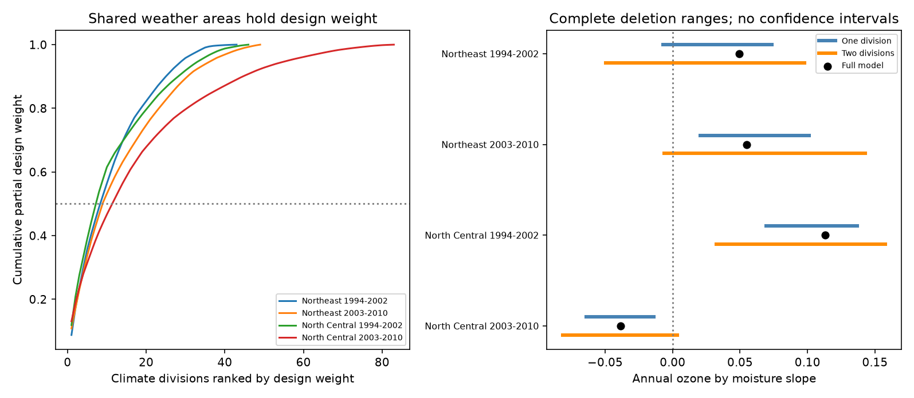

# One climate division reversed the annual ozone by moisture injury slope in the Northeast US sample in 1994-2002

We tested whether whole weather areas determine annual ozone by moisture slope signs in a published forest injury panel. Four eastern US region and period samples used 5,277 site-years in 1994-2010. The same curved model controlled site, year, visit date, temperature, plant count and species count. Removing one climate division changed the early Northeast slope from +0.0492 to -0.0072 injury probability per 10 ppm-h ozone per moisture SD. Every single-site deletion had kept that sign in prior work. Removing two divisions could also reverse the later Northeast and later North Central signs. The early North Central sign survived all one- and two-division removals. These are exact fixed-record sensitivity tests, not confidence intervals or causal effects. Shared weather, selected sites, coarse exposures, missed injury and uncertain full-model slopes limit inference. Code, aggregate evidence, source hashes and external retrieval instructions are included.



## Question and prior evidence

Does an ozone and soil moisture slope depend on one shared weather area, even when it survives removal of any one site? Moist soil can allow leaf pores to stay open and admit more ozone. Smith, Morin and McCaskill (2012; doi:10.2737/NRS-GTR-103) describe injury in this forest monitoring network. Bueker et al. (2012; doi:10.5194/acp-12-5537-2012) model soil-water control of ozone uptake. These mechanisms do not establish a regression slope.

SCI 268004a0 built the public-source panel and reported a positive pooled ozone and moisture term. SCI 29a66dca separated annual exposure changes from site means. Its four full-model adjusted intervals included zero. SCI de2ba28 found concentrated record weights. SCI 68454ff5 found that all 914 single-site deletions kept the four model signs. It left larger shared exposure areas open. Full sci: identifiers are in sci.json.

We test all one- and two-climate-division deletions with the same sample and model as the single-site study. A climate division supplies the shared temperature reference in this panel. It is not an ozone monitor catchment or a CPC moisture grid cell. We do not claim that it is the true error cluster. This is new evidence about grouped support from overlapping data, not an independent ecological replication. We searched the campaign before selecting the question. Time-order, prior-injury and missed-injury tests already existed and were not repeated. The search record is included. We chose the two-division census before fitting. This exploratory choice is not registered.

## Source and sample

The exact external panel is files/source_panel.csv from SCI 29a66dcad4d1679fc2b2a1d38ce3f74aac627d2501d8a2fb9efa3b831e91470b. Its SHA-256 is b8096a35a665bd8d8dbb80c3dbdd2bf4052828b6feb15116484477f66675e31c, and its size is 1,963,708 bytes. The complete parent ZIP passed SCI verification. provenance.json gives its exact shared path, resolved path and ZIP hash. No raw shared dataset was used. Relevant shared dataset names were checked before analysis. No download or dataset change was needed.

The parent panel combines FIA validated visible injury, EPA ozone, NOAA CPC moisture and NOAA climate-division temperature. The source snapshot was retrieved on 9 November 2026; the climate-division release is v1.0.0-20261006. We did not repeat raw source joins. The parent preserves raw source hashes and retrieval code. The rounded panel is the exact input for every calculation here.

The four samples are Northeast and North Central states in 1994-2002 and 2003-2010. Each site needs at least three records within its sample. The sample has 5,277 site-years and 914 site memberships. Sites can recur in both periods. The two regions share weather systems. These are separate scope checks, not four independent experiments. The outcome is any validated visible injury in sampled indicator plants, not biodiversity loss or mortality.

Ozone is the largest three-consecutive-month W126 exposure in April-October, in 10 ppm-h units. Moisture is the June-August CPC anomaly, in local SD units relative to 1981-2010. These seasonal windows can include time after the injury visit. No claim of strict exposure time order is made. We use the panel's climate division labels without geographic remapping. Every site has one division label.

## Fixed model and exact group removal

Let o and m be ozone and moisture minus their site means. The target column is o*m. Other columns are o, m, mean ozone times m, mean moisture times o, visit day per ten days, temperature anomaly, o squared, m squared, temperature squared, log evaluated plant count, and evaluated species count. Site and year effects are included. This is a linear probability projection. Units are injury probability per 10 ppm-h ozone per moisture SD. Stable site controls and sample counts partly address observation bias. They cannot fix changing species, crew skill, missed injury or site selection. Sample counts can themselves respond to stress.

We subtract each site's mean from the outcome, all columns and explicit year indicators. The first year indicator is omitted. Scale each column of this transformed X by its Euclidean norm to get Z. Set A=Z'Z and v=Z'y. Each division g contributes A_g=Z_g'Z_g and v_g=Z_g'y_g. For a set G of removed divisions, solve (A-sum A_g)b=v-sum v_g, then divide the target coefficient by its original column norm. Entire sites are removed, so all retained site means stay unchanged. Year coefficients are re-estimated. This is an exact refit of the fixed model, not a frozen-year residual approximation. Every retained design is full rank.

We enumerate every division and every unordered pair in each sample. A sign reversal means the deletion coefficient times the full coefficient is below zero. No subset is selected as a corrected or preferred fit. We report the smallest number of divisions that permits reversal within this census. If none of the pairs reverses it, the result is greater than two, not an estimate of the global minimum. Pairs can include a division that alone reverses the sign. Pair counts are not independent tests or probabilities of error.

The partial design weight of a division is its sum of squared residual target values divided by the total, after projecting the target on all other columns. This outcome-free weight describes design concentration, not statistical information under shared errors. We also give the reversing witness with the fewest removed rows among the minimum-cardinality groups tested. Division codes are aggregate identifiers, not site records.

## Results

| Sample | Records | Divisions | Full slope | One-division range | Reversals | Two-division range | Reversals |
|---|---:|---:|---:|---|---:|---|---:|
| Northeast 1994-2002 | 1270 | 43 | +0.0492 | -0.0072 to +0.0737 | 1 | -0.0495 to +0.0979 | 34/903 |
| Northeast 2003-2010 | 1463 | 49 | +0.0548 | +0.0203 to +0.1012 | 0 | -0.0061 to +0.1426 | 3/1176 |
| North Central 1994-2002 | 716 | 46 | +0.1131 | +0.0693 to +0.1370 | 0 | +0.0324 to +0.1577 | 0/1035 |
| North Central 2003-2010 | 1828 | 83 | -0.0386 | -0.0640 to -0.0140 | 0 | -0.0812 to +0.0036 | 1/3403 |


The early Northeast sign reverses after division 1902 is removed: 70 records at 11 sites, or 5.5 percent of that sample. Its partial design weight is 8.3 percent. Removing any one of those sites had not reversed the sign in prior work. Thus one-site stability did not imply stability to a shared weather area.

Later Northeast data need at least two divisions in this census. Codes 3002 and 3609 remove 124 records at 18 sites and give -0.00609. Later North Central data also need two. Codes 1109 and 1203 remove 44 records at six sites and give +0.00360. Those six sites account for only 2.4 percent of that sample. No one- or two-division removal changes the early North Central sign. We did not test all triples or larger sets.

Only 1 of 43 single-division deletions reverses the early Northeast sign. The other three samples have no single-division reversal. Pair reversals are also rare among the enumerated pairs. A selected extreme does not show widespread fragility under arbitrary omissions. It does show that grouped dependence can differ from one-site dependence. Half the partial design weight is in 9, 9, 8 and 12 divisions, in table order. The largest division has 8.8, 10.8, 11.9 and 13.1 percent of that weight.

## Checks and limits

All 221 single-division fits were checked against independently rebuilt site means, year columns and direct least squares. We also checked both pair extrema and every reversing pair. Across 271 check fits, the largest coefficient discrepancy was below 1.1e-15. Full designs have rank 19 or 20. The largest scaled deletion normal-matrix condition number is below 277. checks.csv gives counts and errors. deletion_histogram.csv gives aggregate finite-census distributions. No source records are bundled. A second complete run gave byte-identical aggregate CSV files, environment metadata and PNG output; files/reproduction_check.json records this check.

These ranges are deterministic sensitivity results, not confidence intervals. We add no p-values. The prior full-model uncertainty intervals included zero. Reversal of a small uncertain coefficient does not disprove ozone damage. Sign stability also cannot establish an effect. Removal changes exposure support and the target population. We do not identify the deleted records as wrong, or their weather division as a source of bias. A real local response can produce influence.

Shared errors may cross climate divisions. Ozone catchments and CPC grid cells are not audited here. Coarse exposures, panel rounding, selected monitoring sites, changing plant species, validation errors and unknown false negatives remain limits. We reuse published data and code rather than independently validating the raw network. We do not test climate-change attribution, extreme weather, plant abundance, species distributions or ecosystem harm. The study supplies a method and a finite-sample diagnostic for joint pollution and water-stress analysis.

The next useful test is whole ozone-catchment or actual moisture-cell deletion, followed by independent field water and ozone-flux data. The source panel lacks monitor identities. Raw joins in SCI 268004a0 can support that work. A stronger biological test needs different regions or newly observed years, not further changes to this same panel alone.

## Reproduce

Use Python 3.12 with NumPy, pandas and Matplotlib, and the SCI CLI. Exact package versions are in files/environment.json. From the extracted publication folder run:

```sh
python files/retrieve.py --parent /path/to/campaign/29a66dcad4d1679fc2b2a1d38ce3f74aac627d2501d8a2fb9efa3b831e91470b.zip --scratch /tmp/division-input
PYTHONDONTWRITEBYTECODE=1 OPENBLAS_NUM_THREADS=1 OMP_NUM_THREADS=1 MKL_NUM_THREADS=1 python files/analyze.py --panel /tmp/division-input/source_panel.csv --out /tmp/division-output
```

Use a new input scratch directory. Retrieval verifies the complete parent ZIP, ID and exact entry hash. Both scripts reject external output within the signed publication. Compare summary.csv, checks.csv, deletion_histogram.csv and the figure with files/ here. Small floating-point or PNG differences can occur across libraries. The same immutable panel is enough to reproduce all results. For raw reconstruction, use sci read to recover files/code/00_retrieve.sh and 01_fia_prepare.py through 03_moisture.py from SCI 268004a0 into external scratch; current endpoints can differ from the archived snapshot. No private scratch is required to survive.

## Worker and rights

Campaign 11_07_2026. Job sci-1107-dell-climate-pollution-biodiversity-c6df3278412e. Topic climate-pollution-biodiversity. Machine dell. Account codex-olen. Model gpt-6.1-sol with high reasoning effort through the Codex harness in T3 Code. No child agents or background computations were used. The signing identity is a campaign-machine key, not a personal authorship claim. Local storage only; no remote upload or submission was made.

The exact SCI baseline LICENSE covers original and baseline-compatible bundled materials. files/EXTERNAL_DATA_NOTICE.md records source attribution and copied code attribution. External raw records and derivative record databases remain outside the signed package. No private key is included.
