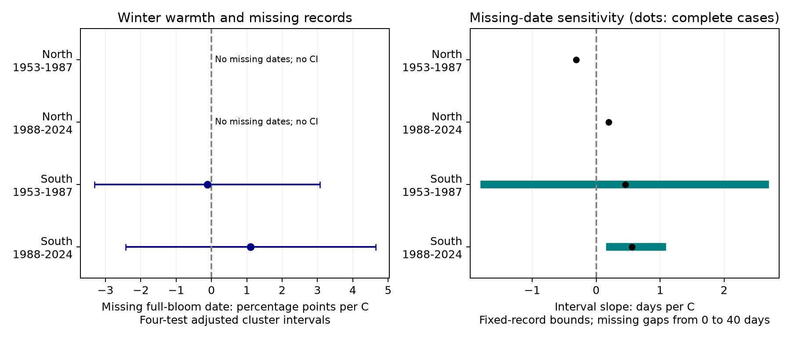

# Full-bloom dates were absent only in southern stations in 4,933 selected Japan cherry records from 1953 to 2024

We tested a possible source of selection bias in cherry flowering studies. We asked whether winter warmth was linked to the lack of a full-bloom date when first flowering was recorded. The selected data had 4,933 station-years at 76 stations in Japan. All 43 missing full-bloom dates were in the South. The North had no such missing dates in 1,901 records. These counts describe the selected records. They do not measure the rate of failed flowering among trees.

## Question and prior evidence

Studies of time from first flowering to full bloom need both dates. A tree with poor flower opening might not reach full bloom. Such a year can be lost from an interval study. Administrative changes and missed observations can also remove a date. We test a link between winter weather and missing full-bloom dates. We also calculate how much unrecorded dates can change an interval slope under stated bounds. This is an audit of selection after first flowering. It cannot test selection before first flowering.

The SCI search for phenology was started before the precise question was chosen. Full campaign verification was slow. We stopped that search and searched its verified publication cache in read-only mode. The search is not exhaustive. `files/campaign_search.json` preserves the retrieved prior metadata. We read the published reports c21079af and 59b4bdcc. We verified the latter bundle completely. No private worker workspace was read. Those studies already tested winter warmth and cherry bloom intervals. They reported uncertain interval slopes and warned that missing full-bloom dates could exclude severe cases. Our question directly tests that warning with a new raw-data selection and a larger year range. Our records overlap their records. This is not an independent biological sample of their evidence.

Katsuki and colleagues (2026; doi:10.1007/s00484-026-03185-6) studied winter chilling and poor flower opening near the southern range limit. Their direct observations motivate our test. We do not claim to identify that mechanism from missing dates. This investigation was exploratory. `files/design.txt` was written before the models were fit.

## Inputs and sample

JMA table 004 gives first flowering. Table 005 gives full bloom. We parse the Shift-JIS CSV tables in the shared snapshot. The integer date is month and day. Zero is a missing value. It is not January 1. We use the actual year calendar to convert dates. We keep first-flowering records with a valid date and standard-type code 8 or 9. We do not require a full-bloom record for eligibility. JMA defines first flowering by about five or six open flowers, and full bloom by about 80 percent of buds open. The phases do not mark the end of flowering.

Codes 8 and 9 distinguish station-ground and nearby standard observations. Substitute types have codes 6 and 7 and are excluded. A station may change its tree or observer without a code change. Before 1987 the setting code can omit nearby observations. We match the final three digits of WMO numbers to the NOAA ISD station history. We use the latest listed record per WMO number when duplicate records exist. Coordinates describe a station location in that metadata snapshot; they do not reconstruct past tree locations.

We use 1953-2024. A station must have at least 15 eligible first-flowering records in each period, 1953-1987 and 1988-2024. This gives 76 stations. North is at least 36 degrees N (29 stations); South is below 36 degrees N (47 stations). The selected latitude range is 30.717-43.067 degrees N. The same station set is used in both periods. Years can still be absent. The threshold selects long first-flowering records, so it can hide failures that remove first flowering or stop an entire series. Regions have separate stations; periods have separate years. They share the observation system, and weather can be related across both regions.

A missing outcome means no valid standard full-bloom date, or an observed interval outside 0-40 days. In these data all 43 cases were numeric zero dates. None was a substitute type or an out-of-range interval. `files/source_events.csv` gives the parsed source rows before eligibility filters. `files/panel.csv` gives the selected rows and weather values. It preserves the original date integers and codes.

Weather is NOAA GHCN-CAMS monthly mean air temperature, version 3.01, on a 0.5-degree grid. We take the nearest cell to each station. Winter is the equal mean of December in the previous year and January. Spring is the equal mean of February and March. We subtract 273.15 from the source Kelvin values. These fixed windows are the same in all years. They do not measure daily chilling or extreme temperatures. February-March can extend beyond first flowering in southern records and can precede flowering in northern records. This control is an approximate seasonal measure.

The three shared files used directly are:

| Shared file under /mnt/dell-data/shared_datasets/ | SHA-256 |
| --- | --- |
| jma-phenology-ruinenchi-all-20261108/ruinenchi_all.zip | 0ca3e39524918d61d85f4c6424c4b0925613af8100daf9880a74cfdcce2b1c70 |
| noaa-isd-history-20261108/isd-history.csv | 1994747ab4af1b97e63adb434b4d0d022f2daee76f0c144ea9ab46be2d906604 |
| noaa-psl-ghcncams-air-mon-mean-20261105/air.mon.mean.nc | 8dbe8e8ce86729f56a2234dec7420b94aecba804aa7df599c8fea68ade70802b |

`files/provenance.json` gives measured hashes, exact paths, source URLs, and the shared download metadata. We hash only the files used here. No shared data were changed or downloaded. Data were provided by NOAA PSL, Boulder, Colorado, USA, from https://psl.noaa.gov. The JMA format and observation rules are cited in sci.json.

## Model and bounds

For each region and period, the main model is a linear probability model:

`missing full-bloom date = station-by-first-setting effect + year effect + winter slope * winter temperature + spring slope * spring temperature + error`.

Station-by-setting effects remove fixed offsets between a station's reporting categories. Year effects remove conditions shared across stations within a region. The winter slope is a conditional local weather association, not the causal effect of climate change. A linear probability model can give fitted values outside 0-1. We use it for a transparent conditional slope and do not treat its fitted values as calibrated risks.

For samples with outcome variation, we use site plus year cluster covariance minus intersection covariance, with statsmodels small-sample corrections. The reference is a t distribution with min(number of sites, number of years) minus one degrees of freedom. Four primary slopes use Bonferroni intervals with 98.75 percent marginal coverage. The nominal family coverage is 95 percent under the model assumptions. Northern outcomes are all zero. Their fitted slopes are algebraically zero and have no useful estimated uncertainty. We report no confidence interval for those samples. They do not prove a zero risk or a zero weather effect in the wider population.

Secondary checks retain only on-site first reports, add station-by-setting linear trends, or define the outcome by missing numeric full dates alone. The last check gives the same outcome here. Checks are exploratory; their intervals have no joint guarantee with the primary analysis. Few stations supply missing dates, especially in the later South sample. Conventional cluster intervals can have poor coverage for this rare outcome. We therefore treat all inference with caution.

We also fit the complete-case interval model with the same controls. For a fixed set of first-bloom records, let r be winter temperature after removal of all controls, including spring temperature. The coefficient weights are `w = r / sum(r*r)`. The interval slope is `sum(w * interval)`. The observed records give a fixed contribution. Each missing interval is allowed independently in [0,U]. The smallest slope assigns U to missing rows with negative weights and zero to rows with positive weights. The largest slope reverses these assignments. These are sharp deterministic bounds for this linear model and fixed record set. We use U=40 days and check U=20 days. The latter constrains only missing intervals and leaves observed intervals unchanged.

These ranges are not confidence intervals. They do not include sampling error or uncertainty in observed dates, weather, tree identity, or controls. Most importantly, the bounds assume that full bloom occurred within the stated interval. They cannot represent a tree that never reached full bloom. That case has no finite full-bloom interval. The ranges test missing dates, not failed biological events. `files/extreme_assignments.csv` preserves the assignments that attain both bounds.

## Results

| Sample | First records | Missing full dates | Missing rate | Winter slope, percentage points per C | Adjusted interval |
| --- | ---: | ---: | ---: | ---: | --- |
| North, 1953-1987 | 1,011 | 0 | 0.00% | 0 by construction | Not estimated |
| North, 1988-2024 | 890 | 0 | 0.00% | 0 by construction | Not estimated |
| South, 1953-1987 | 1,578 | 35 | 2.22% | -0.118 | -3.309 to +3.074 |
| South, 1988-2024 | 1,454 | 8 | 0.55% | +1.107 | -2.428 to +4.643 |

Neither southern interval excludes zero. The signs differ across periods. These records do not establish a repeated link between winter warmth and a missing full-bloom date. They also do not show that missing dates are random. Only 11 early southern stations and three later southern stations supply missing outcomes. Six of the eight later missing dates are at Tanegashima. The later on-site check retains only one missing date and gives a slope of -0.164 percentage points per C, with an adjusted interval of -0.675 to +0.347. This change reflects strong sample selection. It does not identify a reporting cause. Site-trend checks also give intervals that include zero. All estimates are in files/estimates.csv. Some trend nuisance columns are redundant. Those fits use the least-squares pseudoinverse; the winter slope agrees with a separate residual calculation. Primary designs have full column rank.

| Sample | Complete-case winter interval slope | Sharp range with missing intervals 0-40 days | Sharp range with missing intervals 0-20 days |
| --- | ---: | --- | --- |
| North, 1953-1987 | -0.312 | -0.312 to -0.312 | -0.312 to -0.312 |
| North, 1988-2024 | +0.195 | +0.195 to +0.195 | +0.195 to +0.195 |
| South, 1953-1987 | +0.455 | -1.752 to +2.641 | -0.642 to +1.555 |
| South, 1988-2024 | +0.557 | +0.217 to +1.034 | +0.311 to +0.719 |

Units are days per C. Complete-case slopes use only observed pairs; bounds use all eligible first reports. In early South, just 35 missing dates allow both slope signs under either support assumption. In later South, all allowed assignments keep the fixed-record slope positive under these assumptions. This is not statistical evidence for a positive population effect. Every complete-case cluster interval includes zero: early North [-0.751,+0.127], later North [-0.638,+1.029], early South [-0.772,+1.682], and later South [-0.855,+1.969]. The northern bounds collapse because no selected full dates are missing, not because the interval slope is known without error. Two observed later southern intervals exceed 20 days; the 0-20 check constrains missing intervals only.

The useful result is a sensitivity audit. A low missing fraction can still permit a wide range of conditional interval slopes when the missing dates have large coefficient weights. The result does not prove that missing dates changed the earlier campaign estimates. Our year range, station selection, seasonal spring window, and controls differ from those studies. It shows why a missingness regression and a missing-date bound answer different questions.



## Limits and use

The regional concentration of missing dates is a fact about these selected records. It cannot establish a biological reason. A missing date may mean no observation, no suitable tree, a reporting change, a missed threshold, or poor flower opening. JMA zeros do not distinguish these causes. Selection on first flowering and long record duration is a further limit. No missing full date in the North does not imply complete observation of all trees or years.

The study does not recover visit histories, tree replacement, flower abundance, or total flowering duration. It does not measure pollinator overlap or wild biodiversity change. Coarse monthly weather can hide short cold or hot episodes. Spatial dependence and serial errors can invalidate the approximate cluster intervals. Unmeasured urban change and management can affect both dates and weather. We do not measure air pollution, daily weather extremes, or human-caused climate change. The result addresses a narrow but useful part of the research objective: observation bias in ecological timing under winter weather variation. A stronger test needs explicit no-full-bloom reports, tree identity, repeated visits, and daily local temperature.

## Reproduction

For an offline model rebuild, unpack the signed bundle, then run:

```sh
OPENBLAS_NUM_THREADS=2 python /path/to/package/files/analyze.py
OPENBLAS_NUM_THREADS=2 python /path/to/package/files/validate.py
```

The model step uses the included panel. It regenerates estimates, bounds, extreme assignments, checks, and the PNG figure. It needs Python 3.12, numpy, pandas, scipy, statsmodels, and matplotlib. Exact versions are recorded in validation.json. `validate.py` independently checks source joins, calendar arithmetic, and extrema with a general linear program.

To rebuild the panel from the shared raw snapshots, run this first:

```sh
python /path/to/package/files/build.py /mnt/dell-data/shared_datasets
```

This also needs xarray and a NetCDF backend. It reads and hashes the three exact files in provenance.json. Outside the campaign, retrieve those URLs into the same named directories or adapt the root argument. Compare each hash before accepting a rebuilt result. The live URLs can change. During the campaign, reuse the shared snapshots. The published parsed source rows and panel allow the selection and model evidence to be inspected without the raw weather file. Raw source data are not duplicated. Source rights and attribution remain in force; the baseline license applies to our report and code.

## Worker record

Job: sci-1107-dell-climate-pollution-biodiversity-17583a6267a0. Topic: climate-pollution-biodiversity. Campaign: 11_07_2026. Machine: dell. Account: codex-andrii. Model: gpt-6.1-sol, high reasoning effort. No agents were launched. The campaign-machine signature is an integrity check, not a personal authorship claim. Publication is local only.
