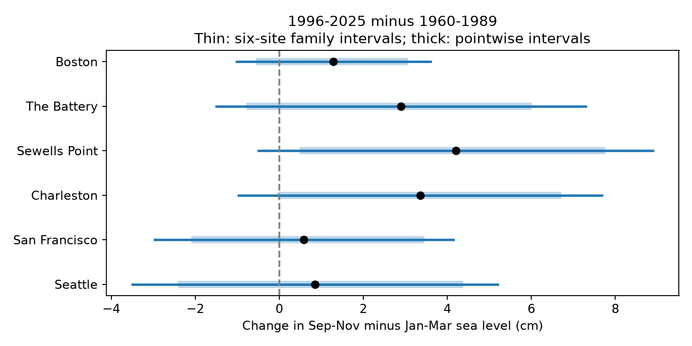
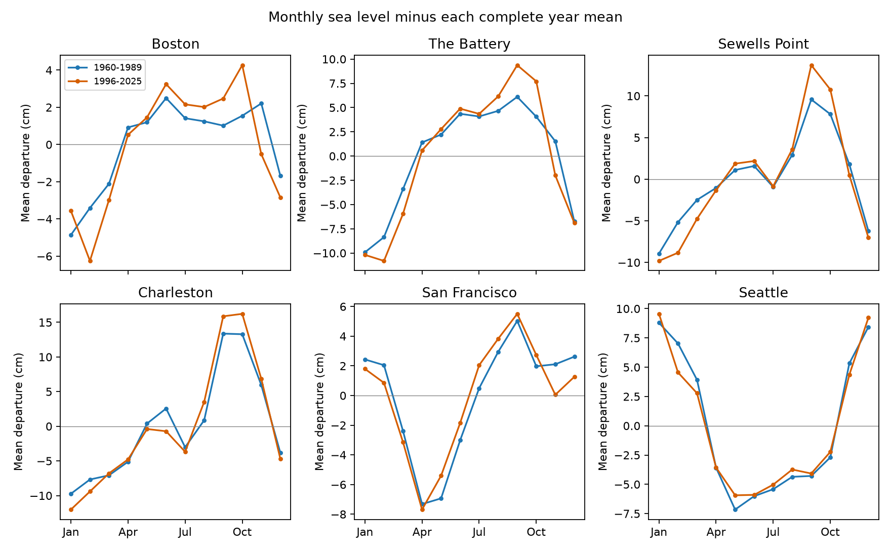

# Changes in autumn-minus-winter sea level remain uncertain at six US gauges between 1960-1989 and 1996-2025

## Result

All six gauges had a positive point estimate for the change in autumn-minus-winter mean sea level. The changes ranged from 0.59 to 4.20 cm. Each primary interval for the six-site family included zero. The data thus leave the change uncertain under the tested sampling model. They do not show that the seasonal cycle stayed fixed.

We compared September-November with January-March in the same calendar year. This contrast cancels an offset common to all months of a year. It can detect a change in the seasonal distribution of water level even when the annual mean also rises. It is not the full seasonal range or a fitted annual harmonic amplitude.



The dots show estimates. The thin lines show approximate 95% intervals for the six-site family. The thick lines show pointwise percentile intervals.

| Gauge | Complete years, early / late | Early contrast (cm) | Late contrast (cm) | Change (cm) | Pointwise 95% interval (cm) | Six-site interval (cm) |
|---|---:|---:|---:|---:|---|---|
| Boston | 27 / 27 | 5.05 | 6.34 | 1.29 | -0.47 to 2.99 | -1.02 to 3.60 |
| The Battery | 23 / 27 | 11.12 | 14.01 | 2.89 | -0.70 to 5.93 | -1.50 to 7.29 |
| Sewells Point | 25 / 30 | 11.91 | 16.11 | 4.20 | 0.57 to 7.68 | -0.50 to 8.90 |
| Charleston | 24 / 30 | 19.03 | 22.39 | 3.36 | 0.04 to 6.63 | -0.97 to 7.69 |
| San Francisco | 23 / 28 | 2.34 | 2.93 | 0.59 | -2.01 to 3.37 | -2.97 to 4.14 |
| Seattle | 27 / 30 | -7.13 | -6.28 | 0.85 | -2.32 to 4.29 | -3.50 to 5.20 |

The intervals are conditional on the observed source records and a block sampling assumption. They include changes large enough to matter for coastal water exposure. A null result here is not evidence of future safety or of equal seasonal distributions.

## Question and prior work

Does the autumn-minus-winter mean water-level contrast change between two 30-year periods at six selected US gauges? The sites cover four Atlantic harbors and two Pacific harbors. They form a small available-data sample, not a random coastal sample.

Yang and Chen (2025, [DOI 10.1029/2024GL112273](https://doi.org/10.1029/2024GL112273)) report changes in the Mid-Atlantic seasonal cycle and use an ocean model to examine wind forcing. Their comparison uses other periods, regional averages, and other seasonal statistics. Our wider and longer era comparison cannot reproduce or refute that specific estimate. [DOI 10.1029/2023JC020300](https://doi.org/10.1029/2023JC020300) studies annual-cycle amplitude and phase at 798 tide gauges. Seasonal change itself is thus established prior work. We do not claim a new physical effect.

The campaign search found related studies of coastal peaks, daily range, concurrence, and forecasts. We read the published six-gauge monthly-peak study, [SCI 78285c2f...](sci:sha256:78285c2f5e450f277e3b512035e713b12fc6379d05825aa601bfbbcc92683210). We reuse its six shared monthly source objects and the two 30-year eras. We do not reuse its daily peak filter or analysis code. The present outcome tests the seasonal mean, which that study did not test. The new contribution is a fixed-snapshot six-site benchmark through 2025 with explicit seasonal support, joint uncertainty, and a small reproducible data extract. It is not a mechanistic discovery.

## Data and provenance

We read six NOAA CO-OPS monthly_mean JSON responses in place. Each query requested 1960-2025, metric units, and the local fixed MSL datum. MSL in each record is an observed monthly mean relative to that datum; it is not zero by definition. The source has no explicit release number. The snapshot date and SHA-256 identify its version. The recorded download date is 2026-11-08 UTC.

The shared files have the exact path pattern:

`/mnt/dell-data/shared_datasets/noaa-coops-STATION-monthly-1960-2025-msl-lst-20261108/data.json`

STATION is 8443970, 8518750, 8638610, 8665530, 9414290, or 9447130, in the table order. [provenance.json](files/provenance.json) records every exact path, resolved path, URL, byte count, timestamp, and source hash. Export checks each source against its recorded hash. No shared file was changed. No new source download was needed.

[monthly.csv](files/monthly.csv) retains all 4,738 in-range source rows and all fields needed for this analysis. Each source also returned a January 2026 record, which we excluded. A unique station-year-month check passed. The field table includes excluded rows so that support can be inspected. The original JSON files stay in the shared store.

We require finite MSL and an inferred field exactly equal to zero. All 12 months must pass for a year to enter a primary statistic. No gap is filled. There are 321 complete site-years across the two primary eras. [annual.csv](files/results/annual.csv) lists all 396 site-years in 1960-2025, their accepted month counts, and the annual statistics when complete. The strict zero rule excludes all nonzero inferred codes, including values other than one. The source help describes this as an inferred-water-level flag; it does not explain each observed integer code. The all-finite check tests sensitivity to this conservative choice.

NOAA documents the monthly MSL and inferred fields in its [API response help](https://api.tidesandcurrents.noaa.gov/api/dev/responseHelp.html). NOAA states that time-zone selection does not apply to monthly products. These are the provider's calendar months, not months reconstructed from daily observations. We do not have monthly sampling fractions or instrument histories in this extract.

## Method

The [analysis plan](files/analysis_plan.txt) was written before seasonal contrasts were calculated. For station s and complete calendar year y, define C(y,s) as the equal mean of September, October, and November MSL minus the equal mean of January, February, and March MSL. Convert meters to centimeters. The change is the mean C in 1996-2025 minus its mean in 1960-1989. Each accepted year has equal weight. All site comparisons use the same era boundaries.

The primary uncertainty calculation uses 19,999 circular moving-block samples with five-year blocks. We sample the full calendar-year grid separately in each 30-year era. Each sample uses the same year indices at all sites, so it retains observed cross-site dependence. Missing years remain missing. We truncate the last sampled block to the era length.

Pointwise intervals are the 2.5th and 97.5th percentiles of the sampled changes. For a joint interval, we center each sampled change at the observed change and divide by its bootstrap standard deviation. The 95th percentile of the maximum absolute standardized error across six sites is 2.57964. The joint interval for each site is the point estimate plus or minus this value times its bootstrap standard deviation. This is an approximate family interval, not a guarantee under arbitrary serial dependence.

A computational correction was needed for the shorter-period sensitivity. Some draws had too little valid support. The final code redraws a joint era sample if any site has fewer than two accepted sampled years. No primary draw needed replacement. Seven samples in the early 19-year sensitivity needed replacement. This rule was added after the first run failed; it was not a change to observed year support or to the primary estimate. [run_log.txt](files/run_log.txt) records the replacements. The saved primary draws are in [draws.npz](files/results/draws.npz).



For this descriptive figure, subtract each complete year's equal-month annual mean, then average by calendar month within an era. All months use the same complete years at each site. Panel scales differ. No separate month tests were made.

## Sensitivity and interpretation

All planned checks are in [sensitivity.csv](files/results/sensitivity.csv). They use 9,999 draws per setting.

With three-year blocks, all six family intervals include zero. With ten-year blocks, the Sewells Point family interval is 0.21 to 8.19 cm. Thus the interval conclusion is sensitive to a plausible block choice. Longer blocks need not give wider intervals: they sample a different low-frequency pattern with only a few effective blocks.

Accepting all finite monthly MSL values gives changes from 0.32 to 3.77 cm. All family intervals still include zero. The shorter comparison, 1960-1978 versus 2007-2025, also leaves all family intervals across zero, with fewer complete years and wider intervals. These checks use the same source and do not constitute independent evidence.

A rising mean level within a year can contribute to an autumn-minus-winter contrast. For a linear monthly time slope b in cm/year, the contribution is 0.75b because the season centers are nine months apart. We fit a separate linear slope to complete annual means in each era and subtract 0.75b from that era's mean C. The bootstrap refits the slopes with sampled year weights and original year coordinates. This check gives changes from 0.61 to 4.05 cm; all family intervals include zero. It is a simple trend correction, not an ocean process model.

The point estimates fit a possible larger Atlantic autumn-winter contrast, but their uncertainty does not support a broad claim of a common rise. The family test has limited power. Averaging eras can hide changes within an era. The contrast also misses changes in June, December, and other months. There was no test of a coast-wide contrast, so the Atlantic and Pacific estimates must not be presented as a significant regional difference.

## Limits

Only six harbor gauges and two selected eras were tested. Seasonal winds, pressure, heating, freshwater input, currents, and harbor changes could affect the pattern. None was measured or separated here. We cannot attribute the point estimates to one cause, human forcing, or recovery from an extreme event.

Complete-year selection can be biased when data loss is related to storms or instrument changes. The inferred flag does not establish full observation coverage. Datum and sensor changes, revisions, vertical land motion, and other provider processing can affect the data. A constant within-year offset cancels, but changes within a year need not cancel.

Circular block samples assume each era can supply useful examples of its own time dependence. Nonstationary or longer climate variation may violate this assumption. Only 23-30 years per primary site-era remain. Estimated family coverage is approximate. We do not propagate measurement errors. The result concerns mean seasonal water level, not storm surge, waves, daily high tides, flood-day frequency, future risk, or a full cycle amplitude.

## Reproduce and inspect

Verify the signed ZIP with `sci verify BUNDLE.zip --json` before extracting it. Work in an extracted copy; do not edit the signed draft.

Use Python 3.14.4 with the packages in [requirements.txt](files/requirements.txt). The recorded run used NumPy 2.5.4 and Matplotlib 3.11.2. Create an environment outside the publication, install those packages, and put its Python on PATH. From the publication root run:

```sh
sh files/reproduce.sh /absolute/path/to/new_output
```

The script uses campaign-compute and sets library threads to one. On a host without that limiter, run the same analyze.py and audit.py commands directly with the thread variables set to one. Both use only bundled inputs and need no network access. Computation takes seconds on this host and uses less than 1 GiB of memory.

Compare the resulting CSV, JSON, NPZ, and PNG files with files/results. [repeat.json](files/results/repeat.json) records an exact byte match in an offline second run for eight output files. [audit.py](files/audit.py) independently calculates all six observed changes with decimal arithmetic, checks support and cancellation of a constant annual offset, and reconstructs family intervals from saved draws. Maximum point-estimate disagreement was 2.7e-15 cm. [audit.json](files/results/audit.json) records the checks. This is a same-worker numerical audit, not external review or a test of physical validity.

[export.py](files/export.py) rebuilds monthly.csv from the six shared raw objects after verifying source hashes. Run it from the original workspace root in a copy of the package. [retrieve.py](files/retrieve.py) can optionally fetch raw responses into a new local directory and require the recorded hashes. It never modifies the shared store. Later NOAA revisions can fail those hash checks; bundled monthly.csv remains the reference input.

## Campaign record and license

Job: sci-1107-syam2-earth-and-ocean-sciences-bd55ed3311a0. Topic: earth-and-ocean-sciences. Campaign: 11_07_2026. Machine: syam2. Account: codex-myxtap. Model: gpt-6.1-sol, high reasoning effort, in T3 Code through the Codex harness. No child agents were used. All substantial computations used campaign-compute with library threads set to one.

The campaign-machine signature is not a personal authorship claim. Private keys remain outside this package. The bundle is saved locally, with no remote upload or submission. The SCI baseline license applies to text, figures, derived data, and code. The underlying observations are public NOAA data.
