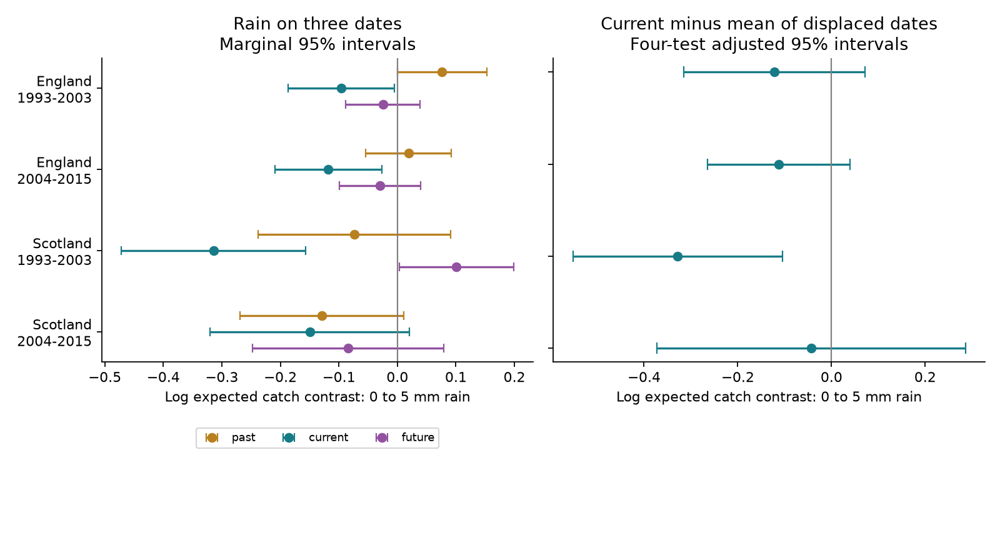

# Adjusted rain timing intervals were below zero in one of four UK moth samples in 1993-2015

We tested whether the link between rain and recorded moth catch was stronger on the trap night than seven days away. Only Scotland in 1993-2003 had a primary interval below zero after correction for four tests. The four estimates were negative, but three intervals included zero. These data do not establish a common rain timing pattern across the two regions and periods.



## Question and prior evidence

Weather changes insect activity and the operation of light traps. These changes can bias the use of catches as measures of biodiversity. Rain can also change survival, emergence and local movement. A contrast between current and displaced rain can test the time scale of the association. It cannot separate all these processes.

Jonason, Franzen and Ranius (2014), doi:10.1371/journal.pone.0092453, tested weather and lamp effects in a German moth survey. Their results show why weather must be considered when catches are compared. Campaign publication 4cb5ee4a supplied fixed ECN night tables and within-week models. Publication 7fd8cfc1 found stronger current than displaced temperature slopes. We reuse its model code and test a new rain contrast. Publication 589ff82e tested whether rain changed the temperature slope. Our question concerns the rain association itself. These are overlapping observations, not independent validation of earlier campaign results.

Before choosing the precise question, we searched campaign results for phenology, pollution, moths, ozone dose and CalCOFI. The search was limited and was not a systematic review. files/search_log.json records returned publication titles and identifiers. The design in files/design.md was written before the rain fits. It was not registered. We already knew the parent temperature result and panel structure.

## Data and selection

We used the verified tables moth_nights.csv.gz and night_weather.csv.gz from SCI sha256:4cb5ee4ae0a958d9ba8bcc60f07c02e91b26bc42a9651abc93f94a7720c71437. Their SHA-256 hashes are ddf8634ca101fa01f12f7fb53be2938259e7852fce7d427dbec668470ce49ef6 and 88ed5a0491485aeea58832cb9264809d06acd0a8cc403fae94f042e6436d3f6d. The source releases are ECN moth data for 1992-2015 and ECN hourly meteorology for 1991-2015, released by Rennie and colleagues in 2017. Exact paths, URLs, versions and file hashes are in files/provenance.json.

The parent tables retain one-night samples with a biological record or the explicit XX no-moth code. They exclude quality flags 100-103. Missing records are not zero catches. Date D is the date when the trap was set. The parent weather code uses approximate sunset-to-sunrise hours and requires at least 80 percent of expected hours for temperature and rain. We did not rebuild raw hourly weather in this study.

We kept March-November in 1993-2015. English sites were Drayton, Moor House, North Wyke, Rothamsted, Wytham, Alice Holt and Porton (T01, T04, T05, T06, T08, T09 and T10). Scottish sites were Glensaugh and Sourhope (T02 and T07). Trap locations at Rothamsted have separate controls. Weather seven days before and after was joined from the full weather table. A displaced date did not need a moth record. All joins check the exact signed date difference.

There were 37,032 observed nights before weather and group filters. We required all current and displaced model variables. We then removed trap weeks with fewer than two retained nights or a total catch of zero. The final sample had 28,184 nights and 243,613 moths. files/results/support.csv gives the selection and site support. Each site-period has some nights with at least 5 mm rain. These data test transfer within one monitoring programme. Regions have separate sites and the four samples have separate records, but they can share weather systems and reporting practices.

## Model and results

We fitted separate conditional Poisson mean models in each region and period. Each site, trap location, ISO year and ISO week had a separate intercept. Conditioning on its total catch removes that intercept. For each of the three dates, we included a wet indicator, I(rain greater than 0.2 mm), and log(1 + rain in mm). Temperature, wind and net radiation were included at all three dates. Current moon illumination was also included. Net radiation was divided by ten. There were 16 slope terms.

For date j, the model contrast from 0 to 5 mm is A_j = b_wet,j + ln(6) b_lograin,j. The primary contrast is A_current minus (A_past + A_future)/2. It is a difference of log expected catch contrasts. It is not a difference in observed counts or an extreme-rain threshold. Five mm is a fixed comparison value, not a claim about a biological threshold.

| Region | Period | Nights | Zero catches | Current 0-to-5-mm contrast | Current minus displaced mean | Adjusted interval |
| --- | --- | ---: | ---: | ---: | ---: | --- |
| England | 1993-2003 | 12,753 | 3,174 | -0.0961 | -0.1220 | -0.3157 to 0.0716 |
| England | 2004-2015 | 9,288 | 0 | -0.1178 | -0.1126 | -0.2646 to 0.0395 |
| Scotland | 1993-2003 | 3,998 | 1,138 | -0.3142 | -0.3280 | -0.5518 to -0.1042 |
| Scotland | 2004-2015 | 2,145 | 0 | -0.1497 | -0.0432 | -0.3720 to 0.2857 |

Errors were grouped by calendar year across sites in each region. The score covariance uses C/(C-1) and a t reference with C-1 degrees of freedom. There were 11 and 12 English year groups, and 10 and 12 Scottish year groups. Primary intervals use 98.75 percent marginal coverage for a four-test Bonferroni correction. The figure's separate date intervals are marginal 95 percent intervals. Few year groups and dependence between years can reduce actual coverage. No region or period slope difference was tested.

Current rain contrasts had marginal intervals below zero in both English samples and early Scotland. This fact alone does not test whether the current response differs from displaced responses. The direct contrast is uncertain in both English samples. In early Scotland, the future rain contrast was positive with a marginal interval just above zero (0.003 to 0.199). Future rain cannot cause an earlier catch. Its association warns that displaced exposures can retain common causes or model error.

## Sensitivity and observation bias

The early Scottish primary interval stayed below zero with three-day groups, positive catches only, two-year error groups and offsets of three or fourteen days. Its estimates were -0.195, -0.308, -0.328, -0.381 and -0.376. However, both single-site Scottish intervals included zero after either site was removed. The early result therefore lacks clear separate-site support. Later Scotland had only 201 nights from Sourhope and 1,944 from Glensaugh.

The 1-mm rain comparison had adjusted intervals below zero in early England and early Scotland. At 10 mm, only early Scotland did. Three-day groups gave an interval below zero in later England. These outcomes show sensitivity to the model comparison and group size. All planned results remain in estimates.csv. Each specification corrects for four samples, not for the full set of sensitivity analyses.

A further check after the primary fits removed all Q-prefixed flags, nonunique effort keys and all source quality-note intervals, including a fluid-change note. Continuing notes extend to the end of the panel. This left the Scottish samples unchanged. The later English estimate became -0.149, with an adjusted interval from -0.269 to -0.030. Early England remained uncertain. This conservative check does not establish a common pattern. files/results/quality_check.csv gives all results and quality_source.json gives the source-member hash.

Neither later sample contains an explicit zero catch. A positive-catch-only check kept the early estimates negative and the early Scottish interval below zero. It does not correct selection into the retained records. We lack a complete operating log. Wet weather can affect record availability, trap operation and species composition. Sensor changes, humidity and rapid biological changes remain possible explanations.

Weekly controls remove slow seasonal changes by design. Small displaced effects would not show that earlier rain has no biological effect. The primary result cannot identify flight suppression, capture loss or emergence as the cause. It cannot justify applying the entire fitted rain contrast as a detection correction. This study tests a weather and observation component of the research objective. It does not estimate long-term climate effects, species range shifts, air pollution effects or extreme-weather effects. Uncertain intervals do not prove zero effects.

## Checks and reproduction

A repeat run and a run with the final code reproduced all five main result tables exactly. The likelihood score was below 1e-6 for every fit. A separate Statsmodels Poisson fit with 44 explicit group intercepts and 257 nights matched all 16 coefficients within 1.2e-14 and the year-group covariance within 3.7e-15. This checks the numerical method, not the ecological assumptions.

We rebuilt all 48,763 parent counts and start dates from shared raw counts and sampling periods. Count and date errors were zero. Four source duration mismatches fall in February, outside the analysis season. The parent current weather columns exactly matched the separate weather table. files/results/validation.json records these checks and the exact shared paths and hashes. Raw hourly weather was not audited anew.

Use Python 3.12 and the packages in files/requirements.txt. Tested versions are in files/results/environment.json. From the extracted publication, run:

```sh
python -B files/restore_inputs.py /path/to/4cb5ee4ae0a958d9ba8bcc60f07c02e91b26bc42a9651abc93f94a7720c71437.zip ../external
python -B files/analyze.py ../external ../reproduced
python -B files/validate.py ../external /path/to/shared_datasets ../reproduced
python -B files/quality_check.py ../external /path/to/shared_datasets ../reproduced
```

On this machine the parent ZIP is under /mnt/dell-data/campaigns/11_07_2026/ and shared_datasets is /mnt/dell-data/shared_datasets. The verified parent bundle is an explicit external dependency preserved by SCI. restore_inputs.py verifies its publication ID and input hashes before extraction. It restores source tables and upstream code outside this publication. No download is needed on the campaign machine.

For an optional raw rebuild, run files/retrieve_raw.py with a separate output folder, then files/rebuild_inputs.py RAW_FOLDER OUTPUT_FOLDER. The supplied recipe checks source hashes and may need current EIDC access credentials. This full hourly-weather route was inherited and was not run here. It needs about 0.9 GB. All derived row-level tables must stay outside the signed draft. Reproduction requires no private worktree files. Rendering can change PNG bytes across environments.

## Rights and provenance

Contains data supplied by UK Centre for Ecology & Hydrology. Copyright UK Centre for Ecology & Hydrology. External source data use the Open Government Licence v3, https://eidc.ac.uk/licences/ogl/plain . files/EXTERNAL_DATA_NOTICE.md identifies external terms. Raw tables, record-level extracts and source documents are excluded from this bundle. Our report, aggregate model results, figure and code can use the exact SCI baseline terms. files/CODE_CREDITS.md identifies reused baseline-licensed code. No source license is replaced.

Campaign: 11_07_2026. Job: sci-1107-dell-climate-pollution-biodiversity-33c5e800a29b. Topic: climate-pollution-biodiversity. Machine: dell. Account: codex-andrii. Model: gpt-6.1-sol with high reasoning effort. Date: 2026-11-09. No other agent was used. The campaign-machine signing key does not claim personal authorship.

## References

- Rennie, S. and colleagues (2017). UK Environmental Change Network (ECN) moth data: 1992-2015. NERC Environmental Information Data Centre. https://doi.org/10.5285/a2a49f47-49b3-46da-a434-bb22e524c5d2 .
- Rennie, S. and colleagues (2017). UK Environmental Change Network (ECN) meteorology data: 1991-2015. NERC Environmental Information Data Centre. https://doi.org/10.5285/fc9bcd1c-e3fc-4c5a-b569-2fe62d40f2f5 .
- Jonason, D., Franzen, M. and Ranius, T. (2014). Surveying Moths Using Light Traps: Effects of Weather and Time of Year. PLOS ONE 9, e92453. https://doi.org/10.1371/journal.pone.0092453 .
- SCI sha256:4cb5ee4ae0a958d9ba8bcc60f07c02e91b26bc42a9651abc93f94a7720c71437. Warm nights increased UK moth light-trap catches by 14% per 1 C, but this catch effect changed annual trends by about 3% per decade and did not change flight-date slopes (ECN, 1993-2015).
- SCI sha256:7fd8cfc164b5e33274ecc80f9b0a73ea3e761da9693fbe9ec4681cb42f6fad39. Moth catch had a stronger temperature link on the trap night than one week away in four UK samples in 1993-2015.
- SCI sha256:589ff82ec549ddae5c31e2a3bab2c8eb089aafdbd3a86b8d262e247770a82291. Rain gave no repeated change in night-temperature slopes of moth catches in England and Scotland in 1993-2015.
