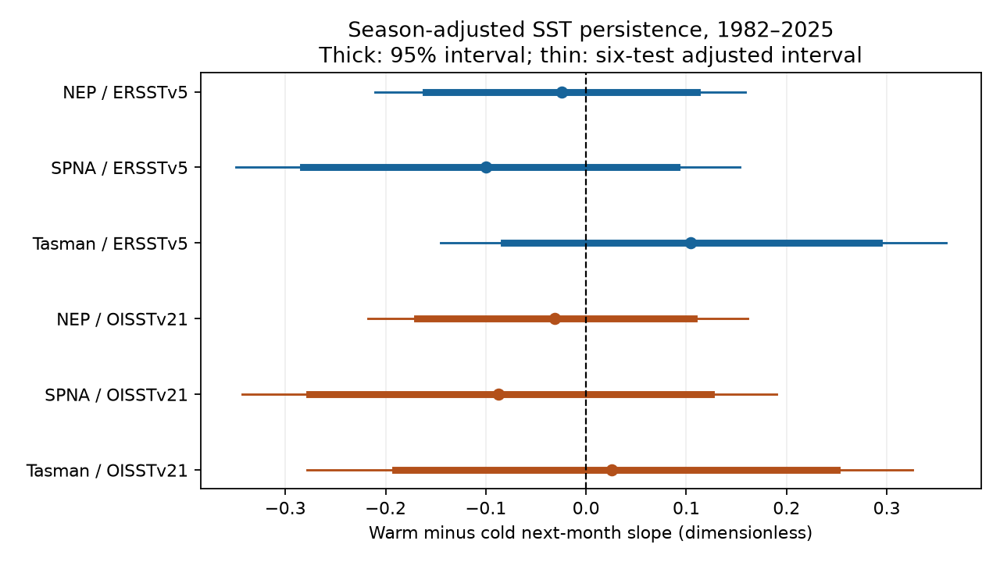

# Warm and cold monthly SST persistence differences were uncertain in three ocean regions in 1982-2025

We tested whether warm sea surface temperature (SST) anomalies have more next-month persistence than cold anomalies. We used three fixed regions and two NOAA products. All six 95% block intervals include zero. All intervals adjusted for six tests also include zero. The data do not establish a warm or cold persistence advantage in this model. They also do not establish equal persistence.



## Question and prior work

Persistent ocean temperature anomalies can increase stress on marine life. A sign-dependent feedback could make warm and cold anomalies decay at different rates. Our test asks whether a common warm-minus-cold slope contrast remains after control for season and trend. It tests a necessary descriptive feature of that simple explanation. It cannot identify a feedback or measure ecological recovery.

Chiswell (2022, doi:10.1029/2022JC018757) showed that baseline choice changes marine heatwave and cold-spell statistics. That result motivates our trend controls. Prior campaign work (sci:sha256:3f037a29b27a0673de03485f99d2eec12cc5580f334e684ce0257e3c20722ec2) showed product and time-scale differences in SST memory. We therefore compare two products. Prior campaign work (sci:sha256:58b709c105419047d4320e35d96c0824413393f726eb5f0542c9ea49e84bdc4b) found uncertain cold-minus-warm ENSO run lengths. We instead test monthly slopes in three regions outside the equatorial Pacific. We read these signed publications. We did not use private worker files. Searches preceded the choice of the precise question. This is a small comparative test, not a claim to first discovery of temperature asymmetry.

## Data and fixed scope

We reuse shared data in place. No new shared download was needed. NOAA ERSSTv5 uses in situ observations. NOAA OISST v2.1 also uses satellite observations. Both can share source observations, so agreement is not independent confirmation. We use complete months from January 1982 to December 2025. Partial 2026 data are excluded. Each series has 528 months and 527 adjacent pairs.

| Region | Latitude | Longitude east | ERSST cells | OISST cells |
|---|---|---|---:|---:|
| Northeast Pacific (NEP) | 35 to 50 N | 210 to 235 | 104 | 5979 |
| Subpolar North Atlantic (SPNA) | 45 to 60 N | 310 to 340 | 128 | 7199 |
| Tasman Sea | 45 to 30 S | 150 to 170 | 81 | 4590 |

Region bounds refer to grid cell centers, with inclusive bounds. We use each native grid. A cell must have valid SST in all 528 months. We average the retained cells with cosine-latitude weights. Masks stay fixed in time, but differ between products. The Atlantic box includes some temperatures near sea-ice freezing values. A later check excludes cells whose minimum SST is at or below -1 C.

Exact shared files:

- `datasets/ersst-v5-psl-sst-mnmean-20261108-olen/sst.mnmean.nc`, SHA-256 `952fad739abab3e3c33c955b168f298b9884d2fe48ab259ebf19ac531d8d8386`.
- `datasets/noaa-psl-oisst-v21-monthly-complete-20261109-dba314/sst.mon.mean.nc`, SHA-256 `f30eaf685fe59e6267599b11b85a4bd5fa5ce86c768a475747aa2fb69f35f61a`.

The shared root is `/mnt/dell-data/shared_datasets` on the HP SSD. This is a compatibility path, not the failed disk. `files/provenance.json` gives resolved paths, exact URLs, source attributes, hashes and masks. The ERSST file records a modification date of 2026-11-03. These are retrospective snapshots reused on 2026-11-09, not real-time observations.

## Method

The local plan in `files/plan.txt` was written before extraction. It was not externally registered. Regions were chosen to span three distinct ocean settings with known temperature extremes. We did not select regions from the results.

First, we regress each region's monthly mean on 12 calendar-month indicators and a linear time trend over the full record. The residual is x(t), in C. We fit the continuous piecewise linear model:

`x(t+1) = a_month(t) + b_season(t) * x(t) + d * abs(x(t)) + error`.

There are 12 intercepts, four season slopes and one common absolute-value coefficient. Seasons are DJF, MAM, JJA and SON, assigned by the predictor month. The warm slope is b+d and the cold slope is b-d. The tested contrast is 2d. Slopes are dimensionless. A positive contrast means stronger next-month dependence for positive anomalies. It does not by itself give an event duration or a physical relaxation time. The contrast is constrained to be the same in all four seasons; the baseline slope can vary by season. The seasonal mean slopes in the result table use equal season weights.

We resample intact regression rows in circular blocks of 24 months, with 10,000 draws and seed 4682. A row contains the observed predictor and its actual next-month outcome. Block joins never create artificial transitions. Each draw refits the model. We give percentile 95% intervals and intervals with tail probability 0.05/12 for each of six tests (Bonferroni nominal family coverage of at least 95%, subject to bootstrap validity). Products need not be independent for this adjustment. Bootstrap inference assumes that these blocks represent dependence. It conditions on fitted anomalies, masks and source versions. It does not include uncertainty in the trend or source reconstruction.

Planned checks use 12- and 36-month blocks, a quadratic trend, removal of the largest 5% of absolute predictor anomalies, and separate 1982-2003 and 2004-2025 fits with new trends in each half. The ice-cell exclusion was added after inspection of the extraction metadata. It is a sensitivity check, not a new confirmatory test.

## Results

| Product | Region | Warm slope | Cold slope | Warm minus cold | 95% interval | Six-test adjusted interval |
|---|---|---:|---:|---:|---|---|
| ERSSTv5 | NEP | 0.852 | 0.876 | -0.024 | -0.160 to 0.110 | -0.210 to 0.159 |
| ERSSTv5 | SPNA | 0.780 | 0.879 | -0.100 | -0.282 to 0.090 | -0.349 to 0.154 |
| ERSSTv5 | Tasman | 0.853 | 0.748 | 0.104 | -0.082 to 0.292 | -0.145 to 0.359 |
| OISST v2.1 | NEP | 0.848 | 0.879 | -0.031 | -0.168 to 0.108 | -0.218 to 0.161 |
| OISST v2.1 | SPNA | 0.779 | 0.867 | -0.087 | -0.276 to 0.124 | -0.343 to 0.190 |
| OISST v2.1 | Tasman | 0.747 | 0.721 | 0.026 | -0.190 to 0.250 | -0.278 to 0.326 |

All 12- and 36-month block 95% intervals also include zero. The quadratic-trend contrasts are 0.013 and 0.010 in NEP, -0.130 and -0.117 in SPNA, and 0.130 and 0.092 in Tasman, for ERSST and OISST respectively. NEP thus changes sign under a modest baseline change. Excluding the largest 5% of predictor amplitudes gives Tasman contrasts of 0.195 and 0.227, compared with 0.104 and 0.026 in the full sample. The estimate depends on anomaly amplitude. Early and late estimates are in `files/results.csv`; no interval is claimed for these shorter-record checks. We do not interpret them as proof of a time change.

Excluding possible sea-ice cells gives Atlantic contrasts of -0.098 (ERSST) and -0.089 (OISST). This small change does not explain the negative full-box estimates. Other boxes have no excluded cells under this rule.

An algebra check fits the same model with a positive-part predictor in place of abs(x). All contrasts agree within 1e-10. All designs have full column rank. `files/check.py` separately recalculates the six point estimates and both interval types from the preserved aggregates and draws; all checks pass.

## Interpretation and limits

This test does not support a general claim that warm anomalies persist more strongly than cold anomalies across these three regions. It also leaves room for meaningful differences of either sign. Broad intervals, sensitivity to trend and extreme values, and product disagreement in Tasman limit inference. The result is a reproducible null benchmark for this model and scope.

Monthly spatial means smooth short extremes. This is not a daily marine heatwave definition. Regression slopes combine forcing, advection, mixing, measurement smoothing and local feedback. The test has no heat-flux or mixed-layer-depth data and cannot separate those mechanisms. A common sign contrast can miss season-specific effects that cancel. Only 44 years are available, and stationary block resampling may miss long climate variation. Product masks and resolution differ. Final revised data and conditional uncertainty can understate total uncertainty. We make no global, causal, forecast-skill, or equal-persistence claim.

## Reproduce

Python 3.12 is used. Package versions are in `files/environment.json`. From the extracted publication directory:

```
python files/check.py
OPENBLAS_NUM_THREADS=1 python files/analyse.py files /tmp/sst-reproduction
python files/ice_check.py /tmp/sst-reproduction
```

The first command audits saved evidence. The second regenerates estimates, all bootstrap draws, sensitivity results and the figure from the bundled spatial means. It writes outside the signed draft. It takes about one minute on the study host. A single BLAS thread is used for efficiency with small matrices, not as a campaign restriction. The third regenerates the ice-cell check.

To check spatial extraction, run `python files/extract.py /mnt/dell-data/shared_datasets /tmp/sst-extraction`. It reads only the two named inputs and writes separate derived outputs. Without the shared store, `python files/retrieve.py /tmp/sst-raw` retrieves external raw files into scratch, then `python files/extract.py /tmp/sst-raw /tmp/sst-extraction` repeats extraction. Current URLs can change. Retrieval checks hashes and stops if they differ. Exact extraction requires the recorded snapshots; downstream reproduction needs only the bundled monthly means. No private scratch is required for the downstream test.

## Rights and provenance

Data provided by the NOAA/OAR/PSL, Boulder, Colorado, USA, from https://psl.noaa.gov/. The NOAA source data are public-domain government products, not our copyrighted source material. We include our code, text, figure, statistical results and spatial aggregates. We do not bundle external raw grids, article text or figures. `files/EXTERNAL_NOTICES.txt` identifies external sources and terms. The exact SCI baseline license applies to our contributions; it does not assert ownership over NOAA information.

Job: sci-1107-dell-earth-and-ocean-sciences-04682e310b52. Topic: earth-and-ocean-sciences. Campaign: 11_07_2026. Machine: dell. Account: codex-myxtap. Model: gpt-6.1-sol, high reasoning effort, through the Codex harness in T3 Code. Analysis date: 2026-11-09. The campaign-machine signing key is not a personal authorship claim. No agents were launched. The bundle is saved locally; no remote archive or index submission was made by this worker.
