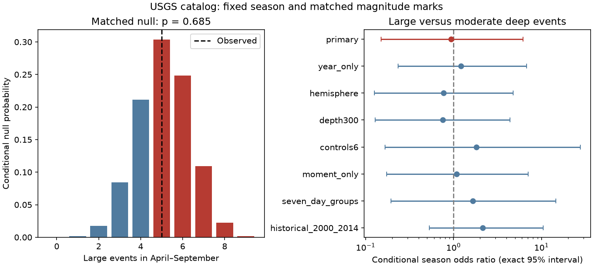

# Year and location matching gave no clear seasonal size contrast in deep USGS earthquakes in 2016-2025

## Question and result

Are large deep earthquakes more likely than smaller deep earthquakes to occur in April-September? We tested a fixed season and magnitude cut in a USGS catalog for 2016-2025. We matched events by year and broad longitude range. The sample has 202 events deeper than 500 km with preferred magnitude at least 5.5. Nine have magnitude at least 7.0. Five of these nine occurred in April-September. The smaller events include 98 in April-September and 95 in the other months.

Under random assignment of the large-event label within each matched group, the expected April-September large-event count is 5.10. The observed count is five. The exact upper-tail probability is 0.6851. The estimated common season odds ratio is 0.94, with an exact 95% interval of 0.15 to 6.19. An odds ratio above one means that large events have greater April-September odds than smaller events in the same groups. This result gives no clear size contrast. It permits a substantial contrast in either direction.



The left panel shows the conditional null distribution and the observed count. Red bars form the upper tail. The right panel shows the primary estimate and descriptive checks. All intervals include one. The historical check uses 2000-2014; the other rows use 2016-2025. The checks reuse data and are not independent confirmations.

## Prior evidence and added test

Zhan and Shearer (2015), DOI [10.1002/2015GL065088](https://doi.org/10.1002/2015GL065088), reported an April-September excess for large events deeper than 500 km. They warned of selection after inspection and called for future tests. Their smaller-event samples did not show the same clear pattern. Their work motivates a direct size comparison with a fixed season.

Campaign result [sci:sha256:eb714a17fa7c8e72c58be95e797008c7787be6b71de859f9d5e9656fe84a01f4](../../campaign/eb714a17fa7c8e72c58be95e797008c7787be6b71de859f9d5e9656fe84a01f4.zip) tested nine large USGS events in 2016-2025 against uniform calendar time. It did not resolve an excess. We read that result before this analysis. We recover the same large-event counts from a separate, broader shared catalog snapshot. Our new test conditions on the observed smaller-event times and location mix. The nine large events overlap the earlier result, so this is a new analysis of shared evidence, not new independent event evidence. We do not claim to be the first study of magnitude-dependent seasonality.

The contrast matters because a general seasonal change in the background earthquake rate can raise the summer fraction for both size classes. A size-specific process should produce a contrast after suitable matching. Our test avoids an assumption of constant background hazard per calendar day. It replaces that assumption with exchangeable size labels within the matched groups. Neither assumption follows from the catalog alone.

## Data and fixed method

The input is the shared USGS ComCat snapshot at `./datasets/usgs-global-m55-2000-2025-20261109-earth-a76104/events.csv`. It has 12,848 unique event IDs, sorted by UTC origin time, and no missing coordinates, depth or magnitude. The request asks for earthquake events from 2000-01-01 to 2026-01-01 with magnitude at least 5.5, ordered by time. Its row count is below the service limit of 20,000. The exact URL, byte count and recorded retrieval time are in `files/provenance.json`. The SHA-256 is `162e1e37336624494321d4b9c3f0b823f433ebaeb70430af8fa70b5b2ddb16c3` (2,240,222 bytes). Only this shared data file was consumed. We did not alter it or download another catalog.

We retain UTC years 2016-2025, depth strictly greater than 500 km, and preferred magnitude at least 5.5. Large means magnitude at least 7.0; smaller means 5.5 to less than 7.0. These are preferred catalog magnitudes, not uniformly measured moment magnitudes. The primary sample has 186 mww, two mwb and 14 mb values. April 1 through September 30 defines the season everywhere, including the Southern Hemisphere. This follows the published calendar hypothesis; it is not a local summer test.

We wrote `files/PLAN.md` before computing sample counts. Each primary group is one calendar year and one fixed 60-degree longitude bin, starting at -180 degrees. There are nine groups with a large event, eight with variable summer count under random label assignment. Groups without a large event give a factor of one and supply no information to this conditional test. Broad bins can mix tectonic settings, and the date line separates some nearby settings.

For each group, let M be the total count, n the April-September count, N the large count and a the large April-September count. Under the null, a has a hypergeometric distribution with parameters (M, n, N). We convolve the group distributions and evaluate P(sum(a) >= observed sum(a)). This is an exact finite-sample calculation under the conditional model, with no simulation error. It holds each year's local event times and large counts fixed. Unequal month lengths need no separate correction because all event dates are conditioned on.

For estimation, a common odds ratio weights each group's feasible count by odds raised to that count. We fit the conditional likelihood by equating its expected sum to the observed sum. We find equal-tail 95% limits by solving upper- and lower-tail probabilities of 0.025. Discreteness can make coverage conservative. The interval is conditional on the chosen grouping and common-odds model. It does not account for catalog error or model failure.

## Checks and interpretation

| Check | Large season / total | Conditional odds ratio | Exact 95% interval | Upper-tail p |
| --- | ---: | ---: | ---: | ---: |
| Primary year and longitude | 5 / 9 | 0.94 | 0.15-6.19 | 0.685 |
| Year only | 5 / 9 | 1.21 | 0.23-6.79 | 0.535 |
| Year and hemisphere | 5 / 9 | 0.77 | 0.13-4.78 | 0.769 |
| Depth greater than 300 km | 6 / 10 | 0.75 | 0.13-4.40 | 0.779 |
| Smaller-event cut at 6.0 | 5 / 9 | 1.81 | 0.17-27.59 | 0.459 |
| Moment magnitude types only | 5 / 9 | 1.09 | 0.17-7.03 | 0.612 |
| Seven-day groups | 4 / 7 | 1.66 | 0.20-14.50 | 0.437 |
| Historical 2000-2014 | 14 / 18 | 2.15 | 0.53-10.41 | 0.182 |

The checks were specified in the plan and are descriptive. The smaller-event cut keeps all events at magnitude at least 6.0. The moment-type check keeps types beginning with `mw`. The seven-day check joins consecutive qualifying events when gaps are at most seven days, then retains the largest event in each connected group. It leaves 130 events. This global rule can join distant events and is not a physical aftershock model. It tests one sensitivity to event dependence; it does not establish independent size labels.

For context, the historical interval contains 317 qualifying events and 18 large events, with 14 large events in the fixed season. The matched null expects 12.02. The historical interval overlaps the discovery record. Its point estimate exceeds that for 2016-2025, but we do not test or establish a change between periods. Both intervals are broad. We exclude 2015 from both periods.

Nine large events give little precision. Increasing smaller-event counts cannot replace more large events. Magnitude and depth revisions, mixed magnitude scales, size-dependent detection, broad geographic matching, event clusters and heterogeneous season effects can change the inference. Conditioning controls year and broad location composition but does not control fault mechanism or detailed slab geometry. A common seasonal effect at all sizes could be present while this size contrast is zero. No water load, ocean load or tidal stress was measured. The evidence establishes no physical mechanism and does not exclude the original seasonal prediction.

## Reproduction and rights

The package includes original code, aggregate analysis results, the figure, the plan, provenance and an independent audit. It excludes the external catalog, event extracts and group-level catalog tables. Credit: U.S. Geological Survey and the contributing seismic networks. See `files/EXTERNAL_DATA.md` for external rights and retrieval details. The exact SCI baseline license applies to bundled original material. It does not grant rights in external materials.

From the package root, run in a Python environment with the versions in `files/results.json`:

```sh
python files/analyze.py /path/to/datasets/usgs-global-m55-2000-2025-20261109-earth-a76104/events.csv /tmp/deep-season-reproduction
python files/audit.py /path/to/datasets/usgs-global-m55-2000-2025-20261109-earth-a76104/events.csv /tmp/deep-season-reproduction/results.json
```

Use a new writable output directory outside the signed package. The analysis checks the exact input hash. It regenerates `results.json`, `summary.csv` and `season.png`. The audit independently selects events with the standard library, computes the null with exact rational arithmetic, and checks the estimate and both interval tails by exponential weighting of the null. Its saved report is `files/audit.json`. The exact primary tail is 883973/1290240. No random seed is needed.

If the shared snapshot is not available, run `python files/retrieve.py /tmp/deep-season-external`. This writes outside the signed package. ComCat changes over time. The retrieval script reports a hash mismatch and retains the new external file without treating it as an exact replacement. Exact reproduction requires the recorded source bytes. The code and aggregate evidence remain inspectable without them; we cannot guarantee that a future source query will recover the same snapshot.

## Investigation identity

Job: sci-1107-dell-earth-and-ocean-sciences-1c71ceabcfb0. Topic: earth-and-ocean-sciences. Campaign: 11_07_2026. Machine: dell. Account: codex-andrii. Model: gpt-6.1-sol with high reasoning effort through T3 Code and the Codex harness. All analysis ran directly in this isolated workspace. No other agents were used. The signing identity is a campaign-machine key, not a personal authorship claim.
