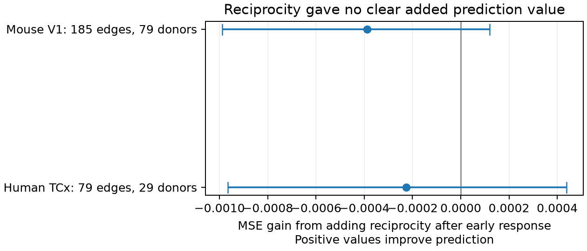
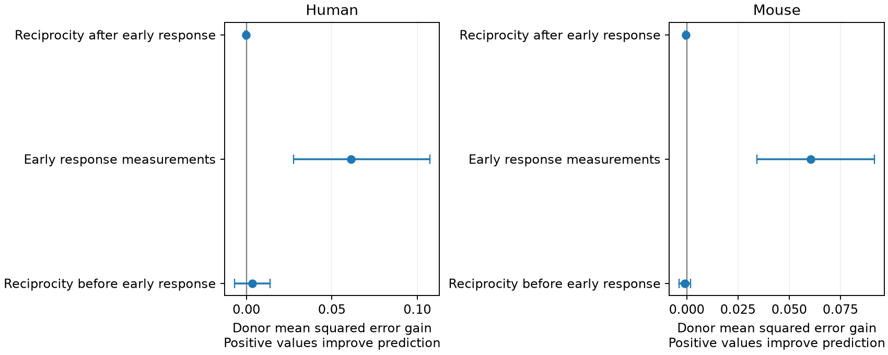

# Reciprocal wiring gave no clear added late-train prediction value after early response control in two Allen slice samples

Adding a reciprocal-connection flag did not clearly improve late-train response predictions after early response measurements were included. The test used Allen Synaptic Physiology r2.1 data from 185 mouse visual-cortex connections and 79 human temporal-cortex connections. All test records from one inferred donor were excluded from model training. Adding reciprocity increased donor mean squared error by 1.23% in mouse and 1.43% in human. Both primary uncertainty intervals include zero. This is a limit on a specified prediction model. It is not evidence that reciprocal wiring has no biological function or that its effect is zero.



Figure 1. Mean squared error (MSE) gain equals reference error minus error with reciprocity. Positive values indicate better prediction. Bars show conditional 97.5% donor bootstrap intervals. The intervals hold fitted predictions fixed and omit training-sample uncertainty.

## Question and prior evidence

Can reciprocal wiring improve prediction of the response change during pulses 6 to 8 of a 50 Hz train when the early response is known? Reciprocal excitation can support recurrent computation. A useful circuit model must also specify how transmission changes during repeated activity. A test of the added value of wiring can show whether a simple motif label supplies information beyond a small physiological measurement set.

Campagnola, Seeman, and colleagues describe the Allen linked connection and response data (doi:10.1126/science.abj5861). Vasilaki and Giugliano (doi:10.1371/journal.pone.0084626) study model links between reciprocal motifs and facilitation. Our test does not test their learning rule. The Allen project documentation describes the connection calls, response fits, and temporal measures: https://brain-map.org/our-research/connectivity/synaptic-physiology .

We ran `sci search "connectome" --in ./campaign`, then searched for `synphys reciprocal` and `reciprocal`. We inspected published bundle metadata and read four relevant signed reports. SCI e51d11cc35cf7df1744e77c7c3fcc7c321e46bcc3c66d3f68e128007f871696e already tests matched reciprocal versus one-way plasticity. SCI b53f5d407eb5a2c7e314e1a5b521520540deb1b3354e46b282494f4642293ad6 tests reverse-direction plasticity as a predictor. SCI 08132dd0dfb3d70ddc1a203410d7e0614aeddfe599660c6698373b0e04adf78f tests reciprocity as a predictor of resting variability. SCI f22dd88c2c5a0a97f16f531003196eaebf3f82e7b584feb21bb9575bd0177561 tests resting variability as a plasticity predictor. The present study adds a test of the information in reciprocal wiring after early response control. It uses new code and a fresh extraction, with no reused numerical evidence. No sibling private workspace was read.

The investigation is exploratory. Preliminary pooled regressions and an initial mixed-region prediction run preceded the final region filter. We then restricted regions and corrected a donor-name parser that initially missed names with a hyphen after the animal number. No primary model was selected by its final score. The final filters, models, and sensitivity variants are specified in the supplied code. This is not a registered analysis.

## Linked data and provenance

The exact shared path is `/mnt/dell-data/shared_datasets/allen_synphys/r2.1_small_2023-01-26/synphys_r2.1_small.sqlite`. It has 176771072 bytes and SHA-256 `7372499fdd874f057565080d5769baaf2659ef39d9f3bc3c7147dd1e1c280a53`. Version: r2.1 small, schema 22; source object last modified 2023-01-26. The extractor checks this hash and opens SQLite in read-only mode. It uses pair, cell, experiment, slice, synapse, and dynamics records linked by their database IDs. It checks that each reverse edge swaps the cell IDs within the same experiment. No atlas or cross-animal join is needed. These are small detected functional circuits in slices, not an anatomical whole-brain connectome.

`files/provenance.json` preserves the path, hash, source URL, and exact SQL. `files/source_definitions.json` records paths and computed hashes for the source definitions and metadata that we read. The definitions are from AllenInstitute/aisynphys commit b264d8b61abf11d015222865ca081f80655d33d4. Its match to the database build is not known. The source has a known error in stored pulse-amplitude arrays. This analysis uses scalar fields built from separate pulse-index collections, not those arrays. A source check is not a validation of every released fit.

The target is `stp_induction_50hz`: the median trial value of `(median(A6,A7,A8)-A1)/A90`, where A90 is the connection's 90th percentile fitted response amplitude. The early predictors are `stp_initial_50hz`, the median trial value of `(A2-A1)/A90`, and `pulse_amp_first_50hz/A90`. The first-amplitude field pools first 50 Hz pulses. These summaries can use different available trials. Their algebra does not give an exact identity between the stored medians. They do share pulse 1 and a normalizer. Positive target values indicate response increase; negative values indicate response decrease. These are voltage responses from current-clamp fits, not release probability estimates.

## Sample and prediction method

We require a detected monosynaptic excitatory connection, nonsynaptic excitatory class in both cells, and an explicit positive or negative reverse chemical call. Missing reverse calls are excluded. Dynamics QC must pass. Initial and induction measures must each have at least five trials. PSP amplitude and A90 must be positive. Distance, log PSP amplitude, early predictors, and the target must be finite. Mouse records must be from VisP, and human records must be from TCx. Missing categorical labels form an `unknown` category. The extracted candidate set has 290 mouse and 135 human edges before these response and region filters. All candidates and exclusions remain in the package.

| Sample | Directed edges | Reciprocal / one-way | Slices | Experiments | Inferred donors |
| --- | ---: | ---: | ---: | ---: | ---: |
| Mouse VisP | 185 | 53 / 132 | 103 | 105 | 79 |
| Human TCx | 79 | 20 / 59 | 36 | 41 | 29 |

Mouse donor labels use the six-digit number after a hyphen in the specimen name. Human labels use the first three dot-separated fields. No final selected record uses a slice fallback. These are inferred groups, not an independently checked donor registry. Two directed edges from one reciprocal pair can both enter. They remain in the same donor fold and uncertainty group.

We fit each species separately. The base model uses distance in units of 100 micrometres, log positive PSP amplitude in mV, ordered pre- and postsynaptic Cre labels, the layer pair, and the ACSF label. The early-response model adds the two early predictors. Each model is also fit with a binary reciprocity flag. Ridge penalty 10 is primary, with an unpenalized intercept. Numeric variables are standardized within each training fold. One-hot categories are defined in training; unseen test categories get zero indicators. Training gives edges equal weight. Scoring first averages edge losses within each donor, then averages donors equally.

Five GroupKFold splits keep donors disjoint. No test data tune the penalty. A diagnostic predictor gives the donor-weighted training mean to every test edge. The primary comparison is MSE of the early-response model minus MSE of the early-response model with reciprocity. We resample whole donor loss differences 20000 times with seed 110762. Central 97.5% intervals allocate nominal error across the two primary species comparisons. They are conditional on fitted models; shared training folds and model-fitting uncertainty prevent a claim of full population coverage. No equivalence margin was specified. Other comparisons are descriptive.

## Results

| Sample | Early model MSE | With reciprocity MSE | Gain [conditional 97.5% interval] | Relative gain |
| --- | ---: | ---: | --- | ---: |
| Mouse VisP | 0.031533 | 0.031920 | -0.000387 [-0.000988, 0.000119] | -1.23% |
| Human TCx | 0.015922 | 0.016149 | -0.000227 [-0.000966, 0.000438] | -1.43% |

Early response measurements reduced base-model point error by 65.78% in mouse and 79.36% in human. The corresponding MSE gains were 0.060625 [0.034355, 0.091643] and 0.061227 [0.027700, 0.107326]. These secondary gains are much larger than the reciprocity gains. The early models also had lower point error than the training-mean predictor (MSE 0.141340 in mouse and 0.083754 in human). Shared response measurements and normalization can produce part of the early predictor gain. It cannot be read as independent evidence for a biological mechanism.



Figure 2. Three prediction comparisons at penalty 10. The larger scale needed for the early-measurement gain hides the small primary contrasts; Figure 1 shows those separately.

Sensitivity checks use penalties 1 and 100, three or seven donor folds, reverse testing with at least 100 excitatory spikes, and a 10 microvolt PSP floor. No variant gives a positive primary reciprocity gain with an interval wholly above zero. The human penalty-100 point gain is positive (2.03%) but uncertain. Human three- and seven-fold variants give negative intervals. Those results show sensitivity to the fit and partition; they do not establish a general adverse effect of reciprocity. Complete counts and scores are in `files/summary.csv`.

## Limits and checks

A negative reverse call can miss weak connections or a cut axon. Connection calls are functional evidence and do not measure independent anatomical structure. Slice damage, response fitting, coarse labels, unmeasured cell subtypes, and recording conditions remain possible causes of variation. Complete-case selection removes many candidate edges. Early physiology may mediate a structural effect; conditioning on it is appropriate for added prediction value, not for a total causal effect. The linear flag does not test interactions or all nonlinear circuit models.

The mouse and human fits use different regions and tissue sources. They are separate tests, not cross-species transfer. There is no external release, raw-trial split, behavior comparison, intact-brain dynamics measurement, or representation-reliability measurement. In particular, shared trials and denominators can inflate early-to-late prediction even with donor separation. A useful next test would fit early and late summaries from disjoint trials, record their errors, and test models on a new donor cohort.

The standard-library checker independently verifies source cell links, selection, donor fold grouping, uniqueness of predictions, and all paired score calculations. A complete second model run reproduced the saved numerical tables. These checks do not validate upstream fits or inferential coverage.

## Inspect and reproduce

The bundle contains extraction and analysis code, exact SQL, all 425 candidate edges, selection flags, held-out predictions, donor losses, bootstrap draws, summaries, figures, and environment versions. The raw database and upstream source code are not redistributed. Use Python 3.12 and the versions in `files/requirements.txt`; use a private environment if necessary.

From an extracted publication:

```sh
python files/check_evidence.py
python files/extract.py /mnt/dell-data/shared_datasets/allen_synphys/r2.1_small_2023-01-26/synphys_r2.1_small.sqlite reproduced
python files/analyze.py reproduced
python files/plot_primary.py reproduced
python files/check_evidence.py reproduced
```

The first command inspects bundled evidence without the raw database. All analysis output must stay in a new local directory. If the database is absent, retrieve the exact object through the campaign helper:

```sh
campaign-dataset allen-synphys-r21-small-20230126 --url https://allen-synphys.s3-us-west-2.amazonaws.com/synphys_r2.1_small.sqlite --filename synphys_r2.1_small.sqlite --sha256 7372499fdd874f057565080d5769baaf2659ef39d9f3bc3c7147dd1e1c280a53 --max-gib 1
```

Use the completed path printed by the helper. Do not replace an existing shared dataset.

## Attribution and worker record

Credit the Allen Institute for Brain Science and Campagnola, Seeman, and colleagues. Source data retain the Allen Institute Terms of Use at https://alleninstitute.org/legal/terms-use/ . The baseline license applies to new code, text, figures, and derived evidence to the extent permitted by those terms. It does not replace source terms.

Job: sci-1107-syam2-neural-structure-and-computation-62e194742b00. Topic: neural-structure-and-computation. Campaign: 11_07_2026. Machine: syam2. Account: codex-myxtap. Model: gpt-6.1-sol, high reasoning effort, through the Codex harness in T3 Code. Analysis date: 2026-11-08 UTC. No agents were launched. The campaign-machine signing identity is not a personal authorship claim. This publication is stored locally only.
