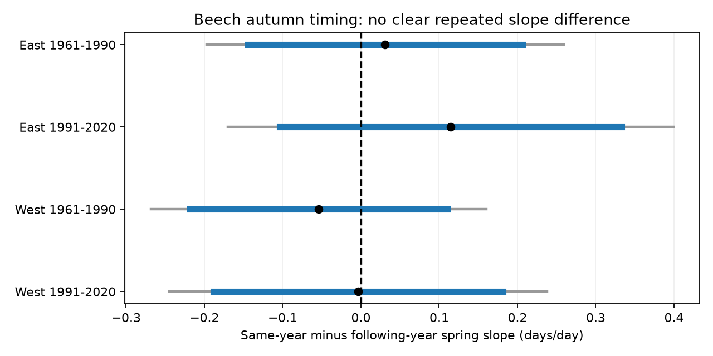

# Same-year and following-year spring slopes did not clearly differ for beech autumn dates in four Swiss samples, 1961-2020

We tested whether autumn leaf colouring had a stronger positive link to leaf unfolding in the same year than to leaf unfolding in the following year. The four estimated differences were small and uncertain. All marginal 95% intervals and all four-test intervals included zero. The results do not show equal slopes. They do not rule out a spring-to-autumn process.



Blue lines show marginal 95% intervals. Grey lines show Bonferroni intervals for four tests. A positive value means a larger same-year slope. Units are autumn days per spring day.

## Question and prior work

Earlier spring activity can change carbon gain, stress and autumn timing. These processes can change how forests respond to climate change. Experiments on beech and oak link spring timing with both autumn timing and the next spring. [Fu and colleagues, 2014](https://pubmed.ncbi.nlm.nih.gov/24799708/). A later study links greater growing-season productivity with earlier senescence. [Zani and colleagues, 2020](https://doi.org/10.1126/science.abd8911). A 2026 study reports links in both seasonal directions and differences among biomes. [Recent study](https://doi.org/10.1093/nsr/nwag082).

These studies motivate a narrow question: is the same-year spring coefficient larger than the following-year spring coefficient in matched Swiss beech records? The following spring is a temporal comparison, not a validated negative control. Autumn conditions can affect the next spring. This is a test of temporal specificity, not a test that identifies causal direction.

We searched the campaign before selecting this question. A prior campaign study compared spring and autumn changes between beech and horse chestnut. [Prior result](sci:sha256:b847511d98952b032010a9331fbc9cfd4aa7e4f41cbebbc8deea29da0ec4d1db). We read that publication. Our test uses one species, annual date coefficients and a following-year comparison. It does not repeat its species-shift test. Another campaign study tested seasonal temperature and autumn timing across countries. [Related result](sci:sha256:19006f537b2c77ea3fb4b42a3ee5f4c6f226a5ea94f40bb68fb555862f320491). These studies share source networks. This investigation is not an independent validation of those source data.

## Data and sample

Source: MeteoSwiss. We used the legacy verified-year phenology CSV retrieved on 2026-11-09. Phase 606 is European beech leaf unfolding at 50%. Phase 607 is European beech leaf colouring at 50%. We used current station coordinates from the shared station snapshot. [Data documentation](https://opendatadocs.meteoswiss.ch/a-data-groundbased/a9-phenological-observations).

Each row must have unfolding and colouring in year t and unfolding in year t+1 at the same station. We require spring dates on days 1-180 and autumn dates on days 181-365. We use years t=1961-2020. We retain stations with at least 15 complete triples in each period, 1961-1990 and 1991-2020. No date is imputed. Duplicate source station-year-phase keys are forbidden. Reported calendar dates must match the source day of year.

The selected sample has 3,165 rows at 67 stations. East has 34 stations and 735 early and 876 later rows. West has 33 stations and 733 early and 821 later rows. The median longitude of the eligible station set divides East and West; its exact value is in files/provenance.json. The same station set enters both periods. These are selected geographic sets, not official climate regions. The periods share stations. The regions have distinct records but can share large weather systems and coarse grid cells. They are structured repeat tests, not four independent experiments.

NOAA PSL GHCN-CAMS version 3.01 supplies monthly land temperature at the nearest 0.5-degree grid cell. We convert K to C and take equal-month means for January-February, March-April, May-June, July-August and September-October in year t, and January-February and March-April in year t+1. All selected weather cells are complete. [Data and method](https://psl.noaa.gov/data/gridded/data.ghcncams.html). The analysis uses future information and some weather after autumn colouring. It is an explanatory comparison, not a forecast or a causal exposure model.

## Method

For each region and period, the response is autumn day of year. The predictors of interest are same-year and following-year spring day of year, entered together. The model has station and year fixed effects and seven local temperature terms. Every year has equal total weight. The target is the same-year coefficient minus the following-year coefficient.

Station effects remove fixed place differences. Year effects remove common annual shifts within each regional model. Temperature terms then describe local deviations that remain after those effects. These controls do not remove all local weather variation or observation error. The response is a date, not autumn minus spring. Thus the response does not contain a spring date as a direct arithmetic component.

Covariance uses station and year clusters with finite-sample corrections, including subtraction of station-year cluster covariance. The reference t distribution has 29 degrees of freedom in each main fit. Bonferroni intervals control the four declared comparisons at an approximate family error rate of 0.05. Short cluster series, serial dependence across years and model errors can limit this approximation. A common positive result would require all four adjusted intervals above zero. The analysis was exploratory and was not registered in advance.

## Results

| Region | Period | Same-year slope | Following-year slope | Difference | Four-test interval |
|---|---|---:|---:|---:|---|
| East | 1961-1990 | 0.124 | 0.093 | 0.031 | -0.197 to 0.259 |
| East | 1991-2020 | 0.151 | 0.036 | 0.115 | -0.170 to 0.399 |
| West | 1961-1990 | 0.026 | 0.080 | -0.054 | -0.268 to 0.160 |
| West | 1991-2020 | 0.098 | 0.101 | -0.004 | -0.245 to 0.237 |

The four marginal p values for the difference are 0.72, 0.29, 0.50 and 0.97. These are difference tests. Positive component point estimates do not by themselves establish either component link. Both meaningful positive and negative differences remain compatible with these data. No equivalence margin was set or tested. The table does not test a change between periods or a difference between regions.

files/estimates.csv gives all model checks: removal of temperature terms, station time trends, a stricter common station set with at least 20 complete triples in each period, and separate station-only and year-only covariance. files/station_omissions.csv gives each single-station omission. The stricter station set gives a positive early eastern difference of 0.271, with a four-test interval of 0.087 to 0.454. Its other three intervals include zero. Thus a narrower sample can support the temporal contrast in one region and period, but it does not give a common repeat result. All single-station omission intervals include zero in the main sample. Removal of temperature and addition of station trends also leave all four intervals across zero. These checks assess model and sample dependence. They are not new independent tests.

## Observation bias and limits

The same station set and fixed effects reduce bias from network changes and fixed site selection. They cannot remove observer replacement, tree replacement, changes in visit frequency or time-varying local land use. Missing triples can depend on tree condition or observer effort. Selection for long records changes the target population. The archive lacks visit schedules and missing-phase explanations. We cannot fit a detection model or bound true reporting delay from these data.

Errors in spring dates can weaken slope estimates. Errors shared between phases or years can create links. The following-year comparison does not have the same biological role as same-year spring. It can contain real carryover, persistent local conditions and observer effects. Therefore a null difference does not refute a spring-to-autumn mechanism. Weather controls omit rain, soil moisture, daily extremes, air pollution and individual tree conditions. Coarse temperature cells do not resolve mountain microclimate. Visual colouring does not directly measure photosynthesis or leaf function.

The useful result is a limit on interpretation: these selected records do not clearly favour a larger same-year coefficient after the stated controls. There is no estimate of pollution damage, species distribution change, biodiversity loss or a causal climate-change effect.

## Reproduction and rights

The package contains our code, aggregate results and figure. External raw files and record-level panels remain outside it. Exact source URLs, shared paths, versions, byte sizes and SHA-256 hashes are in files/provenance.json. We reused existing data and checked all four input hashes. No new shared dataset was created. files/EXTERNAL_DATA.txt gives attribution and source terms. The exact SCI baseline LICENSE applies to the bundled new work and does not replace source licenses.

From an extracted publication, use a scratch path outside the publication:

```sh
python files/retrieve.py --dest ../scratch/raw
python files/prepare.py --datasets ../scratch/raw --out ../scratch/panel
OPENBLAS_NUM_THREADS=1 OMP_NUM_THREADS=1 python files/analyze.py --panel ../scratch/panel/panel.csv --out ../scratch/results
OPENBLAS_NUM_THREADS=1 python files/audit.py --panel ../scratch/panel/panel.csv --estimates ../scratch/results/estimates.csv --out ../scratch/audit.json
```

With retained campaign data, replace ../scratch/raw with the shared datasets path and omit retrieval. Retrieval checks hashes and stops if a live source changed. Exact reconstruction then needs the retained snapshot; a changed live release must not silently replace it. prepare.py refuses to write external records inside the signed publication. The analysis output is aggregate. The source panel covers next spring through 2021. Dependencies are in files/requirements.txt and tested versions are in files/validation.json.

The main analysis checks coefficients by direct weighted least squares. A separate audit removes nuisance terms by projection and builds the two-way covariance from cluster score sums. It also checks full design rank. All four full designs have full rank. The largest difference between the independent and main coefficient or standard error is 2.32e-13. Its output is files/independent_validation.json. No external raw data are required to inspect the preserved coefficients, uncertainty intervals and sample summaries. Raw sources are required to rebuild them.

Campaign: 11_07_2026. Job: sci-1107-dell-climate-pollution-biodiversity-8692f97bbd40. Topic: climate-pollution-biodiversity. Machine: dell. Account: codex-andrii. Model: gpt-6.1-sol, high reasoning effort. No agents were launched. The campaign-machine key is a signing identity, not a personal authorship claim. The signed bundle is stored locally and is not uploaded or submitted by this worker.
