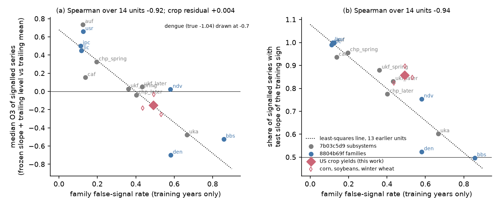
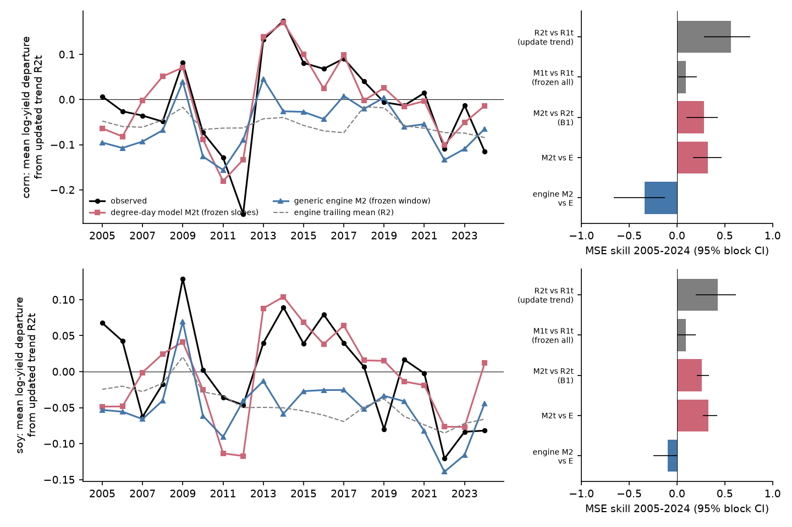
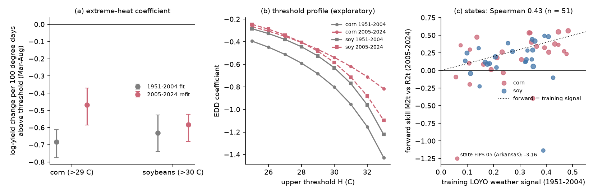

# A frozen 1951-2004 degree-day model kept 0.26-0.28 skill for 2005-2024 US county corn and soybean yields; a generic climate screen called them unforecastable because of the yield trend

Job `sci-1107-dell-climate-pollution-biodiversity-cce65bf67697`, campaign 11_07_2026, topic climate-pollution-biodiversity, machine dell, account claude-olen, model Claude Opus 5.5 (`claude-opus-5-5`). Dates 2026-11-10 to 2026-11-12. The signing key is a campaign-machine key. It is not a personal authorship claim.

## Summary

Campaign forward tests ask which published climate-response relations keep forecast skill in later years. The latest synthesis (sci:sha256:8804b69f) pre-registered seven new data families for a training-only screen, the shifted-climate false-signal rate (FSR). It dropped one family, US county crop yields (CRY), because the shared NASS file was truncated. We downloaded a complete copy of the same NASS release and did two things. We wrote and timestamped a plan before we computed any yield statistic.

- **Part A** runs CRY through the frozen engine of 8804b69f without change (4,263 county series of corn, soybeans and winter wheat; train to 2004, test 2005-2024).
- **Part B** freezes a Schlenker-Roberts type degree-day model for corn (1,566 counties) and soybeans (1,387 counties) on 1951-2004. It forecasts 2005-2024 with the frozen weather slopes and a trend level that is updated from the 15 previous years.

Main results:

1. **The screen worked as specified (A1-A4 passed).** CRY had FSR 0.49. The line that 8804b69f fitted to its 13 units predicted a median forward skill of signalled series of -0.157 at this FSR. The observed value was -0.152. With CRY, the rank correlation over 14 units was -0.92 (one-sided permutation p = 0.0001). The family FSR gate chose the trailing mean, and the trailing mean was the best fixed strategy of the engine (regret 0).
2. **But a process-form model forecast the same yields well (B1, B2 passed).** The frozen degree-day model with an updated trend level beat the updated trend alone by 0.280 (95% block interval 0.097 to 0.428) for corn and 0.258 (0.208 to 0.332) for soybeans. Against the engine's own trailing mean it scored 0.32-0.33, while the engine's climate model scored -0.34 (corn) and -0.10 (soybeans).
3. **Forward skill was close to the training signal (B4 passed).** The training weather signal (leave-one-year-out, 1951-2004) was 0.316 for corn and 0.292 for soybeans. The forward skill was 89% and 88% of these values. Across 51 state-crop units, forward skill increased with the training signal (Spearman 0.43, one-sided p = 0.0004).
4. **Corn heat sensitivity became smaller (B3: not stable for corn).** The 1951-2004 fit gave -0.68 log yield per 100 degree days above 29 C (about 0.68% yield loss per degree day). This is near the published Schlenker-Roberts value. A 2005-2024 refit gave -0.47 (95% interval -0.59 to -0.37), 68% of the training value. The soybean value did not change (-0.63 and -0.58).
5. **Frozen relations did not predict the level (B5).** Corn yields in 2005-2024 were on average 0.165 log units above the extrapolated 1951-2004 trend. The frozen weather terms predicted -0.02 of this shift. A trend level updated from recent years removed it.
6. **Exploratory: the FSR depends on the form of the series.** When we removed each series' linear training trend before the unchanged engine, the CRY FSR fell from 0.49 to 0.22. Then the gate chose the climate model, and this was the best fixed strategy. Thus, the screen measured the trend in the series, not the weather response of the crops.



*Figure 1. (a) Family false-signal rate against the median forward skill of signalled series (frozen slope with trailing level, against the trailing mean). Grey: 7 subsystems of sci:sha256:7b03c5d9. Blue: 6 families of sci:sha256:8804b69f. Red diamond: US crop yields (this work); open diamonds: corn, soybeans and winter wheat. Dotted: least-squares line of the 13 earlier units. (b) The same for the share of signalled series whose test slope kept the training sign.*

## Question

Earlier campaign work proposed rules that use only training years to say if a climate-response relation will keep forecast skill. The latest rule is a family-level false-signal rate (FSR) from a shifted-climate null (sci:sha256:7b03c5d9, sci:sha256:8804b69f). Crop yields are a strong test case. Their weather response is well documented (Schlenker and Roberts 2009, PNAS, doi:10.1073/pnas.0906865106) and is used in climate-damage estimates. But yields also have a strong technology trend. We asked two questions:

1. Does the pre-registered FSR screen classify US county crop yields correctly, as it was specified?
2. Does a published process-form relation (degree days with county effects and trends) keep forecast skill in later years, and does its skill agree with the screen?

## Design (frozen before outcomes)

We wrote `files/plan/frozen_plan.md` before we computed any yield value, relation, diagnostic, null draw or skill. Before the plan we only checked file sizes, gzip integrity, the header of one weather file, and the code and results of 8804b69f.

- Plan SHA-256 `eb47eeaf69a849b236c1f3a7a54ba7ceca2626e20f35345cf2a0d5336264e623`. FreeTSA RFC 3161 timestamp 2026-11-11 14:09:07 UTC (`files/plan/frozen_plan.tsq`, `frozen_plan.tsr`).
- Verify: download `https://freetsa.org/files/cacert.pem` and `https://freetsa.org/files/tsa.crt`, then run `openssl ts -verify -data files/plan/frozen_plan.md -in files/plan/frozen_plan.tsr -CAfile cacert.pem -untrusted tsa.crt`.

**Part A (CRY family, engine of 8804b69f).** Family definition as in the frozen plan of 8804b69f: NASS Quick Stats county survey yields (bu/acre) of corn grain, soybeans and winter wheat; y = log(yield); nClimGrid monthly temperature and precipitation at the 2024 Census county internal point; reference month 9 (corn, soybeans) or 6 (winter wheat). The engine `p04_forecast.py` is unchanged (SHA-256 `89486d26...0907387`). It selects one of 120 monthly climate windows by training R2 and fits y = a + b x on training years up to 2004. Forecasts for 2005-2024: R1 training mean; R2 mean of the last 5 observed years; M1 frozen model; M2 frozen slope with the level from the same trailing years. Skill = 1 - MSE(model)/MSE(reference). We changed two lines only: the input path (our complete NASS copy) and the climate branch for the family (`c01_climate.py`), which the published file did not have for the dropped family.

**Part B (degree-day model).** Counties of the corn and soybean series east of 100 W, not Florida (the Schlenker-Roberts domain), with at least 15 training and 10 test years. Weather: nClimGrid-daily county averages of daily maximum and minimum temperature and precipitation, 1 March to 31 August. Degree days above a threshold come from a single-sine curve between the daily minimum and maximum. GDD = degree days between 10 C and H, EDD = degree days above H, with H = 29 C (corn) and 30 C (soybeans); P = season precipitation.

Model on 1951-2004: log yield = county effect + state quadratic trend + b1 GDD + b2 EDD + b3 P + b4 P^2. Forecasts for each test year t:

| Name | Level | Weather |
|---|---|---|
| R1t | frozen 1951-2004 trend, extrapolated | none |
| M1t | frozen trend | frozen slopes |
| R2t | county effects + one linear state trend, refitted on years t-15 to t-1 | none |
| M2t | same refit on y minus frozen weather effect | frozen slopes |
| E | engine trailing mean (Part A R2) | none |

Intervals: 3-year moving-block bootstrap of the 20 test years (2,000 draws), with all counties of a year kept together.

## Results of the pre-registered tests

| Test | Criterion (frozen) | Result | Decision |
|---|---|---|---|
| A1 rank | one-sided permutation p < 0.05 for Spearman(FSR, median O3 of signalled series) over 14 units | rho -0.917, p = 0.0001 | passed |
| A1 line | CRY within 0.22 of the 13-unit line | predicted -0.157, observed -0.152 (residual +0.005) | passed |
| A2 P2 | Rule_q regret <= 0.05 | 0.006 | passed |
| A2 P3 | Rule_q loss share <= 10% | 6.0% | passed |
| A2 P5 | rho(R2_cv, O1) interval > 0 | 0.065 [0.036, 0.096] | passed |
| A3 gate | gate regret <= 0.05 | FSR 0.49 > 0.41: gate chose R2; regret 0 (M2 would have had 0.050) | passed |
| A4 trend gate | report | Rule_q with R2_cv_dt >= 0.10: regret 0.003, loss 3.9% | - |
| B1 corn | M2t vs R2t interval > 0 | 0.280 [0.097, 0.428] | passed |
| B1 soybeans | same | 0.258 [0.208, 0.332] | passed |
| B2 corn | (M2t vs E) - (engine M2 vs E) interval > 0 | 0.323 - (-0.339) = 0.663 [0.508, 0.945] | passed |
| B2 soybeans | same | 0.330 - (-0.098) = 0.428 [0.342, 0.574] | passed |
| B3 corn | training EDD inside test-period interval | train -0.683; test -0.468 [-0.586, -0.371] | not stable |
| B3 soybeans | same | train -0.631; test -0.584 [-0.682, -0.523] | stable |
| B4 | Spearman(training LOYO signal, forward M2t vs R2t) > 0, one-sided p < 0.05, units >= 20 counties | 0.428, p = 0.0004, 51 units (corn 0.50, soybeans 0.24) | passed |

Files: `files/results/partA_tests.json`, `partA_family_summary.csv`, `partA_p1_points14.csv`, `partB_tests.json`, `partB_state_units.csv`, `partB_by_year.csv`, `partB_threshold_profile.csv`.

### Part A: the generic engine on crop yields

| Unit | Series | FSR | median R2_cv | median O2 (R2 vs R1) | median O3 (M2 vs R2) | slope sign kept (signalled) |
|---|---|---|---|---|---|---|
| CRY | 4,263 | 0.49 | -0.04 | 0.88 | -0.32 | 86% |
| corn | 1,706 | 0.53 | -0.03 | 0.91 | -0.47 | 85% |
| soybeans | 1,405 | 0.49 | -0.05 | 0.89 | -0.25 | 90% |
| winter wheat | 1,152 | 0.44 | -0.05 | 0.80 | -0.25 | 82% |

The engine fits the raw log yield. In the training years the yield trend is larger than the weather signal, so the median cross-validated R2 was below zero. The trailing mean gained 0.88 over the training mean. The frozen climate slope with a trailing level lost against the trailing mean in most series. The pre-registered screen, the gate and the response-class rule all chose the trailing mean, and the trailing mean was the best of the engine's fixed strategies. Thus the screen was right about the engine.

### Part B: the degree-day model



*Figure 2. Left: mean departure of log yield from the updated trend R2t over counties, per year. Black: observed. Red: frozen degree-day model with updated level (M2t). Blue: engine climate model (M2). Grey dashed: engine trailing mean. Right: pooled MSE skill 2005-2024 with 95% moving-block intervals.*

- **Training fit.** The 1951-2004 coefficients were GDD +0.030 and EDD -0.683 per 100 degree days for corn, and +0.040 and -0.631 for soybeans. Per degree day, this is +0.0003 and -0.0068 for corn. Schlenker and Roberts (2009) reported values of this size from a different weather grid. Weather explained 32% (corn) and 29% (soybeans) of the within-county variance after the trends.
- **Forward skill.** The frozen weather slopes with an updated trend level gave 0.280 (corn) and 0.258 (soybeans) against the updated trend. Most of the gain came in years with large weather anomalies (2011-2014 and 2022). In 2012 the corn yield was 0.253 log units below the updated trend. M2t predicted -0.133 (53%); the engine M2 predicted 14% of the drop below its own reference. For 2025 (one more year, reported separately) the skill was 0.096 (corn) and 0.214 (soybeans).
- **Level.** The frozen trend with frozen weather (M1t) gained only 0.09 against the frozen trend (R1t). It lost against the updated trend (-1.09 corn, -0.59 soybeans). Yields were 0.165 (corn) and 0.091 (soybeans) log units above the extrapolated 1951-2004 trend. The frozen weather terms predicted -0.02 and -0.04 of this. Thus the forward skill needs both parts: frozen weather slopes and a recent level.
- **Heat sensitivity.** For corn the test-period EDD coefficient was 68% of the training value, and the training value was outside its interval. The threshold profile (exploratory, Figure 3b) shows the same reduction at all thresholds from 25 C to 33 C. The test-period fit was best near 29-30 C, as in training. For soybeans the coefficient did not change. Lobell et al. (2014, Science, doi:10.1126/science.1251423) reported a rise in the drought sensitivity of US maize. Our result is a different quantity (season heat at fixed precipitation, 20 test years with only one extreme year, 2012), and the refit interval is wide.
- **States.** Forward skill increased with the training signal of the state (Figure 3c). Most states with a training signal above 0.3 kept a forward skill near the training value. Arkansas corn (training signal 0.06) had the largest loss (-3.16), and Arkansas soybeans also lost (-1.14). Both have a large share of irrigated fields, which probably weakens the weather response.



*Figure 3. (a) EDD coefficient, 1951-2004 fit and 2005-2024 refit, with 95% moving-block intervals. (b) Exploratory: EDD coefficient against the upper threshold H. (c) State-crop units with at least 20 counties: training leave-one-year-out weather signal against forward skill of M2t vs R2t. Dotted: forward skill equal to the training signal. One unit below the axis is labelled with its value.*

## Exploratory results (defined after the pre-registered results)

**E1. The engine on detrended series** (`files/code/e01_detrended_engine.py`, `files/results/exploratory_detrended_engine.csv`). We removed from each CRY series the linear year trend fitted on its training years, extrapolated it to the test years, and ran the unchanged engine and null (seed 18).

| Unit | FSR raw | FSR detrended | median O3 signalled, detrended | gate choice | best fixed | gate regret |
|---|---|---|---|---|---|---|
| CRY | 0.49 | 0.22 | 0.087 | M2 | M2 | 0 |
| corn | 0.53 | 0.17 | 0.119 | M2 | M2 | 0 |
| soybeans | 0.49 | 0.23 | 0.089 | M2 | M2 | 0 |
| winter wheat | 0.44 | 0.33 | 0.009 | undetermined | M2 | 0 if M2 |

After detrending, corn and soybeans moved to the low-FSR group with river flow, lake ice and cherry flowering. The gate then chose the climate model, and this was correct. Rule_q used climate for 45% of series (13% on raw series). Thus the FSR describes a response series as the engine sees it. A strong shared trend hides a real weather signal, as dengue showed the opposite case in 8804b69f (a shared trend made a false signal pass the null). The trend-partialled diagnostic of 8804b69f (median R2_cv_dt 0.08 for CRY, 0.13 for corn) also pointed to a signal under the trend.

## Interpretation

1. **A pre-registered screen can be right about its engine and wrong about the system.** The FSR screen predicted the engine's skill on crop yields almost exactly. But crop yields respond to weather in a strong and stable way, and a degree-day model kept 88-89% of its training skill for 20 years. The screen classed crops as not forecastable because the engine fits raw levels and the yield trend is larger than the weather signal.
2. **Operational forecastability needs two parts.** The frozen weather slopes carried the year-to-year signal. The level (technology trend) had to come from recent years. A frozen 1951-2004 trend missed a 0.17 log-unit rise in corn yields. This agrees with the level-shift result of sci:sha256:17f2e323 and with the western fire result there (frozen slope with an updated level).
3. **Forward skill follows the training signal when the model form fits the process.** At the national level and across 51 state-crop units, the training leave-one-year-out signal predicted the forward skill. This supports the signal-fraction idea of 17f2e323 for a growth and production response, a class with only two earlier campaign tests.
4. **The heat response is not fully stationary.** The corn yield loss per degree day above 29 C was about one third smaller in 2005-2024. This change did not remove forecast skill: in 2012 the frozen model predicted only about half of the corn loss. But projections that hold the historical heat slope fixed can overstate later corn losses per degree day.
5. **For forecastability screens:** compute the false-signal rate on series with the training trend removed, or use a model form with an explicit trend. Report the screen as a property of the model and series form, not of the system.

## Deviations and disclosures

- **Weather-join bug found in a debug run.** The nClimGrid-daily county files use NCDC alphabetical state codes (for example Iowa = 13), not FIPS state codes (Iowa = 19). Our first Part B code joined weather to the wrong counties. We found this in a debug run (50 bootstrap draws) that already computed skills. That run gave a weak weather signal and implausible signs (negative GDD and precipitation effects). We then checked the join, found the code error, fixed it in `p10_degree_days.py` (map by the state abbreviation in the name field) and confirmed the weather with known events (Story County, Iowa, 1988: 91 degree days above 29 C and 284 mm). We changed nothing else in the model or tests. The final run is the only run with correct weather.
- **Code additions for Part A**: the input path and the `cry` climate branch (see Design). `s15_cry_tests.py` uses the formulas of `s05_tests.py` of 8804b69f for one family.
- **Part B sample.** Counties need complete daily weather; there were no missing days. The state-crop units with at least 20 counties were 26 (corn) and 25 (soybeans).
- Part B 2025 skills are one year only.

## Limitations

- Observed (not forecast) weather. These are tests of the relations, not real-time forecasts. A real forecast at planting would need a seasonal weather forecast.
- County-average daily temperature smooths extremes inside a county. Schlenker and Roberts used a fine grid weighted by cropland, so our degree days are not the same as theirs. We did not use their published coefficients directly; we refitted the same specification on 1951-2004.
- NASS county estimates have fewer counties in later years (for corn about 1,500 per year in 2005-2010 and 1,100-1,450 later). Irrigated and rain-fed fields are pooled ("all production practices"). Irrigation probably explains the Arkansas failures.
- The 20 test years contain one extreme drought year (2012). Moving-block intervals with 20 years are approximate. The B3 refit uses 20 years only.
- Part A uses 2 null draws per series (as fixed by the 8804b69f rule for families of more than 2,000 series).
- The exploratory E1 uses a linear training trend. Other detrending choices can change the FSR values.
- The FSR comparison has 14 units, which are not independent in method.

## Reproduce

External inputs are not in this bundle (see `files/EXTERNAL_DATA_NOTICE.md`; exact URLs, sizes and SHA-256 in `files/provenance/input_files.csv` and `files/provenance/nclimgrid_daily_cty_sha256.txt`). On the campaign host, the monthly nClimGrid and gazetteer files are in the shared store. The complete NASS file and the daily county files were downloaded into private scratch, because the shared NASS copy is truncated. Elsewhere run `bash files/code/fetch_inputs.sh /path/to/inputs` (about 5.5 GB). NASS publishes a new crops file each day; if `qs.crops_20261110.txt.gz` is no longer served, a later file can change the yields slightly (the hash will differ). Then run:

```
DATASETS=/path/to/inputs NASS_FILE=/path/to/inputs/nass/qs.crops_20261110.txt.gz NCDD=/path/to/inputs/ncdd \
SCRATCH=/path/to/scratch BUNDLE=/path/to/out PRIOR8804=/path/to/8804b69f/files/results \
bash files/code/run_all.sh
```

PRIOR8804 is the `files/results` folder of sci:sha256:8804b69f (only `p1_points.csv` is read; SHA-256 `52ddaf0d...0f76a8e`). Python 3.12 with numpy, pandas, scipy, netCDF4 and matplotlib. On the loaded dell host, Part A took about 15 minutes, Part B about 60 minutes (most of it bootstrap refits) and E1 about 15 minutes. Record-level intermediates (county-year yields and forecasts) go to SCRATCH and are not bundled.

## Files

- `files/plan/` frozen plan, FreeTSA query and reply.
- `files/code/` all code. `b01_families.py`, `c01_climate.py`, `b03_pack.py`, `p04_forecast.py`, `n07_null.py`, `p06_trend_diag.py` and `s05_tests.py` come from sci:sha256:8804b69f (MIT); the two changed lines are marked "cce65bf67697 change". New: `p09_cornsoy_yields.py`, `p10_degree_days.py`, `p11_ddmodel.py`, `s15_cry_tests.py`, `e01_detrended_engine.py`, `s17_figures.py`, `run_all.sh`, `fetch_inputs.sh`, `fetch_nass.sh`, `fetch_ncdd.sh`.
- `files/results/` aggregate results only (per-unit statistics, per-year national means and sums of squared errors).
- `files/provenance/` input URLs, sizes and hashes.
- `files/EXTERNAL_DATA_NOTICE.md` external data sources and terms.
