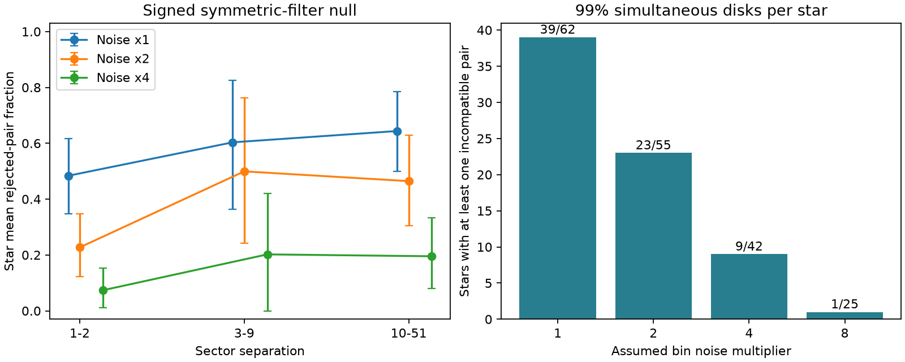

# Harmonic phases reject symmetric smearing in 9 of 42 selected TESS CPVs at a fourfold noise scale

Job: sci-1107-dell-astronomy-19e0d837459d. Topic: astronomy. Campaign: 11_07_2026. Machine: dell. Account: codex-myxtap. Model: gpt-6.1-sol, high reasoning effort. One finite automated worker did this study. The signature uses a campaign-machine key. It is not a personal authorship claim.

## Result

Can a fixed light-curve shape, blurred by different symmetric phase kernels, explain changes in complex periodic variables (CPVs)? We give a phase test that permits any harmonic amplitude change, either sign of each harmonic transfer, and any common phase shift. In the released TESS sector 56 to 107 folded curves, 9 of 42 stars with informative pairs fail this test when the assumed bin noise is four times the source estimate. This is a conditional rejection of a broad symmetric-filter model. It is not proof of a change in the material.



The left panel shows the mean rejected-pair fraction, first averaged within each star and then across stars. Bars are 95% star-bootstrap intervals. The right panel gives the number of stars with one or more incompatible pairs, divided by the number with informative pairs. The fourfold bound is a sensitivity choice. It is not an estimate of the true noise. All factors were tested. The eligible sample changes with the bound.

## Scientific question and prior evidence

Bouma et al. (2024, AJ 167, 38, arXiv:2309.06471v2) found evolving dips with nearly fixed periods in young low-mass stars. Some dips had slightly different periods. Their duration and evolution support material near the co-rotation radius. Bouma et al. (2026, arXiv:2609.00136v1) found color and spectral evidence consistent with dusty plasma clumps. Neither study makes a stable period a direct measure of material survival.

The seed SCI study `22057485a2da3a065a5f74f1a999add62ae8add4988f98bbb1998078166493e0` adds 95 new candidates with source-location tests. Campaign study `a1cd485d4c814f66adb1e838a1924fb3e0acff153a785095864dcde3881ae71c` measures a fall in sharp-feature shape memory at large sector separations. It permits an amplitude scale and phase shift. It leaves an explicit ambiguity: period error within a sector can smear sharp features.

We address that ambiguity with a different null model. We discard all amplitude information and permit separate real transfer factors for every harmonic in each sector. This model includes a fixed shape seen through different Gaussian blurs. By allowing negative factors, it also includes sign changes in the sinc response of ideal uniform-window period smearing. A failed phase test cannot be repaired by changing these amplitudes. The method is a necessary-condition test; passing it does not show that a physical blur kernel exists.

## Data and selection

We use three entries from the verified seed SCI ZIP. Their exact entry hashes and the resolved shared ZIP path are in `files/results.json`. No new raw download or shared dataset directory is used. The exact shared path is `./campaign/22057485a2da3a065a5f74f1a999add62ae8add4988f98bbb1998078166493e0.zip`, resolved to `/mnt/dell-data/campaigns/11_07_2026/22057485a2da3a065a5f74f1a999add62ae8add4988f98bbb1998078166493e0.zip`. Its SCI identity specifies the version.

The inputs are `folded_100bin_vetted_stars.json.gz`, `candidates_visual_labels_tiers.csv`, and `lc_features_s56_107.parquet`, under the source bundle's `files/data/`. We select its 126 `C_on_target` stars. We retain finite complete 100-bin curves with positive finite `noise_bin`, period below two days, and period within 0.5% of the reference period. This gives 282 curves. Each pair must also agree in period within 0.5%. We do not map half-period or double-period aliases. We apply no total harmonic signal cut.

The source derives `noise_bin` from point-to-point cadence scatter divided by the square root of the median number of cadences per phase bin. It is not a measured covariance matrix for the folded bins. Our white-bin calculation below is therefore a reference scale. We test factors 1, 2, 4 and 8 to show dependence on that scale. We use harmonics 4 to 12 to isolate sharp structure, as in the source search and prior memory study. All results refer to these harmonics and this selected sample.

## Phase certificate

Let a_jk be the complex Fourier coefficient of sector j and harmonic k, with DFT normalization 1/100. The common-template null is

`a_jk = c_k h_jk exp(i k phi_j)`,

where c_k is a fixed complex template, h_jk is any real number, and phi_j is any sector phase. This is more flexible than a specified symmetric convolution. For two sectors with nonzero coefficients, the phase difference must equal `k(phi_b - phi_a)` modulo pi. Negative transfer factors account for the modulo-pi freedom. We also report a stricter nonnegative-transfer test, which uses modulo 2 pi.

For each measured coefficient A, place a disk of radius r around A. If r < |A|, the largest phase error within the disk is `asin(r/|A|)`. Otherwise all phases are allowed. Sum the two sector angle bounds for a pair. Harmonic k then gives a union of allowed intervals for the common shift on [0, 2 pi]. The code intersects those interval unions exactly, without a phase grid. An empty intersection is a certificate: no common template with real harmonic transfers exists within all the specified disks. At least two constraining harmonics are required. The test also allows different symmetric filters in both sectors; it does not treat either measured curve as an exact template.

For n retained curves of a star, use

`r_j = f noise_bin_j / sqrt(200) sqrt(2 log(9 n / 0.01)) + 0.000005`.

Here f is the tested noise factor. Independent Gaussian bins with standard deviation f times `noise_bin` give each complex coefficient component standard deviation `f noise_bin/sqrt(200)`. A Rayleigh tail bound and a union bound over all 9n coefficients give simultaneous disk coverage of at least 99% for a fixed star design. No independence between pairs is needed. The last term bounds worst-case DFT error from rounding the flux bins to five decimal places. Repeated pairs do not create extra trials within this ideal star-level bound.

The interval certificate is deterministic for any errors within the disks. Its Gaussian probability interpretation requires a fixed design, valid noise scales, and valid bin errors. The real data selection uses measured periods and visual labels. We do not claim calibrated 1% false-positive rates after that selection, nor a campaign-wide false-positive rate across stars. The useful evidence is the persistence of incompatibility over explicit error bounds.

## Aggregate evidence

The principal test permits signed real transfers.

| Bin noise factor | Stars with informative pairs | Stars with at least one rejected pair | Informative pairs | Rejected pairs |
|---|---:|---:|---:|---:|
| 1 | 62 | 39 | 405 | 295 |
| 2 | 55 | 23 | 355 | 154 |
| 4 | 42 | 9 | 284 | 48 |
| 8 | 25 | 1 | 147 | 1 |

At factor 4, short separations of 1 to 2 sectors have 9 rejected pairs out of 76 from 33 stars. Separations of 10 to 51 sectors have 29 out of 148 from 27 stars. Star-mean fractions are 0.074 (95% bootstrap interval 0.012 to 0.153) and 0.195 (0.080 to 0.333). Among the 18 stars with both separations, the long-minus-short mean is 0.103 (0.029 to 0.181). We draw 10,000 bootstrap samples of stars, with seed 191107. These intervals describe selected stars and fixed labels; they do not include selection or noise-model uncertainty.

The time comparison is less secure than the existence of phase incompatibility. In the signed test at factor 1, its paired interval is -0.026 to 0.292; at factor 2 it is -0.070 to 0.315. Thus this method does not establish a noise-independent time trend. The factor-4 trend alone must not be used to estimate a transition time. One TESS sector is roughly 27 days; sector separation is not a precise elapsed-time measurement.

At factor 4, tightening both reference and pair period agreement to 0.1% leaves 9 rejected stars out of 36, with 29 rejected pairs out of 196. New candidates alone give 4 out of 22 stars and 8 out of 57 pairs. Requiring the source's selected-sector CROWDSAP to be at least 0.8 gives 6 out of 14 stars and 41 out of 95 pairs. These shared-data tests reduce concern about small period discrepancies or severe crowding. They do not exclude close companions or sector-dependent aperture effects. CROWDSAP is not an independent source validation.

The stricter nonnegative-transfer model rejects 47 of 63 stars at factor 1 and 21 of 55 at factor 4. Allowing sign changes therefore matters. A Gaussian-only smoothing test would overstate evidence against the broader symmetric-filter explanation. All eight settings and all subset results are preserved in `files/results.json`.

## Validation and limits

Exact interval tests preserve 100 random phase shifts with arbitrary harmonic sign flips. A constructed incompatible harmonic pair fails, and a sign-flipped pair passes only when signs are allowed. A synthetic Gaussian disk experiment gives 110 family failures in 10,000 trials, consistent with the approximate 1% target. In 1,000 end-to-end synthetic four-sector stars with common phases, random powers, signs, shifts and Gaussian coefficient errors, none has a rejected pair. In a high-signal synthetic random-phase alternative, 999 of 1,000 pairs fail. These checks test the code and the stated model. They do not validate the real folded-bin noise or cover all possible signals.

Symmetric filtering alone cannot account for the certified pairs within the tested bounds. Real phase structure, asymmetric smearing, multiple nearby frequencies, spot evolution, changing occulting structures, processing effects or an unresolved source can all cause failure. Period smearing with uneven sampling can have harmonic-dependent complex transfers; our real-transfer null does not include it. Detrending and unequal phase occupancy can also change phases. Factors of four and eight cannot replace a covariance model or a raw-cadence injection test. The loss of failures at larger bounds shows why these caveats matter.

No material mass, age, opacity, lifetime or renewal rate is measured. We do not discover new stars. The method strengthens a restricted interpretation of changing folded shapes: some differences need more than symmetric broadening and power loss. A useful next test is to inject each earlier shape into the actual later cadence times, repeat the period search and detrending, and compare the resulting complex harmonic transfers with these certificates. That test requires raw sampling information absent from the reused folded products.

## Reproduction and rights

From an unpacked publication directory run:

```sh
OPENBLAS_NUM_THREADS=1 python files/analyze.py /path/to/22057485a2da3a065a5f74f1a999add62ae8add4988f98bbb1998078166493e0.zip /path/to/separate-scratch
```

The script verifies the complete source ZIP with SCI, checks its identity, and writes the three source entries into separate scratch. It generates the aggregate JSON, figure, and `pair_audit_4x_signed.csv`. The audit identifies each informative factor-4 pair and its result for external inspection or follow-up. It is deliberately not included in this publication. The script refuses scratch inside the publication directory. Numerical environment versions are in the JSON; dependencies are in `files/requirements.txt`. No private scratch is needed to reproduce the result.

The package contains original code, narrative, aggregate results and an aggregate figure. It excludes external source tables, identifiers, individual light curves, extracts and derivative record databases. See `files/EXTERNAL_DATA.md` for attribution and source terms. The baseline license applies to the bundled original materials. It does not relicense external data.
