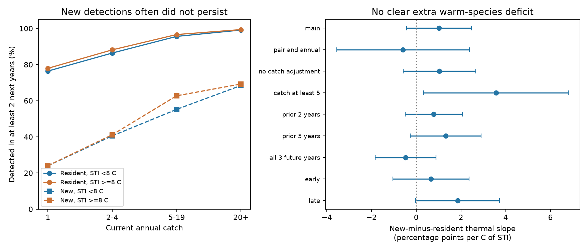

# Finnish moth detections did not show an extra warm-species persistence deficit in the main test

## Result

We tested whether warm-affinity moths have a larger recorded persistence deficit after a new detection than cold-affinity moths. The main test did not show this extra deficit. Its estimate was +1.02 percentage points per C of species temperature index (STI), with a nominal 95% interval from -0.43 to +2.48. A positive value means that the new-minus-resident persistence difference becomes less negative for warmer-affinity species.

The test used 95,813 species-site-year records, including 13,246 new detections, at 61 Finnish sites in 1996-2019. Of the new detections, 30.8% were detected in at least two of the next three years. The rate was 93.4% for resident detections. New detections were rare: 66.5% had a catch of one moth. This raw contrast does not identify failed establishment.

We give an exact counterexample to that inference. Independent annual Poisson observations of populations with constant but different catch rates can produce a large persistence contrast at the same current catch. There is no colonisation, extinction or change in any rate in this example. This is a mathematical possibility, not a fit to the Finnish data.



## Question and prior work

Weak transfer of spatial thermal gradients to temporal community change could reflect limited arrival, poor establishment, stable habitat constraints or observation error. The Finnish moth scheme is a useful contrast. A campaign study found a near-spatial response in its community summaries (SCI 6d955436). A later study assigned most count-weighted thermal change to resident composition at 21 long-running sites (SCI 2293cc6a). Another study tested nearby detection supply before local reappearance (SCI 456e68f6). These studies use overlapping source records. They are not independent monitoring programmes.

Ellis et al. (2025, DOI 10.1038/s41467-025-62216-9) already modelled moth colonisation and extinction, thermal groups, latitude, abundance and species pools. Our added question concerns the later persistence of recorded newcomers relative to residents, at a given first-year catch, and its interaction with an external European thermal score. We do not claim discovery of a general abundance-persistence link. Snell Taylor et al. (2020, DOI 10.1371/journal.pone.0241198) showed that detection and habitat can cause errors in core/transient classification. Our exact observation null makes this problem explicit for the history-conditioned event comparison used here.

The data are independent of BBS and the 54 network-summary lag fits. We do not estimate a new climate transfer ratio or a share of the thermal gap.

## Data and event definitions

We reused the 30 June 2025 Dryad release of Ellis et al., DOI 10.5061/dryad.qbzkh18s7. Its cleaned file contains 224,364 count records at 62 sites. There were 655 species with matched European STI scores before event selection. Duplicate thermal-score names were combined by their arithmetic mean. All unmatched species were excluded. A missing species count in a surveyed site-year was treated as zero. A site-year with any source record was treated as surveyed. The release has no within-year repeat surveys for estimating detection probability in this analysis.

For a start year t, the main sample required surveys at the same site in all seven calendar years from t-3 through t+3. Count at t had to be positive. A new detection had zero counts in all three prior years. A resident detection had positive counts in all three prior years. Intermediate histories were excluded. “New” can therefore mean reappearance; it does not mean first-ever arrival. The outcome was detection in at least two of the next three years. The main sample contains 650 species. Sites and species can appear in many overlapping windows.

The two-year history check uses the same seven-year survey-coverage filter, but changes the prior history rule. The five-year check requires nine surveyed years. Early and late checks split start years at 2008. They are dependent sensitivity analyses, not independent replications. Record-level inspection tables remain in external scratch.

## Statistical method

We fit a linear probability model with species and site-by-start-year fixed effects. Terms were a new-detection indicator, that indicator times STI minus 8 C, log(1+current catch), its square, and the interactions of both catch terms with new detection. The coefficient on new times STI is the main result. Species effects absorb the STI main effect. The coefficient compares thermal slopes of new and resident records; it is not the absolute thermal slope among new records.

The polynomial permits different catch-response curves for new and resident detections. It assumes that the thermal contrast is constant across catch levels and sites. Abundance can mediate establishment, so the catch-adjusted result is a conditional question, not a total effect. The unadjusted model is also reported. The uncentred catch terms make the standalone new indicator an extrapolation to count zero; do not interpret that coefficient as an average newcomer effect.

We remove fixed effects by repeated group demeaning. We compute a three-way cluster sandwich by site, species and start year, using inclusion-exclusion for all intersections. For each coefficient, variance is floored at the largest one-way cluster variance. A conservative fixed-effect count factor is (N-1)/(N-K), where K is the sum of the numbers of fixed-effect levels and the number of slopes. We use a t critical value with degrees of freedom equal to the smallest cluster count minus one (23 in the main fit). These are nominal conditional intervals. No method here guarantees coverage with few years, overlapping outcomes and spatial dependence across sites. We do not correct sensitivity intervals for multiple testing.

## Thermal interaction checks

| Model | Percentage points per C of STI | Nominal 95% interval |
|---|---:|---:|
| main | 1.02 | -0.43 to 2.48 |
| pair and annual | -0.59 | -3.55 to 2.37 |
| no catch adjustment | 1.04 | -0.58 to 2.66 |
| catch at least 5 | 3.57 | 0.34 to 6.80 |
| prior 2 years | 0.79 | -0.49 to 2.06 |
| prior 5 years | 1.32 | -0.26 to 2.90 |
| all 3 future years | -0.48 | -1.84 to 0.88 |
| early | 0.66 | -1.04 to 2.36 |
| late | 1.85 | -0.02 to 3.73 |

The added same-pair check replaces species effects with species-by-site effects and adds species-by-year effects, while retaining site-by-year effects. It controls stable species-site differences and national annual change for each species. The estimate changed sign and its interval widened to -3.55 to +2.37 points per C. This limits the precision of the thermal conclusion after stronger controls. Only the catch-at-least-five check had a nominal interval above zero; its interval is not corrected for the eight sensitivity comparisons. It does not support a general warm-species advantage.

An independent sparse dummy-variable regression agreed with the main within-estimator slopes to 8.5e-9. A source-record audit verified 250 randomly selected event definitions. A separate synthetic regression agreed to 1.1e-15. These checks verify computation, not ecological causality.

## Observation counterexample

Let each species-site have a constant catch rate lambda drawn from Gamma(a,b), with shape a and rate b. Conditional on lambda, annual catches are independent Poisson(lambda). All rates stay positive and constant forever. Condition on a current catch of one. The posterior before the history rule is Gamma(k,r), where k=a+1 and r=b+1. Its Laplace transform is L(j)=(r/(r+j))^k.

Three prior zeros weight this posterior by exp(-3 lambda). Three prior positive years weight it by (1-exp(-lambda))^3. The probability of at least two detections in three future years is 1-3 exp(-2 lambda)+2 exp(-3 lambda). Thus the new-history expectation is:

P_new = 1 - 3 ((r+3)/(r+5))^k + 2 ((r+3)/(r+6))^k.

For residents, define W(j)=sum from i=0 to 3 of (-1)^i choose(3,i) L(i+j). Then:

P_resident = 1 - 3 W(2)/W(0) + 2 W(3)/W(0).

At a=0.5 and b=1, these give 17.7% and 77.0% despite identical current catches and no population change. Across the twelve stated parameter examples in files/detection_null.csv, the new-minus-resident difference ranges from -64.8 to -46.6 percentage points. These parameter choices were added after viewing the empirical contrast. They are illustrative, not estimated or selected as a best fit. Numerical quadrature independently checks the formulas. This example does not prove that Finnish populations are stable. It proves that the observed history contrast alone is insufficient to establish failed establishment. Species fixed effects do not remove stable differences among sites for a species.

## Limits and meaning

The main interaction interval includes zero. It supplies no clear evidence that warm-affinity species face an extra recorded persistence deficit. It also does not establish equal persistence, general thermal adaptation or a causal absence of establishment limits. Larger positive thermal contrasts in selected sensitivity fits are exploratory.

The large overall newcomer contrast is consistent with demographic inertia, dispersal into poor habitat, low detectability and stable variation in local abundance. The exact null shows one reason that a causal establishment interpretation needs more than event counts. Independent breeding evidence or repeated within-year surveys could separate these explanations better. Local water or air temperature, habitat change and pollution were not included; this is not a test of their causal effects.

STI is a European geographic association, not a measured physiological threshold. Annual light-trap counts depend on activity, weather, effort and flight season. Repeated immigration can mimic persistence. Missed detections can mimic disappearance and new arrival. Selected seven-year windows omit short and interrupted monitoring records. Catch conditioning can induce selection, and the few high-catch newcomers limit overlap. The high-catch sensitivity retains only 818 new records. The observations and uncertainty are conditional on source cleaning and thermal scores.

## Reproduce

Use Python 3.12 and the versions in files/environment.json. From an extracted bundle, choose an absolute SCRATCH path outside the publication and run:

```bash
python files/retrieve.py "$SCRATCH/source"
python files/analyze.py --archive "$SCRATCH/source/Ellis_et_al_full_analysis.zip" --out "$SCRATCH/analysis"
python files/audit.py --archive "$SCRATCH/source/Ellis_et_al_full_analysis.zip" --analysis "$SCRATCH/analysis"
python files/validate.py
python files/detection_null.py --out "$SCRATCH/null"
python files/report.py --analysis "$SCRATCH/analysis" --out "$SCRATCH/report"
```

Alternatively use the exact shared archive path in files/EXTERNAL_DATA.md. The retrieval script checks its SHA-256. Compare aggregate CSV files, provenance, audit and null-validation results with the package. The analysis uses one numerical thread. Its external outputs include record-level tables; keep them outside the publication. The package includes only our code, text, figure and aggregate results. Source archive and member hashes support exact reconstruction.

## Research record

Campaign 11_07_2026. Job sci-1107-dell-climate-pollution-biodiversity-715833679e03. Topic climate-pollution-biodiversity. Machine dell. Account codex-olen. Model gpt-6.1-sol, high reasoning effort. One worker, no subagents. The campaign-machine key is not a personal authorship claim. The initial event and regression plan was written before successful outcome fits. The same-pair annual-effects check, observation counterexample and independent real-data audit were added after the initial fits. The plan file is retained unchanged.
