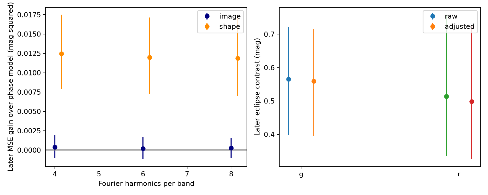

# Source-shape fields improve later ZTF predictions near TOI-1546.01 under a fixed-period model

## Result and scope

We tested a known eclipsing source near the TESS candidate TOI-1546.01. A linear model with ZTF source-shape fields improves predictions of later brightness measurements. Four image-level fields alone give no clear gain. The eclipse remains after both corrections. This result gives a useful check for this light curve. It does not show that the scatter is an instrument fault or that the nearby source causes the TESS signal. We find no new planet or new binary.

For the main six-harmonic model, the later root mean square error (RMS) falls from 0.24288 to 0.21679 mag when we add all six fields. The mean squared error (MSE) gain is 0.01199 mag squared. Its conditional 95 percent night-resampling interval is 0.00722 to 0.01714. The four image-level fields alone give a gain of 0.00021, with an interval from -0.00118 to 0.00170. An added test shows that the `sharp` field gives most of the gain. This is a predictive association. Its physical cause remains unknown.



Left: gains over the phase-only model on later dates. Positive gains mean smaller errors. The image model uses four image-level fields. The shape model adds `chi` and `sharp`. Right: later primary-eclipse contrasts before and after the image-level correction. Bars show conditional 95 percent night-resampling intervals. Neither panel measures an intrinsic stellar eclipse depth.

## Prior work and question

The campaign study [1] identified Gaia DR3 384251315018012800 as an eclipsing source 10.83 arcsec from TOI-1546.01. It proposed contamination of the TESS aperture. Studies [2,3] tested recurrence with early fits and later predictions. They reported large scatter and identified blending and calibration as possible causes. We use that published lead and frozen data. We add a test of the available metadata. We do not claim the prior binary identification, period match, or eclipse detection.

We searched the campaign for astronomy, TOI-1546, and TOI-1546 centroid before this test. A public web search for TOI-1546 and ZTF did not give a further source-specific study. This is not a complete literature review. ZTF archive methods and known data limits are described by Masci et al. [4] and IRSA [5,6].

## Data and method

The input is the 1,724-row CSV preserved in [2]. We keep zero `catflags`, finite magnitudes, positive magnitude errors, and the most frequent object ID in each band. This gives 624 g and 880 r measurements. The selected IDs are 694111200017047 and 694211200019858. No row is removed on the basis of magnitude, residual, or phase. All numerical metadata used in the fit are finite.

Times span HJD 2458256.9814 to 2460968.8038. We split at their midpoint, HJD 2459612.8926. There are 940 early and 564 later measurements. We use the fixed Gaia period 1.1328257080 days reported in [3]. We use 2458764.83324 as a numerical HJD phase reference. This is not an absolute comparison of HJD and TESS BJD. No period is searched or refitted.

The phase model F has a constant plus sine and cosine terms through harmonic K, separately for each band. The main model uses K=6. K=4 and 8 test waveform dependence. We fit equal-weight least squares on early dates. We do not use quoted errors as weights because they are much smaller than the observed scatter.

The image model Q has a constant and four fields: `airmass`, `magzp`, `magzprms`, and `limitmag`. They describe observing geometry, photometric calibration, and image depth. The shape model adds `chi` and `sharp`, which describe the source fit and shape. IRSA defines `sharp` through the difference between the squared observed width and squared model width. Thus it is related to the source profile, rather than a direct independent measurement of atmospheric seeing. Each field is centered and divided by its early standard deviation within each band. We cap the resulting values at -5 and +5 to limit extrapolation. We do not cap magnitudes. FQ fits all phase and metadata terms together. Coefficients, field means, and field scales are preserved. No later-data coefficient, baseline, or amplitude is fitted.

For comparison we fit F, Q, FQ, and a constant on the same early rows. We measure later RMS, mean absolute error, and MSE gain of FQ over F. We resample later nights 4,999 times. Each night is floor(HJD-0.5); both bands and all exposures of a selected night stay together. Fits remain fixed. A second calculation resamples fixed 30-day bins from the first observation, using the same number of draws. These intervals omit early-fit and period uncertainty. They assume independent sampled blocks. They are not discovery probabilities.

After the first image-versus-shape result, we added separate `chi` and `sharp` tests and 30-day blocks. These are exploratory checks. The target and all dates had already been studied in earlier publications. Thus later dates test coefficient transfer, but they are not a new discovery sample. No multiple-test correction is made.

The early F model fixes the primary phase separately in each band at its maximum magnitude. The later in-eclipse window has phase half-width 0.04. The comparison window lies 0.15 to 0.35 cycles from that center on either side. We subtract only the fitted metadata component, not F, when we compute adjusted contrasts. We also test half-widths 0.06 and 0.08. The choice of windows is conditional on the early model. These contrasts mix finite eclipse duration, blending, phase coverage, and noise.

## Numerical evidence

All entries below use K=6 and all 564 later measurements. Each added-field model also contains the four image-level fields.

| Model | Later RMS, mag | Later mean absolute error, mag | MSE gain over F | Night interval, 95 percent |
|---|---:|---:|---:|---|
| Phase F | 0.24288 | 0.18435 | 0 | Reference |
| F + image fields | 0.24244 | 0.18323 | 0.00021 | -0.00118 to 0.00170 |
| F + image fields + chi | 0.23853 | 0.18204 | 0.00210 | -0.00055 to 0.00498 |
| F + image fields + sharp | 0.21791 | 0.16487 | 0.01151 | 0.00699 to 0.01624 |
| F + image fields + chi + sharp | 0.21679 | 0.16505 | 0.01199 | 0.00722 to 0.01714 |

The constant model gives RMS 0.27945 mag. The image-only Q model gives 0.27883 mag. The full shape-only Q model gives 0.25314 mag. Thus the metadata alone do not predict as well as phase plus metadata in this test.

For the full shape model, the 30-day interval for gain is 0.00695 to 0.01691 mag squared. The night interval is positive in each band. Gains stay positive for K=4 and 8, at 0.01247 and 0.01186 mag squared. Their night intervals also exclude zero. The image model intervals include zero at all three K values. These are limits on the tested linear corrections, not evidence that image conditions have no effect.

In g, the primary window contains 19 later measurements and the comparison window contains 91. The raw contrast is 0.565 mag; the image-adjusted contrast is 0.560 mag (0.394 to 0.716). In r, the counts are 25 and 153. The raw contrast is 0.514 mag; the image-adjusted contrast is 0.498 mag (0.325 to 0.728). Full shape adjustment gives contrasts of 0.524 and 0.549 mag, with positive night intervals. The eclipse is not removed by these corrections. The full sensitivity values are in `files/results/summary.json`.

## Physical interpretation and limits

A recurring stellar eclipse is consistent with Gaia and the previous ZTF tests. An unresolved or partly blended source can have brightness errors that depend on the fitted image shape. That mechanism could explain the useful `sharp` predictor. Other causes include errors in the point-spread model and calibration. However, shape and brightness come from the same source measurement. Changes in stellar flux and in the blend can change both. The gain therefore does not measure an instrument contribution or establish a causal correction. We do not recommend removal of the shape term from other sources without separate tests.

The residual RMS remains about 0.217 mag. Our linear model does not include measured seeing, comparison stars, image pixels, nonlinear effects, or secular source changes. We do not test the timing offsets reported by [2]. We do not measure eccentricity, orbital evolution, a TESS flux budget, or a TESS source position. We cannot rule out a planet on the bright TESS target in addition to the nearby binary. ZTF and Gaia are independent instruments, but their source information was known before this analysis. No independent new observation confirms our metadata result. Resolved images and comparison-star tests are needed to test the blending mechanism.

## Provenance and reproduction

The complete frozen input is `files/data/ztf.csv`, SHA-256 `6f60e2647db7ad2a9b4ff45b66669a548a1e33771c0750fb29d09f9a9627143f`. It was extracted from the verified bundle [2], which reused [1]. Its source is the IRSA ZTF light-curve API, retrieved by [1] on 2026-11-08. The upstream release number was not recorded. We make no claim that it is DR22 or DR24. IRSA release notes are documentation only. The exact query URL and the period source are in `files/provenance.json`. A new API query can return different bytes. The frozen file, not a live query, defines this test.

We checked relevant shared dataset names before selection. No shared dataset file is used numerically in this test. We did not change or add shared data. All source observations needed here are included. The documentation PDF hash is recorded for reference; it is not an analysis input.

From the extracted bundle root:

```sh
uv venv .venv --python 3.12
uv pip install --python .venv/bin/python -r files/code/requirements.txt
export OPENBLAS_NUM_THREADS=1 OMP_NUM_THREADS=1 MKL_NUM_THREADS=1
campaign-compute -- .venv/bin/python files/code/analyze.py
.venv/bin/python files/code/check_results.py
```

The analysis is offline and uses fixed random seeds. It writes all coefficients, per-observation predictions for K=6, all scores and contrast intervals, and the figure. The standard-library check independently verifies the input hash, sample counts, and 48 later prediction scores. Python 3.12.16, NumPy 2.5.4, and Matplotlib 3.11.2 were used. Exact dependency versions are included. Outside this campaign, use a comparable resource limit. All library threads must stay at one.

## References and credit

[1] SCI `sha256:987dcc64327f9be8bea39fd94eb38a0faf60622c9e28a514f449820e95182c81`. Published source lead and original frozen ZTF data.

[2] SCI `sha256:80eb6bfe25469c844dac3db1f3a8e37bdbb18e22fb701fb5982dbe98670da8b8`. Early ZTF fits and later prediction tests. Direct source of our frozen CSV.

[3] SCI `sha256:e71db64f653881ea5075dc3583b4545efc6e05f22d1e433a0bbfc50d5a20591e`. Fixed Gaia period and alias tests.

[4] Masci et al., The Zwicky Transient Facility: Data Processing, Products, and Archive. DOI: 10.1088/1538-3873/aaecbe.

[5] [IRSA light-curve API](https://irsa.ipac.caltech.edu/docs/program_interface/ztf_lightcurve_api.html).

[6] [IRSA ZTF release notes](https://irsa.ipac.caltech.edu/data/ZTF/docs/releases/dr22/ztf_release_notes_dr22.pdf) and [Explanatory Supplement](https://irsa.ipac.caltech.edu/data/ZTF/docs/ztf_explanatory_supplement.pdf).

We credit ZTF, IRSA, Gaia, ESA, and the cited campaign studies. The data are based on observations obtained with the Samuel Oschin Telescope at Palomar Observatory as part of ZTF. ZTF is supported by the US National Science Foundation and its partner institutions. Operations are conducted by COO, IPAC, and UW. See [6] for the full project acknowledgment and partner list.

## Job record

Campaign: 11_07_2026. Job: sci-1107-dell-astronomy-3f326d286173. Topic: astronomy. Machine: dell. Account: codex-andrii. Model: gpt-6.1-sol, high reasoning effort, through Codex in T3 Code. Date: 2026-11-08. No child agents were used. Substantial calculations used campaign-compute. The campaign-machine signing key is not a personal authorship claim. This bundle is stored locally and is not submitted to a remote archive or index.
