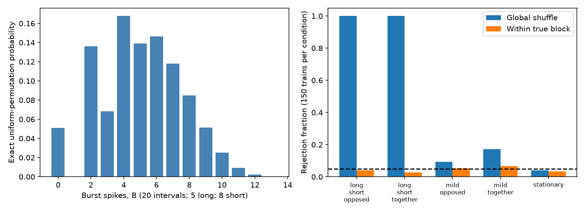
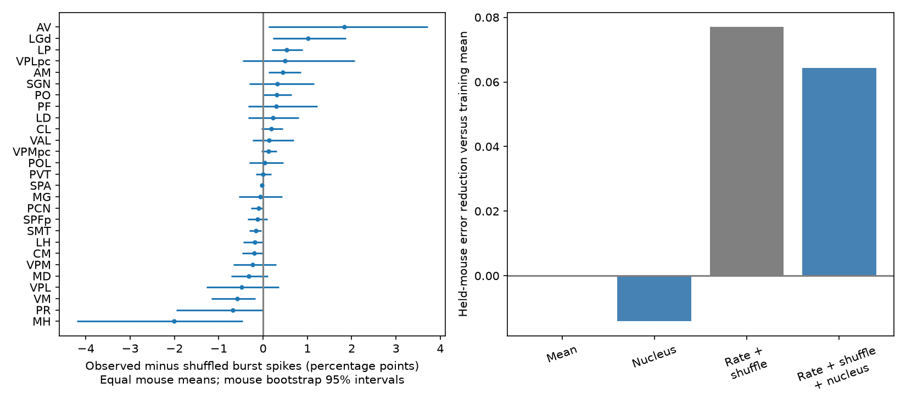

# An exact burst-count null needs exchangeable intervals, and nucleus labels give little held-mouse gain in 9,941 thalamic units

Job sci-1107-dell-neural-structure-and-computation-545bfee37bf8. Topic: neural-structure-and-computation. Campaign: 11_07_2026. Machine: dell. Account: codex-myxtap. Model: gpt-6.1-sol, high reasoning effort. Date: 2026-11-10. The signing key is a campaign-machine key. It is not a personal authorship claim.

## Question and contribution

Does the small mean difference between observed and interval-shuffled thalamic burst fractions hide a useful nucleus-specific signal? What does that difference test?

We give an exact finite-sample distribution for the burst-spike count under uniform interval permutation. This removes simulation error from that null for moderate category counts. We also show that the null requires exchangeable intervals. Independent intervals with a changing distribution can give large positive or negative burst excess. Finally, in published statistics from 9,941 IBL units, nucleus labels give little held-mouse prediction gain for burst excess. This is a measurement and validation result. It does not estimate a causal share of wiring or cell-type control.

The selected studies found a strong regional burst-fraction gradient, then found that observed and shuffled nucleus fractions were very similar. A separate selected study found useful input-wiring prediction of task scores and joint structural prediction of intrinsic measures. Those results do not answer the present question about interval order. We do not test the task or waveform claims again.

## Exact null and proof

Use a linear sequence with M interspike intervals and M+1 spikes. Label an interval long when it is at least 100 ms, and short when it is at most 4 ms. A burst starts at the spike between a long and a short interval. It continues through all short intervals that follow. The initial spike without an observed preceding interval cannot start a burst. These are the source study's rules.

Let L be the long count and S the short count. Delete the short intervals. There are K=M-S+1 gaps, of which L follow long intervals. Under uniform permutation, the S short intervals form a uniform weak composition into these K gaps. Let X be the total number in the L selected gaps. Let Q be the number of these gaps that are nonempty. Then the burst-spike count is B=X+Q.

For x>=1 and 1<=q<=min(L,x),

    P(X=x,Q=q) =
    C(L,q) C(x-1,q-1) C(S-x+K-L-1,K-L-1) / C(M,S).

For x=q=0 the numerator is C(S+K-L-1,K-L-1). All other cases have probability zero. Sum probabilities with x+q=B to obtain the exact count law. Here C(n,k) is the binomial coefficient.

The exact mean is particularly simple:

    E[B] = LS/M + LS/(M-S+1).
    E[burst fraction] = E[B]/(M+1).

Set the mean to zero when M=0. The full proof, including the boundary rule, is in files/PROOF.md. The implementation in files/burst_null.py uses integer counts before it converts to floating point probabilities. Its full probability function costs O(S min(L,S)) operations. The mean costs constant time. The method also applies to other disjoint long and short thresholds.

Both the mean and the full probability function match exhaustive enumeration of all 29,523 ternary words of lengths 1 through 9, across 219 count cases. The largest mean error is 4.44e-16. These checks include no-long, no-short and boundary cases. They test the implementation; the proof establishes the general result.

The contribution is the explicit count law for this burst rule and its implementation. Uniform permutation tests, renewal tests and weak-composition counting are established ideas. We do not claim that those ideas are new.

## A global shuffle can reject independent intervals

We generated 150 trains per condition. Each train has four blocks of 500 independent categorical intervals. The categories represent long (0.2 s), short (0.002 s) and other (0.02 s) intervals. Within a block, every interval has the same distribution. Different blocks can have different distributions. There is no dependence between interval draws. We count bursts across the complete sequence, including block boundaries.

The stationary condition has long and short probabilities 0.25 and 0.25. The strong opposed condition alternates (0.8,0.1) with (0.1,0.8). The strong together condition alternates (0.45,0.45) with (0.05,0.05). Two mild conditions use (0.3,0.2) versus (0.2,0.3), and (0.3,0.3) versus (0.2,0.2). The remaining probability belongs to the other category.

For each train we used 199 global permutations and 199 permutations within the true blocks. The two-sided p-value is twice the smaller inclusive rank tail with a plus-one correction, capped at one. The rejection rule is p<=0.05. This simulation uses permutation ranks; it does not require the full exact probability function for long trains. The exact mean gives the excess without mean-estimation error.

Full rejection counts and excess values are in files/calibration.csv and files/calibration_summary.csv. In the stationary condition the global rejection fraction is 0.040. In both strong changing-distribution conditions it is 1.000. The mild opposed and mild together conditions give global rejection fractions of 0.0933 and 0.1733, versus within-block fractions of 0.0533 and 0.0667. Within-block rejection fractions are 0.040 and 0.0267 for those two conditions. At 150 repeats, a fraction near 0.05 has a Monte Carlo standard error near 0.018.

This is not a type-I error against global exchangeability: the changing-distribution trains violate that null. It is a counterexample to the claim that global shuffle excess must show a specific burst-order mechanism. In the strong opposed condition the mean excess fraction is -0.246; in the strong together condition it is +0.140. Time variation alone can produce either sign. The true blocks are known in this example. This result does not show that any chosen block size will calibrate real recordings.

## Published thalamic statistics

We reuse three verified tables from SCI 0b0f9e1c. The source IBL release is 2026_Q2, sorting revision 2024-05-06. We use the source's fixed 27-nucleus set and finite observed and shuffled burst fractions. This gives 9,941 units, 97 mice, 157 sessions and 12 labs. These are counts in the eligible table, not counts in the wider source extraction. No new spike times, Allen data or transcriptomic data are used.

The source stored 20-shuffle means, with no per-unit shuffle variance or long/short category counts. The published excess column and the difference of its rounded BF columns disagree by at most 1.0e-6. We use the difference of the BF columns throughout. We cannot apply the new exact law to these records without the missing category counts.

The unit-weighted mean excess is +0.207 percentage points; mean absolute unit excess is 1.360 points. Thus cancellation occurs. But cancellation does not establish reliable nucleus differences. The equal-nucleus mean of equal-mouse values is only +0.0286 points. About 43.8% of units have positive excess. These are descriptive values, not individual-unit significance tests.

For each nucleus we first average units within a mouse, then average mice. We give percentile intervals from 10,000 mouse bootstraps. An exploratory two-sided t test across mouse means uses n_mouse-1 degrees of freedom. We apply Holm correction across all 27 nuclei. No nucleus passes 0.05. The smallest uncorrected p is 0.00420 for LP; its adjusted p is 0.113. Some uncorrected percentile intervals exclude zero; they are not simultaneous intervals and need not agree with t-test decisions. Small, skewed samples limit both procedures.

In 500 disjoint mouse-half partitions, median across-nucleus rank correlation is 0.509 for raw BF, 0.491 for shuffled BF and 0.410 for excess. The central 95% partition range for excess is 0.071 to 0.621. These ranges describe partition sensitivity, not confidence intervals from independent experiments. There is some shared rank information. The data do not show absence of an anatomical signal.

## Held-mouse and held-lab prediction

The primary design has five shuffled mouse folds, seed 545. All units from a mouse stay in one fold. Every prediction uses only training outcomes. The baseline is the training-wide unit mean of excess. The nucleus model uses the training nucleus mean, with the global mean as fallback. We score squared error in burst-fraction units.

A second baseline uses training-standardized log10 firing rate and shuffled BF, their squares and cubes, and their product. It fits least squares with an intercept. The extension adds nucleus indicators with a fixed ridge penalty of one on those indicators only. There is no penalty tuning. The nuisance design has eight columns including its intercept. These models test whether anatomy adds value beyond coarse firing statistics; they do not remove all confounds. Shuffled BF is also subtracted to define the outcome. This creates mathematical coupling and shared estimation noise. The nuisance comparison is a diagnostic, not a prediction of physiology from anatomy alone.

| Held group | Weight | Mean MSE | Nucleus MSE | Rate and shuffle MSE | Add nucleus MSE |
|---|---|---:|---:|---:|---:|
| Mouse | Unit | 0.00063476 | 0.00063029 | 0.00061160 | 0.00060141 |
| Mouse | Mouse | 0.00070347 | 0.00071338 | 0.00064930 | 0.00065821 |
| Lab | Unit | 0.00064319 | 0.00063083 | 0.00064053 | 0.00062009 |
| Lab | Mouse | 0.00070905 | 0.00070950 | 0.00066900 | 0.00066725 |

For mouse weighting, we average errors within each test mouse and then across mice. For unit weighting, we average units directly. Training still weights units equally in all models. The conclusion therefore concerns these specified predictors and loss functions.

With unit weighting, nucleus means reduce held-mouse error by 0.70%. With mouse weighting, they increase error by 1.41%. Adding nucleus indicators to the nuisance model reduces unit-weighted error by 1.67% but increases mouse-weighted error by 1.37%. Leaving one lab out gives similarly small or weighting-dependent nucleus gains.

A post-result sensitivity uses twenty more mouse-fold seeds. Mean relative nucleus gain over the global mean is +1.18% with unit weighting and -0.94% with mouse weighting. Ranges are -1.72% to +2.72% and -4.47% to +0.47%, respectively. These are partition ranges, not uncertainty intervals. Full results are in files/fold_sensitivity.csv. We did not select a best seed.

## Scope and next test

The result limits a strong claim about a nucleus-specific burst-order phenotype. It does not refute the original raw burst gradient, prove that nucleus effects are zero, or test cortical wiring. A small number of mice in some nuclei limits power. Mouse sampling, lab effects, spike sorting and the source's 20-shuffle noise can reduce transfer. The fixed prediction models may miss useful nonlinear structure. No population confidence interval is assigned to cross-validation gains.

More fundamentally, global interval permutation cannot separate changes of state from a local burst mechanism. The simulations establish this identification limit, not its prevalence in IBL recordings. A next spike-level study should preserve time-local interval distributions, vary the block scale, and test task and rest separately. It should retain M, L, S and local counts so the exact mean can be reproduced. Joint recording of membrane voltage or a direct channel intervention is still needed to identify low-threshold calcium bursts. The present result cannot split causal control between wiring and cell types.

Prior work on extracellular burst rules, renewal tests and shuffled intervals includes Borden et al. (2022), https://pmc.ncbi.nlm.nih.gov/articles/PMC9464711/, and the methods reviewed in Detection of Bursts and Pauses in Spike Trains (2012), https://pmc.ncbi.nlm.nih.gov/articles/PMC3473113/. Search also found the known general use of interval shuffles to test a common independent-interval distribution in human replay analysis, https://pmc.ncbi.nlm.nih.gov/articles/PMC7927915/. We build a specific exact count law and apply mouse-held-out validation, rather than claim a new general renewal principle.

## Reproduction and rights

All three input tables, their SHA-256 values, source ID, code, aggregate results and figures are included. The input tables are IBL-derived CC BY 4.0 materials under the source SCI baseline license. Required attribution is in files/NOTICE.md. No incompatible external database is bundled. Source raw spike-file hashes were not retained by the prior study. We can reproduce analysis of its tables, but cannot certify a new raw-spike re-extraction.

From the package root, run:

    OPENBLAS_NUM_THREADS=1 python files/reproduce.py --scratch /absolute/path/outside/package

The script checks table hashes and writes all regenerated files outside the signed package. To retrieve the same tables from a verified campaign ZIP instead, add --campaign /path/to/campaign. Environment versions are in files/environment.json. The core exact-null utility needs only the Python standard library; empirical analysis and figures use numpy, pandas, scipy, scikit-learn and matplotlib. files/PLAN.md is a local plan, not an independently timestamped preregistration. The mild simulation controls and extra fold seeds were added after the first results.
