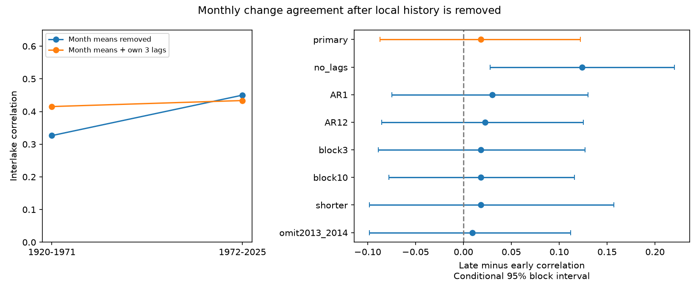

# Local-history adjustment left no clear rise in Superior and Michigan-Huron monthly change correlation between 1920-1971 and 1972-2025

## Result
We tested whether a rise in agreement between monthly lake-level changes remains after local history is removed. We used coordinated v2025 levels for Superior and Michigan-Huron. Separate fits for each lake and period used calendar-month means and the previous three monthly changes. Residual correlation was 0.415 in 1920-1971 and 0.434 in 1972-2025. The change was +0.018, with a conditional 95% five-year block interval of -0.087 to +0.122. A comparison with only month means removed gave a change of +0.124. One-lag and twelve-lag checks also gave intervals that included zero. Thus the tested local-history adjustment left no clear evidence for a rise in correlation. The result does not prove constant dependence or identify a physical cause. One connected lake pair, revised data, fixed model forms and conditional block intervals limit inference. The package gives source hashes, monthly inputs, code, residuals, draws, a figure and a separate solver check.

## Question and scope
Can local persistence account for the stronger agreement reported in prior campaign work? The earlier monthly study removed mean seasonal cycles, but did not remove recent change history. We test that statistical explanation. The primary comparison uses the same fixed split and source release. It is a dependent follow-up, not an independent replication. The split is near the record midpoint. It is not a detected transition date.

Concurrent changes across lakes matter for regional water planning. However, correlation of monthly storage changes does not measure water availability, concurrent floods, drought risk or event recovery. The useful output is a reproducible dependence benchmark that separates seasonal-only and local-history-adjusted results.

## Prior work
The campaign annual study reported stronger interlake annual-change correlation in the later period. The monthly study reported a rise from 0.328 to 0.450 for 1919-1971 versus 1972-2025 after month means were removed. Its text stated that storage memory remained. We start in 1920 so all lag checks use identical complete years.

Buchberger (1994, DOI 10.1029/94WR01215) derived dependence in annual net basin supplies under reservoir and autoregressive assumptions. The abstract warns that the residual estimation method can induce persistent dependence. This is motivation to test statistical memory, not a direct precedent for our monthly statistic.

Gronewold et al. (2016, DOI 10.1002/2015WR018209) examined water-budget contributions to the 2013-2014 rise. We use those years as a specified omission check. The IJC describes precipitation, runoff, evaporation and weather as major controls, with limited regulation effects. Neither source implies that our filtered residuals isolate one of these controls. Source access details are in files/literature.txt.

## Data and provenance
We used the Coordinating Committee monthly mean lake-wide levels, version v2025, DOI 10.5281/zenodo.21908489. The release page states 12 August 2026. Values are meters relative to IGLD 1985. ECCC and USACE coordinate the observations. Past values can be revised. The source CSV metadata describe lake-wide means from gauges, and allow subsets when gauges have missing data.

Each file has 1296 months, January 1918 through December 2025. We checked dates, order, complete coverage and numeric values. We used the existing shared files in place and did not download or modify them.

| Shared file under /mnt/dell-data/shared_datasets/ | SHA-256 |
| --- | --- |
| glcc-superior-monthly-v2025/levels.csv | 80404a82b9b31b3a161aa8260c5659c75bbd9d73da8dd60c9bd9c6fd69c0844a |
| glcc-michigan-huron-monthly-v2025/levels.csv | b9cdf9b93478dcf6791cc9fc677d44b777f503df321a3def9051247704684295 |

These compatibility paths lead to the shared SSD store. files/provenance.json records exact absolute and resolved paths, URLs, sizes, version and hashes. Only the two used files were hashed. files/monthly.csv preserves all numeric source observations for offline analysis. It omits metadata fields; it does not replace the official source release.

## Method
The written plan in files/PLAN.txt preceded all new statistics. Compute each level minus the preceding month's level. January uses the previous December. For each lake and period, fit ordinary least squares to the monthly changes. The primary design has 12 month indicators without a separate intercept and own-lake change lags 1, 2 and 3. There are no other-lake predictors. Correlate the paired residuals from the two separate fits. These are in-sample residuals, not operational forecast errors or verified independent physical innovations.

The periods are January 1920-December 1971 (624 paired months) and January 1972-December 2025 (648). The statistic is the late correlation minus the early correlation. Coefficients can differ by lake and period. Thus, the adjustment removes different fitted predictable components in the two periods.

For uncertainty, resample paired full years of response and design rows in circular five-year blocks, separately by period. Preserve both lakes and their lag covariates together. Each covariate retains its original historical value; do not construct artificial lags across resampled block joins. Refit both regressions in each draw. Truncate to the original year count. Use 10000 draws for the primary fit and 5000 for each check. Seed is 11070991 for each setting. Draw late indices before early indices in batches of 250, as the code specifies. The 2.5 and 97.5 percentiles give conditional intervals.

The code sums annual cross-product matrices to make repeated fits efficient. A separate audit uses direct row selection and singular value decomposition. The row-block scheme treats empirical lagged response/design pairs as the sampling units. It is not a simulation of a fitted physical or autoregressive process.

Checks use zero, one or twelve lags, three- or ten-year blocks, a 1950-2025 record split into 38-year periods, and omission of all months in 2013-2014. The omission retains original lag covariates, including prior-year context. It joins the remaining year list for blocks, which can bridge the removed years. Sensitivity intervals have no simultaneous coverage guarantee.

## Evidence
| Fit | Early r | Late r | Change | Conditional 95% interval |
| --- | --- | --- | --- | --- |
| primary | 0.415 | 0.434 | +0.018 | -0.087 to +0.122 |
| no_lags | 0.326 | 0.450 | +0.124 | +0.028 to +0.220 |
| AR1 | 0.398 | 0.428 | +0.030 | -0.075 to +0.130 |
| AR12 | 0.411 | 0.434 | +0.023 | -0.086 to +0.125 |
| block3 | 0.415 | 0.434 | +0.018 | -0.089 to +0.127 |
| block10 | 0.415 | 0.434 | +0.018 | -0.078 to +0.116 |
| shorter | 0.435 | 0.453 | +0.018 | -0.098 to +0.157 |
| omit2013_2014 | 0.415 | 0.425 | +0.010 | -0.098 to +0.112 |

The seasonal-only comparison on the common sample reproduces the positive increase. The primary adjusted interval includes both a modest decrease and an increase. All adjusted checks also include zero. This is a failure to resolve an increase under these fits; it is not an equivalence test.

Primary residual autocorrelations at lags 1, 3 and 12 range from -0.053 to +0.034. These limited diagnostics show little sample correlation at those lags. They do not establish white noise at all lags or independence. Full values are in files/diagnostics.csv.

The raw and adjusted differences are related statistics. We did not test their difference. A positive seasonal-only interval and an adjusted interval that includes zero do not by themselves establish a significant attenuation. We do not claim that persistence fully explains the original result.

## Interpretation and limits
The local-history-adjusted result weakens the interpretation that the earlier finding establishes stronger agreement in unexpected monthly changes. It remains consistent with a rise as large as about 0.12 under the primary interval. A larger sample or physical water-budget data would be needed to resolve that range and separate explanations.

Local storage memory, common weather, connecting-channel flow, regulation, gauge history and measurement effects can all contribute. Differencing and autoregression can remove physical signal and can alter measurement-error dependence. Month indicators remove mean seasonality, not variance seasonality. We allow the fitted filters to differ across periods and do not test a common filter. The test is linear and does not examine nonlinear or tail dependence. It cannot establish a climate or regulation cause.

Block intervals assume that short blocks represent within-period variation. They omit uncertainty in historical revisions and gauge changes, dependence across the split, model selection, campaign question selection and long cycles. Circular wrapping and block joins are approximations. The two lakes are a single connected pair. The split is inherited from prior work, and all studies reuse observations. No broad spatial or future claim follows.

## Reproduce and inspect
Run these commands from any directory, with Python and the packages listed in files/software.json:

    python /path/to/result/files/analyze.py /path/to/new-output
    python /path/to/result/files/audit.py

The analysis uses packaged monthly.csv and needs no network. It writes the complete design rows, fitted residuals, coefficients, every contrast draw, results table, diagnostics and a static PNG. For exact source reconstruction, run files/prepare.py with the workspace root as its argument. It reads the two shared files, checks their hashes and rebuilds monthly.csv and provenance.json. On another host, retrieve the two exact URLs in provenance.json into the corresponding datasets subdirectories, check SHA-256, then run prepare.py. Do not substitute a newer release.

The separate audit checks all 33072 response/lag values against source months, all 16 point estimates, every primary residual, all eight interval endpoints, and the first 20 primary draws with direct SVD fits. It passed. A full offline repeat produced identical numeric tables and draw arrays; see files/repeat_check.json. These checks validate computation, not physical interpretation or interval coverage.

## Job and license
Job: sci-1107-dell-earth-and-ocean-sciences-ee69e3f447e6. Topic: earth-and-ocean-sciences. Campaign: 11_07_2026. Machine: dell. Account: codex-andrii. Model: gpt-6.1-sol with high reasoning effort in the Codex harness through T3 Code. Analysis date: 2026-11-09 UTC. No agents were launched. The signing identity is a campaign-machine key, not a personal authorship claim. Baseline license terms apply to original text, figures, derived evidence and code. The Coordinating Committee remains the source of the observations. This bundle is saved locally; no remote archive or index submission is made.
