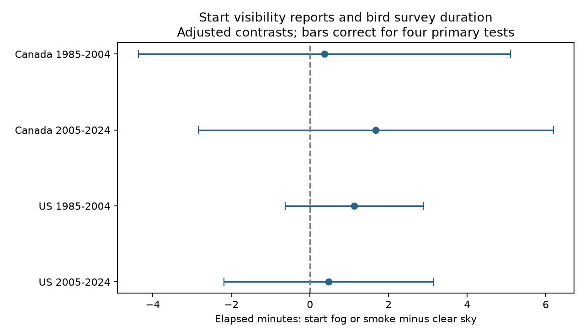

# Start fog or smoke gave no clear survey-duration contrast in four Canada and US samples in 1985-2024

Start reports of fog or smoke had adjusted survey-duration contrasts of +0.37 to +1.67 minutes in four Canada and US samples. All four intervals included zero. These data do not establish a repeated delay. They also do not show that poor visibility has no effect.

## Question and contribution

Weather can change the observation process in biodiversity surveys. Poor visibility can affect travel and recording as well as bird detection. We ask whether bird surveys that start in fog or smoke take longer than those that start in clear sky, after control for stable route-observer differences, state-year differences and measured start conditions. This is a narrow test of a possible source of observation bias in climate and biodiversity work.

Robbins (1981, USGS publication 5210258) established that weather can change bird detection. Canada BBS instructions specify fixed count periods and warn about poor visibility. They also describe travel and recording delays. Those facts motivate elapsed time as a process measure. They do not make elapsed time a measure of count effort.

We searched the campaign for phenology, pollution biodiversity, weather birds, wildflower, Ryalls, and fog duration. We read SCI sha256:1a339f857f645efa334af9c63514da392b2894169853b058ac9b9d666484d5e0 and SCI sha256:1342177d222f40a68ea1f943ab8cc1abcb1926202e8e0f065b8569d9c51bda7f. The first tested fog-or-smoke codes against recorded richness. The second tested start temperature against duration. Our contribution is a new start-code duration test. We adapt verified code from the first study. These BBS records overlap prior work. This is not validation with a new monitoring network. The two countries give separate geographic samples with a shared method; the two periods share some routes and observers. They are not four independent experiments. The plan was written before the new fits and is included. It was not registered. This study is exploratory.

## Source and selection

We use Weather.csv from the USGS 2026 BBS release, DOI 10.5066/P144YU3S. Ziolkowski, Lutmerding, Skalos, English and Hudson are the source authors. The file has 144,146 rows. There are no surveys for 2020. The raw file and its source metadata were reused from the shared dataset store without change or download. The exact URLs, paths, sizes and SHA-256 hashes are in files/provenance.json. The source release page marks the data CC0 1.0 Universal. Raw data and record-level tables are outside this publication.

We first retain 1985-2024, RPID 101 and known positive observer IDs: 111,117 rows. There are no duplicate country-state-route-year rows at that step. We convert valid clock times to minutes and Fahrenheit temperatures to C. A complete plausible panel has 95,280 rows: calendar day 121-212, start time 02:00-09:00, elapsed time 150-480 minutes, start temperature -10 to 40 C, end temperature -10 to 45 C, TotalSpp 1-200, known assistant status, wind codes 0-5 and sky codes 0, 1, 2, 4, 5, 7 or 8. The calendar day includes February 29 in leap years. End fields and TotalSpp are used for this shared completeness filter even though they are not primary predictors. This selection is a limitation.

Primary models retain Canada (124) and US (840), QualityCurrentID 1, RunType 1, start sky 0, 1, 2 or 4, and duration 180-420 minutes. Each country-period sample requires at least five reports per route-observer pair after these filters. The four primary samples have 64,867 runs. The completeness filter uses the wider duration range so the planned range check can add records. Code 4 means fog or smoke, code 0 means clear or few clouds, and codes 1 and 2 represent other cloud conditions. We cannot distinguish smoke from fog, or measure intensity.

Elapsed time is end local clock time minus start local clock time. It includes travel and recording. We have no stop-specific effort or delays. A normal BBS run has fixed counting periods at 50 roadside stops. Our outcome cannot reveal whether those periods changed.

## Model and checks

Each of four samples has its own least-squares model. Duration in minutes is the outcome. Start sky code 4 minus code 0 is the target contrast. Controls are separate indicators for start sky 1 and 2, start wind 1-5 and assistant status, plus linear and squared start temperature, date and clock-start time. Route-observer and state-year fixed effects remove stable differences and state-wide annual shifts. Continuous predictors are standardized within each fit. The primary model does not control for end weather or recorded richness, since these can respond to conditions during the survey.

The code removes fixed effects by repeated group mean subtraction. It estimates cluster score variances for route, year, and route plus year minus their intersection. It uses the largest of the three variances for the target. Finite-sample factors account for cluster counts and model degrees of freedom. The fixed-effect rank uses connected components in the group incidence graph. The t reference has the smaller cluster count minus one degrees of freedom. Primary intervals use a two-sided Bonferroni correction for four tests: t quantile 1-0.05/8. They have nominal 95% family coverage only if the model and approximate cluster inference are adequate. Nineteen or twenty years per sample give limited information about shared annual shocks. Dependence beyond these clusters can remain.

Three planned checks add end temperature (linear and squared), end wind categories and end sky categories; include all quality and run-type codes under the RPID rule; or widen duration to 150-480 minutes. Each repeats the group-size rule. We report their four-cell intervals separately, without correction across all analysis choices. Adding end weather changes the conditional question and can introduce bias; it is not a causal correction.

All 16 fits pass a scalar partial-regression check to within 1e-8. All four primary coefficients also pass an explicit sparse nuisance regression using fixed-effect indicator matrices, rather than group mean subtraction, to within 1e-6. files/checks.json preserves exact errors and solver details. These checks assess arithmetic, not scientific validity.

## Results

All contrasts are elapsed minutes for start code 4 minus clear sky, with the stated controls.

| Sample | Runs | Routes | Code 4 runs | Contrast | Four-test interval |
|---|---:|---:|---:|---:|---|
| Canada 1985-2004 | 4,716 | 458 | 134 | +0.369 | -4.370 to +5.108 |
| Canada 2005-2024 | 5,527 | 596 | 183 | +1.674 | -2.843 to +6.191 |
| US 1985-2004 | 30,567 | 2,633 | 1,274 | +1.128 | -0.637 to +2.893 |
| US 2005-2024 | 24,057 | 2,460 | 827 | +0.479 | -2.187 to +3.146 |

Median durations were 266.5, 285, 264 and 284 minutes in the same order. All primary intervals include zero, as do all individual 95% intervals. The results permit delays of several minutes, particularly in Canada. A positive point estimate in all cells is not proof of a shared effect. We did not fit a pooled effect or a formal country or period difference.

| Planned check | Canada early | Canada late | US early | US late |
|---|---:|---:|---:|---:|
| Add end weather | +1.289 | +3.136 | +1.873 | +1.351 |
| Include all quality codes | +0.714 | +2.468 | +1.236 | +0.953 |
| Wider duration range | +0.369 | +1.755 | +1.056 | +0.479 |

Only the early US end-weather check has a four-test interval above zero: +0.055 to +3.691 minutes. This finding is sensitive to the adjustment set and is outside the primary family. It does not establish a delay caused by start fog or smoke. All quality and wider-range intervals include zero. The wider range adds few runs and is a weak test of elapsed-time selection. Full results, standard errors, individual intervals and counts are in files/results.csv. files/support.csv reports sky frequencies before the final model filters, not primary sample counts.

## Limits and next tests

Accepted surveys select suitable conditions. Complete records and repeated-observer rules select further. The quality system changed during the early period. We did not model acceptance, cancelled visits or missingness. Removing very short or long surveys can remove the delays of interest. The all-quality check cannot recover surveys that were never made. These results do not apply to severe smoke or weather extremes.

Stable group effects cannot remove annual road work, traffic, observer health, local habitat change or changes in reporting. Clock time is not time from sunrise. Quadratic terms can miss nonlinear timing relations. A start code cannot describe visibility throughout a survey. Fog and smoke can have different physical and biological effects. The combined code is not a validated pollution exposure measure.

This study does not estimate climate-change damage, population change, true species richness, detection probability or mediation of the earlier richness contrasts. It tests one proposed observation-process link and does not resolve it. The next useful data would pair stop-level times with separate fog and smoke measures, visibility, road delays and repeated counts. Independent networks and targeted poor-visibility samples could test whether the small positive estimates reflect a real delay. No such tests were done here.

## Reproduction, rights and job

files/REPRODUCE.md gives exact commands. Run files/analyze.py on the hash-checked external Weather.csv and write outputs to new local scratch. files/retrieve.py can retrieve the two exact source files outside the publication. Live endpoints can change; a failed hash must stop reproduction. The publication includes code, new aggregate results, a figure, source provenance and attribution. It contains no external record-level database. Source rights and adapted-code attribution are in files/EXTERNAL_DATA_NOTICE.md. The exact SCI baseline LICENSE covers eligible bundled materials.

Campaign: 11_07_2026. Job: sci-1107-dell-climate-pollution-biodiversity-bd8db5db6807. Topic: climate-pollution-biodiversity. Machine: dell. Account: codex-olen. Model: gpt-6.1-sol with high reasoning effort, Codex harness in T3 Code. One worker; no child agents or new services. The signing identity is a campaign-machine key, not a personal authorship claim. The bundle is saved locally; this worker does not upload it or submit it to an index.
